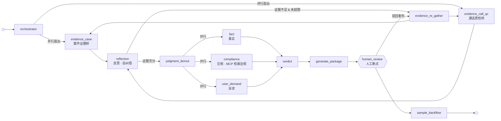
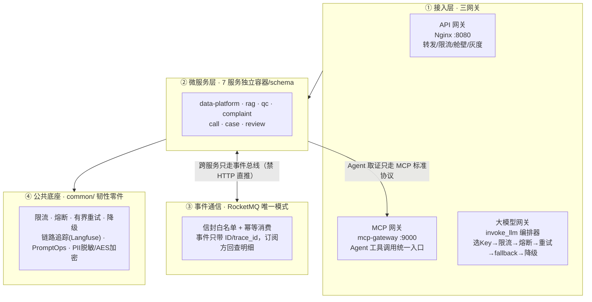

# 从 Chain 到 Agent：一套能上生产的 LLM 多智能体催收系统

> **Beyond Chains, Toward Agents** — a production-grade reference implementation of a multi-agent LLM system (LangGraph · MCP · RAG · RocketMQ · Milvus) for debt collection.

**中文** | **[English](README_EN.md)**

[](https://github.com/GavinYoung66/ai_collection/actions/workflows/ci.yml)


## Why this project?

一个「LLM + 微服务」系统真正难的地方，不是能调通大模型，而是**调通了之后怎么让它不死、不飘、不乱、可审计**。这个仓库把贷后催收这个高合规、重对话的真实业务当作磨刀石，沉淀了一套可复用的生产级底座：

- **真正的多智能体图，不是线性 Chain。** 投诉研判是 13 个节点的 LangGraph：双证据桥与三判研维度**并行扇出**、reflection **反思回环**自我纠错、条件路由按运行态决策、human_review **人工断点**。传统 Chain 是固定流水线，这里是「会走不同路径、会自我纠错、会等人拍板」的图。
- **MCP 作为 Agent 取证唯一协议。** 案件、通话质检、法规检索三类下游能力统一经 MCP 网关调用，下游变更对 Agent 透明，能力可插拔、可审计。
- **生产级韧性，不是玩具 Demo。** RocketMQ 幂等事件闭环、Milvus + Elasticsearch 混合检索、LLM 编排器（限流→熔断→有界重试→fallback→降级）、Prometheus/Grafana/Langfuse 全链路可观测。
- **合规优先的护栏体系。** PII 出 Agent 前脱敏、CoT 推理加密双授权解密、L4 幻觉检测与红线词扫描。核心原则一句话：**AI 只出草稿，不做最终判定。**

## 这是什么

面向**贷后催收**场景，用大模型 + RAG + 多智能体编排拆成 7 个独立微服务，覆盖数据中台、知识库、全量质检、智能外呼、分案、投诉研判、复盘的完整业务闭环。

> 实现深度口径：数据中台 / 知识库 / 全量质检 / 投诉研判四服务**真实事件闭环已跑通**；其余三服务为 health 脚手架，详见[开发进度](docs/roadmap.md)。业务是垂直的，**工程是通用的**——所有韧性零件均可单独抄走。

## 架构为什么先进：LangGraph + MCP + RAG

投诉研判（complaint-service）是整套系统最深的服务，用一张图说明「为什么是多智能体，而不是串一串 Chain」：



| 维度 | 传统 Chain | 本项目的 LangGraph |
|---|---|---|
| 执行路径 | 固定线性，A→B→C 一次跑完 | 条件路由，按运行态决定下一步 |
| 并行度 | 串行 | 双证据桥、三判研维度**并行扇出** |
| 纠错 | 出错即停 | reflection 反思回环 + `max_loops` 有界重试 |
| 人工介入 | 无断点 | human_review `interrupt` 断点，可续跑 / 回退 |
| 状态持久化 | 无 | MemorySaver checkpoint，任意节点断点续跑 |

三个关键技术环环相扣：

- **LangGraph** 负责「怎么编排」：并行取证、反思回环、条件路由、人工断点，全部是图的状态机能力，而非业务代码硬写。
- **MCP** 负责「怎么取证」：Agent 调用案件、通话质检、法规检索统一走 MCP 标准协议，下游换实现不影响 Agent。
- **RAG** 负责「证据从哪来」：ES BM25 + Milvus（BGE-M3 1024 维）混合检索 + rerank，合规节点经 MCP 实时检索法规库，答辩必带 `rag_source_ids` 溯源。

## 整体架构



**两条铁律：**
- 跨服务只走事件总线（通知式，事件只带 ID 与 trace_id，订阅方回查明细，禁止 HTTP 直推业务事件）
- 智能体取证只走 MCP（同步请求-响应，下游变更对 Agent 透明）

## 真实事件闭环

```
dp 种子入库
  └─ etl.task.done ──→ qc-service 开检（R1~R14 规则 + LLM 复核 + RAG 检索）
                          └─ qc.check.completed ──→ dp 消费回写快照质检列
                                                        └─ complaint.created（仅 case_id）
                                                              └─ complaint-service 幂等建单
                                                                    → LangGraph 研判（证据包三桥反查
                                                                      → reflection 判定 → human_review 断点）
                                                                    → approve 后 write_session 回写快照投诉列
                                                                    → complaint.result.ready ──→ dp 确认
旁路：rag 敏感词变更 ── kb.sensitive_updated ──→ qc 词表热刷新（≤60s，version 轮询兜底）
```

## 生产级工程能力（不是 Demo）

| 能力 | 机制 | 代码位置 |
|---|---|---|
| LLM 韧性编排 | 选 Key → 限流 → 熔断（三态机）→ 有界重试 → fallback 换模型 → 降级 | [common/llm/](common/llm/) |
| 事件驱动闭环 | RocketMQ 信封白名单 + 幂等消费 + 订阅方回查 | [common/eventbus/](common/eventbus/) |
| 混合检索 RAG | ES BM25 + Milvus 混合检索 + rerank，敏感词热刷新 | [services/rag-service/](services/rag-service/) |
| 全链路可观测 | 统一 `/metrics` + Prometheus + Grafana + Langfuse | [common/observability/](common/observability/) |
| 提示词治理 | PromptOps：YAML 七段结构 + A/B 选版回滚 + golden 回归门禁 | [common/prompt/](common/prompt/) |
| 质量门禁 | CI 六 job + 1402 单测 + 85% 覆盖率 + ruff/bandit/mypy | [.github/](.github/) |
| 密钥与备份 | sops+age 加密入库 + PG/Milvus/ES 备份与恢复 | [scripts/backup/](scripts/backup/) |

## 业务复杂度：催收与质检的对话与合规

催收是 LLM 落地里「红线最多」的场景之一——话术重、合规严、结论要能对簿公堂。系统把合规拆成了四道闸：

- **全量质检**：R1~R14 规则 + LLM 复核 + RAG 检索，全量而非抽样。
- **合规研判**：compliance 节点经 MCP 实时检索法规库，LLM 只出合规意见、禁止最终定责。
- **L4 后置校验**：幻觉检测（金额/天数/政策未命中 RAG → 自动替换「以坐席核实为准」）+ 红线词扫描（暴力/威胁/伪造身份）→ 命中即兜底替换。
- **数据安全**：PII 出 Agent 前脱敏，CoT 推理 AES-256-GCM 加密、双授权方可解密。

最终防线：**所有 AI 输出必须过 human_review 人工断点，人拍板后才回写业务系统。**

## 技术栈

| 类别 | 选型 | 版本 |
|---|---|---|
| 语言/运行时 | Python | 3.11.15 |
| Web 框架 | FastAPI + Uvicorn | 0.104.1 / 0.24.0 |
| 数据库 | PostgreSQL / Redis | 15 / 7 |
| 向量库 / 稀疏检索 | Milvus (BGE-M3 1024 维) / Elasticsearch | 2.4 / 8 |
| AI 编排 | LangChain + LangGraph | 0.1 / 0.0.40 |
| 大模型 | 阿里云 DashScope qwen-plus | — |
| 事件总线 | RocketMQ（唯一模式，事件信封白名单） | 5.x |

## 快速开始

**前置要求**

- Python 3.11.15（conda 推荐）
- Docker + Docker Compose（PostgreSQL / Redis / Milvus / ES / RocketMQ 由 compose 拉起）

**安装与启动**

```bash
# 1. 环境
conda create -n ai_collection python=3.11.15 && conda activate ai_collection

# 2. 依赖
make compile && make install

# 3. 配置（填入真实密钥）
cp .env.example .env

# 4. 基础设施 + 数据库迁移
make dev && make migrate

# 5. 冒烟验证
make smoke
```

**质量门禁**

```bash
make test    # 单测 + 覆盖率（--cov-fail-under=85）
make lint    # ruff + bandit + mypy
```

**单入口演示**：`docker compose -f docker-compose.gateway.yml up -d` 后，浏览器只访问 `http://localhost:8080`（质检 / 投诉研判 / 知识库同源托管）。

## 目录结构

```
ai_collection/
├── services/          # 7 子系统代码
├── common/            # 公共能力层（LLM 编排、韧性、脱敏、追踪、事件总线）
├── deploy/            # embedding/rerank Dockerfile + nginx
├── migrations/        # Alembic 迁移
├── scripts/           # smoke 脚本 + seed 数据 + 备份
├── docs/              # 设计文档归档 + 开发路线图
├── openspec/          # 宪法层（specs + changes）
└── demand/            # 历史参考（只读）
```

## 文档导航

| 想了解 | 去哪里 |
|---|---|
| 开发进度 / 待办 / 里程碑 | [docs/roadmap.md](docs/roadmap.md) |
| 投诉研判服务细节 | [docs/complaint-service/](docs/complaint-service/) |
| 新服务接入清单 | [docs/platform/new-service-checklist.md](docs/platform/new-service-checklist.md) |
| LLM 平台选型笔记 | [docs/platform/llm-plat-notes.md](docs/platform/llm-plat-notes.md) |
| 规范驱动开发（宪法层） | [openspec/specs/](openspec/specs/) |

## 分支与协作

- `dev`：默认分支，日常开发直接推送
- `master`：受保护分支，仅接受 CI 六 job 全绿的 PR

## 如果对你有帮助

这个仓库的公共底座（LLM 韧性编排、PromptOps、MCP 网关、事件闭环）都是业务无关的通用零件，欢迎抄走、提 Issue 交流。觉得有用就点个 ⭐ Star，也是对持续维护的鼓励。
