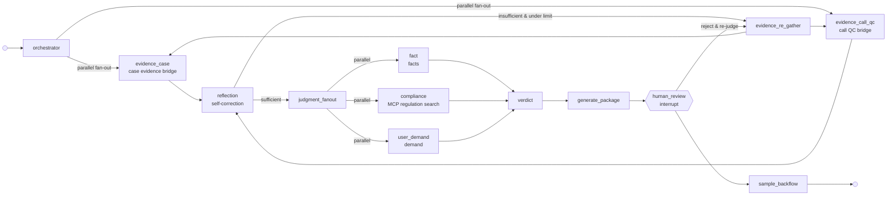
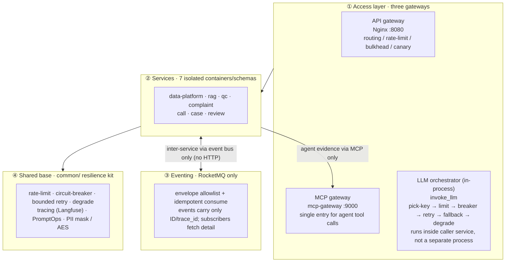

# From Chains to Agents: A Production-Grade Multi-Agent LLM System for Debt Collection

> **Beyond Chains, Toward Agents** — a production-grade reference implementation of a multi-agent LLM system (LangGraph · MCP · RAG · RocketMQ · Milvus) for debt collection. The business is vertical; the engineering is generic — every resilience component can be lifted out and reused.

**[中文](README.md)** | **English**

[](https://github.com/GavinYoung66/ai_collection/actions/workflows/ci.yml)


## Why this project?

The hard part of an "LLM + microservices" system isn't calling the model — it's keeping it from **crashing, hallucinating, drifting, and becoming unauditable** once it's in production. This repo uses debt collection — a high-compliance, dialogue-heavy domain — as a proving ground, and distills a reusable production-grade foundation:

- **A real multi-agent graph, not a linear chain.** The complaint adjudication flow is a 13-node LangGraph: parallel fan-out across two evidence bridges and three judgment dimensions, a **reflection loop** that self-corrects, conditional routing driven by runtime state, and a **human-review interrupt**. A traditional chain is a fixed pipeline; this is a graph that takes different paths, corrects itself, and waits for a human.
- **MCP as the only protocol for agent evidence-gathering.** Case data, call QC, and regulation retrieval all flow through an MCP gateway, so downstream changes are transparent to the agent and every capability is pluggable and auditable.
- **Production-grade resilience, not a toy demo.** RocketMQ idempotent eventing, Milvus + Elasticsearch hybrid retrieval, an LLM orchestrator (rate-limit → circuit-breaker → bounded retry → fallback → degrade), and full-stack observability via Prometheus/Grafana/Langfuse.
- **A compliance-first guardrail system.** PII is masked before it leaves the agent, chain-of-thought is AES-256-GCM encrypted with dual-authorization decryption, and L4 post-checks catch hallucination and red-line language. One principle governs everything: **the AI drafts, a human decides.**

## What this is

A seven-microservice system for **debt collection**, built with LLM + RAG + multi-agent orchestration, covering data platform, knowledge base, full-coverage QA, intelligent outbound calls, case assignment, complaint adjudication, and review.

> Scope note: four services (data platform / knowledge base / QA / complaint adjudication) form a **real, working event loop**; the other three are health-check scaffolds. See [roadmap](docs/roadmap.md).

## Why the architecture matters: LangGraph + MCP + RAG

Complaint adjudication (`complaint-service`) is the deepest service. One diagram explains why this is multi-agent rather than a chain of prompts:



| Dimension | Traditional chain | This LangGraph |
|---|---|---|
| Execution path | Fixed linear A→B→C, one pass | Conditional routing driven by runtime state |
| Parallelism | Serial | **Parallel fan-out** across 2 evidence bridges and 3 judgment dimensions |
| Error recovery | Stops on failure | Reflection loop with bounded `max_loops` retry |
| Human intervention | No breakpoint | `human_review` interrupt — resume / rollback |
| State persistence | None | MemorySaver checkpoint — resume from any node |

Three technologies fit together cleanly:

- **LangGraph** handles *how to orchestrate*: parallel evidence-gathering, reflection loops, conditional routing, and human breakpoints are all graph state-machine capabilities — not hardcoded business logic.
- **MCP** handles *how to gather evidence*: case data, call QC, and regulation search all go through the MCP protocol, so swapping a downstream implementation never touches the agent.
- **RAG** handles *where evidence comes from*: ES BM25 + Milvus (BGE-M3, 1024-dim) hybrid retrieval with rerank. The compliance node searches the regulation corpus live via MCP, and every answer carries traceable `rag_source_ids`.

## Architecture



> Note: the L1 `LLM orchestrator (in-process)` is the `invoke_llm` call chain in `common.llm`; it runs inside the caller service, not as a separate process or gateway.

**Two invariants:**
- Inter-service communication goes only through the event bus (notification-style; events carry just ID + trace_id; subscribers fetch detail; no HTTP fan-out for business events).
- Agent evidence-gathering goes only through MCP (sync request/response; downstream changes are transparent to the agent).

## A real, working event loop

```
dp seed ingestion
  └─ etl.task.done ──→ qc-service opens a check (R1~R14 rules + LLM review + RAG retrieval)
                          └─ qc.check.completed ──→ dp writes the QA column of the snapshot
                                                        └─ complaint.created (case_id only)
                                                              └─ complaint-service idempotently creates a case
                                                                    → LangGraph adjudication (three-bridge evidence lookup
                                                                      → reflection verdict → human_review interrupt)
                                                                    → approve → write_session writes the complaint column
                                                                    → complaint.result.ready ──→ dp confirms
side channel: rag sensitive-word change ── kb.sensitive_updated ──→ qc hot-reloads the wordlist (≤60s, version polling fallback)
```

## Production engineering (not a demo)

| Capability | Mechanism | Code |
|---|---|---|
| LLM resilience | pick key → rate-limit → circuit-breaker (3-state) → bounded retry → fallback → degrade | [common/llm/](common/llm/) |
| Event-driven loop | RocketMQ envelope allowlist + idempotent consume + subscriber fetch-back | [common/eventbus/](common/eventbus/) |
| Hybrid RAG | ES BM25 + Milvus hybrid retrieval + rerank, sensitive-word hot reload | [services/rag-service/](services/rag-service/) |
| Observability | unified `/metrics` + Prometheus + Grafana + Langfuse | [common/observability/](common/observability/) |
| Prompt governance | PromptOps: 7-section YAML + A/B version rollback + golden regression gate | [common/prompt/](common/prompt/) |
| Quality gates | CI 6 jobs + 1402 unit tests + 85% coverage + ruff/bandit/mypy | [.github/](.github/) |
| Secrets & backups | sops+age encrypted-at-rest + PG/Milvus/ES backup & restore | [scripts/backup/](scripts/backup/) |

## Business complexity: dialogue & compliance

Debt collection is one of the highest-red-line domains for LLM adoption — heavy scripts, strict compliance, and conclusions that must hold up under scrutiny. Compliance is enforced through four gates:

- **Full-coverage QA**: R1~R14 rules + LLM review + RAG retrieval, on 100% of calls, not a sample.
- **Compliance adjudication**: the `compliance` node searches the regulation corpus live via MCP; the LLM only issues opinions, never the final ruling.
- **L4 post-checks**: hallucination detection (amounts/days/policies not backed by RAG → auto-replaced with "subject to agent verification") + red-line word scanning (violence / threats / impersonation) → safe fallback on hit.
- **Data security**: PII masked before leaving the agent; chain-of-thought AES-256-GCM encrypted, decrypted only under dual authorization.

The final line of defense: **every AI output must pass the `human_review` interrupt before it is written back to the business system.**

## Tech stack

| Category | Choice | Version |
|---|---|---|
| Language / runtime | Python | 3.11.15 |
| Web framework | FastAPI + Uvicorn | 0.104.1 / 0.24.0 |
| Database | PostgreSQL / Redis | 15 / 7 |
| Vector / sparse search | Milvus (BGE-M3 1024-dim) / Elasticsearch | 2.4 / 8 |
| AI orchestration | LangChain + LangGraph | 0.1 / 0.0.40 |
| LLM | Alibaba Cloud DashScope qwen-plus | — |
| Event bus | RocketMQ (only channel; envelope allowlist) | 5.x |

## Quick start

**Prerequisites**

- Python 3.11.15 (conda recommended)
- Docker + Docker Compose (PostgreSQL / Redis / Milvus / ES / RocketMQ are brought up by compose)

**Install & run**

```bash
# 1. Environment
conda create -n ai_collection python=3.11.15 && conda activate ai_collection

# 2. Dependencies
make compile && make install

# 3. Config (fill in real secrets)
cp .env.example .env

# 4. Infrastructure + migrations
make dev && make migrate

# 5. Smoke test
make smoke
```

**Quality gates**

```bash
make test    # unit tests + coverage (--cov-fail-under=85)
make lint    # ruff + bandit + mypy
```

**Single-origin demo**: after `docker compose -f docker-compose.gateway.yml up -d`, point your browser at `http://localhost:8080` (QA / complaint adjudication / knowledge base, same-origin).

## Layout

```
ai_collection/
├── services/          # 7 subsystem codebases
├── common/            # shared base (LLM orchestration, resilience, masking, tracing, event bus)
├── deploy/            # embedding/rerank Dockerfiles + nginx
├── migrations/        # Alembic migrations
├── scripts/           # smoke scripts + seed data + backups
├── docs/              # design docs + roadmap
├── openspec/          # constitution layer (specs + changes)
└── demand/            # historical reference (read-only)
```

## Docs

| Looking for | Go to |
|---|---|
| Progress / TODO / milestones | [docs/roadmap.md](docs/roadmap.md) |
| Complaint adjudication details | [docs/complaint-service/](docs/complaint-service/) |
| New-service checklist | [docs/platform/new-service-checklist.md](docs/platform/new-service-checklist.md) |
| LLM platform notes | [docs/platform/llm-plat-notes.md](docs/platform/llm-plat-notes.md) |
| Spec-driven development (constitution) | [openspec/specs/](openspec/specs/) |

## Branches

- `dev`: default branch, direct pushes
- `master`: protected branch, PRs only after all six CI jobs pass

## If this helps you

The shared base — LLM resilience orchestration, PromptOps, MCP gateway, event loop — is domain-agnostic and free to reuse. Raise an Issue to discuss. If it's useful, a ⭐ Star keeps it maintained.
