# complaint-service 端到端流程（含异常 / 降级）

负责人：**Ellis Guo**  
范围：数据推送 → 研判图 → 人工复核 → 关单结束。  
说明：默认 `POST .../judge` 的 `run_graph=false`（stub）；真图需 `run_graph=true`。

---

## 全流程图

```mermaid
flowchart TB
  %% ========== 入口 ==========
  DP["数据中台 / 业务系统<br/>推送投诉工单"] --> API_CREATE

  subgraph S0["① 接单层"]
    API_CREATE["POST /api/v1/complaints<br/>complaints.create_complaint"]
    CS_CREATE["complaint_service.create"]
    SS_CREATE["session_service.create_session<br/>幂等锁 SETNX + complaint↔session 映射"]
    ST_PENDING["task_status = pending"]

    API_CREATE --> CS_CREATE --> SS_CREATE --> ST_PENDING

    E0{"同 complaint_id 并发?"}
    SS_CREATE --> E0
    E0 -->|是| IDEMP["返回已有 session<br/>不双开"]
    E0 -->|否| ST_PENDING
  end

  ST_PENDING --> API_JUDGE

  subgraph S1["② 触发研判"]
    API_JUDGE["POST /api/v1/complaints/{id}/judge<br/>JudgeRequest.run_graph"]
    RG{"run_graph?"}
    API_JUDGE --> RG

    STUB["【默认 stub】<br/>直接 transition → pending_review<br/>写 mock verdict / 事件<br/>跳过全部 Agent"]
    GRAPH["【真图】_judge_with_graph<br/>build_complaint_graph + ainvoke"]
    RG -->|false 默认| STUB
    RG -->|true| GRAPH
  end

  STUB --> WAIT_HUMAN
  GRAPH --> ORCH

  %% ========== 图主链 ==========
  subgraph S2["③ LangGraph 主链 → 人工断点"]
    ORCH["orchestrator_node<br/>初始化 evidence_gathering"]
    ORCH_CHK{"已有 exception_info<br/>或 Token ≥ 阈值?"}
    ORCH --> ORCH_CHK
    ORCH_CHK -->|是| MARK_PR1["标 pending_review<br/>（后续仍进边，最终靠条件边进人工）"]
    ORCH_CHK -->|否| FAN_EVI
    MARK_PR1 --> FAN_EVI

    FAN_EVI["并行扇出"]
    EVI_CASE["evidence_case_node<br/>MCP business_ticket<br/>案件/历史工单/历史投诉"]
    EVI_QC["evidence_call_qc_node<br/>MCP call_qc<br/>ASR + 质检违规"]
    FAN_EVI --> EVI_CASE
    FAN_EVI --> EVI_QC

    EVI_CASE_ERR{"MCP 超时/错误?"}
    EVI_QC_ERR{"MCP 超时/错误?"}
    EVI_CASE --> EVI_CASE_ERR
    EVI_QC --> EVI_QC_ERR

    EVI_CASE_ERR -->|超时| NO_RETRY1["不重试 → 写 exception_info"]
    EVI_CASE_ERR -->|业务错| RETRY1["Client 最多重试 3 次<br/>仍败 → exception_info"]
    EVI_CASE_ERR -->|权限拒绝| DENY1["终止调用 + 安全审计"]
    EVI_CASE_ERR -->|OK| MERGE1["写入 CaseEvidenceBundle<br/>reducer 合并"]

    EVI_QC_ERR -->|超时/错误| EXC_QC["写 exception_info"]
    EVI_QC_ERR -->|OK| QC_DEG["ASR 乱码/残缺?<br/>apply_corruption_degradation<br/>降置信度，不判责"]
    QC_DEG --> MERGE2["写入 call_evidence / qc_alerts"]

    NO_RETRY1 --> REFLECT
    RETRY1 --> REFLECT
    DENY1 --> REFLECT
    MERGE1 --> REFLECT
    EXC_QC --> REFLECT
    MERGE2 --> REFLECT

    REFLECT["reflection_node<br/>汇总证据 + LLM ReflectionReport<br/>loop_count++"]
    REF_EDGE{"should_retry_or_proceed"}
    REFLECT --> REF_EDGE

    REF_EDGE -->|有 exception_info| TO_MANUAL1["to_manual"]
    REF_EDGE -->|证据不足 且 loop < max| RE_GATHER["evidence_re_gather_node<br/>清 exception_info<br/>再扇出双证据"]
    REF_EDGE -->|证据不足 且已超限| TO_MANUAL2["to_manual<br/>（循环超限→人工）"]
    REF_EDGE -->|证据充分| JFAN

    RE_GATHER --> FAN_EVI
    TO_MANUAL1 --> HUMAN
    TO_MANUAL2 --> HUMAN

    JFAN["judgment_fanout_node<br/>task_status = judging"]
    FACT["fact_node<br/>LLM FactTimeline<br/>只还原事实"]
    COMP["compliance_node<br/>MCP search_regulations<br/>+ LLM ComplianceOpinion"]
    UD["user_demand_node<br/>LLM UserDemandAnalysis"]
    JFAN --> FACT
    JFAN --> COMP
    JFAN --> UD

    COMP_RAG{"RAG/MCP 失败?"}
    COMP --> COMP_RAG
    COMP_RAG -->|是| COMP_DEG["rag_result=[] + 记 exception_info<br/>仍继续调 LLM"]
    COMP_RAG -->|否| COMP_OK["带法规引用进 Prompt"]
    COMP_DEG --> VERDICT
    COMP_OK --> VERDICT
    FACT --> VERDICT
    UD --> VERDICT

    VERDICT["verdict_node<br/>融合三路 → VerdictDraft"]
    VER_CHK{"三路输入有 None?"}
    VERDICT --> VER_CHK
    VER_CHK -->|是| VER_DEG["写 llm_degraded + pending_review<br/>不调 LLM"]
    VER_CHK -->|否| VER_LLM["LLM 出草稿<br/>confidence<0.7 → conflict_highlight"]

    VER_EDGE{"should_proceed_after_verdict"}
    VER_DEG --> VER_EDGE
    VER_LLM --> VER_EDGE

    VER_EDGE -->|pending_review / llm_degraded / 无草稿| TO_REV["to_review"]
    VER_EDGE -->|正常| GEN

    TO_REV --> HUMAN

    GEN["generate_package_node<br/>MCP 模板 + LLM JudgmentPackage<br/>+ L4 postcheck"]
    GEN_RAG{"模板 MCP 失败?"}
    GEN --> GEN_RAG
    GEN_RAG -->|是| GEN_DEG["空模板 + 记异常<br/>仍生成"]
    GEN_RAG -->|否| GEN_OK["带模板生成"]
    GEN_SHORT{"无 verdict 或已 pending_review?"}
    GEN_DEG --> GEN_SHORT
    GEN_OK --> GEN_SHORT
    GEN_SHORT -->|是| GEN_SKIP["短路 return {}"]
    GEN_SHORT -->|否| GEN_DONE["产出 judgment_package"]
    GEN_SKIP --> HUMAN
    GEN_DONE --> HUMAN

    HUMAN["human_review_node<br/>langgraph interrupt<br/>等人提交 review_action"]
  end

  WAIT_HUMAN["等待人工复核<br/>pending_review"]
  HUMAN --> WAIT_HUMAN

  subgraph S3["④ 人工复核 → 结束"]
    API_REVIEW["PUT /api/v1/complaints/{id}/review"]
    WAIT_HUMAN --> API_REVIEW

    ACT{"review_action"}
    API_REVIEW --> ACT

    ACT -->|approve| RESOLVED["resolved"]
    ACT -->|modify_verdict / modify_response| MOD["改结果后 resolved / 回写"]
    ACT -->|add_evidence| ADD_EV["→ evidence_gathering"]
    ACT -->|reject_rejudge| REJ{"reject_count ≤ 2?"}
    ACT -->|escalate| SENIOR["pending_senior_review"]

    REJ -->|是| RE_AGAIN["to_re_gather<br/>重回双证据"]
    REJ -->|否| FORCE["强制人工/升级<br/>不再无限重判"]

    RE_AGAIN --> FAN_EVI
    ADD_EV --> FAN_EVI
    FORCE --> SENIOR

    RESOLVED --> BACKFLOW
    MOD --> BACKFLOW

    BACKFLOW["sample_backflow_node<br/>MCP write_session<br/>+ write_human_review_truth"]
    BF_ERR{"回写失败?"}
    BACKFLOW --> BF_ERR
    BF_ERR -->|是| BF_DEG["重试最多3次 + 告警<br/>不阻塞关单"]
    BF_ERR -->|否| BF_OK["样本回流成功"]

    BF_DEG --> CLOSE
    BF_OK --> CLOSE
    SENIOR --> CLOSE_OR_WAIT["高审后再关 / 仍可关单"]

    CLOSE["PUT .../close<br/>resolved → closed<br/>complaint.closed"]
    CLOSE_OR_WAIT --> CLOSE
    END_OK["流程结束"]
    CLOSE --> END_OK
  end

  subgraph S4["横切：异常与降级（防整服务崩）"]
    direction TB
    MCP_C["MCPClient：超时不重试 / 业务可重试3次 / 权限终止+审计 / PII脱敏"]
    LLM_C["LLMProvider：Schema重试 / Token阈值 / Router降级链 / Breaker"]
    DEG_L["DegradeLLM：判责→RuleBased / 产出→模板 / RAG→不引法规"]
    DEG_M["DegradeMCP：缺证据需反思 / 缺通话标注 / 回写告警不阻塞"]
    DEG_F["DegradeFlow：循环/步骤/Token/30min → pending_review"]
    EDGE_SAFE["条件边泄洪：异常与超限优先进人工"]
    ISO["工单隔离：N条=N个session，单条失败不影响其它"]
  end

  classDef err fill:#fde8e8,stroke:#c0392b,color:#000
  classDef deg fill:#fff3cd,stroke:#d68910,color:#000
  classDef ok fill:#e8f8f5,stroke:#1e8449,color:#000
  classDef human fill:#e8eaf6,stroke:#3949ab,color:#000

  class NO_RETRY1,RETRY1,DENY1,EXC_QC,TO_MANUAL1,TO_MANUAL2,VER_DEG,FORCE,BF_DEG err
  class QC_DEG,COMP_DEG,GEN_DEG,DEG_L,DEG_M,DEG_F,STUB deg
  class END_OK,BF_OK,RESOLVED ok
  class HUMAN,WAIT_HUMAN,API_REVIEW human
```



---

## 读图说明

| 颜色/类型 | 含义 |
|-----------|------|
| 主链（白） | 幸福路径：取证 → 反思 → 三路研判 → 判责 → 出包 → 人审 → 回流 → 关单 |
| 黄 | 降级后继续：空 RAG、降置信度、stub、回写告警不挡关单 |
| 红 | 收束到人工或终止单次调用：MCP 超时/权限、循环超限、三路缺失、驳回超限 |
| 紫 | 人工等待 / 复核 API |

---

## 关键代码落点

| 阶段 | 路径 |
|------|------|
| API | `services/complaint-service/app/api/routes/complaints.py` |
| 门面 / 会话 | `app/service/complaint_service.py`、`session_service.py` |
| 图 | `app/graph/builder.py`、`edges.py`、`nodes/*` |
| MCP / LLM | `app/mcp/client.py`、`app/llm/provider.py` |
| 降级 | `app/service/degrade_{llm,mcp,flow}.py` |
| 护栏 | `app/service/guardrails_postcheck.py` |

---

## 本地怎么跑通

```bash
# 接单 + stub 研判 + 人审 + 关单（默认）
curl -s -X POST http://localhost:8006/api/v1/complaints \
  -H 'Content-Type: application/json' \
  -d '{"complaint_text":"催收态度恶劣"}'

# 真图（需服务已起、Mock MCP/LLM 可用）
curl -s -X POST http://localhost:8006/api/v1/complaints/{id}/judge \
  -H 'Content-Type: application/json' \
  -d '{"run_graph": true}'
```

更新：2026-09-07 · Ellis Guo
