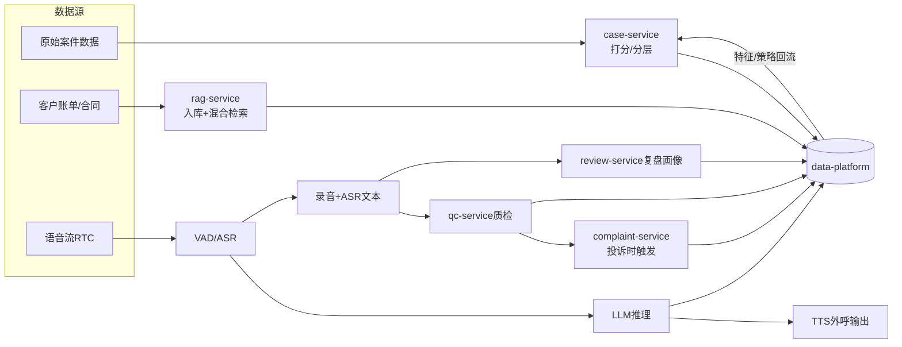

# 业务流程图与数据流程图

> 文档类型：项目总览（规范层）
> 版本：v1.3
> 状态：定稿
> 更新日期：2026-09-10
> 遵循：step1/01 锁定的全局统一口径（7 系统服务名/端口、置信度门控、外呼口径、is_delete 公共字段、code:"0" 响应包）。`qc.complaint.suspected` 发布条件以 DD-02 为准（R11/R12/R13，不是 tag 集合）。

## 修订记录

| 版本 | 日期 | 修订内容 | 修订人 |
|---|---|---|---|
| v0.1 | 2026-08-18 | 初稿骨架，纯文字描述 | — |
| v1.0 | 2026-08-19 | 补真实 Mermaid 业务流与数据流图；对齐 7 系统命名；补关键事件触发与置信度门控 | 规范定稿 |
| v1.2 | 2026-09-09 | 对齐 DD-02 V1.5：主流程去掉旁路实时质检与 qc.escalate.human；质检仅通话结束且全文齐后开工 | Ellis Guo |
| v1.3 | 2026-09-10 | 审阅 16/25：suspected 边条件改为 agent+high+R11/R12/R13；主流程补 WAIT_TEXT（未齐不插 qc_records） | Ellis Guo |

## 一、整体业务主流程

```mermaid
flowchart TD
    A[案件进入系统] --> B[case-service<br/>三维风险打分+分层+人机分流]
    B -->|轻量案件/AI通道| C[call-service<br/>合规外呼调度]
    B -->|高对抗案件/人工通道| H[人工坐席队列]
    C --> D[RTC实时语音通话<br/>VAD检测/支持打断]
    D --> E[rag-service<br/>混合检索账单/政策/标准答案]
    E -->|score≥0.6 知识片段| F[LLM生成回复<br/>qwen-plus结构化输出]
    E -->|score<0.6 无匹配| F2[降级:FAQ/标准答案库]
    F --> G[Guardrails前置+后置校验]
    F2 --> G
    G -->|通过| T[TTS播报]
    G -->|拦截| G2[兜底话术+告警日志]
    G2 --> T
    T --> D
    D -->|通话结束| R[录音+ASR文本落库]
    R -->|turns 未齐| WT[Redis qc:job WAIT_TEXT<br/>禁止 INSERT qc_records]
    WT -->|全文齐| Q
    R -->|全文已齐| Q[qc-service<br/>离线全量质检打分]
    R --> RV[review-service<br/>复盘画像更新]
    Q -->|合并后 hit：agent + high + rule_id∈{R11,R12,R13}| CP[complaint-service<br/>qc.complaint.suspected]
    Q -->|高危| ALERT[事后主管告警<br/>qc.alert.raised]
    RV --> DP[(data-platform<br/>指标/日志/特征)]
    CP --> DP
    Q --> DP
    RV -->|画像回流| B
    DP -->|策略回流| B
```

主流程分为四段：事前（分案 + 知识库准备）、事中（RTC 实时交互 + Guardrails，**无质检**）、事后（离线全量质检 + 复盘 + 投诉嫌疑评估）、离线（数据中台沉淀 + 策略回流）。投诉工单不由 `qc.check.completed` 自动创建；发布 `qc.complaint.suspected` **仅当** MergeHits 后存在 `speaker=agent` 且 `severity=high` 且 `rule_id ∈ {R11,R12,R13}`（权威 DD-02 §5.4.1 / §9.3），供 complaint-service 评估。**不是** `redline_tag ∈ {threat, stop_call, fake_identity}`；R05、纯 AC threat、user 行 **不发** 该事件。qc **不发布** `qc.escalate.human`。

通话结束但双向 turns 未齐：只写 Redis `qc:job:{session_id}.status=WAIT_TEXT`，**禁止 INSERT `qc_records`**；全文齐后才 RUNNING。落库后的 `qc_status` 仍是 DONE / PENDING_REVIEW / REVIEWED / PARTIAL（WAIT_TEXT **不是** 库枚举，权威 DD-02 §3.1）。

## 二、数据流流向



数据流遵循单向汇聚原则：所有业务事件、会话日志、模型调用日志单向汇入 data-platform，由中台做指标计算与特征输出；策略与特征可回流至 case-service，但回流走中台接口，不反向直连业务库。

## 三、模块边界

| 模块（服务名） | 职责范围 | 明确不做 |
|---|---|---|
| call-service | 实时语音会话交互、外呼调度、意图识别、转人工 | 质检、分案策略计算、知识库维护 |
| qc-service | 通话结束后消费 ASR 全文、违规检测、打分、事后告警 | 发起外呼、修改案件状态、事中转人工、通话页弹窗 |
| rag-service | 多模态入库、混合检索、敏感词库、版本管理 | 直接生成催收话术、调用 LLM |
| case-service | 三维打分、分层、人机分流、坐席匹配 | 执行外呼业务逻辑 |
| complaint-service | 投诉工单状态机、判责、证据截取、处置方案 | 修改案件催收状态 |
| review-service | 自动复盘、话术沉淀、坐席画像、运营报表 | 实时介入通话 |
| data-platform | 多源同步、分层加工、指标计算、策略回流 | 执行业务流程、直连业务库写 |

## 四、关键流转规则

1. 任何 AI 输出必须经 Guardrails 前置 + 后置校验，拦截返回兜底话术并记告警日志，违规内容不向下游传递；
2. RAG 检索结果须先打分过滤（score < 0.6 判定无匹配），知识片段不直接喂 LLM 自由作答；
3. LLM 输出 confidence < 0.7 禁止直接回复，走兜底话术或转人工；意图 confidence < 0.6 记 uncertain 不阻断；
4. LLM 超时、熔断、检索为空，按预设话术 → FAQ → 合规兜底分级降级，详见 step3/03；
5. 客户触发停止致电标记，全外呼链路拦截该客户，状态流转见 step1/03；
6. ASR 连续 3 次识别失败走兜底、累计 5 次结束通话；用户静默 10 秒引导、20 秒结束；
7. 单通话第 13 轮触发关键要素判断，第 15 轮强制结束。
