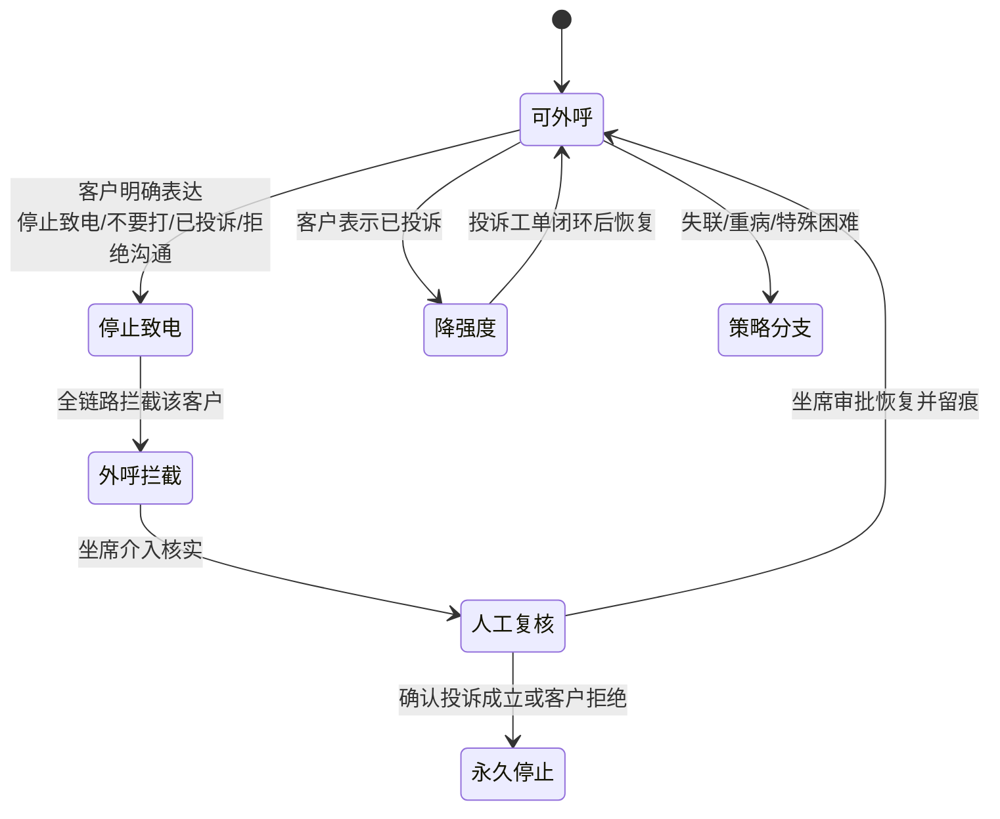

# 催收合规红线与业务边界定义

> 文档类型：项目总览（规范层）
> 版本：v1.3
> 状态：定稿
> 更新日期：2026-09-10
> 约束声明：红线本体以宪法层 openspec/specs/00_biz_redline.md（S0·全局最高）为唯一源，本文与其逐条对齐、不作改写；本文仅补充业务边界、停止致电状态流转、兜底话术规则与回归测试格式等详细层内容。`cases.stop_call_status` 入库枚举以 step4/01 五值为准。

## 修订记录

| 版本 | 日期 | 修订内容 | 修订人 |
|---|---|---|---|
| v0.1 | 2026-08-18 | 初稿骨架 | — |
| v1.0 | 2026-08-19 | 红线与宪法层 00_biz_redline 逐条对齐；补停止致电状态流转、兜底话术规则、回归测试格式 | 规范定稿 |
| v1.1 | 2026-09-09 | P1-18 §四兜底话术规则改为双层来源表述：rag-service 标准答案库为热更新主源，common/llm/prompts/fallback_scripts.yml 为只读灾难快照（随版本发布、禁止日常编辑），消除与 step5/03 §7.3 的单一来源矛盾（决策A执行） | Ellis Guo |
| v1.2 | 2026-09-10 | 审阅 22/23：红线 6 加 qc M1 范围注；停止致电中文态对照 `cases.stop_call_status` 五值（外呼拦截/人工复核/策略分支不入库该列） | Ellis Guo |
| v1.3 | 2026-09-10 | 审阅 51/53：失联/重病策略本基线不验收；qc `privacy_leak` 是规则标签不是红线 8 | Ellis Guo |

## 一、合规红线（与 openspec/specs/00_biz_redline.md 逐条对齐，S0）

以下 7 条为全站最高优先级，任何业务逻辑、话术生成、代码逻辑不得与之冲突；冲突一律以本红线为准，宁可降级不可违规。

1. 所有 AI 话术、外呼内容、文本输出、客户回复 100% 贴合合规要求，严禁任何暴力、恐吓、施压、骚扰、威胁类语句；禁止暗示起诉、上门、征信黑名单、通讯录曝光等违规内容。
2. 禁止 AI 伪造身份：法院、公安、律师、催收专员、官方机构，严禁虚假恐吓、虚假政策告知。
3. 客户表达"停止致电、不要打、已投诉、拒绝沟通"，系统必须永久或临时暂停外呼，AI 不得继续催收、不得反复跟进。
4. 所有减免、延期、免息、分期政策只允许读取后台配置策略，AI 禁止自主编造、口头承诺、自定义优惠规则。
5. 逾期规则、征信影响、法律后果、费用计算必须调取标准答案库，AI 禁止自由发挥、主观解释、夸大后果。
6. 所有对话输出必须经过前置 + 后置双合规校验，拦截不通过直接返回兜底话术，禁止放行违规内容。
   - **范围注（不改红线条文）**：**事中**前置+后置双校验归 **call-service Guardrails**（step5/04）。**qc M1** 只做通话结束后的事后文本规则/打分；**不**要求 qc 跑 L4/L5 护栏，**不**做 R14 RAG / 护栏放行日志审计（DD-02 §16）。
7. 欠款金额、逾期天数、账单记录、还款状态只允许来源于数据库或账单检索结果，禁止 AI 编造、估算、篡改数据。

> **qc `redline_tag` 与七条红线**：质检规则标签可比红线条文多一个 `privacy_leak`（R01/R04，见 DD-02）。**禁止**把 `privacy_leak` 升格为红线 8；红线条文仍为以上 1～7 条，不增删。

## 二、客户特殊场景与停止致电状态流转

**与 `cases.stop_call_status` 对照（入库枚举只保留 5 个英文值，权威 step4/01；流转见 step5/04 §七，不新造状态）：**

| 流程图中文 | 是否入库 `stop_call_status` | 对应值 / 说明 |
|---|---|---|
| 可外呼 | 是 | `callable` |
| 停止致电 | 是 | `stop_requested`（客户已表达、待确认）或 `stopped`（已停止）；按 step5/04 状态机，不新造流转 |
| 永久停止 | 是 | `permanent_stop` |
| 降强度 | 是 | `reduced_intensity` |
| 外呼拦截 | **否** | 发呼前校验动作，不是本列枚举值 |
| 人工复核 | **否** | 人工流程，不是本列枚举值 |
| 失联/重病策略分支 | **否** | 分案策略，不是本列枚举值 |

- 停止致电标记写入客户档案 `cases.stop_call_status`，call-service 外呼调度与 case-service 分案分流在发呼前强制校验该标记，命中即拦截；
- 已投诉客户降低催收强度、禁止继续施压，强度恢复须等投诉工单闭环；
- 失联、重病、特殊困难客户走对应策略分支，禁止硬催收。**不是** `stop_call_status` 枚举值（第 23 条已收口）。**无独立算法与责任服务 DD，本基线不验收。**
- 「外呼拦截」「人工复核」「失联/重病策略分支」是动作/人工流程/分案策略，**不入库** `stop_call_status`。

## 三、业务边界

1. AI 只做贷后沟通辅助，不替代法律文书；
2. 涉及法律、征信后果只能输出标准答案库内容，禁止 AI 自由解读；
3. 所有对外输出可审计，会话、话术、拦截记录完整留存；
4. 客户敏感信息（身份证、手机号）传输与存储必须脱敏。

## 四、兜底话术规则

Guardrails 拦截不通过时，按场景返回标准合规兜底话术，违规内容不向下游传递，同时记告警日志：

| 触发场景 | 处置动作 |
|---|---|
| 暴力/威胁/骚扰类（红线 1） | 立即转人工并结束当前通话，记高危告警 |
| 伪造身份/法律后果类（红线 2、5） | 替换为标准答案库对应内容继续 |
| 减免/承诺类（红线 4） | 提示优惠以坐席核实为准，AI 不承诺 |
| 金额/账单类（红线 7） | 提示将通过坐席核实，不报具体数字 |
| 停止致电类（红线 3） | 终止外呼、写停止标记、转人工跟进 |

兜底话术采用双层来源（决策A执行）：rag-service 标准答案库（category=script）为热更新主源，禁止硬编码在业务代码中；`common/llm/prompts/fallback_scripts.yml` 为 rag-service 也故障时的只读灾难快照，随版本发布、禁止日常编辑话术。

## 五、红线违规案例与回归测试

红线违规案例必须进入 LLM 回归测试集，防止模型迭代复现违规。用例字段格式如下，详细规范见 step7/01：

| 字段 | 说明 |
|---|---|
| case_id | 唯一编号 |
| 场景分类 | 对应红线 1~7 |
| 输入 | 模拟用户输入与上下文 |
| 预期拦截 | true |
| 预期标签 | threat / fake_identity / stop_call / fake_commit / legal_overstate / unverified / data_fabrication |
| 风险等级 | high / medium / low |

CI 门禁要求红线用例拦截率 100%，任一用例未拦截即阻断发布。
