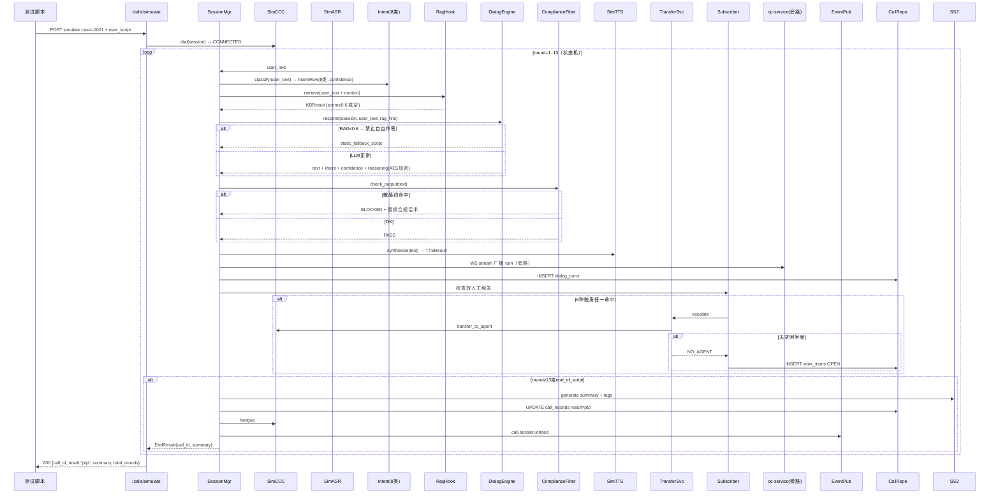
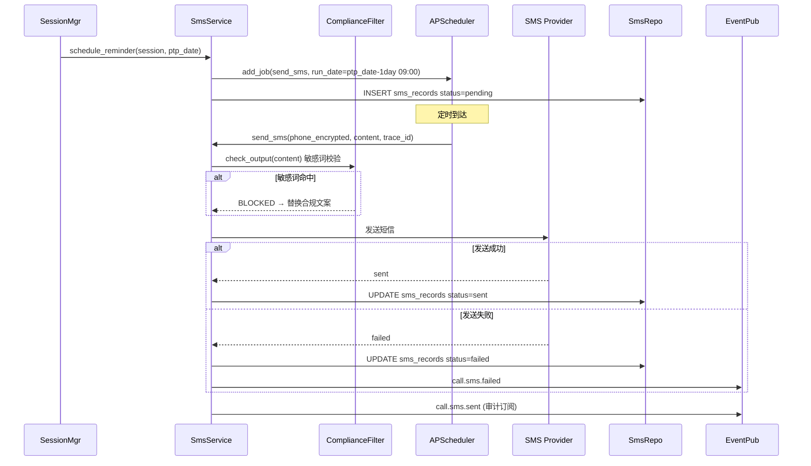

# 子系统详细设计 #01：AI 智能外呼对话系统

> 子系统编号：第 1 号
> 服务名：`call-service`
> 监听端口：**8004**
> 里程碑归属：**M2（M1 最小闭环后启动）**
> MVP 模式：**模拟 CCC + 预留阿里云 Adapter**（用户确认）
> 上游约束：step1/01~03 全局口径、step3/01~03 架构与降级、step4/01~03 数据设计、step5/01~04 技术规范、step6/01~02 异常容错告警、step7/01~03 测试规范、step8/01 M0 任务清单
> 宪法约束：openspec/specs/00~07

---

## 0.1 文档修订记录

| 版本 | 日期 | 修订人 | 修订内容 |
| :--- | :--- | :--- | :--- |
| V1.0 | 2026-08-18 | - | 初始版本，12 章模板 + 模拟 CCC/真实 Adapter 分层 |
| V1.1 | 2026-08-19 | 规范优化 | 新增 FR-OUT-007 短信通知；意图 7→8 类（含 uncertain）；新增 AI 不修改案件状态约束；新增 Ch13~17 五个 AI 专项章节；更新子系统调用关系（RAG 被动/DP 被动/case→rag/case→dp）；对齐 step3~step8 全部规范 |

---

## 1. 模块概览

AI 智能外呼对话系统是整套生态的**对外智能交互入口**：

1. **合规外呼调度**（FR-OUT-001）：按 case-service 分配的 AI 队列出呼；时段 08:00–21:00，每日 ≤3 次/用户，30 分钟重试间隔，最大 3 次，并发 50 路。
2. **模拟 CCC + 预留 Adapter**（FR-OUT-001a）：定义抽象 `CCCAdapter` + `ASRAdapter` + `TTSAdapter` 三层接口。MVP 实现 `SimulatedCCCAdapter`；M3 切换阿里云 CCC/NLS 时，只需写 Adapter 替换实现，核心逻辑不变。
3. **实时语音交互**（FR-OUT-002）：ASR 流式文本 → LLM 多轮对话 → TTS 合成为语音；支持中断打断（barge-in）、ASR 3 次识别失败兜底话术、累计 5 次失败结束；用户静默 10s 引导，20s 结束。
4. **用户意图实时识别**（FR-OUT-003）：LLM 结构化输出 **8 类意图**（willing_to_pay / request_extension / financial_difficulty / stalling / refuse_communication / emotional_resistance / complaint_intent / uncertain） + 统一 confidence；<0.6 → uncertain；超时不阻断。
5. **RAG 合规话术赋能**（FR-OUT-004）：对话中每轮必 rag-service 检索（**RAG 只提供被动检索，不主动向外调用**）；RAG score <0.6 → 禁止自由作答，输出固定兜底话术；RAG 不可用 → 降级为静态标准脚本库。输出前经敏感词三层校验（AC 自动机，命中立即拦截）。
6. **智能转人工**（FR-OUT-005）：激烈情绪 / 投诉意向 / 复杂协商 / 13 轮关键要素未确认 / 敏感词 ≥2 → 触发转人工；无空闲坐席 → AI 安抚 + 生成待跟进工单。
7. **通话结果结构化输出**（FR-OUT-006）：LLM 生成摘要 + 标签汇总 + 回填工单/关联录音；工单回写失败 3 次重试仍失败 → 告警人工。**AI 只输出摘要和建议，不直接修改案件状态，案件状态流转由 case-service 执行。**
8. **短信通知**（FR-OUT-007）：承诺还款（PTP）达成后，在承诺日期前 1 天自动发送短信提醒；短信内容经敏感词校验 + 脱敏处理；短信发送记录入库审计。

> **AI 边界约束（全局）**：call-service 作为 AI 能力层服务，只做分析、打分、标签、建议、研判结论。真正修改工单、案件状态，永远是 case-service。call-service 通过 MQ 异步推送建议给 case-service，由 case-service 完成实际状态变更。

---

## 2. 职责边界

### 2.1 必做事项

1. **合规调度器**：任务入队 / 去重 / 时段过滤 / 频次上限 / 并发 50 路 / 重试（30m间隔 × 3次）。
2. **CCC/ASR/TTS 抽象 Adapter 层**：MVP 提供 Simulator Adapter 实现 + 预留阿里云 Adapter 接口。
3. **多轮对话引擎（STATE MACHINE）**：身份核实 → 欠款告知 → 协商 PTP → 确认关键信息 → 结束；最多 13 轮。
4. **意图识别**：每轮输出 intent_label + confidence（8 类枚举 + 统一置信度，<0.6 → uncertain）。
5. **RAG 赋能+敏感词拦截**：每轮检索+置信度兜底+拦截。
6. **转人工调度**：6 类触发条件；订阅 `qc.escalate.human`。
7. **通话结果**：摘要/标签/工单回填（**仅推送建议，case-service 执行实际变更**）。
8. **短信通知**：PTP 达成后承诺日前 1 天短信提醒，内容脱敏 + 审计。
9. **事件发布**：`call.session.ended`（DP 订阅）/ `call.human.escalated`（case-service 订阅）/ `call.sms.sent`（审计订阅）等。
10. **MVP 独立可测**：模拟用户侧输入的脚本化冒烟测试。

### 2.2 明确不做事项

1. **不做真实呼叫线路/真实 ASR/TTS 代码**：只定义 Adapter 接口；MVP 用 Simulator 实现；真实阿里云实现是独立 M3 任务。
2. **不做违规检测/质检打分**：由 qc-service 负责；call-service 只把 turn 文本发布到 WS 旁路。
3. **不做风险打分/案件分层/派单/案件状态变更**：由 case-service 负责；call-service 只按 case-service 分配过来的 AI 队列出呼，**AI 只输出建议，案件状态变更永远由 case-service 执行**。
4. **不做知识库文档维护/敏感词 CRUD**：由 rag-service 负责；call-service 只调用检索接口。
5. **不做策略参数回流/宽表构建**：由 data-platform 负责。**DP 不主动调用上层 AI 服务，数据以消息推送方式下发**。
6. **不做 RBAC/JWT/审计**：common/security。
7. **不做人机对话前端渲染**：后端。
8. **不做真实 TTS 音频文件落盘**：MVP Simulator 只存 TTS 文本；真实上线由 TTS Adapter 把文件 URL 写到 call_records.recording_url。

---

## 3. 内部模块拆分

```
call-service (FastAPI app)
├── app/
│   ├── main.py                    # FastAPI 入口 + /health + Scheduler
│   ├── routers/
│   │   ├── campaigns.py           # 外呼任务 CRUD（运营配置批次）
│   │   ├── calls.py               # 通话查询/详情/状态
│   │   ├── simulate.py            # MVP 模拟器：POST /calls/simulate
│   │   ├── callbacks.py           # Adapter 回调入口（真实CCC回调时用）
│   │   ├── transcripts.py         # 对话文本导出
│   │   ├── work_items.py          # 转人工待跟进工单
│   │   └── sms.py                 # 短信通知管理（FR-OUT-007）
│   ├── services/
│   │   ├── scheduler_service.py    # 外呼调度器：时段/频次/并发/重试
│   │   ├── session_manager.py      # 会话生命周期：StateMachine+13轮
│   │   ├── dialog_engine.py        # 多轮对话：LLM生成+RAG+拦截+兜底
│   │   ├── intent_service.py       # 意图识别（8类）+ 统一 confidence
│   │   ├── rag_hook_service.py     # 每轮RAG检索+score<0.6 禁止自由作答
│   │   ├── compliance_filter.py    # 每轮输出敏感词拦截（AC 自动机）
│   │   ├── transfer_service.py     # 转人工：触发+无空闲坐席+待跟进工单
│   │   ├── summary_service.py      # 结构化摘要/标签/工单回填（3次重试）
│   │   ├── sms_service.py          # 短信通知：PTP达成后承诺日前1天提醒
│   │   ├── campaign_service.py     # 批次：选择案件/启动/暂停
│   │   └── workitem_service.py     # 待跟进工单 CRUD
│   ├── adapters/                   # Adapter 抽象 + MVP Simulator + 预留 Aliyun
│   │   ├── base.py                 # CCCAdapter / ASRAdapter / TTSAdapter Protocol
│   │   ├── sim_ccc.py              # SimulatedCCCAdapter（MVP）
│   │   ├── sim_asr.py              # SimulatedASRAdapter（MVP）
│   │   ├── sim_tts.py              # SimulatedTTSAdapter（MVP）
│   │   ├── aliyun_ccc.py           # 预留 AliyunCCCAdapter 接口骨架
│   │   ├── aliyun_asr.py           # 预留 AliyunNLSASRAdapter 接口骨架
│   │   └── aliyun_tts.py           # 预留 AliyunNLSTTSAdapter 接口骨架
│   ├── repositories/
│   │   ├── call_repo.py            # call_records / dialog_turns CRUD
│   │   ├── campaign_repo.py        # call_campaigns / campaign_cases
│   │   ├── workitem_repo.py        # work_items（转人工跟进）
│   │   ├── intent_repo.py          # intent_tags 批量写入
│   │   └── sms_repo.py             # sms_records CRUD
│   ├── events/
│   │   ├── publisher.py            # call.session.ended / call.human.escalated / call.sms.sent
│   │   └── subscriber.py           # qc.escalate.human / strategy.updated / case.assigned
│   └── integrations/
│       ├── llm_client.py           # 统一 LLM 调用（common/llm/provider.py 封装）
│       ├── rag_client.py           # RAG 检索 + 敏感词版本缓存
│       └── dp_client.py            # 案件批量拉取 + 工单回填（data-platform）
```

### 3.1 对话状态机（13 轮规则）

```
S0  INIT → S1 身份核实（最多2轮，关键要素1）
S1  OK → S2 欠款金额告知（关键要素2）
S2  → S3 协商还款方案（多轮，关键要素3还款日期/金额）
S3  → S4 确认关键要素（关键要素1/2/3全部确认？）
     ├── Yes → S5 结束（合规话术）
     └── No （且 round<13）→ S3 继续协商
     └── No （且 round≥13）→ 转人工
此外在任意状态：ASR失败5次/静默20s/情绪对抗/投诉意向/敏感词≥2 → 立即 → S_TRANSFER_HUMAN
转人工失败（无空闲坐席）→ S_ANNOUNCE_FOLLOWUP + 生成 work_items
```
3 轮相同话术 → 立即转人工（兜底重复）。

---

## 4. 对外接口详细说明

所有接口 `http://call-service:8004/api/v1`，统一响应包 `{"code":"0","message":str,"data":any|null,"trace_id":str}`。错误码 A1001–A1013 + B 类。

### 4.1 外呼任务批次（campaigns）

| 方法 | 路径 | 职责 | 权限 | 幂等 | 限流 | 错误码 | PII 脱敏 |
| :--- | :--- | :--- | :--- | :--- | :--- | :--- | :--- |
| POST | `/campaigns` | 创建批次（case_ids + 策略ID） | ADMIN/SUPV | `X-Idempotency-Key` | 1/min | A1001/B0002 | case_ids 不含手机号 |
| POST | `/campaigns/{id}/start` | 启动批次 | ADMIN/SUPV | 已启动返回 409 | 1/10s | A1002 | — |
| POST | `/campaigns/{id}/pause` | 暂停 | ADMIN/SUPV | 幂等 | 1/10s | A1002 | — |
| GET | `/campaigns/{id}` | 批次详情+进度 | ADMIN/SUPV/TRAINER | 幂等 | 60/min | A1003 | — |
| GET | `/campaigns` | 列表（分页/状态） | ADMIN/SUPV | 幂等 | 30/min | A1003 | — |

### 4.2 通话查询/转人工/结果

| 方法 | 路径 | 职责 | 权限 | 错误码 | PII 脱敏 |
| :--- | :--- | :--- | :--- | :--- | :--- |
| GET | `/calls/{call_id}` | 单通通话详情+turn列表 | AGENT/SUPV/ADMIN/TRAINER | A1004 | phone=138****1234；reasoning 不返回 |
| GET | `/calls` | 列表（case_id/status/date/agent_id 过滤） | SUPV/ADMIN/TRAINER | A1004 | phone 脱敏 |
| POST | `/calls/{call_id}/transfer` | 手动触发转人工 | SUPV/ADMIN | A1005 | — |
| GET | `/calls/{call_id}/summary` | 结构化摘要+标签 | SUPV/TRAINER | A1006 | reasoning 不返回 |
| GET | `/calls/{call_id}/transcript` | 导出对话文本（CSV/JSON） | ADMIN/TRAINER | A1007/B0007 | reasoning 不导出；phone 脱敏 |

### 4.3 MVP 独立可测：模拟通话入口

| 方法 | 路径 | 职责 | 权限 | 幂等 | 限流 | 错误码 |
| :--- | :--- | :--- | :--- | :--- | :--- | :--- |
| POST | `/calls/simulate` | **发起脚本化模拟通话** | ADMIN/TRAINER | `X-Idempotency-Key` | 5/s | A1008/B0002 |
| GET(WS) | `/calls/{session_id}/stream` | 实时 turn 流（QC 质检旁路订阅） | QC/ADMIN | 每 session 1 路 | 50 连接 | A1009/B0004 |

### 4.4 Adapter 回调（预留真实CCC接入）

| 方法 | 路径 | 职责 | 权限 | 错误码 |
| :--- | :--- | :--- | :--- | :--- |
| POST | `/callbacks/ccc/events` | 真实 CCC 事件（ring/connect/disconnect/transfer） | INTERNAL(签名) | A1010 |
| POST | `/callbacks/nls/asr/{session_id}` | NLS 中间结果/最终结果 | INTERNAL(签名) | A1011 |

### 4.5 待跟进工单

| 方法 | 路径 | 职责 | 权限 | 错误码 |
| :--- | :--- | :--- | :--- | :--- |
| GET | `/work-items` | 待跟进列表（status=OPEN/PROCESSING/DONE） | AGENT/SUPV | A1012 |
| POST | `/work-items/{id}/pick` | 坐席认领 | AGENT | A1012/B0002 |
| POST | `/work-items/{id}/close` | 结案+备注 | AGENT/SUPV | A1013 |

### 4.6 短信通知（FR-OUT-007 新增）

| 方法 | 路径 | 职责 | 权限 | 幂等 | 错误码 | PII 脱敏 |
| :--- | :--- | :--- | :--- | :--- | :--- | :--- |
| GET | `/sms/records` | 短信发送记录列表（call_id/phone/date 过滤） | SUPV/ADMIN | 分页 | A1014 | phone=138****1234 |
| GET | `/sms/records/{id}` | 短信详情（内容/状态/时间） | SUPV/ADMIN | 幂等 | A1014 | phone 脱敏 |
| POST | `/sms/test-send` | 手动触发测试短信（仅 staging/dev） | ADMIN | `X-Idempotency-Key` | A1015/B0002 | phone 脱敏 |

**短信发送规则**：
- 触发条件：通话结果 result=ptp（承诺还款），且承诺日期非空
- 发送时间：承诺日期前 1 天 09:00（定时任务）
- 内容模板：经敏感词校验 + 脱敏处理，不含具体金额数字
- 发送记录：sms_records 表入库审计，含 trace_id

---

## 5. 内部类与方法清单

### 5.1 Adapter 抽象

```python
from typing import Protocol, AsyncIterator, Literal

class CCCAdapter(Protocol):
    name: Literal["simulator","aliyun_ccc"]
    async def dial(self, session: CallSession, phone_encrypted: str) -> DialResult
    async def transfer_to_agent(self, session: CallSession, agent_id: int|None) -> TransferResult
    async def hangup(self, session: CallSession) -> None
    async def events(self, session: CallSession) -> AsyncIterator[CCCEvent]
    async def feed_tts_audio(self, session: CallSession, audio_or_text_id: str) -> None

class ASRAdapter(Protocol):
    name: Literal["simulator","aliyun_nls"]
    async def start(self, session: CallSession) -> None
    async def text_stream(self, session: CallSession) -> AsyncIterator[ASRResult]
    async def stop(self, session: CallSession) -> None

class TTSAdapter(Protocol):
    name: Literal["simulator","aliyun_nls"]
    async def synthesize(self, session: CallSession, text: str) -> TTSResult
```

### 5.2 业务服务层

#### SchedulerService

```python
class SchedulerService:
    async def enqueue_campaign(self, campaign: Campaign) -> int
    async def run_once(self) -> None                    # cron 每秒：并发50、时段08-21、频次≤3
    def within_window(self, now: datetime, tz) -> bool  # 08:00-21:00 法定节假日不打
    async def retry_dead(self, call_id: int) -> None
```

#### SessionManager（13 轮状态机）

```python
class SessionManager:
    async def start(self, session: CallSession) -> None
    async def step(self, session: CallSession, asr_text: str) -> TurnStepResult
    async def end(self, session: CallSession, reason: EndReason) -> EndResult
    def check_transfer_conditions(self, session: CallSession) -> list[TransferTrigger]
```

6 种转人工触发：
1. 意图 = complaint_intent / emotional_resistance 且 confidence ≥0.7
2. 复杂协商（延期/减免 > 阈值，无匹配 RAG）
3. round ≥13 且关键要素未全部确认
4. 连续 3 轮相同话术
5. 订阅 qc.escalate.human 事件（敏感词≥2）
6. 手动 POST /calls/{id}/transfer

#### DialogEngine（LLM 应答生成）

```python
class DialogEngine:
    async def respond(self, session: CallSession, asr: str, rag_hits: list[KBResult]) -> LLMDialogResult
    # LLM 专项设计（见 Ch13）：
    # - Prompt 版本：dialog_v1（common/llm/prompts/dialog.yml）
    # - 置信度阈值：LLM confidence<0.7 → 禁止直接回复 → 转人工（A1010）
    # - 输出解析：response_format=json_object → Pydantic DialogSchema 校验
    # - 幻觉校验：answer 不含编造金额/政策（后置 Guardrails 校验）
    # - 降级路径：RAG<0.6 → static_fallback_script；LLM 熔断 → RuleBasedScriptEngine
```

#### IntentService（8 类枚举）

```python
class IntentService:
    async def classify(self, user_text: str, ctx: CallSession) -> IntentRow
    # 8 类枚举：willing_to_pay / request_extension / financial_difficulty /
    #          stalling / refuse_communication / emotional_resistance /
    #          complaint_intent / uncertain
    # confidence<0.6 → uncertain
```

#### SmsService（FR-OUT-007 新增）

```python
class SmsService:
    async def schedule_reminder(self, session: CallSession, ptp_date: str) -> str
    # PTP 达成后调度定时任务：承诺日前 1 天 09:00 发送
    async def send_sms(self, phone_encrypted: str, content: str, trace_id: str) -> SmsResult
    # 内容经敏感词校验 + 脱敏处理；发送记录入库审计
    async def cancel_reminder(self, session_id: str) -> None
    # 通话取消/重新协商时取消已调度的短信
```

#### RagHookService + ComplianceFilter

```python
class RagHookService:
    async def retrieve(self, query: str, session: CallSession) -> list[KBResult]
    def degraded(self) -> bool  # rag-service 3连失败 → 静态脚本降级

class ComplianceFilter:
    def check_output(self, text: str) -> FilterResult       # AC 自动机敏感词检查
    async def refresh_words(self) -> None                     # 订阅 kb.sensitive_updated
```

#### TransferService + SummaryService

```python
class TransferService:
    async def escalate(self, session, triggers: list, agent_id=None) -> TransferOutcome

class SummaryService:
    async def generate(self, session) -> SummaryResult       # LLM 摘要 + 标签汇总
    async def writeback_workorder(self, session, summary) -> None  # 3次重试
    # AI 只输出摘要建议，不修改案件状态；案件状态变更由 case-service 执行
```

---

## 6. 涉及数据库表与字段

### 6.1 PostgreSQL public schema（与 step4/01 DDL 对齐）

| 表名 | 主键 | 关键列 | 数据闭环 |
| :--- | :--- | :--- | :--- |
| call_records | id | session_id(UQ) + case_id + phone_encrypted(AES) + agent_id + direction + status + result(ptp/promise_later/refuse/no_contact/transfer/lost) + duration_sec + recording_url + start_at/end_at + trace_id | 写入 → DP ETL 同步至 dw.ods_call_records |
| dialog_turns | id + call_id+turn_no | role(agent/user/asr/tts/system) + text(脱敏) + turn_no + asr_confidence + reasoning(AES加密,仅trainer可见) + rag_hits(JSONB) + intent_label + confidence(FLOAT 0-1 CHECK) + latency_ms | 写入 → DP 同步至 dw.dwd_call_records |
| intent_tags | id + call_id+turn_no | intent_type(8类枚举) + confidence 0-1 + evidence_turn_ids(JSONB) | 写入 → DP 同步至 dw.dws_call_result |
| call_campaigns | id | name + strategy_id + status + case_ids(JSONB) + created_by/at + start_at/end_at | 写入 → DP dws_strategy_effectiveness |
| campaign_cases | id/campaign_id+case_id | status(PENDING/DIALING/DONE/FAILED) + retry_count + last_attempt_at + next_retry_at | — |
| work_items | id | call_id + case_id + source(TRANSFER_NO_AGENT/FOLLOWUP/MANUAL) + status(OPEN/PROCESSING/DONE) + assigned_agent_id + close_note | — |
| call_strategies | id/version | 外呼时段/重试/并发/兜底脚本 JSONB | DP 策略版本管理 → 热更新 |
| sms_records | id | call_id + case_id + phone_encrypted(AES) + content(脱敏) + send_at + status(pending/sent/failed) + trace_id | 写入 → 审计追溯 |

> 公共字段统一：id(UUID) / create_time / update_time / is_delete CHAR(1)，与 step4/01 对齐。

### 6.2 Redis（与 step4/03 对齐，DB 4 分配给 call-service）

```
call:session:{session_id}          CallSession JSON 状态机，TTL=24h
call:campaign:{id}:progress        进度计数器，TTL=24h
call:user_daily:{user_id}:{date}   当日拨打次数（INCR，23:59 expire）
call:throttle:global               并发50路令牌桶
call:simulate:run:{idempotency}    模拟器幂等锁 TTL=7d
call:rag_hits:{session_id}:{turn}  RAG 命中缓存
call:qc_stream:{session_id}        QC 旁路 WS 订阅标识
call:transfer:{session_id}         转人工状态防重复（TTL=10min）
call:llm_degraded                  LLM 熔断标识（SET/DEL）
call:sms:scheduled:{session_id}    短信定时任务标识（TTL=48h）
```

---

## 7. 类图与时序图

### 7.1 MVP 模拟通话完整 PTP 流程



### 7.2 短信通知流程（FR-OUT-007 新增）



---

## 8. 模块独立测试方案

### 8.1 依赖与 Mock 清单

| 依赖 | 真实/Mock | 说明 |
| :--- | :--- | :--- |
| PG 15 | 真实 | 外呼表 |
| Redis 7 | 真实 | DB 4 |
| rag-service | 真实 | RAG 检索 + 敏感词种子 |
| data-platform | 真实 | 种子 case 数据 |
| LLM DashScope | Mock (MOCK_LLM=1) | 注入固定响应 |
| CCC/ASR/TTS | Mock=Simulator | 不接真实线路 |
| qc-service | 可选跳过 | 旁路降级为日志 |
| case-service | 不需要 | /calls/simulate 传 case_id |
| SMS Provider | Mock | 注入固定响应 |

### 8.2 独立可测断言清单

```
1.  POST /calls/simulate（PTP 脚本）→ result="ptp", total_rounds<13
2.  call_records.result="ptp"；intent_tags 至少一条 type=willing_to_pay 且 confidence≥0.7
3.  dialog_turns.turn_no 连续不缺；每轮 agent turn 有 rag_hits
4.  违规话术被 compliance_filter 拦截替换
5.  13 轮未确认关键要素 → 转人工，生成 work_items.status=OPEN
6.  ASR 5 次空 → 通话结束 failed=asr_error
7.  静默 20s → 超时结束
8.  批次调度 retry_count 和 last_attempt_at 正确更新
9.  user_daily 第 4 次拦截
10. 时段 22:30 → false，08:30 → true
11. RAG 故障 → static_fallback_script，不调用 LLM
12. call.session.ended 发布 1 次
13. PTP 达成 → sms_records 新增 status=pending（FR-OUT-007）
14. 短信内容不含具体金额数字（脱敏校验）
15. /calls/{id} 默认不返回 reasoning 字段
16. /calls/{id} phone 字段脱敏为 138****1234
17. LLM 熔断后 → RuleBasedScriptEngine 兜底，通话不中断
18. 8 类意图全部可识别（含 uncertain）
```

### 8.3 独立测试 shell 脚本

```bash
#!/usr/bin/env bash
# scripts/smoke/smoke_call_service.sh
set -euo pipefail
ROOT="$(cd "$(dirname "$0")/../.." && pwd)"; cd "$ROOT"

echo "[1/4] 启动底座：PG Redis rag-service data-platform"
docker compose -f docker-compose.yml up -d postgres redis milvus
sleep 20

echo "[2/4] 启动 call-service（端口8004，Mock LLM + Simulator）"
ENV=dev MOCK_LLM=1 ADAPTER_MODE=simulator \
  uvicorn app.main:app --port 8004 &
CALL_PID=$!
sleep 12
trap "kill -9 $CALL_PID 2>/dev/null || true" EXIT

echo "[3/4] 执行断言"
curl -sf http://localhost:8004/health | jq -e '.status=="healthy"'
# ... 断言 1..18

echo "[4/4] Done"
```

---

## 9. 模块通信与依赖

### 9.1 同步 HTTP（我作为 Client）

| 目标 | 路径 | 触发 | 超时 | 重试 | 熔断 | 降级 |
| :--- | :--- | :--- | :--- | :--- | :--- | :--- |
| rag-service 8002 | POST `/knowledge/search` | 每轮检索 | 3s | 2× | 3连 | 静态脚本降级 |
| rag-service 8002 | GET `/sensitive-words` | 启动+刷新 | 3s | 2× | 3连 | 上版词库缓存 |
| data-platform 8001 | GET 内部：批量待催收案件 | 批次启动 | 5s | 3× | 3连 | 本地暂存7d |
| DashScope LLM | text-generation | 对话/意图/摘要 | 5s | 2× | 3连 | 规则引擎兜底 |

> **RAG 被动约束**：rag-service 只提供被动检索接口，不主动向外调用服务。
> **DP 被动约束**：data-platform 不主动同步调用上层 AI 服务，数据以消息推送方式下发。

### 9.2 同步 HTTP（我作为被调）

| 谁调我 | 路径 | 目的 |
| :--- | :--- | :--- |
| 前端运营 | campaigns/* + calls/* + work-items/* + sms/* | 批次/查询/工单/短信 |
| qc-service（旁路） | WS `/calls/{session_id}/stream` | 旁路监听 |
| 真实 CCC/NLS（M3） | `/callbacks/ccc\|nls/*` | 事件回调 |

### 9.3 事件通知（Redis Pub-Sub，与 step4/03 对齐）

#### 发布（我→其他）

| Channel | Payload | 订阅者 | 数据闭环 |
| :--- | :--- | :--- | :--- |
| `call.session.ended` | `{session_id, call_id, case_id, result, duration, ts, trace_id}` | DP(ods同步) + qc(离线补检) + review(复盘) + case(二次分案) | 通话数据回流 DP |
| `call.human.escalated` | `{call_id, case_id, triggers[], agent_id?, ts}` | case-service(转人工工单) | — |
| `call.work_item.created` | `{work_item_id, call_id, case_id, source, ts}` | 前端/坐席端 | — |
| `call.campaign.done` | `{campaign_id, summary, ts}` | DP(策略效果评估) | 策略效果回流 DP |
| `call.sms.sent` | `{sms_id, call_id, phone_hash, status, ts}` | 审计订阅 | — |
| `call.sms.failed` | `{sms_id, call_id, reason, ts}` | 告警订阅 | — |
| `call.llm.degraded` | `{service, reason, ts}` | 告警订阅 | LLM 熔断告警 |

#### 订阅（其他→我）

| Channel | 发布者 | Payload | 处理 |
| :--- | :--- | :--- | :--- |
| `qc.escalate.human` | qc-service | `{session_id, call_id, hits_count}` | 立即转人工 |
| `strategy.updated` | data-platform | `{version, strategy_type}` | 外呼策略热更新 |
| `case.assigned` | case-service | `{assignment_id, case_id, type}` | type=AI → 入默认 campaign 队列 |

---

## 10. 错误处理矩阵（与 step6/01 对齐）

| 错误码 | 描述 | 触发 | 降级策略 |
| :--- | :--- | :--- | :--- |
| A1001 | 批次创建失败 | 校验不通过 | 返回 400 |
| A1002 | 批次状态冲突 | 已启动重 start | 返回当前 status |
| A1003 | 批次不存在 | 404 | — |
| A1004 | 通话记录不存在/无权限 | 404/403 | — |
| A1005 | 转人工失败（无坐席+工单落表失败） | 500 | NO_AGENT + work_item_id |
| A1006 | 摘要生成失败（LLM 熔断） | 500 | 固定模板摘要 |
| A1007 | 导出失败 | B0007 | — |
| A1008 | simulator 参数错 | 400 | 字段级错误 |
| A1009 | WS 旁路订阅失败 | 410 | — |
| A1010 | CCC 回调签名失败 | 401 | 审计 |
| A1011 | NLS 回调非法 | 400 | 审计 |
| A1012 | work_item 不存在/认领冲突 | 404/409 | — |
| A1013 | work_item 已关闭 | 409 | — |
| A1014 | 短信记录不存在 | 404 | — |
| A1015 | 短信发送失败 | 500 | 记录 failed + 告警 |
| B0001-B0010 | 系统级 | 统一 | 按 DEVELOPMENT_CONTRACT |

---

## 11. 宪法规则落地检查清单

| 宪法条款 | 落地方式 | 验收 |
| :--- | :--- | :--- |
| 1.1 RAG≥0.6 禁止自由作答 | RagHook score<0.6 → static_fallback_script | 断言 11 |
| 1.2 LLM 调用落表 | llm_client → llm_call_logs | 行数 = 对话轮+1+1 |
| 1.3 敏感词≥2 立即转人工 | 订阅 qc.escalate.human | work_items 生成 |
| 2.2 AES 敏感字段 | phone_encrypted 调 common.security.crypto | /calls/{id} 返回 138****1234 |
| 2.3 敏感词三层过滤 | ComplianceFilter AC 自动机 | 断言 4 |
| 3.1 5s/重试3次/熔断 | 所有 HTTP client | 注入故障→第4次降级 |
| 3.2 LLM 故障→规则引擎降级 | DialogEngine 熔断→RuleBasedScriptEngine | 断言 17 |
| 3.3 RAG 故障→静态脚本降级 | RagHook 熔断→static_fallback_script | 断言 11 |
| 3.4 监控+降级日志 | /health 5 项 | GET /health |
| 5.1 X-Trace-Id | 全链路+事件 | 响应含 trace_id |
| 5.3 审计+reasoning 脱敏 | reasoning AES 加密，仅 trainer 可见 | /calls/{id} 无 reasoning |
| AI 边界约束 | 不修改案件状态，仅推送建议 | case-service 执行变更 |

---

## 12. 可配置项清单

| 键 | 默认值 | 说明 |
| :--- | :--- | :--- |
| CALL_ADAPTER_MODE | simulator | simulator / aliyun（M3） |
| CALL_MAX_CONCURRENT | 50 | 并发 50 路 |
| CALL_WINDOW_START_HOUR | 8 | 08:00 |
| CALL_WINDOW_END_HOUR | 21 | 21:00 |
| CALL_USER_DAILY_MAX | 3 | 每日 3 次/用户 |
| CALL_RETRY_INTERVAL_MIN | 30 | 30 分钟重试间隔 |
| CALL_RETRY_MAX | 3 | 最大重试次数 |
| CALL_MAX_ROUNDS | 13 | 最多 13 轮 |
| CALL_ASR_MAX_FAILS | 5 | ASR 5 次失败结束 |
| CALL_SILENCE_MAX_SEC | 20 | 静默 20s 结束 |
| CALL_RAG_THRESHOLD | 0.6 | RAG 阈值 |
| CALL_INTENT_THRESHOLD | 0.6 | 意图置信度阈值 |
| CALL_LLM_CONFIDENCE_THRESHOLD | 0.7 | LLM 置信度门控 |
| CALL_LLM_TEMPERATURE | 0.1 | 固定 |
| CALL_LLM_RESPONSE_FORMAT | json_object | 固定 |
| CALL_SMS_LEAD_HOURS | 24 | 短信提前 24h 发送 |
| CALL_SMS_SEND_HOUR | 9 | 短信发送时间 09:00 |
| CALL_MOCK_LLM | false | unittest=true |

---

## 13. LLM 专项设计（新增，对齐 step5/03 + step5/04）

> 凡是调用大模型的功能，必须记录 Prompt 版本号、置信度阈值、输出解析逻辑、幻觉校验规则。

### 13.1 LLM 调用点清单

| # | 功能 | Prompt 版本 | 置信度阈值 | 输出解析 | 幻觉校验 | 降级 |
| :--- | :--- | :--- | :--- | :--- | :--- | :--- |
| L1 | 对话应答生成 | dialog_v1（dialog.yml） | confidence<0.7 → 转人工 | JSON → Pydantic DialogSchema（reasoning/answer/confidence/intent） | answer 不含编造金额/政策；后置 Guardrails 校验 | RAG<0.6→static_fallback；LLM 熔断→RuleBasedScriptEngine |
| L2 | 意图识别 | intent_v1（intent.yml） | confidence<0.6 → uncertain | JSON → Pydantic IntentSchema（intent/confidence） | intent 必须为 8 类枚举之一；非枚举值→重试 | LLM 熔断→uncertain |
| L3 | 通话摘要 | summary_v1（summary.yml） | — | JSON → Pydantic SummarySchema（summary/tags/result） | 摘要不含编造金额；标签必须为预定义枚举 | LLM 熔断→固定模板摘要 |

### 13.2 Prompt 模板结构（七段标准，对齐 step5/03）

```yaml
# common/llm/prompts/dialog.yml
version: "dialog_v1"
role: "你是催收智能助手"
goal: "合规协商还款"
constraints:
  - "不得编造金额、政策、法律后果"
  - "不得使用威胁、辱骂、诱导话术"
  - "必须引用 RAG 检索结果，不得自由作答"
schema:
  type: object
  properties:
    reasoning: {type: string, description: "推理过程"}
    answer: {type: string, description: "回复话术"}
    confidence: {type: number, description: "置信度 0-1"}
    intent: {type: string, enum: [willing_to_pay, request_extension, financial_difficulty, stalling, refuse_communication, emotional_resistance, complaint_intent, uncertain]}
  required: [reasoning, answer, confidence, intent]
prohibitions:
  - "不得输出具体金额数字"
  - "不得输出'可以减免/免息/延期'"
fallback: "抱歉，关于具体金额请与专属顾问核实"
enums:
  intent: [willing_to_pay, request_extension, financial_difficulty, stalling, refuse_communication, emotional_resistance, complaint_intent, uncertain]
```

### 13.3 输出解析与校验链

```
LLM 返回 JSON 字符串
  → json.loads() 解析                    失败→重试3次→兜底
  → Pydantic Schema 校验（必填/类型/枚举）  失败→重试3次→兜底
  → 置信度门控 confidence<0.7 → 转人工
  → 幻觉校验（后置 Guardrails）
    - answer 含编造金额 → 替换兜底话术
    - answer 含威胁/辱骂/诱导 → B0010 拦截
  → reasoning AES-256 加密存储
  → llm_call_logs 审计落表
```

---

## 14. 分层降级策略（新增，对齐 step3/03 + step6/01）

> 区分两类故障：①大模型服务完全不可用；②大模型返回结果置信度不足。分别明确降级路径。

### 14.1 故障分类与降级矩阵

| 故障类型 | 检测方式 | 降级路径 | 兜底内容 | 恢复条件 |
| :--- | :--- | :--- | :--- | :--- |
| ① LLM 完全不可用（超时/500/网络） | 5s 超时 / HTTP 500 / 连接拒绝 | 重试3次→熔断(pybreaker OPEN)→RuleBasedScriptEngine | 按 intent 给固定脚本 | 60s 后半开探测→成功恢复 |
| ① LLM 返回非法 JSON | json.loads() 失败 | 重试3次→熔断→RuleBasedScriptEngine | 固定脚本 | 同上 |
| ① LLM Schema 校验失败 | Pydantic 校验异常 | 重试3次→熔断→RuleBasedScriptEngine | 固定脚本 | 同上 |
| ② LLM 置信度不足（0.6≤confidence<0.7） | confidence 字段值 | 禁止直接回复→补充引导话术→再问一轮 | 引导话术 | 下轮 confidence≥0.7 |
| ② LLM 置信度严重不足（confidence<0.6） | confidence 字段值 | 禁止直接回复→转人工（A1010） | 转人工话术 | 转人工后人工接管 |
| ② LLM 意图 uncertain（confidence<0.6） | intent=uncertain | 继续引导→连续2轮 uncertain→转人工 | 引导话术 | — |
| ② RAG 无匹配（score<0.6） | RAG 返回空或低分 | 禁止自由作答→static_fallback_script | 固定兜底话术 | 下轮 RAG score≥0.6 |
| ① RAG 服务不可用 | 3s 超时 / 3 连失败 | 熔断→static_fallback_script（全部轮次） | 固定兜底话术 | rag-service 恢复 |
| ① ASR 连续失败 | ASR confidence<0.5 ×3 | 播报"没听清"→累计5次→结束通话 | 兜底音频 | — |

### 14.2 熔断状态机

```
CLOSED（正常调用）
  → 连续 3 次失败 → OPEN（停止调用，Redis SET call:llm_degraded=1）
    → 60s 后 → HALF_OPEN（探测一次）
      → 成功 → CLOSED（恢复，Redis DEL call:llm_degraded）
      → 失败 → OPEN（继续等待 60s）
```

### 14.3 兜底话术库（RuleBasedScriptEngine）

| 意图 | 兜底话术 |
| :--- | :--- |
| willing_to_pay | "好的，请您在约定日期前完成还款，感谢配合" |
| request_extension | "关于延期申请，我帮您转接专属顾问处理" |
| financial_difficulty | "理解您的困难，我帮您转接顾问协商方案" |
| stalling | "请您尽快处理逾期款项，避免影响信用" |
| refuse_communication | "感谢您的接听，祝您生活愉快" |
| emotional_resistance | "理解您的心情，我帮您转接顾问" |
| complaint_intent | "您的反馈我们已记录，我帮您转接处理" |
| uncertain | "抱歉没听清，您能再说一下吗？" |

---

## 15. 数据闭环设计（新增，对齐 step4/01 + step4/03）

> 每个功能点写明：数据来源、结果落库位置、哪些数据需要回流 data-platform。

### 15.1 数据闭环矩阵

| 功能 | 数据来源 | 落库位置 | 回流 DP | 回流方式 |
| :--- | :--- | :--- | :--- | :--- |
| 外呼调度 | case-service 分配队列（case.assigned 事件） | call_campaigns + campaign_cases | — | — |
| 实时对话 | ASR 转写 + RAG 检索 + LLM 生成 | dialog_turns + intent_tags | ✅ | call.session.ended → DP ETL → dw.ods_call_records → dw.dwd → dw.dws_call_result |
| 意图识别 | LLM 结构化输出 | intent_tags | ✅ | 同上，dws_call_result 统计意图分布 |
| 通话摘要 | LLM 生成 | call_records.summary_json | ✅ | call.session.ended → DP → dw.dws_sentiment_trend |
| 转人工 | 6 类触发 | work_items | ✅ | call.human.escalated → DP → dw.dws_call_result(transfer_count) |
| 短信通知 | PTP 达成触发 | sms_records | — | call.sms.sent → 审计 |
| LLM 调用审计 | LLM Provider 自动写入 | llm_call_logs | ✅ | DP 汇聚全量 LLM 日志 → 离线分析 |
| 批次完成 | 批次结束 | call_campaigns | ✅ | call.campaign.done → DP → dw.dws_strategy_effectiveness |

### 15.2 数据流图

```
case-service ──(case.assigned MQ)──→ call-service
                                        │
                         ┌──────────────┤
                         ▼              ▼
                    dialog_turns    intent_tags
                    call_records    work_items
                    sms_records     llm_call_logs
                         │
                         ▼
              (call.session.ended Pub-Sub)
                         │
              ┌──────────┼──────────┐
              ▼          ▼          ▼
         data-platform  qc-service  review-service
         (ETL→dw)    (离线补检)   (复盘分类)
```

---

## 16. 可观测埋点设计（新增，对齐 step6/02）

> 所有 AI 接口埋点，采集 LLM 调用耗时、token、置信度、错误类型，用于监控告警。

### 16.1 埋点事件清单

| 事件 | 触发点 | 采集字段 | 告警阈值 |
| :--- | :--- | :--- | :--- |
| llm.call.started | LLM 调用前 | trace_id, session_id, prompt_version, function(dialog/intent/summary) | — |
| llm.call.completed | LLM 返回后 | trace_id, latency_ms, token_usage, confidence, status(success/fallback) | latency P95>800ms |
| llm.call.failed | LLM 失败 | trace_id, error_type(timeout/parse/schema/500), retry_count | 连续3次→熔断告警 |
| llm.circuit.open | 熔断触发 | trace_id, reason, consecutive_failures | 立即告警 |
| llm.circuit.recovered | 熔断恢复 | trace_id, recovery_time | — |
| rag.search.completed | RAG 检索完成 | trace_id, session_id, query, hit_count, top_score | score<0.6 率>30%→Warning |
| rag.search.degraded | RAG 降级 | trace_id, reason | 立即告警 |
| call.session.started | 通话开始 | trace_id, session_id, case_id | — |
| call.session.ended | 通话结束 | trace_id, duration, result, total_rounds | — |
| call.transfer.triggered | 转人工 | trace_id, triggers[], agent_assigned | 无坐席→Warning |
| call.sms.sent | 短信发送 | trace_id, sms_id, status | failed→Warning |

### 16.2 埋点实现

```python
# 所有 AI 接口统一埋点（common/llm/provider.py 已内置）
@structlog_wrapper
async def invoke(prompt, schema, trace_id, session_id, function):
    log.info("llm.call.started", trace_id=trace_id, function=function, prompt_version=prompt.version)
    start = time.monotonic()
    try:
        response = await llm_api.call(prompt, timeout=5)
        latency_ms = int((time.monotonic() - start) * 1000)
        log.info("llm.call.completed", trace_id=trace_id, latency_ms=latency_ms,
                 token_usage=response.usage, confidence=response.confidence, status="success")
        return response
    except Exception as e:
        log.warning("llm.call.failed", trace_id=trace_id, error_type=type(e).__name__)
        raise
```

### 16.3 仪表盘指标

| 指标 | 来源 | 展示 |
| :--- | :--- | :--- |
| LLM 调用成功率 | llm.call.completed status=success / total | 折线图 |
| LLM P95 延迟 | llm.call.completed latency_ms P95 | 折线图 |
| LLM 熔断次数 | llm.circuit.open count | 计数器 |
| RAG 降级率 | rag.search.degraded / rag.search.completed | 百分比 |
| 转人工率 | call.transfer.triggered / call.session.ended | 百分比 |
| 兜底话术使用率 | RuleBasedScriptEngine 调用 / LLM 总调用 | 百分比 |
| 短信发送成功率 | call.sms.sent status=sent / total | 百分比 |

---

## 17. 金融合规脱敏（新增，对齐 step5/04 + openspec/00）

> 催收涉及客户隐私，DD 中明确每个接口客户手机号、录音文本等敏感信息的脱敏、存储、流转规则，满足贷后监管要求。

### 17.1 PII 数据清单

| PII 类型 | 存储方式 | API 返回 | 导出 | 日志 | 流转 |
| :--- | :--- | :--- | :--- | :--- | :--- |
| 手机号 | AES-256-GCM 加密存储（phone_encrypted） | 138****1234（脱敏） | 138****1234（脱敏） | 138****1234（脱敏） | 传 CCC 时解密（内部通道） |
| 身份证号 | AES-256-GCM 加密存储 | 不返回 | 不导出 | 不记录 | — |
| 逾期金额 | AES-256-GCM 加密存储 | ****（打码） | 不导出 | 不记录 | LLM 不可见（不传入 Prompt） |
| LLM reasoning | AES-256-GCM 加密存储 | 仅 trainer 可解密返回 | 不导出 | 不记录 | 审计哈希链 |
| 通话录音 URL | 明文存储（MinIO 签名 URL） | 有权限可见 | 有权限可导出 | URL 不记录 | 仅 DP 回流 metadata |
| ASR 转写文本 | 脱敏后存储（mask_text） | 脱敏展示 | 脱敏导出 | 脱敏 | DP 回流脱敏版 |
| 短信内容 | 脱敏后存储 | 脱敏展示 | 脱敏导出 | 脱敏 | — |

### 17.2 脱敏规则（common/security/mask.py）

| 类型 | 规则 | 示例 |
| :--- | :--- | :--- |
| 手机号 | 保留前3后4，中间**** | 138****1234 |
| 身份证号 | 保留前6后4，中间**** | 110101****1234 |
| 金额 | 全部**** | **** |
| 银行卡号 | 保留后4，前面**** | ****1234 |
| 通用文本 | 正则匹配手机号/身份证/银行卡 → 替换 | "请138****1234联系" |

### 17.3 接口脱敏对照

| 接口 | 返回字段 | 脱敏处理 |
| :--- | :--- | :--- |
| GET /calls/{call_id} | phone | 138****1234 |
| GET /calls/{call_id} | reasoning | 不返回（默认）/ trainer 可解密 |
| GET /calls/{call_id}/transcript | text | 脱敏后展示 |
| GET /calls | phone | 138****1234 |
| GET /sms/records | phone | 138****1234 |
| GET /sms/records/{id} | content | 脱敏展示 |

### 17.4 合规红线（openspec/00 对齐）

| 红线 | 落地方式 |
| :--- | :--- |
| 1. 暴力/威胁 | ComplianceFilter AC 自动机 → B0010 拦截 |
| 2. 伪造身份 | Prompt 禁止 + 后置语义检测 |
| 3. 停止致电 | case.assigned 事件过滤停止致电标记 → 不外呼 |
| 4. 编造承诺 | Prompt 禁止 + answer 不含"减免/免息/延期" |
| 5. 法律解读 | Prompt 禁止 + 后置语义检测 → 转人工 |
| 6. 双校验缺失 | 前置+后置双重 Guardrails → 不可绕过 |
| 7. 编造金额 | LLM 不传入金额 → 无法编造 → answer 不含数字金额 → 替换兜底 |

---

## M2 验收标准

| 验收项 | 标准 |
| :--- | :--- |
| 模拟通话 PTP 脚本 | result=ptp, total_rounds<13 |
| 意图识别 | 8 类枚举全部可识别 |
| 敏感词拦截 | 违规话术被替换 |
| 转人工 | 6 类触发全部可测 |
| RAG 降级 | static_fallback_script |
| LLM 熔断 | RuleBasedScriptEngine 兜底 |
| 短信通知 | PTP 后 sms_records 新增 |
| AI 边界 | 不修改案件状态 |
| PII 脱敏 | phone=138****1234, reasoning 不可见 |
| 数据闭环 | call.session.ended → DP ETL 可消费 |
| LLM 埋点 | latency/token/confidence 可采集 |
| trace_id | 全链路透传 |
