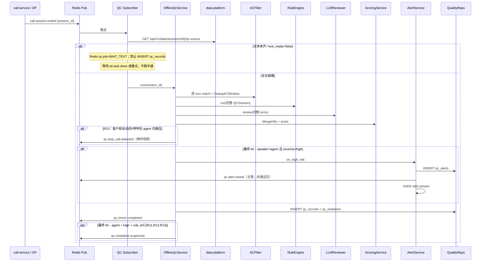
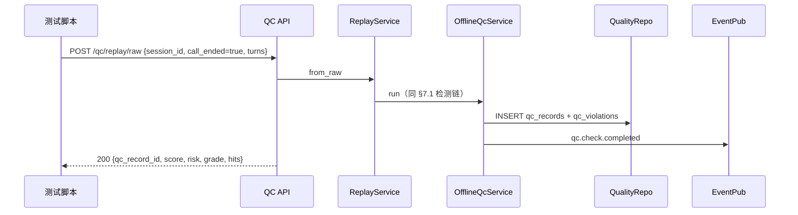
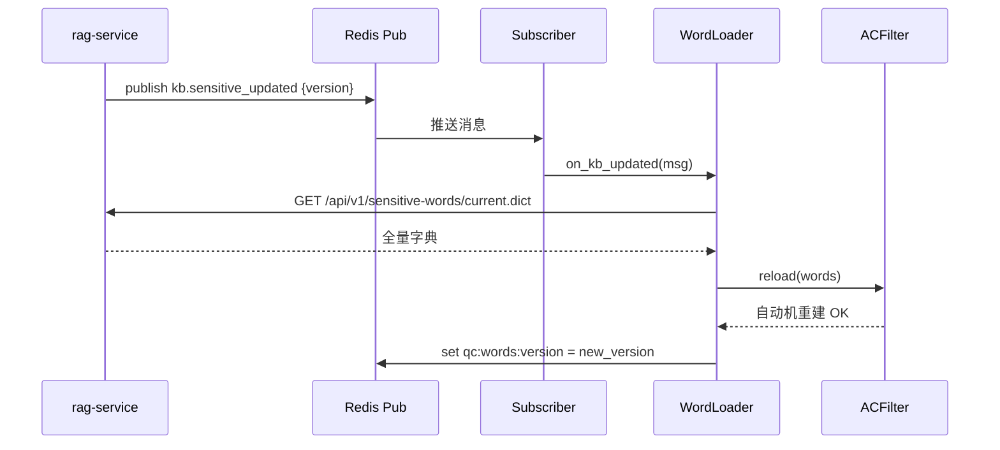
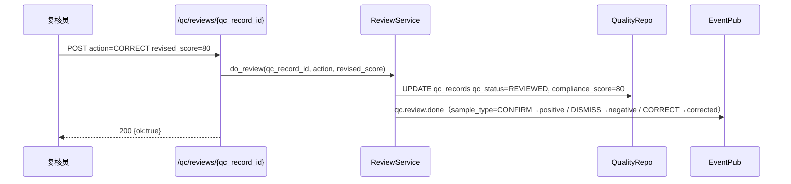

# 子系统详细设计 #02：AI 录音质检系统（离线全量）

> 子系统编号：第 2 号
> 服务名：`qc-service`
> 监听端口：**8003**
> 里程碑归属：**M1（最小闭环，data-platform + rag-service + qc-service 三者即可跑通质检全链路）**
> 上游约束：step1/01~04 全局口径（含覆盖矩阵）、step3/01~03 架构与降级、step4/01~03 数据设计、step5/01~04 技术规范、step6/01~02 异常容错告警、step7/01~03 测试规范、step8/01 M0 任务清单
> 宪法约束：openspec/specs/00~07
> 状态：**V1.11** 离线全量质检；DP qc-source 字段映射已冻结；R14 关键词种子、skipped_rules 落库、R04 话术判定已写死。M2+ RAG/护栏日志为非目标附录。step8 M1 清单仍为覆盖矩阵 G3 缺口。
> 2026-09-09 复审补充（不改变 V1.5 功能口径）：§3.1 状态术语约定、§5.2 规则引擎输入（QCSession）、§5.4 qc_result 映射与 grade/risk 口径澄清，见正文。

---

## 0.1 文档修订记录

| 版本 | 日期 | 修订人 | 修订内容 |
| :--- | :--- | :--- | :--- |
| V1.0 | 2026-08-18 | - | 初始版本，12 章模板 |
| V1.1 | 2026-08-19 | 规范优化 | 新增 AI 不修改案件状态约束；新增 Ch13~16 四个 AI 专项章节（LLM 专项/分层降级/数据闭环/可观测+金融合规脱敏）；更新子系统调用关系（RAG 被动/DP 被动/qc→dp 回流）；对齐 step3~step8 全部规范；新增 PII 脱敏列 |
| V1.2 | 2026-09-09 | Ellis Guo | 规范对齐修订（关闭 P0×3 + P1×4 + P2×2 偏离）：①§6.1 数据模型反向修订 step4/01 DDL（补 3 张表 + Alembic 0011 迁移）；②§10 错误码 A2007-A2011 标注待评审并入 step6/01 全集 + A2003 语义厘清；③§9.1 LLM 重试 2×→3× 对齐 step5/03；④§9.2 complaint→qc 改 MCP call_qc 工具对齐 step3/01 原则6；⑤§4.1 WS URL 补 trace_id + connected 确认帧对齐 step5/02 §5；⑥§13 LLM 置信度门控豁免待登记 step5/03 §3.3；⑦§6.2+§9.3 qc:llm_degraded + qc.llm.degraded 待同步登记 step4/03；⑧§5.4 grade/status 枚举待注册 step5/03 §3.4 |
| V1.3 | 2026-09-09 | Ellis Guo | 复审微修：MCP 改为多方法；RAG/DP 重试 3×；call_id→session_id。修订记录曾误写 `query_records/query_violations/query_alerts`，以 §9.2 canonical 三方法为准（V1.4 已改正文）。 |
| V1.4 | 2026-09-09 | Ellis Guo | 交叉审阅收口：①§15.6 红线 2/3/4/5/6/7 可执行化（R12–R15、`redline_tag`、user 停呼事件）；②威胁类一次升级，≥2 仅 abuse/induce；③新增 `POST /qc/check` ingest，WS 仅告警下行，LLM 异步以保 3s SLA；④词库统一 `/api/v1/sensitive-words/current.dict`；⑤主表冻结 `qc_records`（对齐 step4/01），明细 `qc_violations/qc_alerts/qc_reviews`；⑥删除 DP 主动 POST replay；熔断告警改 `system.alert.raised`；⑦MCP 入参 `(case_id, session_id)`，ASR/会话元数据由 MCP Server 调 call-service，qc 只提供违规查询 |
| V1.5 | 2026-09-09 | Ellis Guo | **去掉全部实时质检**：①无 `POST /qc/check` 每轮 ingest、无 WS 告警下行、无 3s 事中 SLA；②开工条件=通话结束 **且** 双向全文已落库（`call.session.ended` 等待文本 / `etl.task.done` / 手动 replay）；③告警仅事后给主管，不弹通话页；④qc **不再发布** `qc.escalate.human`（事中转人工归 call-service）；⑤客户提及投诉/自杀/停呼/情绪激动 **不记坐席违规**，只核坐席是否停止施压并转为安抚（R13） |
| V1.6 | 2026-09-09 | Ellis Guo | §4 全接口补请求/响应 Schema（含 `/health`）；主键对外统一 `qc_record_id`（= `qc_records.id`），废除旧复核路径参数名；复核路径改为 `POST /qc/reviews/{qc_record_id}`。**不**冻结 QCSession 扩展元数据、**不**改事件 payload、**不**重画 HTTP 映射（留给后续步骤） |
| V1.7 | 2026-09-09 | Ellis Guo | 冻结 QCSession（三条入口共用）；钉死 DP GET `/api/v1/data/sessions/{session_id}/qc-source` 与 `sessions:pending-qc`；replay/raw Body 升级为 QCSession（最小字段仍合法，缺元数据规则 skip）；`call_records` FK 保留：raw 无主数据 → A2003；WAIT_TEXT 只写 Redis、不插 `qc_records`。**不**写三层去重、**不**改事件 payload、**不**改 R10/R14 M1 范围 |
| V1.8 | 2026-09-09 | Ellis Guo | §5.4.1 三层 MergeHits（去重键写死）+ AC 30s 窗口三级退化；告警仅 agent+high+合并后 hit；`qc.complaint.suspected` 改为 rule_id∈{R11,R12,R13}（R05 仍可 tag=threat 并扣低危分，但不发 suspected）。**不**扩 redline_tag 枚举、**不**改事件 payload 字段、**不**改 HTTP、**不**改 R10/R14 M1 范围 |
| V1.9 | 2026-09-09 | Ellis Guo | 事件 payload 与 step4/03 逐字段对齐：`qc.check.completed` 补 `call_id`；`qc.complaint.suspected` 追加 `qc_record_id`（投诉幂等）；`qc.review.done.sample_type`∈{positive,negative,corrected}；`call_id` 无则 JSON null。A2 HTTP 按 step6/01 逐条（删「业务 A 码一律 200」）。**不**改 R10/R14 M1 范围、**不**改 MergeHits |
| V1.10 | 2026-09-09 | Ellis Guo | R01–R15 增加 M1 范围与 skip 条件。R14 降级为规则包关键词/`standard_answer_hit` 包含比对，**不**调 rag-service 检索。R10 仅「应转证据 + result≠escalated」；无 result 则 skip，**禁止**缺护栏日志标 unverified。详情 GET 增 `skipped_rules[]`。skip ≠ 合规、≠ PARTIAL。**不**改事件/HTTP、**不**改 step4 DDL 枚举 |
| V1.11 | 2026-09-09 | Ellis Guo | 收口 7 项：① DP qc-source 字段映射（result/dial_history_24h/case_snapshot）；② R14 关键词种子写入 qc_rules.rules；③ skipped_rules=Redis qc:job + audit_logs（不加列）；④ R04 身份未核实话术判定；⑤⑥ M2+ RAG 检索与红线 6 护栏日志写入 §16 非目标；不改事件 payload |

---

## 1. 模块概览

AI 录音质检系统是整套生态的**事后合规审计与打分守门员**。通话进行中 qc **不介入**；电话没打完、全文不齐，无法判断本通是否违规。

1. **离线全量质检**（FR-QC-001）：工作人员与客户通话结束后，且双向 ASR/对话全文已落库，qc 才开工。数据来自 DP `qc-source`（JOIN `call_records`+`dialog_turns`）或 replay/raw QCSession，不旁路监听通话、不吃实时 turn 流。
2. **MVP 独立可测**（通话回放模拟器）：`POST /qc/replay/{session_id}` 走 DP `qc-source`，或 `POST /qc/replay/raw` 喂 QCSession；种子须先有 `call_records`+`dialog_turns`；无需启动 call-service。
3. **三层违规检测**：复用 `common/guardrails` + AC 敏感词（threat/abuse/induce，**仅坐席侧扣分**）+ 业务规则引擎（R01–R15）+ LLM 语义复核（整通文本齐了再跑，无 3s 事中约束）。
4. **100 分制打分**（FR-QC-003）：起始 100 分，高危 −20 / 中危 −8 / 低危 −2；AC 同词窗口见 §5.4.1；存在 **agent 侧**高危 → risk=high。
5. **风险等级分档**：≥90 优秀 / 80–89 合格 / 60–79 警告 / <60 严重不合格。
6. **事后高危告警**（FR-QC-002）：质检完成后，**仅**合并后 `speaker=agent` 且 `severity=high` 才写 `qc_alerts` + `qc.alert.raised` + `XADD alert:stream`（主管列表/订阅，**不**推送到通话工作台）。user 行与 R05（low）不告警。
7. **人工复核 P1**（FR-QC-005）：PENDING_REVIEW 列表 + 复核员确认/驳回/修正，人工结论写回。
8. **客户侧信号（投诉 / 自杀 / 停呼 / 情绪激动）**：这些话是客户说的，**不记工作人员违规、不扣分**。qc 与之唯一关系：此后坐席须**停止催收施压、转为安抚**；若仍催收/施压 → R13。事中安抚与危机处置由 call-service 负责，不在本文展开。

> **AI 边界约束（全局）**：qc-service 只做检测、打分、标签、事后告警、研判结论。不直接修改案件状态、不直接转人工、不在通话中拦截话术。案件状态变更由 case-service 执行；事中转人工 / 情绪与危机提示由 call-service 执行。质检结果通过 Pub-Sub 回流 data-platform。qc **不发布** `qc.escalate.human`。

---

## 2. 职责边界

### 2.1 必做事项

1. **通话结束后开工**（FR-QC-001）：同时满足「通话已结束」+「双向全文已落库」才创建质检任务。M2+ 订阅 `call.session.ended`，文本未齐则等待/重试；M1 无 call-service 时订阅 `etl.task.done` 后 **qc 主动** `GET` DP `qc-source` / `pending-qc`（JOIN `call_records`+`dialog_turns`，**不是**只读 `dw.ods_call_records`）。运营可 `POST /qc/replay/{session_id}`。data-platform **不得** HTTP 回调 qc。
2. **离线违规检测+事后告警**（FR-QC-002）：对整通跑 AC+规则+LLM；high/medium/low 三级；高危写入告警台账，供主管事后处理。
3. **合规打分+评级**（FR-QC-003）：100 分制+风险等级+违规明细+`redline_tag`，qc_rules 表可配置。
4. **违规台账+统计**（FR-QC-004）：`qc_records` 明细 + 按坐席/类型/时间维度查询。
5. **人工复核**（FR-QC-005 P1）：高风险推送复核，支持确认/驳回/修正。
6. **事后审计「该转未转」**（宪法 1.3，M1）：仅当合并后 hits 已构成应转 **且** `QCSession.result` 存在且 `≠ escalated` 时记 R10。无 `result` → skip，不扣分、不告警、**不**标 `unverified` 充数。M1 **不读** call 护栏放行记录。**不**向 call-service 发转人工事件。
7. **质检结果回流 DP**：发布 `qc.check.completed` → DP ETL → dw.dws_call_result。
8. **MVP 独立可测**：回放模拟器 + 独立脚本。
9. **停呼/危机后仍施压**：user 命中停止致电/已投诉/拒绝沟通/自杀或自伤后，agent 仍催收 → R13 +（停呼场景）`qc.stop_call.detected`。user 行不扣分。`qc.stop_call.detected` 供 case-service 写 `cases.stop_call_status`，不是通话中强拆。

### 2.2 明确不做事项

1. **不做实时质检 / 旁路监听 / 每轮 ingest**：没有 `POST /qc/check` 收 turn，不连通话页 WebSocket。没有「实时失败再降级离线」——离线就是正路。
2. **不做 ASR/TTS/呼叫线路 / 不碰录音文件流**：由 call-service 转写并落库；qc 只吃已结束通话的纯文本 turns（经 DP 或 replay）。
3. **不做敏感词库 CRUD / 知识库内容维护**：词库来自 rag-service `GET /api/v1/sensitive-words/current.dict`（text/plain 全量字典）。**RAG 只提供被动检索，不主动向外调用**。质检启动时 + 每小时 + 订阅 `kb.sensitive_updated` 全量拉取重建 AC（不使用 `since_v` 增量接口）。
4. **不做用户/RBAC/审计日志表结构**：由 common/security 统一处理。
5. **不做通话工作台弹窗 / 事中提示**：后端发布 `qc.alert.raised` + 提供 GET 查询，给**事后主管**。客户情绪、自杀、投诉意图的**事中提示与安抚话术**归 call-service，不在 qc。
6. **不做报表图表绘制**：输出统计 JSON，宽表构建由 data-platform 负责。**DP 不主动调用上层 AI 服务，数据以消息推送方式下发**。
7. **不做分案策略**：由 case-service 负责。**AI 只输出合规分字段供下游参考，不修改案件状态。**
8. **不直接转人工、不发布 `qc.escalate.human`**：事中转接由 call-service Guardrails / 工作台执行。
9. **不把客户提及投诉 / 自杀 / 停呼 / 情绪激动记为工作人员违规**：这些与坐席「犯没犯规」无关；唯一质检点是坐席是否停止施压并安抚。
10. **不替代 Guardrails 双校验（红线 6）**：前置+后置拦截属于 call-service 生成链路。红线 6 的「事后审计护栏双校验」= **M1 非目标**：不在 qc 实现、不读护栏放行日志、**不用缺记录罚分或标 unverified**。qc 复用 `common/guardrails` **仅**作 AC 词分类检测，不拦截 TTS、不返回兜底话术给客户。
11. **不提供 ASR / 通话会话主数据**：投诉 MCP 的 `query_call_asr` / `query_call_sessions` 由 MCP Server **内部调 call-service**；qc 只实现 `query_qc_violations`（及告警查询）。

---

## 3. 内部模块拆分

```
qc-service (FastAPI app)
├── app/
│   ├── main.py                 # FastAPI 入口 + /health + 启动时拉词库
│   ├── routers/
│   │   ├── check.py            # 离线质检：replay / batch（无实时 ingest、无 WS）
│   │   ├── records.py          # qc_records 明细+统计
│   │   ├── alerts.py           # 高危告警查询/读状态（事后主管）
│   │   ├── review.py           # P1 人工复核
│   │   └── rules.py            # qc_rules 查询/生效版本
│   ├── services/
│   │   ├── offline_qc_service.py  # 文本就绪后整通质检：AC+规则+LLM+打分
│   │   ├── replay_service.py      # MVP：从 DP 或 raw turns 触发离线质检
│   │   ├── ac_filter.py           # 对 common.guardrails / common.security.sensitive_words 的 QC 适配（speaker 分流）
│   │   ├── rule_engine.py         # 业务规则引擎（R01–R15）
│   │   ├── llm_reviewer.py        # LLM 语义复核（整通；5s/3次/熔断/降级）
│   │   ├── scoring_service.py     # 100 分制扣分
│   │   ├── alert_service.py       # 高危：qc_alerts + qc.alert.raised + XADD alert:stream（事后）
│   │   ├── review_service.py      # P1 复核：确认/驳回/修正
│   │   └── word_loader.py         # 启动/每小时/订阅 kb.sensitive_updated
│   ├── repositories/
│   │   ├── quality_repo.py        # qc_records / qc_violations CRUD
│   │   ├── alert_repo.py          # qc_alerts CRUD + 状态 ack
│   │   ├── review_repo.py         # qc_reviews（复核动作）
│   │   └── rule_repo.py           # qc_rules 版本 + 读 active 版本
│   ├── events/
│   │   ├── publisher.py           # qc.alert.raised / qc.check.completed / qc.review.done / qc.stop_call.detected / qc.complaint.suspected / system.alert.raised
│   │   └── subscriber.py          # kb.sensitive_updated + etl.task.done + call.session.ended + strategy.updated
│   └── integrations/
│       ├── rag_client.py          # GET /api/v1/sensitive-words/current.dict
│       ├── dp_client.py           # GET /api/v1/data/sessions/{id}/qc-source（qc 作为 Client）
│       └── guardrails_adapter.py # 仅 AC 词分类（threat/abuse/induce）；M1 禁止读 call 护栏放行日志
```

### 3.1 质检任务状态机

无通话中状态。任务只在通话结束后创建：

```
Redis qc:job:{session_id}
  WAIT_TEXT（通话已结束，全文未齐）  ← 只写 Redis，禁止 INSERT qc_records
  → RUNNING（全文就绪，跑 AC+规则+LLM）
  → 完成后落库 qc_status=DONE / PENDING_REVIEW
  → 任务崩溃/重试耗尽 → 此时才 INSERT/UPDATE qc_records.qc_status=PARTIAL（A2001/A2003）
复核完成 → qc_status=REVIEWED
```

`qc_status=PARTIAL`：**仅**表示已落库后的「文本最终不齐或任务中途失败」，不是「旁路断连」。WAIT_TEXT **不是**数据库状态、**不占** `session_id UNIQUE`。未结束的通话不得创建任务、不得插 `qc_records`。

> **状态术语约定**：`WAIT_TEXT / RUNNING / DONE` 是 **Redis 任务态**（`qc:job:{session_id}`）；数据库列 `qc_status` 只落 `DONE / PENDING_REVIEW / REVIEWED / PARTIAL`，**不落** `WAIT_TEXT / FAILED`。正文「保持 WAIT_TEXT」= Redis 等待，此时 **没有** `qc_records` 行。重试耗尽才落 `PARTIAL`。

---

## 4. 对外接口详细说明

业务接口前缀 `http://qc-service:8003/api/v1`。健康检查 `GET /health` 挂在服务根路径（与 rag-service 一致，不在 `/api/v1` 下）。统一响应包 `{"code":"0","message":str,"data":any|null,"trace_id":str}`（step5/02，不可改）。错误码 A2001–A2011 + B 类（step6/01 已收录，全集 68 条编码位）。

**A2 段 HTTP 以 step6/01 为准**（覆盖 step5/02「业务错误统一 200」对 qc 的默认）。参数非法 **只** A2002、HTTP 422，不再叠 B0001。B0002=401、B0003=403。逐条对照见 §4.0.4 与 §10。

> **V1.5 已删除**：`POST /qc/check`（每轮 ingest）、`GET WS /qc/check/stream`（通话页告警）。质检入口只有离线 replay / batch / 事件触发。

### 4.0 全局约定

#### 4.0.1 ID

| 对外字段 | 类型 | 对应列 | 用途 |
| :--- | :--- | :--- | :--- |
| `qc_record_id` | UUID | `qc_records.id` | **主键**。HTTP/MCP/事件出参一律用此名 |
| `session_id` | VARCHAR(100) | `call_records.session_id` / `qc_records.session_id` | 业务查找键。详情 `GET /qc/records/{session_id}` 按此查 |
| `alert_id` | UUID | `qc_alerts.id` | 告警主键 |
| `case_id` | UUID/str | `qc_records.case_id` | 案件关联 |

- 复核路径：`POST /qc/reviews/{qc_record_id}`。
- MCP `call_qc.query_qc_violations` / `query_qc_alerts` 入参仍为 `(case_id, session_id)`；出参**每条**带 `qc_record_id`。方法名不变。

#### 4.0.2 公共 Header

| Header | 必填 | 适用 | 说明 |
| :--- | :--- | :--- | :--- |
| `X-Trace-Id` | 建议 | 全部 HTTP | 缺则服务端生成并回写响应 `trace_id` |
| `X-Idempotency-Key` | 是 | `POST /qc/replay/raw` | 调用方幂等键；TTL 对齐 `qc:replay:run:{session_id}` |
| `X-QC-Force-Rerun` | 否 | `POST /qc/replay/{session_id}`、`POST /qc/replay/raw` | 仅 `true` **且** 角色=ADMIN 时允许重跑已 `REVIEWED` 记录；否则已 REVIEWED → A2002 |

同一 `session_id` 重复 replay：未 REVIEWED → 软删或覆盖明细后重算；已 REVIEWED 且未带合法 Force-Rerun → A2002。

#### 4.0.3 公共对象（Hit / 跑批结果）

`hits[]` 为 **§5.4.1 MergeHits 之后** 的列表。三条入口的规则引擎输入一律是 **§5.2 QCSession**。

Hit 对象：

```json
{
  "turn_id": "t1",
  "rule_id": "R12",
  "word_id": null,
  "severity": "high",
  "redline_tag": "fake_identity",
  "speaker": "agent",
  "evidence_text": "我是法院的"
}
```

| 字段 | 类型 | 说明 |
| :--- | :--- | :--- |
| turn_id | string | 对应输入 turn |
| rule_id | string \| null | 规则命中为 R01–R15；纯 AC 词命中可空 |
| word_id | UUID \| null | AC 词库 ID；规则命中可空 |
| severity | high \| medium \| low | |
| redline_tag | string \| null | 枚举见 step5/03 §3.4 |
| speaker | agent \| user | |
| evidence_text | string | **已脱敏** |

跑批成功 `data`（replay / replay/raw 同步响应共用，下称 QcRunResult）：

```json
{
  "qc_record_id": "8f1a2b3c-4d5e-6789-abcd-ef0123456789",
  "session_id": "sess_xxx",
  "case_id": "case_xxx",
  "compliance_score": 80,
  "risk": "high",
  "grade": "PASS",
  "qc_result": "pending_review",
  "qc_status": "PENDING_REVIEW",
  "hits": [
    {
      "turn_id": "t1",
      "rule_id": "R12",
      "word_id": null,
      "severity": "high",
      "redline_tag": "fake_identity",
      "speaker": "agent",
      "evidence_text": "我是法院的"
    }
  ]
}
```

LLM 在本任务内跑完再出分（无事中 3s 约束）；超时走 §14 降级，仍须给出规则+AC 分数。

#### 4.0.4 A2 HTTP 对照（权威：step6/01 A2 表）

成功：HTTP 200 + `code="0"`。下表为 **qc-service 业务码**；与 step5/02 §2.2「业务错误统一 200」冲突时，**以本表为准**。

| 错误码 | HTTP | body.code | 说明 |
| :--- | :--- | :--- | :--- |
| A2001 | 200 | A2001 | 任务失败；落 `qc_status=PARTIAL`；未 REVIEWED 可重跑 |
| A2002 | 422 | A2002 | 入参非法；**不叠** B0001 |
| A2003 | 200 | A2003 | 对话不可质检（未结束/未齐/`call_records` 不存在）。**不是** 404（404 留给 A2005） |
| A2004 | 400 | A2004 | 批量 >100 |
| A2005 | 404 | A2005 | 质检记录不存在 |
| A2006 | 409 | A2006 | 告警不存在或已 ACK |
| A2007 | 404 | A2007 | 复核任务不存在 |
| A2008 | 400 | A2008 | 复核分数越界 |
| A2009 | 200 | A2009 | 规则版本非法；回退上一版本 |
| A2010 | 200 | A2010 | 规则切换失败；不切换 |
| A2011 | 200 | A2011 | LLM 熔断；跳过 LLM 仍出 AC+规则分 |
| B0002 | 401 | B0002 | 未认证 |
| B0003 | 403 | B0003 | 无权限 |

各接口「失败 code」均按上表配 HTTP，下文不再另发明状态码。

---

### 4.1 质检核心

| 方法 | 路径 | 职责 | 权限 | 幂等 | 限流 | 错误码 | HTTP | PII 脱敏 |
| :--- | :--- | :--- | :--- | :--- | :--- | :--- | :--- | :--- |
| POST | `/qc/replay/{session_id}` | 从 DP 拉**已结束**对话做离线质检（路径参数名可兼容 call_id） | QC/ADMIN/TRAINER | session_id 去重 | 2/10s | A2001/A2002/A2003/B0003 | 200/422/200/403 | — |
| POST | `/qc/replay/raw` | 直接传**完整** turns 做离线质检（须为已结束通话） | QC/ADMIN/TRAINER | `X-Idempotency-Key` | 10/s | A2001/A2002/A2003/B0003 | 200/422/200/403 | — |
| POST | `/qc/check/batch` | 离线批量质检（≤100 通，均须已结束且文本齐） | TRAINER/ADMIN | batch_id | 1/10s | A2002/A2004/B0003 | 422/400/403 | — |
| GET | `/qc/records/{session_id}` | 单通质检详情 | QC/SUPV/ADMIN | 幂等 | 120/min | A2005/B0003 | 404/403 | evidence_text 脱敏 |
| GET | `/qc/records` | 质检记录列表（分页） | QC/SUPV/ADMIN | 幂等 | 60/min | A2005/B0003 | 404/403 | phone 脱敏 |
| GET | `/qc/records/stats` | 违规统计 | SUPV/ADMIN/TRAINER | 幂等 | 30/min | A2002/A2005/B0003 | 422/404/403 | — |

#### 4.1.1 POST `/qc/replay/{session_id}`

从 DP `GET /api/v1/data/sessions/{session_id}/qc-source` 拉已结束对话，组装 **§5.2 QCSession** 后跑离线质检（与事件触发同一入口）。

| 项 | 值 |
| :--- | :--- |
| 权限 | QC / ADMIN / TRAINER |
| 幂等 | 按 `session_id` 去重（见 §4.0.2） |
| 限流 | 2/10s |
| Header | `X-Trace-Id`；已 REVIEWED 重跑须 `X-QC-Force-Rerun: true` 且角色=ADMIN |

路径参数：

| 名 | 类型 | 必填 | 约束 |
| :--- | :--- | :--- | :--- |
| session_id | string | 是 | 对应 `call_records.session_id`；该行必须已存在（否则 A2003） |

Body：无业务字段，或仅 `{"force": false}`（`force=true` 等价 Header `X-QC-Force-Rerun`，仍须 ADMIN）。**禁止**在 Body 里传 turns / case_snapshot（一律走 DP GET）。

开工校验：`qc-source` 必须 `call_ended=true` 且 `text_ready=true` 且 turns 非空；否则 A2003，**只**写 Redis `qc:job={WAIT_TEXT}`，**禁止** INSERT `qc_records`，不跑半通。

成功 `data` 示例（QcRunResult，同 §4.0.3）：

```json
{
  "qc_record_id": "8f1a2b3c-4d5e-6789-abcd-ef0123456789",
  "session_id": "sess_xxx",
  "case_id": "case_xxx",
  "compliance_score": 80,
  "risk": "high",
  "grade": "PASS",
  "qc_result": "pending_review",
  "qc_status": "PENDING_REVIEW",
  "hits": [
    {
      "turn_id": "t1",
      "rule_id": "R12",
      "word_id": null,
      "severity": "high",
      "redline_tag": "fake_identity",
      "speaker": "agent",
      "evidence_text": "我是法院的"
    }
  ]
}
```

失败：`A2001` HTTP 200（任务崩溃/不可恢复，落 PARTIAL）、`A2002` HTTP 422（已 REVIEWED 未强制重跑 / Body 非法）、`A2003` HTTP 200（未结束、全文未齐、或 `call_records` 不存在；**不是** 404）、`B0003` HTTP 403。A2011：HTTP 200 + code=A2011，data 仍含 AC+规则分。

#### 4.1.2 POST `/qc/replay/raw`

请求体 = **扁平 QCSession**（顶层字段与 §5.2 同一份）。V1.6 最小字段（`session_id, case_id, call_ended, turns[], trace_id`）仍合法；缺可选元数据 → 对应规则 **skip**（不是 A2002）。A2002 **仅**用于：`call_ended≠true` / `turns` 空 / `speaker` 非法 / 缺 `session_id` 或 `case_id`。

`session_id` 在 `call_records` 不存在 → **A2003**，message 含「需先落通话主数据」。qc **禁止** INSERT `call_records` / `dialog_turns`。

| 项 | 值 |
| :--- | :--- |
| 权限 | QC / ADMIN / TRAINER |
| 幂等 | `X-Idempotency-Key` 必填 |
| 限流 | 10/s |
| Header | `X-Trace-Id`；`X-Idempotency-Key`；已 REVIEWED 重跑须 `X-QC-Force-Rerun: true` 且角色=ADMIN |

Body 字段：与 §5.2 QCSession 字段表一致（必填/可选/skip 钩子以该表为准）。`turns[]` 入站 `speaker=ai` 必须转为 `agent`。

请求示例（完整 QCSession；省略可选字段即为 skip）：

```json
{
  "session_id": "sess_xxx",
  "case_id": "case_xxx",
  "call_id": "22222222-3333-4444-5555-666666666666",
  "call_ended": true,
  "agent_type": "ai",
  "started_at": "2026-09-09T10:00:00+08:00",
  "ended_at": "2026-09-09T10:08:00+08:00",
  "duration_seconds": 480,
  "result": "completed",
  "debtor_name": "张三",
  "turns": [
    {"turn_id": "t1", "speaker": "agent", "text": "...", "turn_index": 1, "hit_ts": "2026-09-09T10:00:05+08:00", "start_offset_ms": 5000},
    {"turn_id": "t2", "speaker": "user", "text": "...", "turn_index": 2, "start_offset_ms": 12000}
  ],
  "case_snapshot": {
    "due_amount": 3800.00,
    "overdue_days": 32,
    "ptp_amount": null,
    "strategy_refs": ["stg_defer_v2"],
    "standard_answer_hit": null
  },
  "dial_history_24h": {
    "phone_masked": "138****0000",
    "dial_count_24h": 2,
    "window_start": "2026-09-08T10:00:00+08:00",
    "window_end": "2026-09-09T10:00:00+08:00"
  },
  "trace_id": "trace_xxx"
}
```

成功 `data` 示例（QcRunResult，同 §4.0.3）：

```json
{
  "qc_record_id": "8f1a2b3c-4d5e-6789-abcd-ef0123456789",
  "session_id": "sess_xxx",
  "case_id": "case_xxx",
  "compliance_score": 80,
  "risk": "high",
  "grade": "PASS",
  "qc_result": "pending_review",
  "qc_status": "PENDING_REVIEW",
  "hits": [
    {
      "turn_id": "t1",
      "rule_id": "R12",
      "word_id": null,
      "severity": "high",
      "redline_tag": "fake_identity",
      "speaker": "agent",
      "evidence_text": "我是法院的"
    }
  ]
}
```

失败：`A2001` HTTP 200（任务崩溃/不可恢复，落 PARTIAL）、`A2002` HTTP 422（开工必填非法）、`A2003` HTTP 200（`call_records` 无此 session；**不是** 404）、`B0003` HTTP 403。A2011：HTTP 200 + code=A2011，data 仍含 AC+规则分。

#### 4.1.3 POST `/qc/check/batch`

| 项 | 值 |
| :--- | :--- |
| 权限 | TRAINER / ADMIN |
| 幂等 | 按 `batch_id` |
| 限流 | 1/10s |
| Header | `X-Trace-Id` |

Body：

| 名 | 类型 | 必填 | 约束 |
| :--- | :--- | :--- | :--- |
| batch_id | string | 是 | |
| session_ids | string[] | 是 | 长度 1～100；`>100` 整单 A2004，不跑任何一通 |

部分失败：能跑的进 `accepted`，不能跑的进 `rejected`（带 `session_id` + `code`）。

成功 `data` 示例：

```json
{
  "batch_id": "batch_001",
  "accepted": [
    {
      "qc_record_id": "8f1a2b3c-4d5e-6789-abcd-ef0123456789",
      "session_id": "sess_ok",
      "compliance_score": 92,
      "risk": "low",
      "grade": "EXCELLENT",
      "qc_result": "compliant",
      "qc_status": "DONE"
    }
  ],
  "rejected": [
    {"session_id": "sess_empty", "code": "A2003"}
  ]
}
```

失败：`A2002` HTTP 422（body 非法）、`A2004` HTTP 400（>100 通）、`B0003` HTTP 403。

#### 4.1.4 GET `/qc/records/{session_id}`

按 **session_id** 查单通详情；`data` 必须带 `qc_record_id`。

| 项 | 值 |
| :--- | :--- |
| 权限 | QC / SUPV / ADMIN |
| 幂等 | 是 |
| 限流 | 120/min |
| Header | `X-Trace-Id` |

路径参数：`session_id` string 必填。无 Query。

成功 `data` 示例：

```json
{
  "qc_record_id": "8f1a2b3c-4d5e-6789-abcd-ef0123456789",
  "session_id": "sess_xxx",
  "case_id": "case_xxx",
  "agent_id": "11111111-2222-3333-4444-555555555555",
  "compliance_score": 80,
  "risk": "high",
  "grade": "PASS",
  "qc_result": "pending_review",
  "qc_status": "PENDING_REVIEW",
  "high_count": 1,
  "med_count": 0,
  "low_count": 0,
  "hits": [
    {
      "turn_id": "t1",
      "rule_id": "R12",
      "word_id": null,
      "severity": "high",
      "redline_tag": "fake_identity",
      "speaker": "agent",
      "evidence_text": "我是法院的"
    }
  ],
  "skipped_rules": ["R14"]
}
```

`skipped_rules`：本通因缺可选元数据而未执行的 `rule_id` 列表（可空数组）。**仅**本详情接口返回；**不**写入 `qc.check.completed` payload，replay/batch 成功 `data` **不**新增必填字段。skip ≠ 未违规，见 §5.4。

读取顺序（§6.2）：① Redis `qc:job:{session_id}` JSON 的 `skipped_rules`；② 未命中则 `audit_logs`（`action=qc.skip.recorded` 且 `resource_id=qc_record_id`）取最新一条 `detail.skipped_rules`；③ 再没有则 `[]`（V1.11 之前的历史行）。任务完成时 **必须** 同时写 Redis 与 audit_logs（即使数组为空）。

失败：`A2005` HTTP 404（记录不存在）、`B0003` HTTP 403。

#### 4.1.5 GET `/qc/records`

| 项 | 值 |
| :--- | :--- |
| 权限 | QC / SUPV / ADMIN |
| 幂等 | 是 |
| 限流 | 60/min |
| Header | `X-Trace-Id` |

Query：

| 名 | 类型 | 必填 | 约束 |
| :--- | :--- | :--- | :--- |
| page | int | 否 | 从 1，默认 1 |
| page_size | int | 否 | 默认 20，最大 100 |
| agent_id | UUID | 否 | |
| risk | string | 否 | low \| medium \| high |
| grade | string | 否 | EXCELLENT \| PASS \| WARNING \| SERIOUS |
| qc_status | string | 否 | DONE \| PENDING_REVIEW \| REVIEWED \| PARTIAL |
| qc_result | string | 否 | compliant \| violation \| pending_review |
| case_id | string | 否 | |
| session_id | string | 否 | |
| create_time_from | datetime | 否 | ISO-8601 |
| create_time_to | datetime | 否 | ISO-8601 |

成功 `data` 示例：

```json
{
  "items": [
    {
      "qc_record_id": "8f1a2b3c-4d5e-6789-abcd-ef0123456789",
      "session_id": "sess_xxx",
      "case_id": "case_xxx",
      "agent_id": "11111111-2222-3333-4444-555555555555",
      "compliance_score": 80,
      "risk": "high",
      "grade": "PASS",
      "qc_result": "pending_review",
      "qc_status": "PENDING_REVIEW",
      "create_time": "2026-09-09T10:00:00+08:00"
    }
  ],
  "total": 1,
  "page": 1,
  "page_size": 20
}
```

列表项 phone 脱敏（若返回坐席/客户号码相关展示字段）。失败：`A2005` HTTP 404、`B0003` HTTP 403。

#### 4.1.6 GET `/qc/records/stats`

| 项 | 值 |
| :--- | :--- |
| 权限 | SUPV / ADMIN / TRAINER |
| 幂等 | 是 |
| 限流 | 30/min |
| Header | `X-Trace-Id` |

Query：

| 名 | 类型 | 必填 | 约束 |
| :--- | :--- | :--- | :--- |
| from | datetime | 否 | 统计窗口起，ISO-8601 |
| to | datetime | 否 | 统计窗口止 |
| group_by | string | 是 | `agent` \| `rule_id` \| `day` |

成功 `data` 示例（`group_by=rule_id`）：

```json
{
  "from": "2026-09-01T00:00:00+08:00",
  "to": "2026-09-09T23:59:59+08:00",
  "group_by": "rule_id",
  "items": [
    {"key": "R12", "count": 12, "high_count": 12},
    {"key": "R13", "count": 5, "high_count": 5}
  ]
}
```

失败：`A2002` HTTP 422（`group_by` 非法）、`A2005` HTTP 404、`B0003` HTTP 403。

---

### 4.2 告警（事后主管）

| 方法 | 路径 | 职责 | 权限 | 错误码 | HTTP | PII 脱敏 |
| :--- | :--- | :--- | :--- | :--- | :--- | :--- |
| GET | `/qc/alerts` | 高危告警列表（NEW/ACKED） | SUPV/ADMIN | A2006/B0003 | 409/403 | evidence 脱敏 |
| POST | `/qc/alerts/{alert_id}/ack` | 告警确认 | SUPV/ADMIN | A2006/B0002/B0003 | 409/401/403 | — |

告警通过 HTTP 列表 + `qc.alert.raised` + `alert:stream` 触达主管工作台/运营，**禁止**作为通话页实时弹窗数据源。

#### 4.2.1 GET `/qc/alerts`

| 项 | 值 |
| :--- | :--- |
| 权限 | SUPV / ADMIN |
| 幂等 | 是 |
| 限流 | 60/min（表未列则按此补） |
| Header | `X-Trace-Id` |

Query：

| 名 | 类型 | 必填 | 约束 |
| :--- | :--- | :--- | :--- |
| page | int | 否 | 从 1，默认 1 |
| page_size | int | 否 | 默认 20，最大 100 |
| status | string | 否 | NEW \| ACKED |
| session_id | string | 否 | |

成功 `data` 示例：

```json
{
  "items": [
    {
      "alert_id": "aaaaaaaa-bbbb-cccc-dddd-eeeeeeeeeeee",
      "qc_record_id": "8f1a2b3c-4d5e-6789-abcd-ef0123456789",
      "session_id": "sess_xxx",
      "level": "high",
      "status": "NEW",
      "evidence": "***（脱敏）",
      "create_time": "2026-09-09T10:01:00+08:00"
    }
  ],
  "total": 1,
  "page": 1,
  "page_size": 20
}
```

失败：`A2006` HTTP 409、`B0003` HTTP 403。

#### 4.2.2 POST `/qc/alerts/{alert_id}/ack`

| 项 | 值 |
| :--- | :--- |
| 权限 | SUPV / ADMIN |
| 幂等 | 已 ACKED 再 ack → A2006 |
| 限流 | 30/min |
| Header | `X-Trace-Id` |

路径参数：`alert_id` UUID 必填。Body：无（可空 `{}`）。

成功 `data` 示例：

```json
{
  "alert_id": "aaaaaaaa-bbbb-cccc-dddd-eeeeeeeeeeee",
  "status": "ACKED",
  "acked_by": "11111111-2222-3333-4444-555555555555",
  "acked_at": "2026-09-09T11:00:00+08:00"
}
```

失败：`A2006` HTTP 409（不存在或已确认）、`B0002` HTTP 401（未认证）、`B0003` HTTP 403。

---

### 4.3 人工复核（P1）

| 方法 | 路径 | 职责 | 权限 | 错误码 | HTTP | PII 脱敏 |
| :--- | :--- | :--- | :--- | :--- | :--- | :--- |
| GET | `/qc/reviews/pending` | 待复核列表 | QC/SUPV | A2007/B0003 | 404/403 | — |
| POST | `/qc/reviews/{qc_record_id}` | 复核（CONFIRM/DISMISS/CORRECT） | QC/SUPV | A2007/A2008/B0003 | 404/400/403 | — |

#### 4.3.1 GET `/qc/reviews/pending`

| 项 | 值 |
| :--- | :--- |
| 权限 | QC / SUPV |
| 幂等 | 是 |
| 限流 | 60/min |
| Header | `X-Trace-Id` |

Query：`page`（默认 1）、`page_size`（默认 20，最大 100）。必须分页，禁止全表。

成功 `data` 示例：

```json
{
  "items": [
    {
      "qc_record_id": "8f1a2b3c-4d5e-6789-abcd-ef0123456789",
      "session_id": "sess_xxx",
      "case_id": "case_xxx",
      "compliance_score": 80,
      "risk": "high",
      "grade": "PASS",
      "qc_result": "pending_review",
      "qc_status": "PENDING_REVIEW"
    }
  ],
  "total": 1,
  "page": 1,
  "page_size": 20
}
```

失败：`A2007` HTTP 404、`B0003` HTTP 403。

#### 4.3.2 POST `/qc/reviews/{qc_record_id}`

| 项 | 值 |
| :--- | :--- |
| 权限 | QC / SUPV |
| 幂等 | 同一记录重复复核：第二次 A2007（任务不存在或已 REVIEWED） |
| 限流 | 30/min |
| Header | `X-Trace-Id` |

路径参数：`qc_record_id` UUID 必填（=`qc_records.id`）。

Body：

| 名 | 类型 | 必填 | 约束 |
| :--- | :--- | :--- | :--- |
| action | string | 是 | CONFIRM \| DISMISS \| CORRECT |
| revised_score | int | CORRECT 时必填 | 0～100；其它 action 禁止传或忽略 |
| reason | string | 否 | |

`action=CORRECT` 且缺 `revised_score` 或不在 0–100 → A2008。

发布 `qc.review.done` 时 `sample_type` 由 action 映射（写死）：`CONFIRM`→`positive`，`DISMISS`→`negative`，`CORRECT`→`corrected`。禁止其它取值。

成功 `data` 示例：

```json
{
  "qc_record_id": "8f1a2b3c-4d5e-6789-abcd-ef0123456789",
  "action": "CORRECT",
  "qc_status": "REVIEWED",
  "compliance_score": 80,
  "qc_result": "violation"
}
```

失败：`A2007` HTTP 404、`A2008` HTTP 400、`B0003` HTTP 403。

---

### 4.4 规则版本

| 方法 | 路径 | 职责 | 权限 | 错误码 | HTTP |
| :--- | :--- | :--- | :--- | :--- | :--- |
| GET | `/qc/rules/active` | 当前生效规则版本 | ADMIN/TRAINER | A2009/B0003 | 200/403 |
| POST | `/qc/rules/apply` | 新版本生效（原子切换） | ADMIN | A2009/A2010/B0003 | 200/200/403 |

#### 4.4.1 GET `/qc/rules/active`

| 项 | 值 |
| :--- | :--- |
| 权限 | ADMIN / TRAINER |
| 幂等 | 是 |
| 限流 | 30/min |
| Header | `X-Trace-Id` |

无路径参数、无 Body。

成功 `data` 示例：

```json
{
  "version": "v1.0",
  "status": "active",
  "penalty": {"high": 20, "medium": 8, "low": 2},
  "same_word_window_ms": 30000,
  "grade_thresholds": {"EXCELLENT": 90, "PASS": 80, "WARNING": 60, "SERIOUS": 0},
  "effective_at": "2026-09-01T00:00:00+08:00"
}
```

失败：`A2009` HTTP 200（无合法 active 版本，回退上一版）、`B0003` HTTP 403。

#### 4.4.2 POST `/qc/rules/apply`

| 项 | 值 |
| :--- | :--- |
| 权限 | ADMIN |
| 幂等 | 同一 version 重复 apply 保持该版 active |
| 限流 | 1/10s |
| Header | `X-Trace-Id` |

Body：

| 名 | 类型 | 必填 | 约束 |
| :--- | :--- | :--- | :--- |
| version | string | 是 | 对应 `qc_rules.version`，目标行须存在且可切换 |

成功 `data` 示例：

```json
{
  "version": "v1.1",
  "status": "active",
  "previous_version": "v1.0"
}
```

失败：`A2009` HTTP 200（版本非法/阈值缺失，回退上一版本）、`A2010` HTTP 200（事务失败，不切换）、`B0003` HTTP 403。

---

### 4.5 GET `/health`

服务根路径：`http://qc-service:8003/health`（**不**挂 `/api/v1`）。无鉴权。限流：不限。Header：`X-Trace-Id` 建议。幂等：是。

成功 `data` 示例（字段对齐宪法 §11：`ac_version` / `llm_degraded` / `rag_connected`）：

```json
{
  "status": "ok",
  "ac_version": "3",
  "llm_degraded": false,
  "rag_connected": true
}
```

依赖全挂时仍返回统一包，`data.status` 可为 `degraded`（由实现定义）；本接口不用 A200x 业务码。失败仅系统级 `B0007` 等（进程不可用则探活失败，无 JSON）。

### 4.6 DP 查询契约（qc 作为 Client，非本服务路由）

data-platform 尚无独立 DD。以下两条由 **qc 消费**，路径落在 `/api/v1/data/*`（step5/02）。qc 是 HTTP Client；**禁止** DP 回调 qc。Schema 与 §5.2 QCSession 同构。超时/重试/熔断见 §9.1。

#### 4.6.1 GET `/api/v1/data/sessions/{session_id}/qc-source`

`GET http://data-platform:8001/api/v1/data/sessions/{session_id}/qc-source`

路径参数：`session_id` 必填。Header：`X-Trace-Id`。

**turns 来源**：DP **JOIN** `public.call_records` + `public.dialog_turns`，必要时再补案件快照、24h 拨打预聚合。**不是**只读 `dw.ods_call_records`（该表无 turns）。`dialog_turns.speaker`：`ai`→`agent`；人工坐席话术同样映射为 `agent`；`user` 保持 `user`。

成功 `data` = QCSession + 两个开工标志：

```json
{
  "text_ready": true,
  "call_status": "completed",
  "session_id": "sess_xxx",
  "case_id": "case_xxx",
  "call_id": "22222222-3333-4444-5555-666666666666",
  "call_ended": true,
  "agent_type": "ai",
  "started_at": "2026-09-09T10:00:00+08:00",
  "ended_at": "2026-09-09T10:08:00+08:00",
  "duration_seconds": 480,
  "result": "completed",
  "debtor_name": "张三",
  "turns": [
    {"turn_id": "t1", "speaker": "agent", "text": "...", "turn_index": 1, "start_offset_ms": 5000}
  ],
  "case_snapshot": {
    "due_amount": 3800.00,
    "overdue_days": 32,
    "ptp_amount": null,
    "strategy_refs": [],
    "standard_answer_hit": null
  },
  "dial_history_24h": {
    "phone_masked": "138****0000",
    "dial_count_24h": 2,
    "window_start": "2026-09-08T10:00:00+08:00",
    "window_end": "2026-09-09T10:00:00+08:00"
  }
}
```

`call_status` 必须为 `completed` 才允许开工。`text_ready=false` 或 `turns` 空或 `call_ended≠true` → qc **不跑检测**，返回调用方 A2003，Redis `WAIT_TEXT`，**禁止 INSERT 假 DONE / 禁止 INSERT qc_records**。

**M1 字段映射（DP 必须按下列 SQL 源组装；缺源则该键 JSON `null` 或省略对象，qc 按 §5.2.2 skip，禁止 qc 反查 cases）**：

| QCSession 字段 | DP 取值来源（step4/01） | M1 下发规则 |
| :--- | :--- | :--- |
| `result` | `call_records.result` | **必须出键**。DB NULL → JSON `null`（R10 skip）。枚举与表 CHECK 一致 |
| `agent_type` | `call_records.call_type`（`ai`/`human`） | 必须出键 |
| `started_at` / `ended_at` | `start_time` / `end_time` | 有则 ISO-8601 |
| `duration_seconds` | `duration_seconds` | 有则整数 |
| `debtor_name` | `cases.customer_name`（via `call_records.case_id`） | 有则明文姓+名；无案件行 → 省略/null（R01 skip） |
| `call_id` | `call_records.id` | UUID 字符串；无则 null |
| `case_snapshot.due_amount` | `cases.overdue_amount` | 有案件则下发 number |
| `case_snapshot.overdue_days` | `cases.overdue_days` | 有案件则下发 int |
| `case_snapshot.ptp_amount` | **无表列** | M1 **恒为 JSON `null`**（R08 skip）。禁止从 `summary` 正则抠金额 |
| `case_snapshot.strategy_refs` | **无表列** | M1 **恒为 `[]`**（键存在；R03 按「未引用策略」可命中，不 skip） |
| `case_snapshot.standard_answer_hit` | **无表列、M1 不检索 RAG** | M1 **恒为 JSON `null`**。R14 靠规则包关键词（§5.2.3） |
| `dial_history_24h.dial_count_24h` | 预聚合：同一 `cases.phone_hash`、窗口 `[ended_at-24h, ended_at)` 内 `call_records` 且 `call_status∈{connected,completed}` 的行数（含本通） | **必须尝试下发对象**。无 `phone_hash` 或聚合失败 → **省略整个 `dial_history_24h`**（R05 skip）。**禁止** qc 用本通 turns 猜次数 |
| `dial_history_24h.phone_masked` | `cases.phone_encrypted` 解密后 mask（仅后 4 可见形态，如 `138****0000`） | 随对象下发；失败则省略整个对象 |
| `dial_history_24h.window_start` / `window_end` | 窗口起止 | 随对象下发 |

> JOIN 范围：`call_records` ⋈ `dialog_turns` 为开工必做；`cases` 为元数据。**不是** ODS。M1 种子至少要有 `call_records.result` 列可空、`cases` 行以便 R01/R15。

#### 4.6.2 GET `/api/v1/data/sessions:pending-qc`

`GET http://data-platform:8001/api/v1/data/sessions:pending-qc?etl_date=2026-09-09&limit=100`

供订阅 `etl.task.done` 后拉当日待质检会话。

| Query | 类型 | 必填 | 约束 |
| :--- | :--- | :--- | :--- |
| etl_date | date | 否 | 默认当天（Asia/Shanghai） |
| limit | int | 否 | 默认 100，最大 500 |

返回：**已结束、文本齐、尚未质检**（无 `qc_records` 或 `qc_status=PARTIAL` 且未 REVIEWED 可重跑）的 session 列表。

成功 `data` 示例：

```json
{
  "etl_date": "2026-09-09",
  "session_ids": ["sess_001", "sess_002"]
}
```

qc 对每个 `session_id` 再调 §4.6.1 取 QCSession。

---


## 5. 内部类与方法清单

### 5.1 ACFilter（敏感词 Aho-Corasick）

```python
class ACFilter:
    async def reload(self, words: list[SensitiveWord]) -> None
    def match(self, text: str, speaker: Literal["agent","user"]) -> list[WordHit]
    # 实现：适配 common.security.sensitive_words + common.guardrails（禁止平行再写一套自动机）
    # 三分类 severity: high(threat) / medium(abuse) / low(induce) —— 仅 speaker=agent 计入扣分
    # agent：命中计入扣分；threat/fake_identity 等作为事后审计输入（R10）
    # user：投诉/自杀/停呼/情绪激动 只作为 R13 的前置条件，写入上下文，不扣分、不记坐席违规
```

### 5.2 RuleEngine（业务规则 R01–R15）

```python
class RuleEngine:
    def run(self, session: QCSession) -> list[RuleHit]
    # session 必须为已结束通话的完整 QCSession；禁止对进行中会话 run
    # R01–R09、R11–R15 在此执行（含 skip）；R10 在 MergeHits 之后见 §5.2.3
    # M1 禁止为 R14 调用 rag-service 检索；禁止为 R10 读取 call 护栏日志
```

#### 5.2.1 QCSession（三条入口共用，本文件唯一字段表）

`RuleEngine.run` / `OfflineQcService.run` 的输入必须是 **已结束通话的 QCSession**。三条入口填同一对象，qc **不自建**这些数据源，只消费 DP 下发或 raw 调用方传入：

1. `call.session.ended` / `etl.task.done` → `GET .../qc-source` → QCSession
2. `POST /qc/replay/{session_id}` → 无 turns Body → 内部同样 `GET .../qc-source` → QCSession
3. `POST /qc/replay/raw` → Body 即扁平 QCSession

**speaker 映射**（入站必须转成 QC 内部枚举）：`dialog_turns.speaker=ai` → `agent`；人工坐席话术 → `agent`；`user` → `user`。

| 字段 | 类型 | 必填 | 用途 | 缺了怎么办 |
| :--- | :--- | :--- | :--- | :--- |
| session_id | str | 是 | 一通一检 | 缺 → A2002 |
| case_id | UUID/str | 是 | 回流/投诉 | 缺 → A2002 |
| call_id | UUID/str | 否 | 对齐 `call_records.id`；事件 `call_id` 原样填 UUID 字符串 | 空 → 事件填 JSON `null`，**禁止**用 `session_id` 冒充 |
| call_ended | bool | 是 | 开工 | 不为 true → A2002 |
| agent_type | `ai` \| `human` | 否 | R07 仅 ai | 缺 → R07 skip |
| started_at | datetime | 否 | R02（与 ended_at 成对更佳） | 与 ended_at **皆缺** → R02 skip |
| ended_at | datetime | 否 | R02 | 与 started_at **皆缺** → R02 skip；有任一则用该时刻 |
| duration_seconds | int | 否 | R09；亦接受 `duration_ms`（÷1000） | 两者皆缺 → R09 skip |
| result | `ptp` \| `refused` \| `no_answer` \| `lost` \| `escalated` \| `completed` | 否 | R10 | **缺 → skip R10**（不扣分、不告警、不标 unverified） |
| turns | array | 是，且非空 | 全文 | 空或不齐 → A2003，不跑半通 |
| case_snapshot | object | 否 | R03/R08/R14/R15 | 缺对应子字段 → 对应规则 skip |
| dial_history_24h | object | 否 | R05 跨通话，禁止用单通 turns 猜次数 | 缺 → R05 skip |
| debtor_name | str | 否 | R01 排除债务人本人 | **缺 → R01 skip**（不打弱规则） |
| trace_id | str | 否 | 透传 | 用 Header / 服务端生成 |

`turns[]` 每项：

| 字段 | 类型 | 必填 | 说明 |
| :--- | :--- | :--- | :--- |
| turn_id | str | 是 | |
| speaker | `agent` \| `user` | 是 | 入站 `ai` 必须转换 |
| text | str | 是 | |
| turn_index | int | 是 | 从 1 |
| hit_ts | datetime | 否 | 与 `start_offset_ms` 至少一个推荐，均非必填；30s 窗口算法第 3 步 |
| start_offset_ms | int | 否 | 同上 |

`case_snapshot` 子字段（均可选）：`due_amount`、`overdue_days`、`ptp_amount`、`strategy_refs[]`、`standard_answer_hit`。缺哪个子字段则 **只 skip 依赖它的规则**（R03/R08/R14/R15），见 §5.2.2。
`dial_history_24h` 子字段：`phone_masked`、`dial_count_24h`、`window_start`、`window_end`。缺 `dial_count_24h` 即 R05 skip。**禁止**用单通 `turns` 猜拨打次数。

JSON 示例（与 §4.1.2 / §4.6.1 同构；DP 响应另加 `text_ready` / `call_status`）：

```json
{
  "session_id": "sess_xxx",
  "case_id": "case_xxx",
  "call_id": "22222222-3333-4444-5555-666666666666",
  "call_ended": true,
  "agent_type": "ai",
  "started_at": "2026-09-09T10:00:00+08:00",
  "ended_at": "2026-09-09T10:08:00+08:00",
  "duration_seconds": 480,
  "result": "completed",
  "debtor_name": "张三",
  "turns": [
    {"turn_id": "t1", "speaker": "agent", "text": "...", "turn_index": 1, "hit_ts": "2026-09-09T10:00:05+08:00", "start_offset_ms": 5000},
    {"turn_id": "t2", "speaker": "user", "text": "...", "turn_index": 2, "start_offset_ms": 12000}
  ],
  "case_snapshot": {
    "due_amount": 3800.00,
    "overdue_days": 32,
    "ptp_amount": null,
    "strategy_refs": ["stg_defer_v2"],
    "standard_answer_hit": null
  },
  "dial_history_24h": {
    "phone_masked": "138****0000",
    "dial_count_24h": 2,
    "window_start": "2026-09-08T10:00:00+08:00",
    "window_end": "2026-09-09T10:00:00+08:00"
  }
}
```

#### 5.2.2 规则清单（含 M1 范围与 skip）

M1 范围三值写死：`M1-必做` / `M1-降级` / `M1-skip`。本表无 `M1-skip` 行（R01–R15 均在 M1 编码；做不到的降级或按条件 skip 单条，不整条从引擎删除）。

| rule_id | 说明 | severity | redline_tag | M1 范围 | skip 条件（命中则本条不执行、不产生 hit） |
| :--- | :--- | :--- | :--- | :--- | :--- |
| R01 | 联系第三方（非债务人姓名+关系词） | high | privacy_leak | M1-必做 | 无 `debtor_name` |
| R02 | 外呼时段违规（<08:00 或 ≥21:00） | medium | — | M1-必做 | `started_at` 与 `ended_at` **均缺**（有任一则用该时刻判定；两者都有则任一方违规即命中） |
| R03 | 坐席口头承诺减免/延期/免息/分期（未引用后台策略） | medium | fake_commit | M1-必做 | 无 `case_snapshot` 或无 `strategy_refs`（空数组视为有字段、按「未引用策略」可命中） |
| R04 | 债务人身份未核实即透露欠款（**不是**伪造公权力身份；算法 §5.2.4） | medium | privacy_leak | M1-必做 | 无（仅 turns；开工后必跑） |
| R05 | 同一号码 24h 拨打 >3 次 | low | threat（骚扰频次；**不**发 `qc.complaint.suspected`） | M1-必做 | 无 `dial_history_24h.dial_count_24h`。**禁止**用单通 turns 猜次数 |
| R06 | 通话中连续 3 轮无应答 | low | — | M1-必做 | 无（仅 turns） |
| R07 | **AI** 话术第 13 轮仍未确认关键要素（人工坐席不适用） | medium | — | M1-必做 | `agent_type` 缺失或 `≠ ai` |
| R08 | 承诺 PTP 金额与应还金额差 >20% | medium | fake_commit | M1-必做 | 缺 `case_snapshot.due_amount` 或 `ptp_amount` |
| R09 | 录音时长 <10s 即结束 | low | — | M1-必做 | 无 `duration_seconds` 且无 `duration_ms` |
| R10 | **事后审计该转未转**（算法见 §5.2.3；**不**读护栏日志） | high | unverified | M1-降级 | `QCSession.result` **缺失**。skip 时不扣分、不告警、**禁止**标 `unverified` 充数 |
| R11 | 施压/否定拒绝权（连续逼问还款、否定「不想还」） | medium | threat | M1-必做 | 无（仅 turns） |
| R12 | 伪造身份：自称法院/公安/律师/官方机构/催收专员（红线 2） | high | fake_identity | M1-必做 | 无（仅 turns） |
| R13 | user 已表达停止致电/不要打/已投诉/拒绝沟通/**自杀或自伤**后，agent **仍催收或施压**（未转为安抚） | high | stop_call | M1-必做 | 无（仅 turns）。**user 行不扣分** |
| R14 | 法律/征信后果自由发挥（算法见 §5.2.3；**不**检索知识库） | medium | legal_overstate | M1-降级 | 无 `case_snapshot.standard_answer_hit` **且** `qc_rules.rules.R14.keywords` 为空或不存在 |
| R15 | 话术中的金额/逾期天数与案件字段不一致（规则比对，不经 LLM） | high | data_fabrication | M1-必做 | 缺 `case_snapshot.due_amount` **且** 缺 `overdue_days` |

> **R13 客户侧原则**：客户提及投诉、自杀、停呼、情绪激动 **不是**工作人员的违规。user 行 `severity` 可记 high 但不计入 `compliance_score`。只有后续 **agent 仍催收/施压** 才扣坐席分。事中是否已经安抚、是否转接，由 call-service 负责；qc 只根据整通文本事后判定。
>
> **R05 与 suspected**：R05 保留 `redline_tag=threat`（不扩枚举），agent 侧仍扣低危分。`qc.complaint.suspected` **只**看合并后 `rule_id ∈ {R11, R12, R13}`（见 §5.4.1 / §9.3），不看 tag。R05 / R01 / R10 即使 tag 为 threat 或 unverified 也不发。
>
> **skip ≠ 合规**：skip 只表示本条本通不执行，**不得**据此宣称该红线已审计通过。详见 §5.4。被 skip 的 `rule_id` 记入详情 `skipped_rules[]` 与任务日志；**不**因此把 `qc_status` 打成 PARTIAL。

#### 5.2.3 R10 / R14 M1 算法（写死）

**R14（法律后果自由发挥）— M1-降级，禁止 rag-service 检索 HTTP**

M2+ 才允许「标准答案库检索」候选；M1 **不做**知识库 HTTP 检索。`rag_client` 仍 **只**拉 `GET /api/v1/sensitive-words/current.dict`。

1. 读 `keywords = qc_rules.rules.R14.keywords`（string 数组，缺省 `[]`）。
2. 读 `hit_text = case_snapshot.standard_answer_hit`（string，空/null 视为无）。
3. 若 `keywords` 为空 **且** 无 `hit_text` → **skip R14**，`skipped_rules` 含 `"R14"`，不产生 hit。
4. 只扫 `speaker=agent` 的 turns：
   - **仅关键词**（无 `hit_text`）：任一 turn 包含 `keywords` 中任一词 → 命中。
   - **有 `hit_text`**：先把 agent 全文拼接；若全文 **不包含** `hit_text`，再看 `keywords`——有关键词则须另命中任一关键词才打 R14；无关键词则「未引用标准答案关键句」即命中。
5. 命中 severity=medium、`redline_tag=legal_overstate`。默认不告警（`QC_ALERT_LEVEL_MIN=high`）。

**R14 关键词种子（写入默认 `qc_rules.version=v1.0` 的 rules JSONB，M1 必带；改词走规则版本切换，不现场 RAG）**

规则包定位：`rules` 为数组，`rule_id=R14` 的元素 `params.keywords`（文档简称 `qc_rules.rules.R14.keywords`）。默认种子 **写死** 下列 18 词（大小写不敏感、去空白后子串匹配）：

`起诉`、`立案`、`强制执行`、`拘留`、`坐牢`、`判刑`、`刑事责任`、`逮捕`、`征信花了`、`征信洗白`、`上黑名单`、`失信被执行`、`限制高消费`、`追究法律责任`、`冻结银行卡`、`影响子女`、`断供坐牢`、`无法贷款`

**禁止**把「我是法院的/我是公安」放进本列表（那是 R12）。默认 v1.0 含此种子后，生产路径 **不会**因空 keywords 而 skip R14；断言 23 用一份 **去掉 R14.keywords** 的测试规则包。

```json
{
  "rule_id": "R14",
  "type": "keyword",
  "enabled": true,
  "severity": "medium",
  "params": {
    "keywords": [
      "起诉", "立案", "强制执行", "拘留", "坐牢", "判刑",
      "刑事责任", "逮捕", "征信花了", "征信洗白", "上黑名单",
      "失信被执行", "限制高消费", "追究法律责任", "冻结银行卡",
      "影响子女", "断供坐牢", "无法贷款"
    ]
  }
}
```

**R10（该转未转）— M1-降级，禁止读 call 护栏放行记录**

评估时机：**MergeHits 之后**、打分之前（见 §5.4.1 ⑥）。不用 RuleEngine 第一轮的未合并列表。

同时满足才产生 **一条** session 级 hit（`rule_id=R10`，`redline_tag=unverified`，`speaker=agent`，`severity=high`）：

1. `QCSession.result` **存在**（非空）；
2. `result != escalated`；
3. 合并后 hits 中 `speaker=agent` 且：`redline_tag ∈ {threat, fake_identity}` **至少 1 次**，**或** `redline_tag ∈ {abuse, induce}` **累计 ≥2**（按最终 hits 条数，不按原始 AC 重复条）。

否则：

- `result` 缺失 → **skip R10**，`skipped_rules` 含 `"R10"`，不扣分、不告警、**不得**因为「没有护栏日志」写入 `unverified` 或 R10 hit。
- `result == escalated` → 本条不命中（已转），不是 skip。
- 未构成应转条件 → 本条不命中，不是 skip。

宪法 1.3 落地（M1）：只验「有应转证据且 result 未转」。没有护栏日志 **不算失败**。红线 6 双校验 **不在 qc 实现**（M2+ 候选见 §16）。

#### 5.2.4 R04 身份未核实即披露欠款（写死）

与 R12 切割：R12=坐席**自称**公权力/机构；R04=对**尚未确认为债务人本人**的对方说出欠款事实。同一 turn 可两规则都命中（tag 不同，MergeHits 不合并）。

扫描顺序：按 `turn_index` 升序。状态 `identity_confirmed` 初值 `false`。

**user 侧确认本人**（命中任一条则 `identity_confirmed=true`，子串匹配）：
`是我`、`我是本人`、`对是我`、`嗯是我`、`我就是`、`没错是我`、`对的是我`

**agent 侧核身问句**（单独不违规）：含 `您是`/`请问是` +（`先生`/`女士`/`本人`）且**不含**欠款披露词。若该 turn 的**下一轮 user** 为肯定（`是`/`对`/`嗯`/`没错`，长度 ≤8 字）→ `identity_confirmed=true`。

**欠款披露词**（agent）：`欠款`、`逾期`、`欠了`、`要还`、`应还`、`未还`、`账单`、`欠费`

**命中**：`identity_confirmed==false` 且当前 `speaker=agent` 且 text 含任一披露词 → 一条 R04 hit（该 turn）。确认之后的披露 **不**打 R04。

**不命中**：仅核身问句；仅 user 自己报了欠款；R01 第三方姓名另案。不使用 `debtor_name` 做本规则（缺名 skip 的是 R01）。

### 5.3 LLMReviewer（语义复核兜底）

```python
class LLMReviewer:
    async def review(self, turns: list[Turn]) -> list[LLMHit]
    # LLM 专项设计（见 Ch13）：
    # - Prompt 版本：qc_review_v1（common/llm/prompts/qc_review.yml）
    # - 置信度阈值：LLM 不做置信度门控（复核结果全部采纳）
    # - 输出解析：JSON → Pydantic LLMHitSchema（level/rule_id/redline_tag/evidence/reason/confidence）
    # - 幻觉校验：evidence 引用的 turn_id 必须存在；reason 不含编造金额
    # - 客户提及投诉/自杀不得输出为 agent 违规；仅当 agent 在其后继续施压时可打 R13
    def degraded(self) -> bool  # 熔断后跳过 LLM，只规则+敏感词
```

### 5.4 ScoringService

> **V1.4 枚举**：`qc_result` 与 step4/01 / step5/03 对齐为 `compliant / violation / pending_review`。`grade`（EXCELLENT/PASS/WARNING/SERIOUS）与 `qc_status`（DONE/PENDING_REVIEW/REVIEWED/PARTIAL）为扩展列，须在 step5/03 §3.4 登记（本版同步提交）。
>
> 映射（判定优先级从高到低）：① 存在 **agent 侧**违规命中（AC/规则/LLM，user 侧 context 不计）且未复核 → 含高危 `pending_review`，否则 `violation`；② 无 agent 侧违规命中 → `compliant`；③ 复核（CONFIRM/DISMISS/CORRECT）后保持人工结论。score 只决定 `grade` 与 risk 档位参考，不直接改写 `qc_result`。
>
> **grade 与 risk 两维独立**：`grade` 由扣分后的 score 决定，`risk` 由合并后是否存在 **agent + severity=high** 决定——单条高危（−20）会出现 score=80 → `risk=high` 且 `grade=PASS` 并存，配合 `qc_result=pending_review` 表示「已触发高危人工复核、尚未形成合格终态」；复核确认后 `qc_status=REVIEWED` 才是终态。若业务要求「高危一律不可判合格」，可在 `qc_rules.grade_thresholds` 增加 high_risk_floor 配置（本文默认不启用）。user 行与 R05(low) 不把 risk 打成 high。

```python
class ScoringService:
    def score(self, hits: list[AnyHit], active_rules: ActiveRules) -> ScoreResult
    # hits 必须是 MergeHits 之后的列表（§5.4.1）
    # 100 分制：仅 score_eligible=true；高危 -20 / 中危 -8 / 低危 -2；下限 0
    # 风险等级：合并后存在 agent+high → high；累计扣≥20→medium；否则 low
    # 合规档：≥90 EXCELLENT / ≥80 PASS / ≥60 WARNING / <60 SERIOUS
    # qc_status：跑完 DONE/PENDING_REVIEW；崩溃或重试耗尽才 PARTIAL；WAIT_TEXT 不落库
    # skip 的规则不进 hits，也不把任务打成 PARTIAL
```

#### 5.4.0 skip ≠ 合规

- skip 的规则 **不产生 hit**，也 **不得** 据此宣称该红线已审计通过（详情 `skipped_rules[]` 是「未检」不是「通过」）。
- 全文齐且 AC + 必做规则 + LLM（或熔断跳过 LLM）跑完 → 任务仍可 `qc_status=DONE` / `PENDING_REVIEW`（视是否有 agent 高危）。
- **仅**「文本不齐 / 任务崩溃」才 `PARTIAL`（A2001 / A2003）。缺可选元数据（`debtor_name` / `result` / `dial_history_24h` 等）**不是** PARTIAL。
- `skipped_rules` **只**出现在 `GET /qc/records/{session_id}`（及任务日志）。**禁止**给 `qc.check.completed` 或 replay/batch 成功包增加必填字段。不改 step4/01 CHECK 枚举、**不**给 `qc_records` 加列。
- 落库见 §6.2：Redis `qc:job` + `audit_logs`（`qc.skip.recorded`）。

#### 5.4.1 MergeHits + AC 窗口（分数可复现，对齐 openspec/07）

检测顺序（禁止并行乱序写入 hits）：

```
① ACFilter.match 逐 turn
② DedupACWindow（仅 AC 词，见下 A）
③ RuleEngine.run(QCSession)（R01–R09、R11–R15；按 §5.2.2 skip；**不含** R10）
④ LLMReviewer.review（未熔断时；熔断则 LLM 列表=[]）
⑤ MergeHits(ac_hits, rule_hits, llm_hits) → 最终 hits
⑥ R10（§5.2.3）：读最终 hits + `result`；命中则追加一条 session 级 R10 hit；skip 则记 `skipped_rules`
⑦ ScoringService.score(最终 hits，含可能追加的 R10)
⑧ AlertService.on_high_risk 只消费最终 hits
⑨ suspected / stop_call 事件只看最终 hits
```

**A. DedupACWindow（Merge 之前，只作用于 AC，不作用于 R01–R15）**

窗口长度 `W = qc_rules.same_word_window_ms`（默认 30000）。同一 `speaker` + 同一 `word_id`（无 word_id 则用 `normalized_word`）按时间排序后：

1. 若两条都有 `hit_ts`：`|t1-t2| < W` → 丢弃后一条，只留第一条。
2. 否则若两条都有 `start_offset_ms`：偏移差 `< W` → 同上。
3. 否则 **退化（N=2 写死）**：`|turn_index1 - turn_index2| ≤ 2` 的后续命中丢弃。禁止「大约 30 秒」等不可执行描述。
4. 三种条件按 1→2→3 对 **每一对** 命中选用 **最高可用** 精度，不混用（有 `hit_ts` 的对不用 turn_index）。

**B. MergeHits**

1. **规范化**：丢弃 `speaker ∉ {agent, user}`。`speaker=user` 标 `score_eligible=false`；`speaker=agent` 标 `score_eligible=true`。
2. **LLM 预过滤**：`rule_id` 必须 ∈ `{R01..R15}`，否则丢弃该条（禁止 LLM 发明规则）。
3. **去重键（写死）**：
   - AC：`(speaker, word_id 或 normalized_word, turn_id)`
   - 规则：`(speaker, rule_id, turn_id)`
   - LLM：同样 `(speaker, rule_id, turn_id)`，与规则层进同一桶。
4. **跨层同一红线**：若同一 `(speaker, turn_id)` 且双方 `redline_tag` 非空且相等（例如 AC `threat` 与 R11 `threat`），视为同一冲突组，按第 5 条合并，**只扣一次**。
5. **同一键/冲突组多条**：保留 **severity 最高**（high>medium>low）。同级时来源顺序 **AC > 规则 > LLM**。证据用规则或 AC 的原文，**不用** LLM 编的 `evidence`/`reason`。若冲突组内规则层有 `rule_id`，合并结果 **保留该 rule_id**（即使 severity 取自 AC），以便 suspected 白名单仍能命中 R11。
6. **user 行**：可写入 `qc_violations`（R13 前置上下文），**不进入** `compliance_score`，**不进入** `high_count` / `med_count` / `low_count`。

**C. 扣分**

```
score = 100
for hit in 最终 hits:
    if not hit.score_eligible: continue
    score -= {high:20, medium:8, low:2}[hit.severity]
score = max(0, score)
```

例：同一 turn AC `threat` + R11 → 合并后 1 条 high，只扣 20，不是 20+8。

**D. `qc.complaint.suspected` 发布条件（与 tag 解耦）**

仅当最终 hits 中存在同时满足的一条：

- `speaker=agent`
- `severity=high`
- `rule_id ∈ {R11, R12, R13}`

否则不发。payload 字段见 §9.3（含 `qc_record_id` 供投诉幂等；`redline_tags[]` 仅审计）。发布条件仍只看本白名单，**不**看 tag。

推论（必须遵守）：

| 场景 | 扣分 | 告警 | suspected |
| :--- | :--- | :--- | :--- |
| 仅 R05（agent, low, tag=threat） | −2 | 否 | **否** |
| 仅 R11（agent, medium） | −8 | 否 | **否**（未达 high） |
| 同 turn AC threat + R11 合并为 high 且保留 R11 | −20 | 是 | **是** |
| 仅 R12 / R13（agent, high） | −20 | 是 | **是** |
| 仅 R10（agent, high, unverified） | −20 | 是 | **否** |
| 仅 R01（agent, high, privacy_leak） | −20 | 是 | **否** |
| 用户自杀/投诉 + 坐席安抚（无 R13） | 0 | 否 | **否** |
| 纯 AC threat 且无 R11（rule_id 空） | −20 | 是 | **否**（不在白名单） |

客户提及投诉/自杀本身不发 suspected。

### 5.5 AlertService

```python
class AlertService:
    async def on_high_risk(self, hit: AnyHit, session: QCSession) -> AlertRow | None
    # 必须同时满足，否则直接 return None：
    #   1. hit 来自 MergeHits 最终列表（禁止对原始 AC/规则/LLM 未合并列表告警）
    #   2. hit.speaker == "agent"
    #   3. hit.severity == "high"
    # 通过才：写 qc_alerts + PUBLISH qc.alert.raised + XADD alert:stream + audit_logs
    # 订阅方=事后主管/运营，不是通话页
    # user 侧 high、R05(low)、未合并重复命中：一律不告警
```

`QC_ALERT_LEVEL_MIN` 默认 `high`，与上列第 3 条一致。禁止把 medium/low 写入 `qc_alerts`（表 CHECK `level=high`）。

> V1.5 **删除** `EscalateService` / `qc.escalate.human`。R10 只落 `qc_violations`（M1 算法见 §5.2.3）；若合并后为 agent+high 则走本告警，**不**发 suspected。无 `result` 时 R10 被 skip，**不**告警、**不**写 unverified。

### 5.6 ReplayService + WordLoader + OfflineQcService

```python
class OfflineQcService:
    async def run(self, session_id: str) -> str
    # GET qc-source → QCSession → AC+DedupACWindow+规则(不含R10)+LLM → MergeHits → R10 → score → 告警/停呼/suspected(R11/R12/R13) → qc.check.completed

class ReplayService:
    async def from_session_id(self, session_id: str) -> str
    # 对齐 step4/01 call_records.session_id VARCHAR；禁止 realtime 参数
    async def from_raw(self, payload: QCSession) -> str  # 无 call_records 行 → A2003

class WordLoader:
    async def initial(self) -> None      # 启动时拉词库
    async def hourly(self) -> None       # 每小时拉取
    async def on_kb_updated(self, msg: dict) -> None  # 订阅热刷新
```

---

## 6. 涉及数据库表与字段

### 6.1 PostgreSQL public schema（V1.4 冻结主表 `qc_records`，对齐 step4/01）

> **V1.4 数据模型决策**：不再另立 `quality_records`。step4/01 主表为 `qc_records`（`compliance_score` / `qc_result` / `risk_level`）。违规明细拆 `qc_violations` / `qc_alerts` / `qc_reviews`。Alembic `0011_qc_service_v2_split_violations.py`：先加新表→回填 JSONB `violations`→再废弃 JSONB 列，禁止一步 DROP。`grade` / `qc_status` 为 `qc_records` 扩展列。
>
> **V1.7 `call_records` FK（禁止删除 REFERENCES）**：
> 1. 生产/M1 主路径：先有 `call_records`（及 `dialog_turns`）再有 `qc_records`。种子与 `POST /qc/replay/{session_id}` 都依赖库里已有通话行。
> 2. qc **禁止**为质检 INSERT/UPSERT `call_records` 或 `dialog_turns`。
> 3. `POST /qc/replay/raw`：`session_id` 在 `call_records` 不存在 → **A2003**，message 含「需先落通话主数据」。测试种子/DP 种子负责先插通话主数据。
> 4. WAIT_TEXT：**不**插 `qc_records`（避免 score NOT NULL 与 UNIQUE 占坑）；只写 Redis `qc:job:{session_id}=WAIT_TEXT`。全文齐并跑完后才 INSERT/UPDATE `qc_records`。
> 5. 同一 session 未 REVIEWED 重跑：UPDATE `qc_records` + 软删旧 `qc_violations`/`qc_alerts` 再写新明细，不插第二行（UNIQUE）。
> 6. 重试耗尽才允许 INSERT `qc_status=PARTIAL`。

| 表名 | 主键 | 关键列 | 数据闭环 |
| :--- | :--- | :--- | :--- |
| qc_records | id | **session_id VARCHAR(100) UNIQUE REFERENCES call_records(session_id)** + case_id + agent_id + compliance_score(INT 0-100) + risk_level(low/medium/high) + qc_result(compliant/violation/pending_review) + grade(EXCELLENT/PASS/WARNING/SERIOUS) + qc_status(DONE/PENDING_REVIEW/REVIEWED/PARTIAL) + high_count/med_count/low_count | qc.check.completed → DP ETL → dw.dws_call_result |
| qc_violations | id | qc_record_id FK + turn_id + rule_id/word_id + severity + **redline_tag** + speaker(agent/user) + evidence_text(脱敏) + start_offset_ms + end_offset_ms + hit_ts | DP → dw.dwd_call_records |
| qc_alerts | id | qc_record_id + violation_id + level(=high) + status(NEW/ACKED) + acked_by/at | qc.alert.raised + alert:stream（事后主管） |
| qc_reviews | id | qc_record_id FK + reviewer_id + action(CONFIRM/DISMISS/CORRECT) + revised_score(INT 0-100) + reason + 四公共字段 | qc.review.done → DP + RAG |
| qc_rules | id/version UNIQUE | status(draft/active/archived) + penalty_high=20/med=8/low=2(JSONB) + same_word_window_ms=30000 + grade_thresholds + effective_by/at | DP 策略版本管理 |

> 公共字段：id / create_time / update_time / is_delete，与 step4/01 §1.1 对齐。明细表 FK → qc_records.id ON DELETE CASCADE。
>
> `skipped_rules` **不**新增 `qc_records` 列、**不**改 CHECK 枚举。持久化：① Redis `qc:job:{session_id}` JSON 字段（TTL=24h）；② `audit_logs.action='qc.skip.recorded'`（耐久，GET 回源）。详见 §6.2。

### 6.2 Redis（DB 3，与 step4/03 对齐）

```
qc:words:version            敏感词当前版本号
qc:rules:active             qc_rules active 版本 ID + payload JSON（6h TTL）
qc:alerts:new_count         SUPERVISOR 未读告警数
qc:job:{session_id}         JSON：status + qc_record_id? + skipped_rules[]（TTL=24h）
qc:replay:run:{session_id} 回放/重跑去重（TTL=7d）
qc:llm_degraded             LLM 熔断标识（SET/DEL，60s；已登记 step4/03）
```

`qc:job:{session_id}` 值示例（DONE 后）：

```json
{
  "status": "DONE",
  "qc_record_id": "8f1a2b3c-4d5e-6789-abcd-ef0123456789",
  "skipped_rules": ["R05", "R08"]
}
```

任务终态（DONE / PENDING_REVIEW / PARTIAL）**同时** INSERT `audit_logs`：`action=qc.skip.recorded`，`resource_type=qc_records`，`resource_id=qc_record_id`，`user_id=NULL`，`detail={"session_id","skipped_rules","actor":"qc-service"}`。即使 `skipped_rules=[]` 也写。GET 详情回源顺序见 §4.1.4。

> V1.5 **删除** `qc:session:{session_id}` 实时累计 hits（step4/03 v1.7 已改为 `qc:job`）。

---

## 7. 类图与时序图

### 7.1 主路径：通话结束 → 全文就绪 → 离线质检



> **不发布** `qc.escalate.human`。客户提及自杀/投诉本身不进入 `qc.complaint.suspected`。R05 不进入 suspected。告警与 suspected 均只看 MergeHits 最终列表。

### 7.2 MVP 独立可测：POST /qc/replay/raw



### 7.3 敏感词热刷新



### 7.4 人工复核



---

## 8. 模块独立测试方案

### 8.1 依赖与 Mock 清单

| 依赖 | 真实/Mock | 说明 |
| :--- | :--- | :--- |
| PG 15 | 真实 | 质检表 |
| Redis 7 | 真实 | DB 3 |
| Milvus 2.4 | 不需要 | 质检不直连向量库 |
| rag-service | 真实 | GET /api/v1/sensitive-words/current.dict |
| data-platform | 真实+种子 | 先插 `call_records`+`dialog_turns`（10 通已结束）；DP `qc-source`/`pending-qc` 可测 |
| DashScope LLM | Mock(MOCK_LLM=1) | LLMReviewer 注入固定响应 |
| call-service | 不需要 | 用 replay/raw 或 etl.task.done 种子 |

### 8.2 独立可测断言清单

```
1.  POST /qc/replay/raw（含坐席高危话术，call_ended=true）→ score≤60, risk=high, grade=SERIOUS
2.  qc_records 高危计数=1
3.  GET /qc/alerts → 1 条 NEW 高危告警（主管侧）
4.  redis-cli PSUBSCRIBE qc.alert.raised 收到告警事件
5.  不发布 qc.escalate.human（订阅该频道应无消息）
6.  同词 20s 重复 2 次 → 30s 去重，100-2=98
7.  构造 23:30 通话 → R02 时段违规命中，扣 -8
8.  用户说「不要再打了」后 agent 继续催收 → R13 + qc.stop_call.detected；user 行不扣分
9.  自称「我是法院的」→ R12 fake_identity high
10. POST /qc/reviews/{qc_record_id} CORRECT → score 更新，qc_status=REVIEWED
11. POST /qc/replay/{session_id} → 从 DP 拉种子重放成功
12. LLM mock 熔断 → 降级为规则+敏感词，打分仍正常
13. evidence_text 落表不含完整手机号/身份证
14. call_ended=false 或 turns 空 → A2002，不创建 DONE 记录
15. 用户只说「我想自杀」且 agent 转为安抚、不再催收 → 不扣坐席分、不发 qc.complaint.suspected
16. 用户提及投诉后 agent 仍催还款 → R13，坐席扣分
17. 通话未结束的 session_id replay → A2003，Redis WAIT_TEXT，不插 qc_records
18. POST /qc/replay/raw 且 call_records 无该 session_id → A2003（需先落通话主数据），不插 qc_records
19. 同一 turn AC threat + R11 → 只扣 20 分一次（不是 28）；1 条 high 告警
20. 无 hit_ts/start_offset_ms 时，同 speaker 同词 turn_index 差为 1 的第二次 AC 命中丢弃，不断双倍扣
21. 用户只说自杀且坐席安抚（无 R13）→ 无 qc_alerts、不发 qc.complaint.suspected
22. 仅 R05 命中（24h>3）→ 扣 2 分，无 qc_alerts，不发 qc.complaint.suspected
23. R14：无 `standard_answer_hit` 且 `qc_rules.rules.R14.keywords` 为空 → `skipped_rules` 含 R14；无 rag-service 检索调用；`qc_status` 可为 DONE（非 PARTIAL）
24. R14：规则包有关键词（或有 `standard_answer_hit`）且 agent 话术按 §5.2.3 命中 → R14 hit；仍不调 RAG HTTP 检索
25. R10：`result=completed` + 坐席 threat（合并后）→ R10 命中；无 `result` → 不命中且 `skipped_rules` 含 R10，不得写 unverified 充数
26. DP qc-source：响应含 `result` 键（可 JSON null）；无 `dial_history_24h` 则 R05 skip；`ptp_amount` 恒 null 则 R08 skip
27. R04：user 未确认本人 + agent 说「你欠款逾期了」→ R04；user 已说「是我」后再披露 → 不命中 R04
28. GET 详情：写 `skipped_rules=["R14"]` 后 DEL Redis `qc:job` → 仍能从 `audit_logs` 读回同一数组
```

---

## 9. 模块通信与依赖

### 9.1 同步 HTTP（我作为 Client）

| 目标 | 路径 | 触发 | 超时 | 重试 | 熔断 | 降级 |
| :--- | :--- | :--- | :--- | :--- | :--- | :--- |
| rag-service 8002 | GET `/api/v1/sensitive-words/current.dict` | 启动/每小时/订阅刷新 | 3s | 3×（1s/2s/4s） | 2连 | 保持旧 AC 自动机 |
| data-platform 8001 | GET `/api/v1/data/sessions/{session_id}/qc-source` | replay / ended 后拉取 / etl 补齐单通 | 5s | 3×（1s/2s/4s） | 3连 | A2003，Redis WAIT_TEXT，不插 qc_records |
| data-platform 8001 | GET `/api/v1/data/sessions:pending-qc` | 订阅 etl.task.done 后拉待检 session_id[] | 5s | 3×（1s/2s/4s） | 3连 | 本轮不补检；等下次 ETL |
| DashScope LLM | text-generation | llm_reviewer.review（整通） | 5s | 3×（1s/2s/4s） | 3连 | 降级为空列表，仍出 AC+规则分 |

> 词库路径与 step3/02、step4/03、step5/03、step5/04 统一为 `GET /api/v1/sensitive-words/current.dict`（全量字典，不用 `since_v`）。完整 URL = `QC_RAG_SENSITIVE_BASE`（host）+ 该 path。
> **RAG 被动约束**：rag-service 只提供被动检索。qc M1 **只**拉 current.dict；R14 **禁止**再调检索/知识库 HTTP（见 §5.2.3）。
> **DP 被动约束**：data-platform 不主动调用上层 AI；质检由 qc 订阅事件后拉取。DP Schema 见 §4.6；对象同构见 §5.2 QCSession。turns 来自 JOIN `call_records`+`dialog_turns`，不是 ODS。

### 9.2 同步 HTTP（我作为被调）

> **V1.4 MCP 契约**（名称对齐 DD-05 / step3/02；职责拆分）：
> - `call_qc.query_qc_violations(case_id: str, session_id: str) -> list[Violation]`：qc-service 实现；出参每条含 `qc_record_id` / `redline_tag` / `violation_rule_id` / `snippet_text` / 时间戳。
> - `call_qc.query_qc_alerts(case_id: str, session_id: str)`：qc-service 实现（可选）；出参每条含 `qc_record_id` / `alert_id`。
> - `call_qc.query_call_asr` / `query_call_sessions`：**MCP Server 内部调 call-service**，qc 不落 ASR、不实现这两个 tool 的数据面。

| 谁调我 | 调用方式 | 路径 | 目的 |
| :--- | :--- | :--- | :--- |
| 运营/质检员 | HTTP | POST /qc/replay/* 、/qc/check/batch | 手动离线质检 |
| 前端/主管 | HTTP | /qc/records, /qc/alerts, /qc/reviews | 事后管理面 |
| complaint-service | MCP `call_qc`（节点不直连 HTTP） | Server 内 HTTP GET /qc/records、/qc/alerts | 投诉取证（坐席违规） |
| review-service | HTTP | GET /qc/records/stats + /qc/records?min_score=60 | 违规案例复盘 |

> **禁止**：data-platform 作为 HTTP 客户端调用 `/qc/replay`。
> **禁止**：call-service 每轮 HTTP 推 turn。call 只发 `call.session.ended`（事件）。

### 9.3 事件通知（Redis Pub-Sub，与 step4/03 对齐）

Payload **必须**含 `ts`（Unix 秒）与 `trace_id`。字段集以 step4/03 §4.2 为单一事实源；本节与之逐字段同构。

**`call_id` 策略（写死）**：有 `QCSession.call_id`（=`call_records.id`）则填 UUID 字符串；M1 / raw 没有则填 JSON `null`。**禁止**用 `session_id` 冒充 `call_id`。

**`qc.review.done.sample_type` 枚举（写死）**：`positive` \| `negative` \| `corrected`。映射：`CONFIRM`→`positive`，`DISMISS`→`negative`，`CORRECT`→`corrected`。禁止空词或其它取值。

**不发明** `qc.llm.degraded` 频道。LLM 熔断运维告警走 `system.alert.raised`（对齐 step6/02 §3.2）。

#### 发布（我→其他）

| Channel | Payload | 订阅者 | 数据闭环 |
| :--- | :--- | :--- | :--- |
| `qc.alert.raised` | `{alert_id, session_id, call_id, level, evidence, trace_id, ts}` | **事后主管/运营**（非通话页） | 同时 XADD `alert:stream` |
| `qc.check.completed` | `{qc_record_id, session_id, call_id, case_id, score, risk, grade, trace_id, ts}` | DP + review | 宽表/复盘。**不**用本事件自动建投诉工单。`call_id` 可 JSON null |
| `qc.complaint.suspected` | `{qc_record_id, session_id, case_id, redline_tags[], trace_id, ts}` | complaint-service | **发布条件**（V1.8 白名单，本步不改）：MergeHits 后存在 agent + severity=high + `rule_id ∈ {R11, R12, R13}`。**不是** tag 集合。`redline_tags[]` 仅审计。R05 / R01 / R10 / 客户提及投诉或自杀本身 **不发**。追加 `qc_record_id` 供投诉 SETNX 幂等 |
| `qc.stop_call.detected` | `{session_id, case_id, evidence, trace_id, ts}` | case-service（call 可旁听） | 写 `cases.stop_call_status`；通话已结束，不是事中强拆 |
| `qc.review.done` | `{qc_record_id, action, revised_score, redline_tags, evidence_masked, sample_type, trace_id, ts}` | rag-service + DP | 样本治理；`sample_type`∈{positive,negative,corrected} |
| `system.alert.raised` | `{alert_id, level, event, service, description, error_code, trace_id, ts}` | 告警订阅（step6/02） | LLM 熔断等运维告警（**不再**使用 `qc.llm.degraded` 频道） |

> V1.5 **删除频道** `qc.escalate.human`（step4/03 v1.7 已同步删除）。

JSON 示例（`ts` 为 Unix 秒；`call_id` 无主数据时改为 `null`）：

`qc.alert.raised`：

```json
{
  "alert_id": "aaaaaaaa-bbbb-cccc-dddd-eeeeeeeeeeee",
  "session_id": "sess_xxx",
  "call_id": "22222222-3333-4444-5555-666666666666",
  "level": "high",
  "evidence": "***（脱敏）",
  "trace_id": "trace_01H8XK7P9M2Q3R4S5T6U7V8W9X",
  "ts": 1757412600
}
```

`qc.check.completed`：

```json
{
  "qc_record_id": "8f1a2b3c-4d5e-6789-abcd-ef0123456789",
  "session_id": "sess_xxx",
  "call_id": "22222222-3333-4444-5555-666666666666",
  "case_id": "case_xxx",
  "score": 80,
  "risk": "high",
  "grade": "PASS",
  "trace_id": "trace_01H8XK7P9M2Q3R4S5T6U7V8W9X",
  "ts": 1757412600
}
```

M1 / raw 无 `call_records.id` 时同一频道：`"call_id": null`。

`qc.complaint.suspected`：

```json
{
  "qc_record_id": "8f1a2b3c-4d5e-6789-abcd-ef0123456789",
  "session_id": "sess_xxx",
  "case_id": "case_xxx",
  "redline_tags": ["threat", "fake_identity"],
  "trace_id": "trace_01H8XK7P9M2Q3R4S5T6U7V8W9X",
  "ts": 1757412600
}
```

`qc.stop_call.detected`：

```json
{
  "session_id": "sess_xxx",
  "case_id": "case_xxx",
  "evidence": "***（脱敏）",
  "trace_id": "trace_01H8XK7P9M2Q3R4S5T6U7V8W9X",
  "ts": 1757412600
}
```

`qc.review.done`：

```json
{
  "qc_record_id": "8f1a2b3c-4d5e-6789-abcd-ef0123456789",
  "action": "CORRECT",
  "revised_score": 80,
  "redline_tags": ["fake_identity"],
  "evidence_masked": "***（脱敏）",
  "sample_type": "corrected",
  "trace_id": "trace_01H8XK7P9M2Q3R4S5T6U7V8W9X",
  "ts": 1757412600
}
```

`system.alert.raised`（LLM 熔断，A2011）：

```json
{
  "alert_id": "bbbbbbbb-cccc-dddd-eeee-ffffffffffff",
  "level": "warning",
  "event": "qc:llm_degraded",
  "service": "qc-service",
  "description": "LLM 连续失败，跳过 LLM 仍出 AC+规则分",
  "error_code": "A2011",
  "trace_id": "trace_01H8XK7P9M2Q3R4S5T6U7V8W9X",
  "ts": 1757412600
}
```

#### 订阅（其他→我）

| Channel | 发布者 | Payload | 处理 |
| :--- | :--- | :--- | :--- |
| `call.session.ended` | call-service | `{session_id, case_id, result, intent_tags[], trace_id, ts}` | GET qc-source 填 QCSession；未齐则 Redis WAIT_TEXT（不插表），齐则 `OfflineQcService.run`。M1 无 call 时可缺此频道 |
| `kb.sensitive_updated` | rag-service | `{version, trace_id, ts}` | WordLoader 拉 current.dict 重建 AC |
| `etl.task.done` | data-platform | `{run_id, stage, backfill_date, trace_id, ts}` | GET pending-qc → 对每个 session_id GET qc-source → QCSession |
| `strategy.updated` | data-platform | `{version, strategy_type, trace_id, ts}` | 刷新 qc_rules / 策略缓存 |

---

## 10. 错误处理矩阵（对齐 step6/01，68 条编码位）

> A2001–A2011 已在 step6/01 §3.1 收录。**HTTP 以 step6/01 A2 表为准**（覆盖 step5/02「业务错误统一 200」对 qc 的默认）：表已写 4xx 的遵写；只写处置未写 4xx 的用 HTTP 200 + `code=Axxxx`。参数非法 **只** A2002、HTTP 422，**不叠** B0001。replay 查无 `call_records` 用 A2003（HTTP 200），**不是** A2005。B0002=401、B0003=403。缺可选元数据走 skip 不是 A2002。LLM 熔断=A2011，频道走 `system.alert.raised`。

| 错误码 | HTTP | 描述 | 触发场景 | 降级策略 | 状态 |
| :--- | :--- | :--- | :--- | :--- | :--- |
| A2001 | 200 | 离线质检任务失败 | 任务 RUNNING 中崩溃/不可恢复错误 | qc_status=PARTIAL；可对同一 session 重跑（未 REVIEWED）；HTTP 200 + code=A2001 | 已同步 step6/01 |
| A2002 | 422 | 质检入参不合法 | 缺 session_id/case_id、turns 空、角色错、call_ended≠true、已 REVIEWED 未强制重跑 | HTTP 422 + code=A2002。缺可选元数据 **不是** A2002（规则 skip）。**不叠** B0001 | 已收录 |
| A2003 | 200 | 对话不可质检 | `call_records` 不存在、通话未结束、turns 未齐、`text_ready=false` | 未结束/全文未齐 → Redis WAIT_TEXT（不插 qc_records）；文本重试耗尽（QC_TEXT_READY_RETRY_MAX=20）→ INSERT qc_status=PARTIAL。HTTP 200 + code=A2003。**不是** 404 | 已同步 step6/01；V1.7 明确不占 UNIQUE |
| A2004 | 400 | 批量超限 | >100 通 | HTTP 400 + 分批 | 已收录 |
| A2005 | 404 | 质检记录不存在 | GET 详情/列表无记录 | HTTP 404 | 已收录 |
| A2006 | 409 | 告警不存在/已确认 | ack 2 次或不存在 | HTTP 409 | 已收录 |
| A2007 | 404 | 复核任务不存在 | 无待复核 / 已 REVIEWED 再复核 | HTTP 404 | 已收录 |
| A2008 | 400 | 复核分数越界 | >100 或 <0 | HTTP 400 | 已收录 |
| A2009 | 200 | 规则版本非法 | 阈值缺失 | 回退上一版本；HTTP 200 + code=A2009 | 已收录 |
| A2010 | 200 | 规则切换失败 | 事务失败 | 不切换；HTTP 200 + code=A2010 | 已收录 |
| A2011 | 200 | LLM 连续失败（熔断） | 3 次超时/5xx | 跳过 LLM，只规则+敏感词仍出分；发布 `system.alert.raised`；HTTP 200 + code=A2011 | 已收录 |
| B0002 | 401 | 未认证 | 缺/非法凭证 | HTTP 401 | 系统级 |
| B0003 | 403 | 无权限 | 角色不足 | HTTP 403 | 系统级 |
| B0001 及其余 B | 按 step6/01 | 系统级 | 统一 | B0001 **不**用于 qc 入参校验（入参只 A2002） | 基线 |

---

## 11. 宪法规则落地检查清单

| 宪法条款 | 落地方式 | 验收 |
| :--- | :--- | :--- |
| 1.2 LLM 调用落表 | LLMReviewer 走 common.llm_client → llm_call_logs | 单测后 llm_call_logs 有记录 |
| 1.3 敏感词转人工 | **事中转人工不在 qc**。M1 只验「合并后应转证据且 `result≠escalated`」（§5.2.3）。无 `result` → skip。没有护栏日志不算失败、不标 unverified | 断言 5、断言 25 |
| 2.2 敏感字段 AES | evidence_text 脱敏后落表 | 断言 13 |
| 2.3 敏感词三层过滤 | 复用 common.guardrails + AC threat/abuse/induce（坐席） | 3 分类分别扣分 20/8/2 |
| 3.1 5s/重试3次/熔断 | rag/llm/dp client 配置 | 注入故障→降级 |
| 3.2 LLM 故障→规则降级 | LLMReviewer.degraded() → 跳过 LLM | 断言 12 |
| 3.3 RAG 故障→静态词表 | WordLoader 失败 → 旧 AC + qc_rules 静态种子 | 关闭 rag 后启动可打分 |
| 3.4 监控+降级日志 | /health: ac_version/llm_degraded/rag_connected | GET /health |
| 3.5 熔断后告警 | llm_degraded → `system.alert.raised` | 订阅捕获 |
| 5.1 X-Trace-Id | 全链路+事件 | 响应含 trace_id |
| 5.3 审计+reasoning 脱敏 | 复核动作审计；evidence_text 脱敏 | 导出不含明文 |
| AI 边界约束 | 不修改案件状态，不转人工，不发 qc.escalate.human | case-service 执行变更 |

---

## 12. 可配置项清单

| 键 | 默认值 | 说明 |
| :--- | :--- | :--- |
| QC_RAG_SENSITIVE_BASE | http://rag-service:8002 | 词库 host（**不含** `/api/v1`，避免双前缀） |
| QC_RAG_INITIAL_TIMEOUT | 3 | 启动拉词库超时 |
| QC_RAG_HOURLY_CRON | "0 * * * *" | 每小时拉取 |
| QC_DP_BASE | http://data-platform:8001 | DP host（**不含** `/api/v1`） |
| QC_DP_SESSION_PATH | /api/v1/data/sessions/{session_id}/qc-source | 单通 QCSession 拉取 |
| QC_DP_PENDING_QC_PATH | /api/v1/data/sessions:pending-qc | ETL 后待检列表 |
| QC_DP_TIMEOUT | 5 | DP 超时 |
| QC_LLM_MODEL | qwen-plus | LLM 语义复核模型 |
| QC_LLM_TIMEOUT | 5 | 5s 超时 |
| QC_LLM_RETRY | 3 | 重试次数（V1.3 对齐 §9.1 + step5/03 §6.3） |
| QC_LLM_DEGRADE_AFTER | 3 | 熔断阈值 |
| QC_DEDUP_WINDOW_MS | 30000 | 敏感词去重窗口 |
| QC_AUTO_START_ON_ENDED | true | 收到 call.session.ended 后尝试开工 |
| QC_AUTO_COMPLEMENT_AFTER_ETL | true | ETL 后自动拉未质检已结束通话 |
| QC_TEXT_READY_RETRY_SEC | 30 | 文本未齐重试间隔 |
| QC_TEXT_READY_RETRY_MAX | 20 | 未齐重试次数，超限 PARTIAL + A2003 |
| QC_ALERT_LEVEL_MIN | high | 告警最低级别（事后主管） |
| QC_BATCH_MAX | 100 | 批量上限 |
| QC_MOCK_LLM | false | unittest=true |
| QC_DEFAULT_ACTIVE_RULES_VERSION | "v1.0" | 默认规则版本（须含 §5.2.3 R14 关键词种子） |
| QC_R14_RAG_ENABLED | false | M2+ 才允许 true；M1 必须 false，禁止检索 `/kb/search` |

> V1.5 **删除** `QC_EVENT_ESCALATE_ENABLED`。

---

## 13. LLM 专项设计（新增，对齐 step5/03 + step5/04）

> 凡是调用大模型的功能，必须记录 Prompt 版本号、置信度阈值、输出解析逻辑、幻觉校验规则。

> **V1.4 置信度门控豁免**（已同步登记 step5/03 §3.3）：qc-service `LLMReviewer` 输出不直达客户，允许跳过 confidence&lt;0.7 门控；必须保留 JSON Schema、幻觉校验、熔断降级。`llm_call_logs.status=qc_review_exemption`。Schema 仍输出 `confidence` 供审计。该豁免不适用于 call-service / complaint-service。

### 13.1 LLM 调用点清单

| # | 功能 | Prompt 版本 | 置信度阈值 | 输出解析 | 幻觉校验 | 降级 |
| :--- | :--- | :--- | :--- | :--- | :--- | :--- |
| L1 | LLM 语义复核（整通） | qc_review_v1（qc_review.yml） | 不做门控（复核结果全部采纳） | JSON → Pydantic LLMHitSchema（level/rule_id/evidence/reason） | evidence 引用的 turn_id 必须存在；reason 不含编造金额 | LLM 熔断→跳过，只规则+敏感词 |

### 13.2 Prompt 模板结构（七段标准）

```yaml
# common/llm/prompts/qc_review.yml
version: "qc_review_v1"
role: "你是催收合规质检员"
goal: "在通话已结束后，根据完整对话检测坐席违规"
constraints:
  - "只判定 agent 违规；user 文本用于停呼/投诉/自杀等前置条件，不扣 user 分"
  - "客户提及投诉、自杀、停呼、情绪激动不是工作人员违规"
  - "仅当其后 agent 仍催收或施压（未安抚）时，打 R13"
  - "不得因缺少护栏日志或未检索知识库而输出 R10/unverified 或 R14"
  - "evidence 必须引用实际存在的 turn_id"
  - "不得编造规则或扣分依据"
  - "伪造身份（法院/公安/律师/官方）标 fake_identity，勿与身份未核实披露欠款混淆"
schema:
  type: array
  items:
    type: object
    properties:
      level: {type: string, enum: [high, medium, low]}
      rule_id: {type: string}
      redline_tag: {type: string, enum: [threat, fake_identity, stop_call, fake_commit, legal_overstate, unverified, data_fabrication, privacy_leak]}
      evidence: {type: string, description: "引用 turn_id 和原文片段"}
      reason: {type: string}
      confidence: {type: number, minimum: 0, maximum: 1}
    required: [level, rule_id, evidence, reason, confidence]
prohibitions:
  - "不得编造金额"
  - "不得引用不存在的 turn_id"
  - "不得把客户自杀或投诉表述本身标为坐席违规"
fallback: "[]"
enums:
  level: [high, medium, low]
```

### 13.3 输出解析与校验链

```
LLM 返回 JSON 字符串
  → json.loads() 解析                     失败→重试3次→降级空列表
  → Pydantic LLMHitSchema 校验             失败→重试3次→降级空列表
  → 幻觉校验：
    - evidence 引用的 turn_id 必须存在于输入 turns
    - reason 不含编造金额/政策
    - level 必须为 high/medium/low 枚举
    - rule_id 必须为预定义规则之一
    - 禁止将 speaker=user 的投诉/自杀/停呼单独输出为 agent 违规
  → llm_call_logs 审计落表
```

---

## 14. 分层降级策略（新增，对齐 step3/03 + step6/01）

> 区分两类故障：①大模型服务完全不可用；②大模型返回结果不可信。分别明确降级路径。
>
> 无「WS 旁路断连降级」：不存在实时旁路。

### 14.1 故障分类与降级矩阵

| 故障类型 | 检测方式 | 降级路径 | 兜底内容 | 恢复条件 |
| :--- | :--- | :--- | :--- | :--- |
| ① LLM 完全不可用（超时/500/网络） | 5s 超时 / HTTP 500 | 重试3次→熔断(pybreaker OPEN)→跳过 LLM | 只用规则+敏感词打分 | 60s 后半开探测 |
| ① LLM 返回非法 JSON | json.loads() 失败 | 重试3次→熔断→跳过 LLM | 同上 | 同上 |
| ① LLM Schema 校验失败 | Pydantic 校验异常 | 重试3次→熔断→跳过 LLM | 同上 | 同上 |
| ② LLM 幻觉（evidence turn_id 不存在） | 幻觉校验 | 丢弃该条 LLMHit | 不影响打分 | — |
| ② LLM 幻觉（reason 含编造金额） | 幻觉校验 | 丢弃该条 LLMHit | 不影响打分 | — |
| ① RAG 词库拉取失败 | 3s 超时 / 2 连失败 | 保持旧 AC 自动机 | 旧词库继续检测 | rag-service 恢复 |
| ① RAG 冷启动失败 | 启动时拉取失败 | qc_rules 静态种子词表 | 内置 20 条基础敏感词 | — |
| ① 全文未齐 | ODS/qc-source turns 空或通话未 ended | Redis WAIT_TEXT + 重试（不插 qc_records） | 不跑半通、不出 DONE 分 | 文本就绪或超限才落 PARTIAL |
| ② R10 该转未转 | 合并后应转 + result 存在且 ≠escalated | 记 R10 high + 主管告警 | 不回调 call 转接；无 result → skip 不标 unverified | — |

### 14.2 熔断状态机

```
CLOSED（正常调用 LLM）
  → 连续 3 次失败 → OPEN（停止调用，Redis SET qc:llm_degraded=1）
    → 60s 后 → HALF_OPEN（探测一次）
      → 成功 → CLOSED（Redis DEL qc:llm_degraded）
      → 失败 → OPEN
```

### 14.3 降级对照表

| 场景 | 正常模式 | 降级模式 | 兜底 |
| :--- | :--- | :--- | :--- |
| LLM 语义复核 | AC + 规则 + LLM 三层 | AC + 规则（跳过 LLM） | 仍产出 score |
| RAG 词库 | 拉取最新词库 | 旧版本 AC 自动机 | 旧词库继续检测 |
| RAG 冷启动 | 从 RAG 拉取 | qc_rules 静态种子 20 条 | 基础检测可用 |
| 文本未齐 | 整通质检 | 等待 ETL/重试 | 不影响已结束的通话本身 |

---

## 15. 数据闭环 + 可观测埋点 + 金融合规脱敏（新增，对齐 step4/01~03 + step6/02 + step5/04）

### 15.1 数据闭环矩阵

| 功能 | 数据来源 | 落库位置 | 回流 DP | 回流方式 |
| :--- | :--- | :--- | :--- | :--- |
| 离线全量质检 | 通话结束后 DP qc-source（JOIN call_records+dialog_turns） / replay | qc_records + qc_violations | ✅ | qc.check.completed → DP ETL → dw.dws_call_result |
| 回放质检 | DP qc-source 或 raw QCSession | qc_records | ✅ | 同上 |
| 敏感词检测 | AC 自动机匹配（坐席扣分） | qc_violations | ✅ | DP → dw.dwd_call_records |
| 规则引擎 | RuleEngine.run() | qc_violations | ✅ | 同上 |
| LLM 语义复核 | LLM 返回 | qc_violations + llm_call_logs | ✅ | DP 汇聚 LLM 日志 |
| 合规打分 | ScoringService.score() | qc_records | ✅ | qc.check.completed → DP → dw.dws_call_result |
| 高危告警 | AlertService | qc_alerts | — | qc.alert.raised + alert:stream（事后主管） |
| 人工复核 | 复核员操作 | qc_reviews | ✅ | qc.review.done → DP + RAG 样本治理 |
| 质检统计 | 聚合查询 | — | ✅ | DP → dw.dws_call_result + dw.ads_daily_report |

### 15.2 数据流图

```
通话进行中 ── qc 不介入 ──→ 通话结束（call.session.ended）
                                 │
                    录音+ASR 全文落库（call_records + dialog_turns）
                                 │
                    文本未齐 → Redis WAIT_TEXT（不插 qc_records；等 etl.task.done）
                    文本已齐 → qc-service OfflineQcService
                                 │
                    ┌────────────┤
                    ▼            ▼
              qc_records     qc_violations
              qc_alerts        qc_reviews
              llm_call_logs
                    │
                    ▼
          (qc.check.completed / qc.complaint.suspected)
                    │
          ┌─────────┼─────────┐
          ▼         ▼         ▼
     data-platform  review   complaint（仅坐席红线 suspected 才评估建单）
     (ETL→dw)     (复盘)
```

### 15.3 可观测埋点

| 事件 | 触发点 | 采集字段 | 告警阈值 |
| :--- | :--- | :--- | :--- |
| qc.check.started | 离线质检开始（全文已齐） | trace_id, call_id, session_id, mode=offline | — |
| qc.check.wait_text | 通话结束但文本未齐 | trace_id, session_id | 重试耗尽→Warning |
| qc.check.completed | 质检完成 | trace_id, latency_ms, score, risk, grade, violation_count | score<60 率>10%→Warning |
| llm.review.started | LLM 复核开始 | trace_id, prompt_version, turn_count | — |
| llm.review.completed | LLM 复核完成 | trace_id, latency_ms, token_usage, hit_count, status | latency P95>800ms |
| llm.review.degraded | LLM 降级 | trace_id, reason | 立即告警 |
| rag.words.loaded | 词库加载 | trace_id, version, word_count | — |
| rag.words.stale | 词库过期 | trace_id, stale_hours | >2h→Warning |
| qc.alert.raised | 高危告警（事后） | trace_id, call_id, level, evidence | 立即告警主管 |

> V1.5 **删除** `qc.escalate.triggered` 与 `mode=realtime`。

### 15.4 仪表盘指标

| 指标 | 来源 | 展示 |
| :--- | :--- | :--- |
| 质检覆盖率 | 已质检（DONE/REVIEWED）通话数 / 已结束通话数 | 百分比 |
| 平均合规分 | qc_records.compliance_score AVG | 折线图 |
| 高危通话率 | risk=high / total | 百分比 |
| LLM 复核命中率 | llm_hits > 0 / total | 百分比 |
| LLM 降级率 | llm.review.degraded / llm.review.started | 百分比 |
| 敏感词命中 TOP 10 | qc_violations GROUP BY word（speaker=agent） | 柱状图 |
| 规则命中 TOP 10 | qc_violations GROUP BY rule_id | 柱状图 |
| 文本等待超时率 | WAIT_TEXT 超限 / ended | 百分比 |

### 15.5 金融合规脱敏

| PII 类型 | 存储方式 | API 返回 | 导出 | 日志 | 流转 |
| :--- | :--- | :--- | :--- | :--- | :--- |
| evidence_text | 脱敏后存储（mask_text） | 脱敏展示 | 脱敏导出 | 脱敏 | DP 回流脱敏版 |
| 手机号 | 不存储（原 turn text 已脱敏） | 不返回 | 不导出 | 不记录 | — |
| 身份证号 | 不存储 | 不返回 | 不导出 | 不记录 | — |
| 逾期金额 | 不存储 | 不返回 | 不导出 | 不记录 | LLM 不传入 |
| LLM reasoning | AES-256 加密 | 不返回 | 不导出 | 不记录 | 审计哈希链 |

### 15.6 合规红线落地（openspec/00 + step1/03）

> 下表「事后处置」发生在**整通质检完成之后**。事中拦截/转人工/危机安抚不在 qc。

| 红线 | 检测层 | rule_id / 标签 | severity | 事后处置 |
| :--- | :--- | :--- | :--- | :--- |
| 1 暴力/威胁/骚扰 | AC `threat` + R11 施压（**坐席**） | `threat` | high | 告警须 agent+high；suspected **仅** rule_id=R11 且合并后 high（R05 同 tag 不发） |
| 2 伪造身份 | **R12**（禁止映射到 R04） | `fake_identity` | high | 告警 + suspected（R12） |
| 3 停止致电/危机后仍催收 | 扫描 **user** 作条件；**R13** 打 **agent** | `stop_call` | high | 客户原话不扣分、不告警；坐席仍施压才扣分 + `qc.stop_call.detected` + 告警 + suspected（R13） |
| 4 编造承诺 | R03（减免/延期/免息/分期）+ R08 | `fake_commit` | medium | 不告警（默认 QC_ALERT_LEVEL_MIN=high） |
| 5 法律后果自由发挥 | **R14** M1=规则关键词 / `standard_answer_hit` 包含比对（**不** RAG HTTP 检索；细则 §5.2.3） | `legal_overstate` | medium | 不告警（默认 high）。无关键词且无 hit_text → skip，不 PARTIAL |
| 6 双校验 | **M1 非目标**：不在 qc 实现、不读 call 护栏放行记录、**不用缺记录罚分或标 unverified** | — | — | 事中双校验归 call-service。R10 的 unverified **只**用于「有应转证据且 result 未转」，不是红线 6 |
| 7 编造金额 | **R15** 与案件字段比对（规则引擎，金额不喂质检 LLM） | `data_fabrication` | high | 告警 |
| （监管项）身份未核实披露欠款 | **R04** 保留 | `privacy_leak` | medium | 不告警（默认 high）；**不是**红线 2 |
| （客户侧）提及投诉/自杀/情绪激动 | 仅 R13 前置条件 | — | — | **不记坐席违规**；唯一检查：坐席是否停止施压并安抚 |

> §13「reason 不含编造金额」约束的是 **质检 LLM 自己不胡写**；红线 7 的通话侧检测走 R15。

---

## M1 验收标准

| 验收项 | 标准 |
| :--- | :--- |
| 离线开工 | 仅通话结束且全文齐才出 DONE；未结束/turns 空 → A2002/A2003 |
| 无实时路径 | 无 POST /qc/check ingest；无 WS /qc/check/stream；不发 qc.escalate.human |
| 三层检测 | 整通 AC + 规则 + LLM 可触发；LLM 熔断仍出分。R14 **不测** RAG 检索（断言 23 skip + 断言 24 关键词降级） |
| 100 分制 | 高危-20/中危-8/低危-2，30s 去重；user 不扣分 |
| 事后告警 | qc_alerts + qc.alert.raised + alert:stream；主管可 GET/ack |
| 客户侧原则 | 仅自杀/投诉且坐席已安抚停催 → 不扣分；其后仍催收 → R13 |
| 红线 2/3 | R12 伪造身份；R13 停呼/危机后仍催 + 停呼场景 qc.stop_call.detected |
| 红线 5（R14） | 不测 RAG 检索；skip 与关键词降级各一条（断言 23/24） |
| 红线 6 | **非 M1 必过**；qc 不读护栏日志、不因缺记录标 unverified |
| R10 | `result=completed` + 坐席 threat → 命中；无 result → 不命中且 skipped_rules 含 R10（断言 25） |
| 人工复核 | CORRECT → score 更新 |
| 词库热更新 | kb.sensitive_updated → GET current.dict → AC 重建 |
| AI 边界 | 不修改案件状态，不转人工 |
| 数据闭环 | qc.check.completed → DP；suspected 仅 R11/R12/R13（agent+high） |
| PII 脱敏 | evidence_text 脱敏 |
| trace_id | HTTP/Pub-Sub 全链路透传 |
| R04 | 未确认本人即披露欠款命中；确认后披露不命中（断言 27） |
| skipped_rules 耐久 | Redis 过期后 GET 仍能从 audit_logs 读回（断言 28） |

---

## 16. M2+ 非目标（写清以免再当缺口）

M1 **禁止实现**本节。落地日以 call-service DD、rag 契约评审为准。

### 16.1 RAG 标准答案检索（R14 增强）

- **触发**：仅 M2+ 且配置 `QC_R14_RAG_ENABLED=true`（默认 false）。
- **调用**：`POST http://rag-service:8002/api/v1/kb/search`，body `{ "query": <agent 含法律/征信表述的最长 turn>, "category": "script", "top_k": 3, "answer": false }`（契约 DD-03 §5.2）。
- **采用**：`results[0].score ≥ 0.6` 时把 `results[0].content` 截断至 80 字写入本通内存中的 `standard_answer_hit`，再跑 §5.2.3 M1 算法。低于阈值或 `results=[]` → 只用规则包关键词。
- **失败**：超时/熔断/A3005 → **回退 M1 关键词**，不 skip、不 PARTIAL、不发明 qc 频道。
- M1 的 `rag_client` 仍 **只**拉 `current.dict`。

### 16.2 call 护栏放行日志（红线 6）

- 红线 6 双校验仍归 **call-service**（step5/04 L4/L5）。call 无 DD 前 qc **不得**假设表结构。
- M2+ 候选：call 将每次 precheck/postcheck **放行**写入 `audit_logs`（建议 `action=guardrail.pass`，`resource_id=session_id`，`detail.layer=L4|L5`）。qc 只读、不拦截 TTS。
- **缺放行记录仍禁止标 `unverified` 充数**（与 V1.10 相同）。可选增强：有放行记录但合并后仍有 agent+high 的 threat/fake_identity → 任务日志记 `guardrail_miss=true`，**不**新增 rule_id、不改红线枚举。
- M1 验收 **不**把红线 6 当必过项。
