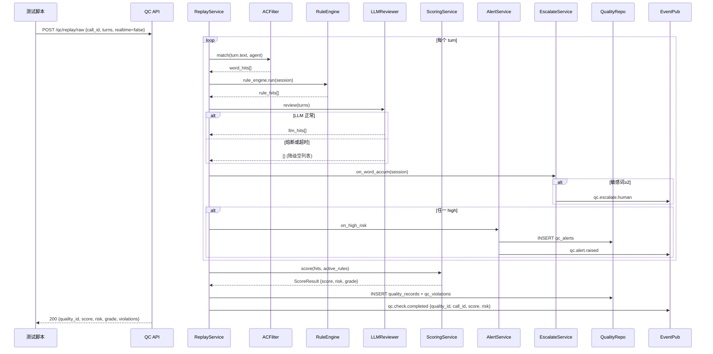
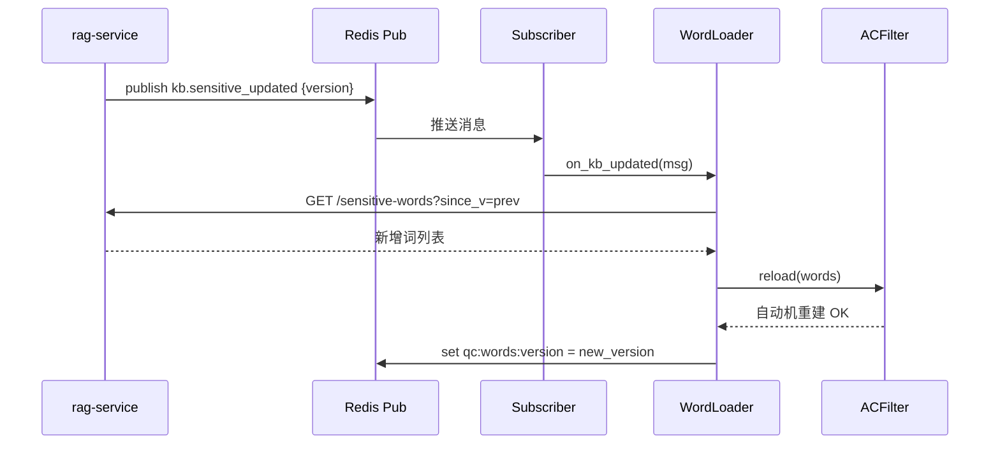
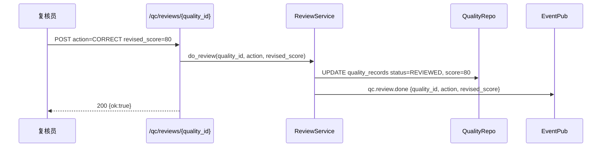

# 子系统详细设计 #02：AI 实时合规质检系统 (录音质检系统)

> 子系统编号：第 2 号
> 服务名：`qc-service`
> 监听端口：**8003**
> 里程碑归属：**M1（最小闭环，data-platform + rag-service + qc-service 三者即可跑通质检全链路）**
> 上游约束：step1/01~03 全局口径、step3/01~03 架构与降级、step4/01~03 数据设计、step5/01~04 技术规范、step6/01~02 异常容错告警、step7/01~03 测试规范、step8/01 M0 任务清单
> 宪法约束：openspec/specs/00~07

---

## 0.1 文档修订记录

| 版本 | 日期 | 修订人 | 修订内容 |
| :--- | :--- | :--- | :--- |
| V1.0 | 2026-08-18 | - | 初始版本，12 章模板 |
| V1.1 | 2026-08-19 | 规范优化 | 新增 AI 不修改案件状态约束；新增 Ch13~16 四个 AI 专项章节（LLM 专项/分层降级/数据闭环/可观测+金融合规脱敏）；更新子系统调用关系（RAG 被动/DP 被动/qc→dp 回流）；对齐 step3~step8 全部规范；新增 PII 脱敏列 |

---

## 1. 模块概览

AI 实时合规质检系统是整套生态的**全链路合规风控守门员**：

1. **旁路实时质检**（FR-QC-001）：对接 call-service WebSocket 拿双向文本流，不中断通话；通话过程中持续检测违规。
2. **MVP 独立可测**（通话回放模拟器）：`POST /qc/replay/{call_id}` 从 data-platform 拉历史对话重放，或 `POST /qc/replay/raw` 直接喂 turns 数组；无需启动 call-service。
3. **三层违规检测**：AC 自动机敏感词（threat/abuse/induce 三分类）+ 业务规则引擎（10+ 条规则）+ LLM 语义复核兜底。
4. **100 分制打分**（FR-QC-003）：起始 100 分，高危 −20 / 中危 −8 / 低危 −2；同一敏感词 30s 去重；存在高危 → risk=high。
5. **风险等级分档**：≥90 优秀 / 80–89 合格 / 60–79 警告 / <60 严重不合格。
6. **高危告警**（FR-QC-002）：命中高危立即写 qc_alerts + 发布 `qc.alert.raised`。
7. **人工复核 P1**（FR-QC-005）：PENDING_REVIEW 列表 + 复核员确认/驳回/修正，人工结论写回。
8. **敏感词≥2 立即转人工**：累计命中≥2 → 发布 `qc.escalate.human`，call-service 订阅执行转人工。

> **AI 边界约束（全局）**：qc-service 作为 AI 能力层服务，只做检测、打分、标签、告警、研判结论。不直接修改案件状态、不直接转人工坐席。案件状态变更由 case-service 执行；转人工动作由 call-service 执行。质检结果通过 Pub-Sub 回流 data-platform。

---

## 2. 职责边界

### 2.1 必做事项

1. **旁路监听**（FR-QC-001）：接入 call-service WebSocket 文本流；主链路异常不影响通话；失败降级为离线补检。
2. **事中实时违规检测+告警**（FR-QC-002）：三层检测，high/medium/low 三级；高危立即告警落表+发布事件。
3. **合规打分+评级**（FR-QC-003）：100 分制+风险等级+违规明细，qc_rules 表可配置。
4. **违规台账+统计**（FR-QC-004）：quality_records 明细 + 按坐席/类型/时间维度查询。
5. **人工复核**（FR-QC-005 P1）：高风险推送复核，支持确认/驳回/修正。
6. **敏感词≥2 强转人工**：发布 `qc.escalate.human`，call-service 执行。
7. **离线补检**：`POST /qc/replay/{call_id}` + 订阅 `etl.task.done` 自动补检。
8. **质检结果回流 DP**：发布 `qc.check.completed` → DP ETL → dw.dws_call_result。
9. **MVP 独立可测**：回放模拟器 + 独立脚本。

### 2.2 明确不做事项

1. **不做 ASR/TTS/呼叫线路**：由 call-service 提供文本流。质检只吃纯文本 turn。
2. **不做敏感词库 CRUD / 知识库内容维护**：词库来自 rag-service `/sensitive-words`。**RAG 只提供被动检索，不主动向外调用**。质检启动时 + 每小时 + 订阅 `kb.sensitive_updated` 增量拉取。
3. **不做用户/RBAC/审计日志表结构**：由 common/security 统一处理。
4. **不做前端告警弹窗渲染**：后端发布 `qc.alert.raised` + 提供 GET 查询接口。
5. **不做报表图表绘制**：输出统计 JSON，宽表构建由 data-platform 负责。**DP 不主动调用上层 AI 服务，数据以消息推送方式下发**。
6. **不做分案策略**：由 case-service 负责。**AI 只输出合规分字段供下游参考，不修改案件状态。**
7. **不直接转人工坐席**：质检只发布 `qc.escalate.human` 事件；真正的转人工调用由 call-service 执行。

---

## 3. 内部模块拆分

```
qc-service (FastAPI app)
├── app/
│   ├── main.py                 # FastAPI 入口 + /health + 启动时拉词库
│   ├── routers/
│   │   ├── check.py            # 实时/离线质检（含回放模拟器）
│   │   ├── records.py          # quality_records 明细+统计
│   │   ├── alerts.py           # 高危告警查询/读状态
│   │   ├── review.py           # P1 人工复核
│   │   └── rules.py            # qc_rules 查询/生效版本
│   ├── services/
│   │   ├── listener_service.py    # WebSocket 接收 call.service.stream turn
│   │   ├── replay_service.py      # MVP 独立可测：回放重放
│   │   ├── ac_filter.py           # Aho-Corasick 敏感词自动机（三分类）
│   │   ├── rule_engine.py         # 业务规则引擎（10+ 条规则）
│   │   ├── llm_reviewer.py        # LLM 语义复核（5s/3次/熔断/降级）
│   │   ├── scoring_service.py     # 100 分制扣分
│   │   ├── alert_service.py       # 高危：写 qc_alerts + publish qc.alert.raised
│   │   ├── escalate_service.py    # 敏感词≥2：publish qc.escalate.human
│   │   ├── review_service.py      # P1 复核：确认/驳回/修正
│   │   └── word_loader.py         # 启动/每小时/订阅 kb.sensitive_updated
│   ├── repositories/
│   │   ├── quality_repo.py        # quality_records / qc_violations CRUD
│   │   ├── alert_repo.py          # qc_alerts CRUD + 状态 ack
│   │   ├── review_repo.py         # qc_reviews（复核动作）
│   │   └── rule_repo.py           # qc_rules 版本 + 读 active 版本
│   ├── events/
│   │   ├── publisher.py           # qc.alert.raised / qc.escalate.human / qc.check.completed / qc.review.done
│   │   └── subscriber.py          # kb.sensitive_updated + etl.task.done
│   └── integrations/
│       ├── rag_client.py          # GET rag-service/sensitive-words
│       └── dp_client.py           # 回放服务 GET data-platform 查 ods_call_records
```

### 3.1 对话状态机

无独立状态机。质检流程为线性流水：接收 turn → AC 匹配 → 规则引擎 → LLM 复核 → 打分 → 告警/转人工 → 落表。

---

## 4. 对外接口详细说明

所有接口 `http://qc-service:8003/api/v1`，统一响应包 `{"code":"0","message":str,"data":any|null,"trace_id":str}`。错误码 A2001–A2011 + B 类。

### 4.1 质检核心

| 方法 | 路径 | 职责 | 权限 | 幂等 | 限流 | 错误码 | PII 脱敏 |
| :--- | :--- | :--- | :--- | :--- | :--- | :--- | :--- |
| GET(WS) | `/qc/check/stream?session_id=xxx` | 告警流订阅 | AGENT/SUPV/ADMIN | 每连接 1 路 | 100 连接 | A2001/B0004 | evidence_text 脱敏 |
| POST | `/qc/replay/{call_id}` | MVP 从 DP 拉对话重放质检 | QC/ADMIN/TRAINER | call_id 去重 | 2/10s | A2002/A2003/B0003 | — |
| POST | `/qc/replay/raw` | MVP 直接传 turns 质检 | QC/ADMIN/TRAINER | `X-Idempotency-Key` | 10/s | A2002/B0002 | — |
| POST | `/qc/check/batch` | 离线批量质检（≤100 通） | TRAINER/ADMIN | batch_id | 1/10s | A2002/A2004 | — |
| GET | `/qc/records/{call_id}` | 单通质检详情 | QC/SUPV/ADMIN | 幂等 | 120/min | A2005 | evidence_text 脱敏 |
| GET | `/qc/records` | 质检记录列表（分页） | QC/SUPV/ADMIN | 幂等 | 60/min | A2005 | phone 脱敏 |
| GET | `/qc/records/stats` | 违规统计 | SUPV/ADMIN/TRAINER | 幂等 | 30/min | A2005 | — |

### 4.2 告警

| 方法 | 路径 | 职责 | 权限 | 错误码 | PII 脱敏 |
| :--- | :--- | :--- | :--- | :--- | :--- |
| GET | `/qc/alerts` | 高危告警列表（NEW/ACKED） | SUPV/ADMIN | A2006 | evidence 脱敏 |
| POST | `/qc/alerts/{alert_id}/ack` | 告警确认 | SUPV/ADMIN | A2006/B0002 | — |

### 4.3 人工复核（P1）

| 方法 | 路径 | 职责 | 权限 | 错误码 | PII 脱敏 |
| :--- | :--- | :--- | :--- | :--- | :--- |
| GET | `/qc/reviews/pending` | 待复核列表 | QC/SUPV | A2007 | — |
| POST | `/qc/reviews/{quality_id}` | 复核（CONFIRM/DISMISS/CORRECT） | QC/SUPV | A2007/A2008 | — |

### 4.4 规则版本

| 方法 | 路径 | 职责 | 权限 | 错误码 |
| :--- | :--- | :--- | :--- | :--- |
| GET | `/qc/rules/active` | 当前生效规则版本 | ADMIN/TRAINER | A2009 |
| POST | `/qc/rules/apply` | 新版本生效（原子切换） | ADMIN | A2009/A2010 |

---

## 5. 内部类与方法清单

### 5.1 ACFilter（敏感词 Aho-Corasick）

```python
class ACFilter:
    async def reload(self, words: list[SensitiveWord]) -> None
    def match(self, text: str, speaker: Literal["agent","user"]) -> list[WordHit]
    # 三分类 severity: high(threat) / medium(abuse) / low(induce)
    # 只检测 agent 说的话；用户说的话统计但不扣分
```

### 5.2 RuleEngine（业务规则 10+ 条）

```python
class RuleEngine:
    def run(self, session: QCSession) -> list[RuleHit]
```

| rule_id | 说明 | severity |
| :--- | :--- | :--- |
| R01 | 联系第三方（非债务人姓名+关系词） | high |
| R02 | 外呼时段违规（<08:00 或 ≥21:00） | medium |
| R03 | 坐席承诺非合规方案（"免息"/"只还本金"） | medium |
| R04 | 债务人身份未核实即透露欠款 | medium |
| R05 | 同一号码 24h 拨打 >3 次 | low |
| R06 | 通话中连续 3 轮无应答 | low |
| R07 | AI 话术第 13 轮仍未确认关键要素 | medium |
| R08 | 承诺 PTP 金额与应还金额差 >20% | medium |
| R09 | 录音时长 <10s 即结束 | low |
| R10 | 敏感词命中 ≥2 次未转人工 | high |

### 5.3 LLMReviewer（语义复核兜底）

```python
class LLMReviewer:
    async def review(self, turns: list[Turn]) -> list[LLMHit]
    # LLM 专项设计（见 Ch13）：
    # - Prompt 版本：qc_review_v1（common/llm/prompts/qc_review.yml）
    # - 置信度阈值：LLM 不做置信度门控（复核结果全部采纳）
    # - 输出解析：JSON → Pydantic LLMHitSchema（level/rule_id/evidence/reason）
    # - 幻觉校验：evidence 引用的 turn_id 必须存在；reason 不含编造金额
    def degraded(self) -> bool  # 熔断后跳过 LLM，只规则+敏感词
```

### 5.4 ScoringService

```python
class ScoringService:
    def score(self, hits: list[AnyHit], active_rules: ActiveRules) -> ScoreResult
    # 100 分制：高危 -20 / 中危 -8 / 低危 -2
    # 同一敏感词 30s 去重
    # 风险等级：有高危→high；累计扣≥20→medium；否则 low
    # 合规档：≥90 EXCELLENT / ≥80 PASS / ≥60 WARNING / <60 SERIOUS
```

### 5.5 AlertService + EscalateService

```python
class AlertService:
    async def on_high_risk(self, hit: AnyHit, session: QCSession) -> AlertRow

class EscalateService:
    async def on_word_accum(self, session: QCSession) -> None  # ≥2 → publish qc.escalate.human
```

### 5.6 ReplayService + WordLoader

```python
class ReplayService:
    async def from_call_id(self, call_id: int, realtime: bool) -> str
    async def from_raw(self, payload: ReplayRawReq) -> str

class WordLoader:
    async def initial(self) -> None      # 启动时拉词库
    async def hourly(self) -> None       # 每小时拉取
    async def on_kb_updated(self, msg: dict) -> None  # 订阅热刷新
```

---

## 6. 涉及数据库表与字段

### 6.1 PostgreSQL public schema（与 step4/01 DDL 对齐）

| 表名 | 主键 | 关键列 | 数据闭环 |
| :--- | :--- | :--- | :--- |
| quality_records | id | call_id(UNIQUE) + case_id + agent_id + score(INT 0-100 CHECK) + risk_level(ENUM) + grade(ENUM) + status(DONE/PENDING_REVIEW/REVIEWED) + high_count/med_count/low_count + reviewed_by/at/action | qc.check.completed → DP ETL → dw.dws_call_result |
| qc_violations | id | quality_id FK + turn_id + rule_id/word_id + severity + evidence_text(脱敏) + start_offset_ms + end_offset_ms + hit_ts | DP 同步 → dw.dwd_call_records |
| qc_alerts | id | quality_id + violation_id + level(=high) + status(NEW/ACKED) + acked_by/at | — |
| qc_reviews | id | quality_id FK + reviewer_id + action(CONFIRM/DISMISS/CORRECT) + revised_score(INT) + reason + created_at | qc.review.done → DP + RAG 样本治理 |
| qc_rules | id/version UNIQUE | status(draft/active/archived) + penalty_high=20/med=8/low=2(JSONB) + same_word_window_ms=30000 + grade_thresholds + effective_by/at | DP 策略版本管理 |

> 公共字段统一：id(UUID) / create_time / update_time / is_delete CHAR(1)，与 step4/01 对齐。

### 6.2 Redis（与 step4/03 对齐，DB 3 分配给 qc-service）

```
qc:words:version          敏感词当前版本号
qc:rules:active           qc_rules active 版本 ID + payload JSON（6h TTL）
qc:alerts:new_count       SUPERVISOR 未读告警数
qc:session:{session_id}   实时质检会话状态（TTL=24h）
qc:replay:run:{call_id}   回放去重（TTL=7d）
qc:llm_degraded           LLM 熔断标识（SET/DEL）
```

---

## 7. 类图与时序图

### 7.1 MVP 独立可测：POST /qc/replay/raw 完整流程



### 7.2 敏感词热刷新



### 7.3 人工复核



---

## 8. 模块独立测试方案

### 8.1 依赖与 Mock 清单

| 依赖 | 真实/Mock | 说明 |
| :--- | :--- | :--- |
| PG 15 | 真实 | 质检表 |
| Redis 7 | 真实 | DB 3 |
| Milvus 2.4 | 真实 | RAG 检索（最小闭环） |
| rag-service | 真实 | 敏感词种子 60 条 + /sensitive-words |
| data-platform | 真实+种子 | ods_call_records 种子对话 10 通 |
| DashScope LLM | Mock(MOCK_LLM=1) | LLMReviewer 注入固定响应 |
| call-service | 不需要 | 用 replay/raw 或 from_call_id |

### 8.2 独立可测断言清单

```
1.  POST /qc/replay/raw（含高危话术）→ score≤60, risk=high, grade=SERIOUS
2.  quality_records.high_count=1
3.  GET /qc/alerts → 1 条 NEW 高危告警
4.  redis-cli PSUBSCRIBE qc.alert.raised 收到告警事件
5.  构造 2 个敏感词命中 → qc.escalate.human 发布
6.  同词 20s 重复 2 次 → 30s 去重，100-2=98
7.  构造 23:30 通话 → R02 时段违规命中，扣 -8
8.  /qc/rules/apply penalty_high=30 → 新版本生效，score 重算
9.  POST /qc/reviews CORRECT → score 更新，status=REVIEWED
10. POST /qc/replay/{call_id} → 从 DP 拉种子重放成功
11. GET /qc/records/stats → 统计字段齐全
12. LLM mock 熔断 → 降级为规则+敏感词，打分仍正常
13. evidence_text 落表不含完整手机号/身份证（脱敏校验）
14. GET /qc/records → phone 字段脱敏为 138****1234
```

---

## 9. 模块通信与依赖

### 9.1 同步 HTTP（我作为 Client）

| 目标 | 路径 | 触发 | 超时 | 重试 | 熔断 | 降级 |
| :--- | :--- | :--- | :--- | :--- | :--- | :--- |
| rag-service 8002 | GET `/sensitive-words` | 启动/每小时/订阅刷新 | 3s | 2× | 2连 | 保持旧 AC 自动机 |
| data-platform 8001 | GET 内部对话详情 | replay/from_call_id | 5s | 2× | 3连 | A2003 |
| DashScope LLM | text-generation | llm_reviewer.review | 5s | 2× | 3连 | 降级为空列表 |

> **RAG 被动约束**：rag-service 只提供被动检索，不主动向外调用。
> **DP 被动约束**：data-platform 不主动调用上层 AI 服务，数据以消息推送方式下发。

### 9.2 同步 HTTP（我作为被调）

| 谁调我 | 路径 | 目的 |
| :--- | :--- | :--- |
| 前端/运营 | /qc/records, /qc/alerts, /qc/reviews/pending, /qc/records/stats | 质检查询/复核/统计 |
| complaint-service | GET /qc/records/{call_id} | 投诉关联质检 |
| review-service | GET /qc/records/stats + /qc/records?min_score=60 | 违规案例复盘 |
| data-platform | POST /qc/replay/{call_id} | ETL 后自动补检 |

### 9.3 事件通知（Redis Pub-Sub，与 step4/03 对齐）

#### 发布（我→其他）

| Channel | Payload | 订阅者 | 数据闭环 |
| :--- | :--- | :--- | :--- |
| `qc.alert.raised` | `{alert_id, call_id, session_id, level, evidence, ts}` | 前端/坐席端/管理员 | — |
| `qc.escalate.human` | `{session_id, call_id, reason, hits_count, ts}` | call-service | call-service 执行转人工 |
| `qc.check.completed` | `{quality_id, call_id, case_id, score, risk, grade, ts}` | DP(宽表) + review(复盘) + complaint(触发) | 质检结果回流 DP → dw.dws_call_result |
| `qc.review.done` | `{quality_id, action, revised_score, ts}` | RAG(样本治理) + DP(回流) | 人工复核结果回流 DP |
| `qc.llm.degraded` | `{service, reason, ts}` | 告警订阅 | LLM 熔断告警 |

#### 订阅（其他→我）

| Channel | 发布者 | Payload | 处理 |
| :--- | :--- | :--- | :--- |
| `kb.sensitive_updated` | rag-service | `{version}` | WordLoader 拉最新词库重建 AC |
| `etl.task.done` | data-platform | `{run_id, stage, backfill_date}` | 自动补检当日缺失 |

---

## 10. 错误处理矩阵（与 step6/01 对齐）

| 错误码 | 描述 | 触发场景 | 降级策略 |
| :--- | :--- | :--- | :--- |
| A2001 | 会话/WS 失败 | call.service.stream 断连 | 不影响通话；标记 PARTIAL；离线补检 |
| A2002 | 质检入参不合法 | turns 空/角色错 | 400 |
| A2003 | DP 回放数据缺失 | from_call_id 查不到 ODS | "对话不存在或未完成ETL" |
| A2004 | 批量超限 | >100 通 | 400 + 分批 |
| A2005 | 质检记录不存在 | 404 | — |
| A2006 | 告警不存在/已确认 | ack 2 次 | 409 |
| A2007 | 复核任务不存在 | 404 | — |
| A2008 | 复核分数越界 | >100 或 <0 | 400 |
| A2009 | 规则版本非法 | 阈值缺失 | 回退上一版本 |
| A2010 | 规则切换失败 | 事务失败 | 不切换 |
| A2011 | LLM 连续失败（熔断） | 3 次超时/5xx | 跳过 LLM，只规则+敏感词 |
| B0001-B0010 | 系统级 | 统一 | 按 DEVELOPMENT_CONTRACT |

---

## 11. 宪法规则落地检查清单

| 宪法条款 | 落地方式 | 验收 |
| :--- | :--- | :--- |
| 1.2 LLM 调用落表 | LLMReviewer 走 common.llm_client → llm_call_logs | 单测后 llm_call_logs 有记录 |
| 1.3 敏感词≥2 立即转人工 | EscalateService → publish qc.escalate.human | 断言 5 |
| 2.2 敏感字段 AES | evidence_text 脱敏后落表 | 断言 13 |
| 2.3 敏感词三层过滤 | ACFilter threat/abuse/induce 三层 | 3 分类分别扣分 20/8/2 |
| 3.1 5s/重试3次/熔断 | rag/llm/dp client 配置 | 注入故障→降级 |
| 3.2 LLM 故障→规则降级 | LLMReviewer.degraded() → 跳过 LLM | 断言 12 |
| 3.3 RAG 故障→静态词表 | WordLoader 失败 → 旧 AC + qc_rules 静态种子 | 关闭 rag 后启动可打分 |
| 3.4 监控+降级日志 | /health: ac_version/llm_degraded/rag_connected | GET /health |
| 3.5 熔断后告警 | llm_degraded → publish qc.llm.degraded | 订阅捕获 |
| 5.1 X-Trace-Id | 全链路+事件 | 响应含 trace_id |
| 5.3 审计+reasoning 脱敏 | 复核动作审计；evidence_text 脱敏 | 导出不含明文 |
| AI 边界约束 | 不修改案件状态，不直接转人工 | case-service 执行变更 |

---

## 12. 可配置项清单

| 键 | 默认值 | 说明 |
| :--- | :--- | :--- |
| QC_RAG_SENSITIVE_BASE | http://rag-service:8002/api/v1 | 词库拉取 base |
| QC_RAG_INITIAL_TIMEOUT | 3 | 启动拉词库超时 |
| QC_RAG_HOURLY_CRON | "0 * * * *" | 每小时拉取 |
| QC_DP_BASE | http://data-platform:8001/api/v1 | DP 查询 base |
| QC_DP_TIMEOUT | 5 | DP 超时 |
| QC_LLM_MODEL | qwen-plus | LLM 语义复核模型 |
| QC_LLM_TIMEOUT | 5 | 5s 超时 |
| QC_LLM_RETRY | 2 | 重试次数 |
| QC_LLM_DEGRADE_AFTER | 3 | 熔断阈值 |
| QC_DEDUP_WINDOW_MS | 30000 | 敏感词去重窗口 |
| QC_AUTO_COMPLEMENT_AFTER_ETL | true | ETL 后自动补检 |
| QC_EVENT_ESCALATE_ENABLED | true | 回放时可关闭 |
| QC_ALERT_LEVEL_MIN | high | 告警最低级别 |
| QC_BATCH_MAX | 100 | 批量上限 |
| QC_MOCK_LLM | false | unittest=true |
| QC_DEFAULT_ACTIVE_RULES_VERSION | "v1.0" | 默认规则版本 |

---

## 13. LLM 专项设计（新增，对齐 step5/03 + step5/04）

> 凡是调用大模型的功能，必须记录 Prompt 版本号、置信度阈值、输出解析逻辑、幻觉校验规则。

### 13.1 LLM 调用点清单

| # | 功能 | Prompt 版本 | 置信度阈值 | 输出解析 | 幻觉校验 | 降级 |
| :--- | :--- | :--- | :--- | :--- | :--- | :--- |
| L1 | LLM 语义复核 | qc_review_v1（qc_review.yml） | 不做门控（复核结果全部采纳） | JSON → Pydantic LLMHitSchema（level/rule_id/evidence/reason） | evidence 引用的 turn_id 必须存在；reason 不含编造金额 | LLM 熔断→跳过，只规则+敏感词 |

### 13.2 Prompt 模板结构（七段标准）

```yaml
# common/llm/prompts/qc_review.yml
version: "qc_review_v1"
role: "你是催收合规质检员"
goal: "检测通话中的违规行为"
constraints:
  - "只检测 agent 说的话，不检测 user"
  - "evidence 必须引用实际存在的 turn_id"
  - "不得编造规则或扣分依据"
schema:
  type: array
  items:
    type: object
    properties:
      level: {type: string, enum: [high, medium, low]}
      rule_id: {type: string}
      evidence: {type: string, description: "引用 turn_id 和原文片段"}
      reason: {type: string}
    required: [level, rule_id, evidence, reason]
prohibitions:
  - "不得编造金额"
  - "不得引用不存在的 turn_id"
fallback: "[]"
enums:
  level: [high, medium, low]
```

### 13.3 输出解析与校验链

```
LLM 返回 JSON 字符串
  → json.loads() 解析                     失败→重试3次→降级空列表
  → Pydantic LLMHitSchema 校验             失败→重试3次→降级空列表
  → 幻觉校验：
    - evidence 引用的 turn_id 必须存在于输入 turns
    - reason 不含编造金额/政策
    - level 必须为 high/medium/low 枚举
    - rule_id 必须为预定义规则之一
  → llm_call_logs 审计落表
```

---

## 14. 分层降级策略（新增，对齐 step3/03 + step6/01）

> 区分两类故障：①大模型服务完全不可用；②大模型返回结果不可信。分别明确降级路径。

### 14.1 故障分类与降级矩阵

| 故障类型 | 检测方式 | 降级路径 | 兜底内容 | 恢复条件 |
| :--- | :--- | :--- | :--- | :--- |
| ① LLM 完全不可用（超时/500/网络） | 5s 超时 / HTTP 500 | 重试3次→熔断(pybreaker OPEN)→跳过 LLM | 只用规则+敏感词打分 | 60s 后半开探测 |
| ① LLM 返回非法 JSON | json.loads() 失败 | 重试3次→熔断→跳过 LLM | 同上 | 同上 |
| ① LLM Schema 校验失败 | Pydantic 校验异常 | 重试3次→熔断→跳过 LLM | 同上 | 同上 |
| ② LLM 幻觉（evidence turn_id 不存在） | 幻觉校验 | 丢弃该条 LLMHit | 不影响打分 | — |
| ② LLM 幻觉（reason 含编造金额） | 幻觉校验 | 丢弃该条 LLMHit | 不影响打分 | — |
| ① RAG 词库拉取失败 | 3s 超时 / 2 连失败 | 保持旧 AC 自动机 | 旧词库继续检测 | rag-service 恢复 |
| ① RAG 冷启动失败 | 启动时拉取失败 | qc_rules 静态种子词表 | 内置 20 条基础敏感词 | — |
| ① WS 旁路断连 | 连接断开 | 标记 PARTIAL + 离线补检 | 不影响通话 | 重连 |
| ② 规则引擎 R10 未转人工 | call-service 未响应 qc.escalate.human | 记录 + 告警 | 标记 R10 high | — |

### 14.2 熔断状态机

```
CLOSED（正常调用 LLM）
  → 连续 3 次失败 → OPEN（停止调用，Redis SET qc:llm_degraded=1）
    → 60s 后 → HALF_OPEN（探测一次）
      → 成功 → CLOSED（Redis DEL qc:llm_degraded）
      → 失败 → OPEN
```

### 14.3 降级对照表

| 场景 | 正常模式 | 降级模式 | 兜底 |
| :--- | :--- | :--- | :--- |
| LLM 语义复核 | AC + 规则 + LLM 三层 | AC + 规则（跳过 LLM） | 仍产出 score |
| RAG 词库 | 实时拉取最新词库 | 旧版本 AC 自动机 | 旧词库继续检测 |
| RAG 冷启动 | 从 RAG 拉取 | qc_rules 静态种子 20 条 | 基础检测可用 |
| WS 旁路 | 实时监听 | 离线补检 | 不影响通话 |

---

## 15. 数据闭环 + 可观测埋点 + 金融合规脱敏（新增，对齐 step4/01~03 + step6/02 + step5/04）

### 15.1 数据闭环矩阵

| 功能 | 数据来源 | 落库位置 | 回流 DP | 回流方式 |
| :--- | :--- | :--- | :--- | :--- |
| 旁路实时质检 | call-service WS 文本流 | quality_records + qc_violations | ✅ | qc.check.completed → DP ETL → dw.dws_call_result |
| 回放质检 | DP ods_call_records | quality_records | ✅ | 同上 |
| 敏感词检测 | AC 自动机匹配 | qc_violations | ✅ | DP → dw.dwd_call_records |
| 规则引擎 | RuleEngine.run() | qc_violations | ✅ | 同上 |
| LLM 语义复核 | LLM 返回 | qc_violations + llm_call_logs | ✅ | DP 汇聚 LLM 日志 |
| 合规打分 | ScoringService.score() | quality_records | ✅ | qc.check.completed → DP → dw.dws_call_result |
| 高危告警 | AlertService | qc_alerts | — | qc.alert.raised → 前端 |
| 人工复核 | 复核员操作 | qc_reviews | ✅ | qc.review.done → DP + RAG 样本治理 |
| 质检统计 | 聚合查询 | — | ✅ | DP → dw.dws_call_result + dw.ads_daily_report |

### 15.2 数据流图

```
call-service ──(WS 文本流)──→ qc-service
                                 │
                    ┌────────────┤
                    ▼            ▼
              quality_records  qc_violations
              qc_alerts        qc_reviews
              llm_call_logs
                    │
                    ▼
          (qc.check.completed Pub-Sub)
                    │
          ┌─────────┼─────────┐
          ▼         ▼         ▼
     data-platform  review   complaint
     (ETL→dw)     (复盘)    (投诉关联)
```

### 15.3 可观测埋点

| 事件 | 触发点 | 采集字段 | 告警阈值 |
| :--- | :--- | :--- | :--- |
| qc.check.started | 质检开始 | trace_id, call_id, session_id, mode(realtime/replay) | — |
| qc.check.completed | 质检完成 | trace_id, latency_ms, score, risk, grade, violation_count | score<60 率>10%→Warning |
| llm.review.started | LLM 复核开始 | trace_id, prompt_version, turn_count | — |
| llm.review.completed | LLM 复核完成 | trace_id, latency_ms, token_usage, hit_count, status | latency P95>800ms |
| llm.review.degraded | LLM 降级 | trace_id, reason | 立即告警 |
| rag.words.loaded | 词库加载 | trace_id, version, word_count | — |
| rag.words.stale | 词库过期 | trace_id, stale_hours | >2h→Warning |
| qc.alert.raised | 高危告警 | trace_id, call_id, level, evidence | 立即告警 |
| qc.escalate.triggered | 转人工触发 | trace_id, call_id, hits_count | — |

### 15.4 仪表盘指标

| 指标 | 来源 | 展示 |
| :--- | :--- | :--- |
| 质检覆盖率 | 已质检通话数 / 总通话数 | 百分比 |
| 平均合规分 | quality_records.score AVG | 折线图 |
| 高危通话率 | risk=high / total | 百分比 |
| LLM 复核命中率 | llm_hits > 0 / total | 百分比 |
| LLM 降级率 | llm.review.degraded / llm.review.started | 百分比 |
| 敏感词命中 TOP 10 | qc_violations GROUP BY word | 柱状图 |
| 规则命中 TOP 10 | qc_violations GROUP BY rule_id | 柱状图 |

### 15.5 金融合规脱敏

| PII 类型 | 存储方式 | API 返回 | 导出 | 日志 | 流转 |
| :--- | :--- | :--- | :--- | :--- | :--- |
| evidence_text | 脱敏后存储（mask_text） | 脱敏展示 | 脱敏导出 | 脱敏 | DP 回流脱敏版 |
| 手机号 | 不存储（原 turn text 已脱敏） | 不返回 | 不导出 | 不记录 | — |
| 身份证号 | 不存储 | 不返回 | 不导出 | 不记录 | — |
| 逾期金额 | 不存储 | 不返回 | 不导出 | 不记录 | LLM 不传入 |
| LLM reasoning | AES-256 加密 | 不返回 | 不导出 | 不记录 | 审计哈希链 |

### 15.6 合规红线落地（openspec/00 对齐）

| 红线 | 落地方式 |
| :--- | :--- |
| 1. 暴力/威胁 | ACFilter threat 分类 → high → 扣 20 分 + 告警 |
| 2. 伪造身份 | RuleEngine R04 → medium → 扣 8 分 |
| 3. 停止致电 | RuleEngine 检查 call_records 中 stop_call 标记 → 告警 |
| 4. 编造承诺 | RuleEngine R03 → medium → 扣 8 分 |
| 5. 法律解读 | LLMReviewer 语义复核 → 检测非标准法律表述 |
| 6. 双校验缺失 | ACFilter + LLMReviewer 双重检测 → 不可绕过 |
| 7. 编造金额 | LLMReviewer 幻觉校验 → reason 不含编造金额 |

---

## M1 验收标准

| 验收项 | 标准 |
| :--- | :--- |
| 回放质检 | replay/raw 3 turn 含高危 → score≤60, risk=high |
| 三层检测 | AC + 规则 + LLM 均可触发 |
| 100 分制 | 高危-20/中危-8/低危-2，30s 去重 |
| 高危告警 | qc_alerts 落表 + qc.alert.raised 发布 |
| 敏感词≥2 转人工 | qc.escalate.human 发布 |
| 人工复核 | CORRECT → score 更新 |
| LLM 降级 | 熔断 → 只规则+敏感词，打分正常 |
| 词库热更新 | kb.sensitive_updated → AC 重建 |
| AI 边界 | 不修改案件状态，不直接转人工 |
| 数据闭环 | qc.check.completed → DP 可消费 |
| PII 脱敏 | evidence_text 脱敏，phone 不可见 |
| LLM 埋点 | latency/token 可采集 |
| trace_id | 全链路透传 |
