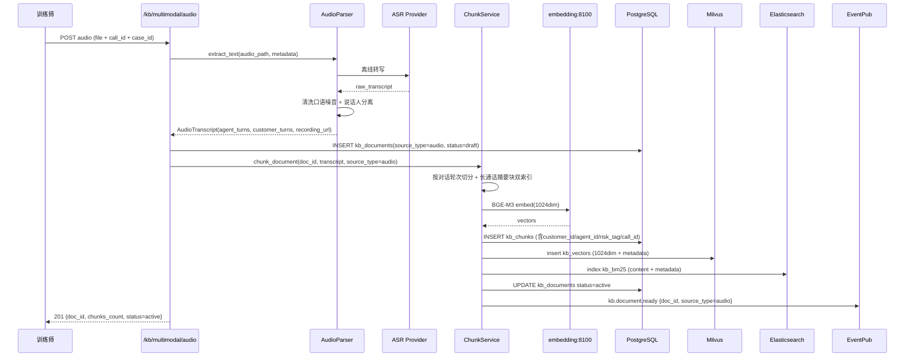
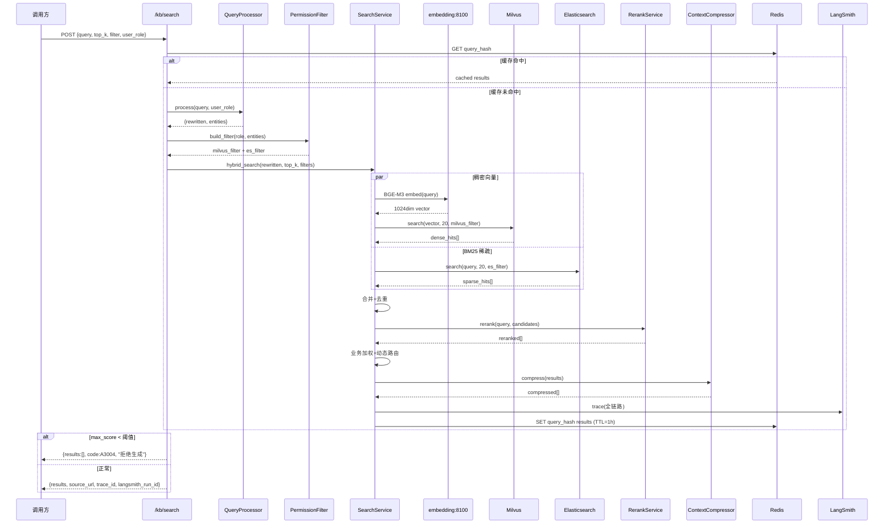
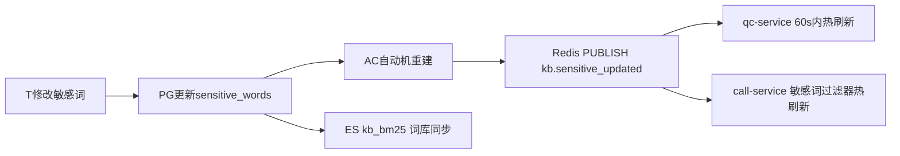

# 子系统详细设计 #03：多模态混合检索全局知识库

> 子系统编号：第 3 号
> 服务名：`rag-service`
> 监听端口：**8002**
> 里程碑归属：**M1（最小闭环，与 data-platform、qc-service 同时落地）**
> 上游约束：step1/01~03 全局口径、step3/01~03 架构与降级、step4/01~03 数据设计、step5/01~04 技术规范、step6/01~02 异常容错告警、step7/01~03 测试规范、step8/01 M0 任务清单
> 宪法约束：openspec/specs/00~07

---

## 0.1 文档修订记录

| 版本 | 日期 | 修订人 | 修订内容 |
| :--- | :--- | :--- | :--- |
| V1.0 | 2026-08-18 | - | 初始版本，12 章模板，BM25 内存方案 |
| V2.0 | 2026-08-19 | 规范优化 | **重大升级**：嵌入模型 bge-large-zh→BGE-M3(1024dim)；BM25 内存→Elasticsearch；新增 bge-reranker 重排序；新增多模态解析（音频ASR/OCR/结构化工单）；新增 Query 预处理（改写+扩展+实体提取）；新增结构化前置过滤+业务加权+动态路由；新增溯源输出+拒绝生成+两套业务 Prompt；新增行级权限+LangSmith 观测+评估模块；新增 Ch13~15 AI 专项章节；向量维度 768→1024；需联动更新 step4/02+step5/01 |

> **注意**：本次升级涉及基础设施变更（新增 Elasticsearch + bge-reranker），需同步更新 step4/02（Milvus 1024dim）、step5/01（技术栈新增 ES+reranker）、docker-compose（新增 ES 容器）。

---

## 1. 模块概览

多模态混合检索全局知识库是整套 AI 生态的**唯一知识中枢**，也是**本项目最大亮点**。区别于普通单向量 RAG，本系统具备五大核心能力：

### 1.1 多模态数据解析（区别普通 RAG 的第一个亮点）

| 功能编号 | 功能 | 说明 |
| :--- | :--- | :--- |
| FR-RAG-001 | 音频解析 | 催收通话录音对接 ASR 转文本，清洗口语噪音（"嗯"、"啊"、重复词），保留说话人角色【坐席/客户】，绑定录音路径+通话元数据 |
| FR-RAG-002 | PDF/Word 制度文档 | 布局解析（pdfplumber/python-docx），识别标题/条款/表格，过滤页眉页脚，支持文档版本管理 |
| FR-RAG-003 | 图片工单截图 | OCR（PaddleOCR）提取图片内工单文字，原图路径存入元数据，**不把图片直接向量化** |
| FR-RAG-004 | 结构化工单对接 | 从 PostgreSQL 读取逾期金额、客户 ID、坐席 ID、风险标签，**不作为检索文本，用作过滤条件** |
| FR-RAG-005 | 增量入库 | 新通话/新制度文档实时解析→切片→写入索引库；旧文档标记 expired 自动过滤 |

### 1.2 文档预处理 & 元数据管理（企业 RAG 重点）

| 功能编号 | 功能 | 说明 |
| :--- | :--- | :--- |
| FR-RAG-006 | 业务定制分块 | 规则文档按语义边界切（段落>句号>逗号）；通话 ASR 按**对话轮次**切分（不切断上下文）；长通话额外生成**摘要块双索引**（摘要块+原文块同时入索引） |
| FR-RAG-007 | 自动元数据标签 | 来源类型（audio/document/image/structured）、customer_id、agent_id、风险标签、时间戳、文档版本 |
| FR-RAG-008 | 脏数据过滤 | 过滤无效语气词、空片段、过期文档、低于最短长度的 chunk |

### 1.3 混合检索核心（本项目最大亮点）

| 功能编号 | 功能 | 说明 |
| :--- | :--- | :--- |
| FR-RAG-009 | Query 预处理 | 查询改写（同义扩展）+ 查询扩展（补充上下文）+ 提取业务实体（客户 ID、风险关键词） |
| FR-RAG-010 | 结构化前置过滤 | 拿实体去做元数据过滤，先筛掉无关客户、过期数据，缩小检索空间 |
| FR-RAG-011 | 两路并行召回 | **稠密向量检索（BGE-M3 1024dim，Milvus）** + **BM25 稀疏检索（Elasticsearch）** 并行召回 |
| FR-RAG-012 | Rerank 重排序 | bge-reranker 对候选集打分，过滤低相关性片段 |
| FR-RAG-013 | 业务加权 | 新通话权重抬高，高危风险标签片段优先上浮 |
| FR-RAG-014 | 动态路由 | 规则类问题调高 BM25 权重；通话复盘类问题调高向量检索权重 |

### 1.4 生成 & 安全防护（催收业务强约束）

| 功能编号 | 功能 | 说明 |
| :--- | :--- | :--- |
| FR-RAG-015 | 上下文压缩 | 精简冗余内容，降低 token 消耗 |
| FR-RAG-016 | 溯源输出 | 答案附带来源（通话 ID、文档名称、原始资源链接，可跳转录音/工单截图/PDF） |
| FR-RAG-017 | 拒绝生成策略 | 全部召回片段分数低于阈值 → 返回无证据，**禁止 LLM 编造** |
| FR-RAG-018 | 两套业务 Prompt | 坐席知识库问答 Prompt + 质检判定 Prompt（强制所有结论必须来自检索上下文） |

### 1.5 企业级工程能力

| 功能编号 | 功能 | 说明 |
| :--- | :--- | :--- |
| FR-RAG-019 | 行级权限隔离 | 基于元数据的行级权限，不同角色只能查看有权限客户数据 |
| FR-RAG-020 | LangSmith 全链路观测 | 记录 query→改写 query→召回片段→打分→LLM 输入输出，方便调优 RAG |
| FR-RAG-021 | 高频查询缓存 | Redis 缓存高频查询结果，TTL=1h |
| FR-RAG-022 | 评估模块 | 召回率、幻觉率统计，辅助 RAG 调优 |

> **AI 边界约束（全局）**：rag-service 作为知识库服务，只提供被动检索，不主动向外调用服务。不修改案件状态，不做话术生成（由 call-service LLM 生成），不做质检打分（由 qc-service）。
> **RAG 被动约束**：rag-service 只提供被动检索接口，不主动向外调用服务。
> **DP 被动约束**：data-platform 不主动调用上层 AI 服务，数据以消息推送方式下发。

---

## 2. 职责边界

### 2.1 必做事项

1. **多模态解析入库**（FR-RAG-001~005）：音频 ASR 转写+清洗、PDF/Word 布局解析、图片 OCR、结构化工单读取、增量入库。
2. **业务定制分块+元数据**（FR-RAG-006~008）：规则文档语义切、通话轮次切、摘要块双索引、自动元数据标签、脏数据过滤。
3. **混合检索**（FR-RAG-009~014）：Query 预处理→前置过滤→BGE-M3 向量+ES BM25 并行召回→Rerank→业务加权→动态路由。
4. **安全防护生成**（FR-RAG-015~018）：上下文压缩、溯源输出、拒绝生成（score<阈值→空）、两套业务 Prompt。
5. **行级权限**（FR-RAG-019）：基于 customer_id/agent_id 的元数据级行级权限过滤。
6. **全链路观测**（FR-RAG-020）：LangSmith 记录 RAG 全链路（query→改写→召回→打分→LLM I/O）。
7. **缓存+评估**（FR-RAG-021~022）：高频查询 Redis 缓存、召回率/幻觉率统计。
8. **敏感词库管理**：CRUD + 三分类（threat/abuse/induce）+ 版本管理 + Pub-Sub 热刷新。
9. **版本管理**：文档/敏感词/规则版本切换+回滚+灰度。
10. **MVP 独立可测**：不依赖 call/qc/case 等业务服务。

### 2.2 明确不做事项

1. **不做话术生成本身**：知识库只返回检索片段+溯源信息，最终应答由 call-service LLM 生成。
2. **不做案件状态修改**：AI 只输出检索结果，案件状态由 case-service 执行。
3. **不做质检打分**：违规检测与打分由 qc-service 负责。
4. **不做用户/RBAC**：由 common/security 统一处理；本模块只做元数据级行级过滤。
5. **不做 ETL 或宽表**：由 data-platform 负责。**DP 不主动调用上层服务，数据以消息推送方式下发**。
6. **不做真实呼叫/ASR/TTS**：ASR 实时流由 call-service 提供；离线音频转写由 rag-service 调用 ASR Provider（common/speech/asr_provider.py）。
7. **不主动向外调用**：**RAG 只提供被动检索，不主动向外调用服务**。

---

## 3. 内部模块拆分

```
rag-service:8002
├── app/
│   ├── main.py                      # FastAPI 入口 + /health + 启动加载
│   ├── routers/
│   │   ├── documents.py             # /kb/documents 文档管理（含多模态上传）
│   │   ├── search.py                # /kb/search 混合检索
│   │   ├── multimodal.py            # /kb/multimodal 音频/图片/结构化工单入库
│   │   ├── version.py               # /kb/documents/{id}/versions 版本管理
│   │   ├── sensitive_words.py       # /sensitive-words CRUD
│   │   └── evaluation.py           # /kb/evaluation 评估模块（召回率/幻觉率）
│   ├── services/
│   │   ├── ingest_service.py        # 文档上传→解析→元数据入库
│   │   ├── multimodal_service.py    # 音频ASR/图片OCR/结构化工单对接
│   │   ├── chunk_service.py         # 业务定制分块（规则语义/通话轮次/摘要双索引）
│   │   ├── search_service.py        # 混合检索核心（预处理+前置过滤+双路召回+Rerank+加权+路由）
│   │   ├── query_processor.py       # Query 预处理（改写+扩展+实体提取）
│   │   ├── rerank_service.py        # bge-reranker 重排序
│   │   ├── context_compressor.py    # 上下文压缩（精简冗余，降低token）
│   │   ├── permission_filter.py     # 行级权限隔离（元数据级 customer_id/agent_id 过滤）
│   │   ├── cache_service.py         # 高频查询缓存（Redis）
│   │   ├── evaluation_service.py    # 评估模块（召回率/幻觉率统计）
│   │   ├── version_service.py       # 版本切换/回滚/灰度
│   │   └── langsmith_tracer.py      # LangSmith 全链路追踪
│   ├── parsers/                     # 多模态解析器
│   │   ├── base.py                  # DocumentParser ABC
│   │   ├── pdf_parser.py            # pdfplumber（布局解析，识别标题/条款/表格）
│   │   ├── docx_parser.py           # python-docx
│   │   ├── xlsx_parser.py           # openpyxl
│   │   ├── text_parser.py           # UTF-8 文本
│   │   ├── md_parser.py             # Mistune
│   │   ├── audio_parser.py          # 音频→ASR转写→清洗口语噪音→说话人分离
│   │   └── image_ocr_parser.py      # PaddleOCR 图片文字提取
│   ├── vectorstore/
│   │   ├── milvus_client.py          # pymilvus（BGE-M3 1024dim, IVF_FLAT）
│   │   ├── es_client.py              # Elasticsearch BM25 索引（新增）
│   │   └── rerank_client.py          # bge-reranker HTTP 调用
│   ├── repositories/
│   │   ├── doc_repo.py              # kb_documents CRUD
│   │   ├── chunk_repo.py            # kb_chunks CRUD
│   │   ├── sensitive_repo.py        # sensitive_words CRUD
│   │   └── structured_repo.py       # 结构化工单读取（cases/call_records 元数据）
│   ├── events/
│   │   ├── publisher.py             # kb.sensitive_updated / kb.version.switched / kb.document.ready
│   │   └── subscriber.py            # call.session.ended（通话结束后ASR文本入库）
│   └── integrations/
│       ├── embed_client.py          # embedding-service:8100（BGE-M3 1024dim）
│       ├── rerank_client.py         # rerank-service:8101（bge-reranker）
│       └── asr_client.py            # ASR Provider（离线音频转写）
```

### 3.1 混合检索流水线

```
用户 Query
    │
    ▼
Query 预处理（query_processor.py）
  ├── 查询改写（同义扩展："怎么协商" → "如何协商还款方案"）
  ├── 查询扩展（补充上下文："逾期多久" → "逾期天数计算规则"）
  └── 实体提取（customer_id=1001, risk_tag=high_risk）
    │
    ▼
结构化前置过滤（permission_filter.py + structured_repo.py）
  ├── 行级权限：按角色过滤 customer_id 范围
  ├── 实体过滤：customer_id=1001, 过期文档排除
  └── 缩小检索空间：从全量 → 相关子集
    │
    ▼
两路并行召回（search_service.py）
  ┌─────────────────────────────────────┐
  │                                     │
  ▼                                     ▼
稠密向量检索                         BM25 稀疏检索
BGE-M3 1024dim                      Elasticsearch
Milvus top20                        ES top20
语义召回                             关键词精确命中
    │                                     │
    └─────────────┬─────────────────────┘
                  ▼
          结果合并 + 去重
                  │
                  ▼
          Rerank 重排序（rerank_service.py）
          bge-reranker 对候选集打分
          过滤低相关性片段
                  │
                  ▼
          业务加权（search_service.py）
          ├── 新通话权重 ×1.5
          ├── 高危风险标签 ×1.3
          └── 过期文档 ×0.1
                  │
                  ▼
          动态路由调整
          ├── 规则类问题：BM25 权重 ×1.5
          └── 复盘类问题：向量权重 ×1.5
                  │
                  ▼
          上下文压缩（context_compressor.py）
          精简冗余，降低 token
                  │
                  ▼
          返回 Top-K + 溯源信息
          或 score<阈值 → 拒绝生成（返回空）
```

---

## 4. 对外接口详细说明

所有接口 `http://rag-service:8002/api/v1`，统一响应包 `{"code":"0","message":str,"data":any|null,"trace_id":str}`。错误码 A3001–A3015 + B 类。

### 4.1 文档管理

| 方法 | 路径 | 职责 | 权限 | 幂等 | PII 脱敏 |
| :--- | :--- | :--- | :--- | :--- | :--- |
| POST | `/kb/documents` | 上传文档（PDF/Word/Excel/TXT/MD/HTML） | ADMIN/TRAINER | SHA256 去重 | 文档内容不含手机号 |
| GET | `/kb/documents` | 列表分页（category/status/page） | ADMIN/SUPV/QC/TRAINER | 幂等 | — |
| GET | `/kb/documents/{id}` | 详情（元数据+chunks 数量） | ADMIN/SUPV/QC/TRAINER | 幂等 | — |
| PUT | `/kb/documents/{id}` | 更新（创建新版本） | ADMIN/TRAINER | 否，version+1 | — |
| DELETE | `/kb/documents/{id}` | 归档（非物理删除） | ADMIN/TRAINER | 幂等 | — |

### 4.2 多模态入库（新增）

| 方法 | 路径 | 职责 | 权限 | 幂等 | PII 脱敏 |
| :--- | :--- | :--- | :--- | :--- | :--- |
| POST | `/kb/multimodal/audio` | 上传音频→ASR转写→清洗→说话人分离→分块入库 | ADMIN/TRAINER | SHA256 去重 | ASR文本脱敏后存储 |
| POST | `/kb/multimodal/image` | 上传图片→OCR提取文字→元数据存原图路径→不向量化 | ADMIN/TRAINER | SHA256 去重 | OCR文本脱敏 |
| POST | `/kb/multimodal/structured` | 从PG读取结构化工单元数据（customer_id/agent_id/risk_tag）→写入chunk元数据 | ADMIN/TRAINER | 按case_id去重 | customer_id/agent_id 加密 |
| POST | `/kb/multimodal/sync` | 增量同步：新通话/新文档实时解析入库 | INTERNAL(签名) | 幂等 | — |

### 4.3 混合检索

| 方法 | 路径 | 职责 | 权限 | 限流 | PII 脱敏 |
| :--- | :--- | :--- | :--- | :--- | :--- |
| POST | `/kb/search` | 混合检索（Query预处理+前置过滤+双路召回+Rerank+加权+路由+压缩+溯源） | ADMIN/SUPV/QC/AGENT/TRAINER | 2000/min | source 不含手机号 |
| POST | `/kb/search/agent` | 坐席知识库问答检索（Prompt: agent_qa_v1） | AGENT+ | 200/min | — |
| POST | `/kb/search/qc` | 质检判定检索（Prompt: qc_judge_v1，强制结论来自上下文） | QC+ | 100/min | — |

**检索响应结构**：
```json
{
  "code": "0",
  "data": {
    "results": [
      {
        "content": "chunk文本（脱敏）",
        "source": "催收自律公约.pdf",
        "source_type": "document|audio|image|structured",
        "source_url": "/kb/documents/{doc_id} 或 /kb/multimodal/audio/{recording_id}",
        "score": 0.87,
        "rerank_score": 0.92,
        "doc_id": "uuid",
        "chunk_index": 3,
        "category": "regulation",
        "version": 2,
        "metadata": {
          "customer_id": null,
          "agent_id": null,
          "risk_tag": null,
          "call_id": null,
          "timestamp": "2026-08-18T10:00:00Z"
        }
      }
    ],
    "degraded": false,
    "query_original": "逾期多久可以协商",
    "query_rewritten": "逾期天数计算规则 如何协商还款方案",
    "entities_extracted": {"risk_keyword": "协商"},
    "trace_id": "xxx",
    "langsmith_run_id": "xxx"
  }
}
```

### 4.4 敏感词库 CRUD

| 方法 | 路径 | 职责 | 权限 | PII 脱敏 |
| :--- | :--- | :--- | :--- | :--- |
| GET | `/sensitive-words` | 列表（category/severity/status 过滤） | ADMIN/SUPV/QC/TRAINER | — |
| POST | `/sensitive-words` | 新增（自动刷新 ES + AC 自动机 + Pub-Sub） | ADMIN/TRAINER | — |
| PUT | `/sensitive-words/{id}` | 修改 | ADMIN/TRAINER | — |
| DELETE | `/sensitive-words/{id}` | 软删除 | ADMIN/TRAINER | — |
| GET | `/sensitive-words/current.dict` | 内部简化接口（qc-service 拉取，纯数组） | INTERNAL | — |

### 4.5 版本管理

| 方法 | 路径 | 职责 | 权限 | 错误码 |
| :--- | :--- | :--- | :--- | :--- |
| GET | `/kb/documents/{id}/versions` | 版本列表 | ADMIN/TRAINER | B0004 |
| POST | `/kb/documents/{id}/versions` | 切到指定版本（原子切换） | ADMIN | A3006 |

### 4.6 评估模块（新增）

| 方法 | 路径 | 职责 | 权限 | 错误码 |
| :--- | :--- | :--- | :--- | :--- |
| GET | `/kb/evaluation/metrics` | 召回率/幻觉率/平均score统计 | ADMIN/TRAINER | — |
| POST | `/kb/evaluation/test-set` | 上传测试集进行评估 | ADMIN/TRAINER | A3015 |

---

## 5. 内部类与方法清单

### 5.1 多模态解析器

```python
# app/parsers/audio_parser.py
class AudioParser(DocumentParser):
    """音频→ASR转写→清洗口语噪音→说话人分离→绑定录音元数据"""
    async def extract_text(self, audio_path: Path, metadata: dict) -> AudioTranscript:
        # 1. 调用 ASR Provider (common/speech/asr_provider.py) 离线转写
        # 2. 清洗口语噪音（"嗯"/"啊"/重复词）
        # 3. 说话人分离（agent/customer 标记）
        # 4. 绑定录音路径 + 通话元数据（call_id/case_id/agent_id）
        # 5. 返回带说话人标记的文本

# app/parsers/image_ocr_parser.py
class ImageOCRParser(DocumentParser):
    """图片→PaddleOCR提取文字→原图路径存元数据→不向量化"""
    async def extract_text(self, image_path: Path) -> str:
        # PaddleOCR 提取文字
        # 原图路径存入 metadata.source_url
        # 不生成向量，只存文本+元数据
```

### 5.2 QueryProcessor（查询预处理）

```python
class QueryProcessor:
    async def process(self, query: str, user_role: str) -> ProcessedQuery:
        # 1. 查询改写：同义扩展（"怎么协商" → "如何协商还款方案"）
        # 2. 查询扩展：补充上下文
        # 3. 实体提取：customer_id, risk_keyword, category
        # 返回：{original, rewritten, entities, expanded_query}
```

### 5.3 PermissionFilter（行级权限隔离）

```python
class PermissionFilter:
    def build_filter(self, user_role: str, user_id: UUID,
                     entities: dict) -> dict:
        # ADMIN/TRAINER: 无限制
        # AGENT: 只能查自己关联的 customer_id 数据
        # QC: 可查所有但 evidence 脱敏
        # 返回 Milvus + ES 的过滤表达式
```

### 5.4 SearchService（混合检索核心）

```python
class SearchService:
    async def hybrid_search(self, query: str, top_k: int,
                            filter: KBSearchFilter,
                            user_role: str) -> tuple[list[KBResult], bool]:
        # 1. QueryProcessor.process(query, user_role) → rewritten + entities
        # 2. PermissionFilter.build_filter(role, entities) → 元数据过滤表达式
        # 3. 并行召回：
        #    a) Milvus dense: BGE-M3 1024dim, top20, metric=IP
        #    b) ES BM25 sparse: top20
        # 4. 合并+去重（按 chunk_id）
        # 5. RerankService.rerank(query, candidates) → rerank_score
        # 6. 业务加权：新通话×1.5, 高危风险×1.3, 过期×0.1
        # 7. 动态路由：规则类 BM25×1.5, 复盘类 vector×1.5
        # 8. ContextCompressor.compress(results) → 精简
        # 9. score<阈值 → 返回空 + 拒绝生成标记
        # 10. LangSmithTracer.trace(全链路)
```

### 5.5 RerankService（bge-reranker 重排序）

```python
class RerankService:
    async def rerank(self, query: str,
                     candidates: list[KBResult]) -> list[KBResult]:
        # 调用 rerank-service:8101
        # bge-reranker 对 query-doc pair 打分
        # 过滤 rerank_score < 0.3 的片段
        # 返回重排序后的列表
```

### 5.6 ChunkService（业务定制分块）

```python
class ChunkService:
    async def chunk_document(self, doc_id: UUID, text: str,
                             source_type: str) -> list[KBChunk]:
        if source_type == "audio":
            # 按对话轮次切分（不切断上下文）
            # 长通话额外生成摘要块双索引
        elif source_type == "document":
            # 按语义边界切（段落>句号>逗号）
        # 自动打元数据标签
        # 过滤脏数据（空片段/语气词/过期）
        # 写 PG kb_chunks + Milvus kb_vectors + ES index
```

### 5.7 SensitiveWordManager + VersionService + CacheService

```python
class SensitiveWordManager:
    # 同 V1.0，AC 自动机 + Pub-Sub + ES 词库同步

class VersionService:
    # 同 V1.0，版本切换+回滚+灰度

class CacheService:
    async def get(self, query_hash: str) -> list[KBResult] | None
    async def set(self, query_hash: str, results: list) -> None  # TTL=1h

class EvaluationService:
    async def compute_metrics(self, test_set: list) -> EvalMetrics
    # 召回率 = 命中相关文档 / 总相关文档
    # 幻觉率 = LLM 输出无引用占比

class LangSmithTracer:
    async def trace(self, query: str, rewritten: str,
                    recall_hits: list, rerank_scores: list,
                    llm_input: str, llm_output: str) -> str
    # 记录全链路，返回 run_id
```

---

## 6. 涉及数据库表与字段

### 6.1 PostgreSQL public schema（与 step4/01 对齐，新增字段）

| 表名 | 主键 | 关键列 | 数据闭环 |
| :--- | :--- | :--- | :--- |
| kb_documents | id | title, category(regulation/script/case/other), content, **source_type(document/audio/image/structured)**, version, status(draft/active/archived/expired), created_by, created_at | kb.document.ready → DP ETL |
| kb_chunks | id | doc_id(FK), chunk_index, content(脱敏), vector_id, category, version, **source_type, customer_id, agent_id, risk_tag, call_id, recording_url, is_summary**, created_at | DP → dw.dwd_kb_chunks |
| sensitive_words | id | word, category(threat/abuse/induce), severity(high/medium/low), status, version, created_by | kb.sensitive_updated → DP + QC |
| kb_evaluation_results | id | test_set_id, query, expected_doc_ids, actual_doc_ids, recall_score, hallucination_score, created_at | DP → dw.dws_strategy_effectiveness |

### 6.2 Milvus Collection `kb_vectors`（升级：768→1024 dim）

| 字段 | 类型 | 说明 |
| :--- | :--- | :--- |
| chunk_id | INT64, PK | 对应 kb_chunks.id |
| vector | FLOAT_VECTOR(**1024**) | **BGE-M3** 输出；索引 IVF_FLAT，nlist=1024，metric=IP |
| doc_id | INT64 | kb_documents.id |
| category | VARCHAR(32) | regulation/script/case/other |
| version | INT64 | 版本号 |
| source | VARCHAR(255) | doc.title |
| **source_type** | VARCHAR(32) | document/audio/image/structured |
| **customer_id** | INT64 | 行级权限过滤 |
| **agent_id** | INT64 | 行级权限过滤 |
| **risk_tag** | VARCHAR(32) | 业务加权用 |
| **is_summary** | BOOL | 是否摘要块 |

> **注意**：向量维度从 768→1024，需同步更新 step4/02 的 Milvus collection schema。

### 6.3 Elasticsearch Index `kb_bm25`（新增）

| 字段 | 类型 | 说明 |
| :--- | :--- | :--- |
| chunk_id | keyword | 对应 kb_chunks.id |
| content | text + keyword | BM25 检索字段（中文分词 ik_max_word） |
| doc_id | keyword | 文档 ID |
| category | keyword | 分类过滤 |
| version | integer | 版本过滤 |
| source_type | keyword | 来源类型过滤 |
| customer_id | keyword | 行级权限 |
| agent_id | keyword | 行级权限 |
| risk_tag | keyword | 业务加权 |
| is_expired | boolean | 过期文档过滤 |

### 6.4 Redis（与 step4/03 对齐，DB 2 分配给 rag-service）

```
rag:bm25:version                    ES 索引版本号
rag:sensitive:version               敏感词当前版本号
rag:cache:query:{hash}             高频查询缓存（TTL=1h）
rag:documents:hot:{doc_id}         热点文档缓存（TTL=1h）
rag:rerank:degraded                rerank 熔断标识
rag:embed:degraded                 embedding 熔断标识
rag:langsmith:enabled              LangSmith 开关
```

---

## 7. 类图与时序图

### 7.1 多模态音频入库时序（新增）



### 7.2 混合检索完整流程（升级）



### 7.3 敏感词热刷新（同 V1.0，增加 ES 同步）



---

## 8. 模块独立测试方案

### 8.1 依赖与 Mock 清单

| 依赖 | 真实/Mock | 说明 |
| :--- | :--- | :--- |
| PG 15 | 真实 | 知识库表 |
| Redis 7 | 真实 | DB 2 |
| Milvus 2.4 | 真实 | kb_vectors collection（1024dim） |
| **Elasticsearch 8** | **真实** | kb_bm25 index（新增） |
| embedding-service | Mock 或真实 | BGE-M3 1024dim |
| **rerank-service** | Mock 或真实 | bge-reranker |
| ASR Provider | Mock | 离线音频转写 |
| PaddleOCR | Mock 或真实 | 图片 OCR |
| LangSmith | Mock | 全链路追踪 |
| call/qc/case/complaint/review | 不需要 | 独立可测 |

### 8.2 独立可测断言清单

```
 1. 6种格式文档上传 → kb_chunks 行数>0 且 Milvus 返回 1024dim 向量
 2. 音频上传 → ASR转写→清洗→说话人分离→按轮次切分→双索引
 3. 图片上传 → OCR提取文字→原图路径存元数据→不生成向量
 4. 结构化工单 → 读取 customer_id/agent_id/risk_tag→写入chunk元数据
 5. Query预处理 → "怎么协商" 改写为 "如何协商还款方案"
 6. 前置过滤 → AGENT 角色只能查自己关联客户数据
 7. 双路并行召回 → Milvus+ES 同时返回结果→合并去重
 8. Rerank → rerank_score 排序与原始 score 不同
 9. 业务加权 → 新通话权重×1.5 后排名上升
10. 动态路由 → 规则类问题 BM25 权重×1.5
11. 上下文压缩 → compressed tokens < original tokens
12. 溯源输出 → source_url 可跳转
13. score<阈值 → results=[], code=A3004, 拒绝生成
14. 增量入库 → 新文档标记 active，旧文档标记 expired 被过滤
15. 敏感词新增 → 60s 内 qc 侧可命中
16. Milvus 宕机 → 降级 ES-only，code=A3005
17. ES 宕机 → 降级 Milvus-only，code=A3005
18. 双侧宕机 → 降级静态话术库，code=A3005
19. 高频查询缓存 → 第二次相同 query 命中缓存
20. 评估模块 → 召回率/幻觉率统计正确
21. LangSmith 追踪 → run_id 返回，全链路可查
22. 行级权限 → AGENT 不能查其他 AGENT 的客户数据
23. 长通话 → 摘要块双索引同时存在
```

---

## 9. 模块通信与依赖

### 9.1 同步 HTTP（我作为 Client）

| 目标 | 路径 | 触发 | 超时 | 重试 | 熔断 | 降级 |
| :--- | :--- | :--- | :--- | :--- | :--- | :--- |
| embedding-service:8100 | POST `/embed` | 分块+检索 | 5s | 3× | 3连 | 标记 pending_retry |
| rerank-service:8101 | POST `/rerank` | 检索重排 | 3s | 2× | 3连 | 跳过 rerank，用原始 score |
| ASR Provider | 离线转写 | 音频入库 | 30s | 2× | 3连 | 标记 pending_retry |
| PG/Milvus/ES/Redis | — | 常规 | — | — | — | — |

> **RAG 被动约束**：rag-service 只提供被动检索，不主动向外调用服务。
> **DP 被动约束**：data-platform 不主动调用上层 AI 服务，数据以消息推送方式下发。

### 9.2 同步 HTTP（我作为被调）

| 谁调我 | 路径 | 目的 |
| :--- | :--- | :--- |
| call-service | POST /kb/search/agent | 坐席知识库检索 |
| qc-service | GET /sensitive-words/current.dict | 词库拉取 |
| complaint-service | POST /kb/search | 合规法规检索 |
| review-service | POST /kb/search | 案例检索 |
| case-service | POST /kb/search | 业务规则检索（风险打分用） |

### 9.3 事件通知（Redis Pub-Sub）

#### 发布

| Channel | Payload | 订阅者 | 数据闭环 |
| :--- | :--- | :--- | :--- |
| `kb.sensitive_updated` | `{version}` | qc-service + call-service | — |
| `kb.version.switched` | `{doc_id, from_v, to_v, status}` | SearchService | — |
| `kb.document.ready` | `{doc_id, category, source_type}` | DP(ETL同步) | 文档元数据回流 DP |
| `kb.document.expired` | `{doc_id, reason}` | DP + SearchService | 过期文档过滤 |

#### 订阅

| Channel | 发布者 | 处理 |
| :--- | :--- | :--- |
| `call.session.ended` | call-service | 通话结束后 ASR 文本入库（增量） |
| `etl.task.done` | data-platform | ETL 完成后触发知识库同步 |

---

## 10. 错误处理矩阵（与 step6/01 对齐）

| 错误码 | 描述 | 触发 | 降级 |
| :--- | :--- | :--- | :--- |
| A3001 | 格式不支持 | mime 不在允许列表 | 415 |
| A3002 | 解析失败 | Parser 异常 | status=failed |
| A3003 | 向量化服务异常 | embedding 3连失败 | pending_retry |
| A3004 | 检索无匹配（score<阈值） | 最高 score<0.6 | 返回空+拒绝生成 |
| A3005 | 降级（单侧或双侧故障） | Milvus/ES 故障 | 单侧降级或静态话术 |
| A3006 | 版本切换失败 | 事务异常 | 自动回滚 |
| A3007 | OCR 失败 | PaddleOCR 异常 | 标记 pending_review |
| A3008 | ASR 转写失败 | ASR Provider 异常 | 标记 pending_retry |
| A3009 | ES 索引失败 | Elasticsearch 异常 | 降级 Milvus-only |
| A3010 | Rerank 失败 | rerank-service 故障 | 跳过 rerank，用原始 score |
| A3011 | Query 预处理失败 | LLM 改写超时 | 使用原始 query |
| A3012 | 结构化工单读取失败 | PG 查询异常 | 跳过元数据过滤 |
| A3013 | 行级权限拒绝 | 无权限 customer_id | 403 |
| A3014 | 音频清洗失败 | 清洗规则异常 | 使用原始 ASR 文本 |
| A3015 | 评估测试集非法 | 格式错误 | 400 |
| B0001-B0010 | 系统级 | 统一 | 按 DEVELOPMENT_CONTRACT |

---

## 11. 宪法规则落地检查清单

| 宪法条款 | 落地方式 | 验收 |
| :--- | :--- | :--- |
| 1.1 RAG score<0.6 禁止自由作答 | score<阈值 → A3004 空+拒绝生成 | 断言 13 |
| 1.2 LLM 调用落表 | embedding + rerank 调用写 llm_call_logs | 审计有记录 |
| 2.2 AES 敏感字段 | ASR 文本脱敏后存储 | GET 无明文手机号 |
| 2.3 敏感词三层过滤 | AC 自动机 threat/abuse/induce | 3 分类分别扣分 |
| 3.1 5s/重试3次/熔断 | embedding/rerank/ASR client | 注入故障→降级 |
| 3.2 LLM/embedding 故障→降级 | embedding 熔断→pending_retry | 断言 16 |
| 3.3 RAG 故障→静态话术 | 双侧故障→A3005 静态话术 | 断言 18 |
| 3.4 监控+降级日志 | /health: es_connected/milvus_connected/embed_degraded | GET /health |
| 5.1 X-Trace-Id | 全链路+事件+LangSmith run_id | 响应含 trace_id |
| 5.3 reasoning 脱敏 | 知识库不存 CoT | GET /kb/* 无 reasoning |
| AI 边界约束 | 不修改案件状态，只提供被动检索 | — |
| 行级权限 | 元数据级 customer_id/agent_id 过滤 | 断言 22 |

---

## 12. 可配置项清单

| 键 | 默认值 | 说明 |
| :--- | :--- | :--- |
| KB_EMBED_MODEL | bge-m3 | 嵌入模型（升级） |
| KB_EMBED_DIM | 1024 | 向量维度（升级） |
| KB_EMBED_ENDPOINT | http://embedding-service:8100/embed | 嵌入服务 |
| KB_RERANK_ENDPOINT | http://rerank-service:8101/rerank | 重排序服务 |
| KB_RERANK_THRESHOLD | 0.3 | rerank 低分过滤 |
| KB_CHUNK_SIZE | 500 | 规则文档分块大小 |
| KB_CHUNK_OVERLAP | 50 | 分块重叠 |
| KB_AUDIO_CHUNK_BY | turn | 通话按轮次切分 |
| KB_AUDIO_SUMMARY_DUAL_INDEX | true | 长通话摘要块双索引 |
| KB_RETRIEVAL_TOP_N | 20 | 每路召回 top |
| KB_RRF_K | 60 | RRF 融合 k 值 |
| KB_LOW_SCORE | 0.6 | 低于此→拒绝生成 |
| KB_MILVUS_NLIST | 1024 | IVF_FLAT nlist |
| KB_ES_INDEX | kb_bm25 | ES 索引名 |
| KB_ES_ANALYZER | ik_max_word | 中文分词器 |
| KB_BUSINESS_WEIGHT_NEW_CALL | 1.5 | 新通话加权 |
| KB_BUSINESS_WEIGHT_HIGH_RISK | 1.3 | 高危风险加权 |
| KB_BUSINESS_WEIGHT_EXPIRED | 0.1 | 过期文档降权 |
| KB_ROUTE_RULE_BM25_BOOST | 1.5 | 规则类 BM25 加权 |
| KB_ROUTE_REVIEW_VECTOR_BOOST | 1.5 | 复盘类向量加权 |
| KB_CACHE_TTL | 3600 | 高频查询缓存 TTL |
| KB_LANGSMITH_ENABLED | false | LangSmith 开关 |
| KB_EVAL_ENABLED | false | 评估模块开关 |
| KB_SEARCH_QPM | 2000 | 检索限流 |
| KB_DEFAULT_QPM | 600 | 默认限流 |

---

## 13. LLM 专项设计（新增，对齐 step5/03 + step5/04）

### 13.1 LLM/模型调用点清单

| # | 功能 | 模型 | Prompt 版本 | 置信度阈值 | 输出解析 | 幻觉校验 | 降级 |
| :--- | :--- | :--- | :--- | :--- | :--- | :--- | :--- |
| L1 | Embedding 向量化 | BGE-M3(1024dim) | — | — | 向量直接入 Milvus | — | 熔断→pending_retry |
| L2 | Rerank 重排序 | bge-reranker | — | rerank_score<0.3 过滤 | 分数排序 | — | 熔断→跳过 rerank |
| L3 | Query 改写 | qwen-plus | query_rewrite_v1 | — | JSON→Pydantic RewrittenSchema | 改写不含编造实体 | 超时→用原 query |
| L4 | 通话摘要块生成 | qwen-plus | audio_summary_v1 | — | JSON→Pydantic SummarySchema | 摘要不含编造金额 | 熔断→不生成摘要块 |
| L5 | 坐席知识库问答 | qwen-plus | agent_qa_v1 | LLM confidence<0.7→不回复 | JSON→Pydantic AnswerSchema | answer 必须引用 source；不含编造 | score<0.6→拒绝生成 |
| L6 | 质检判定 | qwen-plus | qc_judge_v1 | — | JSON→Pydantic VerdictSchema | 结论必须来自检索上下文 | score<0.6→拒绝生成 |

### 13.2 两套业务 Prompt

```yaml
# common/llm/prompts/agent_qa.yml — 坐席知识库问答
version: "agent_qa_v1"
role: "你是催收知识库助手"
goal: "根据检索到的知识片段回答坐席问题"
constraints:
  - "答案必须引用检索到的 source"
  - "不得编造金额、政策、法律后果"
  - "如检索结果不足，直接回答'知识库无相关内容'"
schema:
  type: object
  properties:
    answer: {type: string}
    sources: {type: array, items: {type: string}}
    confidence: {type: number}
  required: [answer, sources, confidence]
prohibitions: ["不得编造", "不得引用不存在的source"]
fallback: "知识库无相关内容"

# common/llm/prompts/qc_judge.yml — 质检判定
version: "qc_judge_v1"
role: "你是催收合规质检判定员"
goal: "根据检索到的法规和案例判定通话是否违规"
constraints:
  - "所有结论必须来自检索上下文，不得自行推理"
  - "引用必须标注 source 和 chunk_id"
schema:
  type: object
  properties:
    verdict: {type: string, enum: [violation, compliant, uncertain]}
    evidence: {type: array, items: {type: object, properties: {source, chunk_id, quote}}}
    reason: {type: string}
  required: [verdict, evidence, reason]
prohibitions: ["不得编造法规条款", "不得引用不存在的chunk_id"]
fallback: "uncertain"
```

### 13.3 输出解析与校验链

```
检索结果返回
  → score < 0.6 → 拒绝生成（A3004），不调用 LLM
  → score ≥ 0.6 → 上下文压缩 → 调用 LLM
  → LLM 返回 JSON
    → json.loads() 解析                    失败→重试3次→拒绝生成
    → Pydantic Schema 校验                  失败→重试3次→拒绝生成
    → 幻觉校验：
      - answer 必须引用实际存在的 source
      - evidence 的 chunk_id 必须在检索结果中
      - reason 不含编造金额/政策
    → llm_call_logs 审计落表
    → LangSmith trace 全链路记录
```

---

## 14. 分层降级策略（新增，对齐 step3/03 + step6/01）

### 14.1 故障分类与降级矩阵

| 故障类型 | 检测方式 | 降级路径 | 兜底内容 | 恢复条件 |
| :--- | :--- | :--- | :--- | :--- |
| ① Embedding 服务不可用 | 5s 超时 / 3 连失败 | 熔断→pending_retry | 文档暂不入库 | 60s 半开探测 |
| ① Milvus 不可用 | 连接失败 | 降级 ES-only（A3005） | BM25 检索 | Milvus 恢复 |
| ① ES 不可用 | 连接失败 | 降级 Milvus-only（A3005） | 向量检索 | ES 恢复 |
| ① 双侧不可用 | 双侧故障 | 降级静态话术库（A3005） | 10 条通用话术 | 任一恢复 |
| ① Rerank 服务不可用 | 3s 超时 / 3 连失败 | 跳过 rerank，用原始 score | RRF 融合 score | rerank 恢复 |
| ① ASR 不可用 | 30s 超时 | 标记 pending_retry | 音频暂不入库 | ASR 恢复 |
| ② 检索 score<0.6 | score 字段值 | 拒绝生成，返回空 | 不调用 LLM | — |
| ② LLM Query 改写超时 | 5s 超时 | 使用原始 query | 不改写 | — |
| ② LLM 摘要生成失败 | LLM 熔断 | 不生成摘要块 | 只索引原文块 | LLM 恢复 |
| ② LLM 答案幻觉 | answer 引用不存在的 source | 丢弃该 answer | 返回拒绝生成 | — |
| ② 行级权限拒绝 | 无权限 customer_id | 403（A3013） | 不返回数据 | — |

### 14.2 熔断状态机

```
CLOSED（正常）
  → 连续 3 次失败 → OPEN（Redis SET rag:embed:degraded=1）
    → 60s 后 → HALF_OPEN（探测）
      → 成功 → CLOSED（DEL rag:embed:degraded）
      → 失败 → OPEN
```

### 14.3 降级对照表

| 场景 | 正常模式 | 降级模式 | 兜底 |
| :--- | :--- | :--- | :--- |
| 向量+BM25 检索 | 双路并行+Rerank | 单路（Milvus 或 ES） | RRF 融合 |
| 双侧故障 | — | 静态话术库 | 10 条通用话术 |
| Rerank | bge-reranker 精排 | 跳过，用 RRF score | 原始排序 |
| Query 改写 | LLM 同义扩展 | 使用原 query | 不改写 |
| 摘要块双索引 | 摘要+原文双索引 | 只原文索引 | 不影响检索 |
| OCR | PaddleOCR | 标记 pending_review | 人工处理 |
| ASR 转写 | ASR Provider | pending_retry | 延迟入库 |

---

## 15. 数据闭环 + 可观测 + 金融合规脱敏（新增，对齐 step4~06 + step5/04）

### 15.1 数据闭环矩阵

| 功能 | 数据来源 | 落库位置 | 回流 DP | 回流方式 |
| :--- | :--- | :--- | :--- | :--- |
| 文档入库 | 用户上传 | kb_documents + kb_chunks | ✅ | kb.document.ready → DP ETL → dw.ods_kb |
| 音频入库 | ASR 转写 | kb_chunks(source_type=audio) | ✅ | 同上 |
| 图片 OCR | PaddleOCR | kb_chunks(source_type=image) | ✅ | 同上 |
| 结构化工单 | PG cases/call_records | kb_chunks(metadata) | — | 元数据级引用 |
| 增量入库 | call.session.ended 事件 | kb_chunks(增量) | ✅ | 同上 |
| 敏感词管理 | 训练师 CRUD | sensitive_words | ✅ | kb.sensitive_updated → DP |
| 检索 | Query→双路召回 | — | ✅ | 检索日志 → DP → dws_strategy_effectiveness |
| 评估 | 测试集 | kb_evaluation_results | ✅ | → DP → dws_strategy_effectiveness |
| LLM 调用 | embedding/rerank/qa/judge | llm_call_logs | ✅ | DP 汇聚 LLM 日志 |

### 15.2 数据流图

```
用户上传文档/音频/图片 ──→ rag-service
                              │
                    ┌─────────┤
                    ▼         ▼
              kb_documents  kb_chunks
              sensitive_words
              kb_eval_results
                    │
                    ▼
          (kb.document.ready Pub-Sub)
                    │
          ┌─────────┼─────────┐
          ▼         ▼         ▼
     data-platform  call    complaint
     (ETL→dw)     (检索)   (法规检索)
                    │
                    ▼
          检索结果 + 溯源信息
                    │
          ┌─────────┼─────────┐
          ▼         ▼         ▼
     call-service  qc      review
     (话术生成)  (质检)  (复盘)
```

### 15.3 可观测埋点

| 事件 | 触发点 | 采集字段 | 告警阈值 |
| :--- | :--- | :--- | :--- |
| rag.search.started | 检索开始 | trace_id, query, filter, user_role | — |
| rag.search.completed | 检索完成 | trace_id, latency_ms, hit_count, max_score, degraded | P95>500ms |
| rag.search.rejected | 拒绝生成 | trace_id, max_score, reason | 拒绝率>30%→Warning |
| rag.ingest.completed | 入库完成 | trace_id, doc_id, source_type, chunks_count | — |
| rag.ingest.failed | 入库失败 | trace_id, error_type, reason | 立即告警 |
| rag.rerank.completed | Rerank 完成 | trace_id, latency_ms, candidate_count | P95>200ms |
| rag.rerank.degraded | Rerank 降级 | trace_id, reason | 立即告警 |
| rag.embed.degraded | Embedding 降级 | trace_id, reason | 立即告警 |
| rag.langsmith.traced | LangSmith 追踪 | trace_id, run_id, stages | — |
| rag.cache.hit | 缓存命中 | trace_id, query_hash | — |
| rag.permission.denied | 权限拒绝 | trace_id, user_role, reason | 频繁→Warning |

### 15.4 仪表盘指标

| 指标 | 来源 | 展示 |
| :--- | :--- | :--- |
| 检索 P95 延迟 | rag.search.completed latency_ms P95 | 折线图 |
| 拒绝生成率 | rag.search.rejected / rag.search.started | 百分比 |
| 平均最高 score | rag.search.completed max_score AVG | 折线图 |
| Rerank 降级率 | rag.rerank.degraded / rag.rerank.completed | 百分比 |
| Embedding 降级率 | rag.embed.degraded / embed 总调用 | 百分比 |
| 缓存命中率 | rag.cache.hit / rag.search.started | 百分比 |
| 召回率 | kb_evaluation_results.recall_score AVG | 折线图 |
| 幻觉率 | kb_evaluation_results.hallucination_score AVG | 折线图 |
| 文档入库量 | rag.ingest.completed by source_type | 柱状图 |

### 15.5 金融合规脱敏

| PII 类型 | 存储方式 | API 返回 | 导出 | 日志 | 流转 |
| :--- | :--- | :--- | :--- | :--- | :--- |
| ASR 文本 | 脱敏后存储（mask_text） | 脱敏展示 | 脱敏导出 | 脱敏 | DP 回流脱敏版 |
| 手机号 | 不存储 | 不返回 | 不导出 | 不记录 | — |
| 身份证号 | 不存储 | 不返回 | 不导出 | 不记录 | — |
| 逾期金额 | 不存储 | 不返回 | 不导出 | 不记录 | LLM 不传入 |
| customer_id | 加密存储（元数据） | 不返回 | 不导出 | 不记录 | 仅内部过滤用 |
| agent_id | 加密存储（元数据） | 不返回 | 不导出 | 不记录 | 仅内部过滤用 |
| 录音 URL | MinIO 签名 URL | 有权限可见 | 有权限可导出 | URL 不记录 | — |

---

## 需联动更新的规范文件

| 文件 | 需更新内容 | 原因 |
| :--- | :--- | :--- |
| step4/02 | Milvus collection 768→1024dim；新增 ES index schema | BGE-M3 + ES BM25 |
| step5/01 | 技术栈新增 Elasticsearch 8 + bge-reranker + PaddleOCR | 新基础设施 |
| docker-compose | 新增 ES 容器 + rerank-service 容器 | 新基础设施 |
| step8/01 M0 | docker-compose 新增 ES + rerank-service | 基础设施变更 |

---

## M1 验收标准

| 验收项 | 标准 |
| :--- | :--- |
| 6 种格式文档上传 | kb_chunks 行数>0，Milvus 1024dim 向量 |
| 音频入库 | ASR 转写→清洗→说话人分离→轮次切分→双索引 |
| 图片 OCR | 文字提取+原图路径存元数据+不向量化 |
| 结构化工单 | customer_id/agent_id 写入 chunk 元数据 |
| Query 预处理 | 改写+扩展+实体提取 |
| 前置过滤 | 缩小检索空间 |
| 双路并行召回 | Milvus+ES 同时返回→合并去重 |
| Rerank | bge-reranker 重排序 |
| 业务加权 | 新通话×1.5，高危×1.3 |
| 动态路由 | 规则类 BM25×1.5，复盘类向量×1.5 |
| 上下文压缩 | token 减少 |
| 溯源输出 | source_url 可跳转 |
| 拒绝生成 | score<0.6→空+禁止编造 |
| 两套 Prompt | 坐席问答+质检判定 |
| 行级权限 | AGENT 不能查其他 AGENT 数据 |
| LangSmith | 全链路 run_id |
| 缓存 | 高频查询命中 |
| 评估 | 召回率/幻觉率统计 |
| 增量入库 | 新文档 active，旧文档 expired 过滤 |
| 降级 | Milvus/ES 单侧降级、双侧静态话术 |
| PII 脱敏 | ASR 文本脱敏，customer_id 不返回 |
| trace_id | 全链路透传 |
