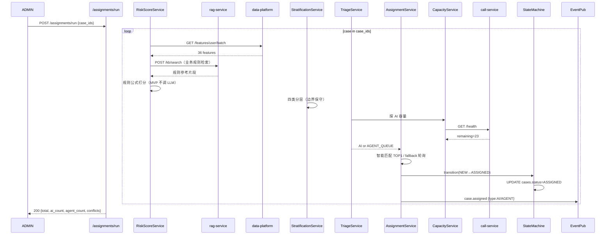
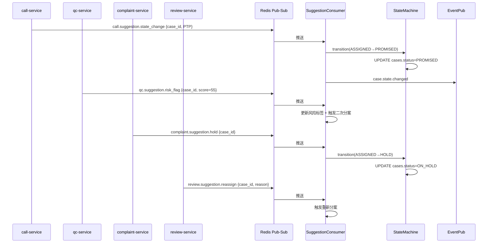
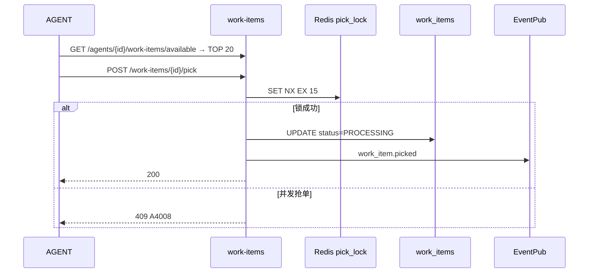

# 子系统详细设计 #04：案件管理与智能分案系统

> 子系统编号：第 4 号
> 服务名：`case-service`
> 监听端口：**8005**
> 里程碑归属：**M2（M1 闭环 + 外呼后上线）**
> ACD 模式：**先落 work_items 表 + 手动认领模拟**（用户确认，M3 接真实 ACD 零改核心）
> 上游约束：step1/01~03 全局口径、step3/01~03 架构与降级、step4/01~03 数据设计、step5/01~04 技术规范、step6/01~02 异常容错告警、step7/01~03 测试规范、step8/01 M0 任务清单
> 宪法约束：openspec/specs/00~07

---

## 0.1 文档修订记录

| 版本 | 日期 | 修订人 | 修订内容 |
| :--- | :--- | :--- | :--- |
| V1.0 | 2026-08-18 | - | 初始版本，12 章模板 |
| V1.1 | 2026-08-20 | 规范优化 | 明确双层架构（AI 评分层+业务状态层）；AI 不直接调 LLM（P2 可选复核）；新增 case→RAG 调用（业务规则检索）；新增 MQ 异步建议接收；新增 Ch13~15 AI 专项章节；新增 PII 脱敏列+数据闭环列；对齐 step3~step8 |

---

## 1. 模块概览

案件管理与智能分案系统是整套生态的**业务智能调度中枢**，采用**双层架构**：

### 1.1 双层架构定义

```
┌─────────────────────────────────────────────────────┐
│                case-service (8005)                    │
│                                                      │
│  ┌────────────────────────────────────────────────┐  │
│  │  AI 评分层（分析/打分/标签/建议）              │  │
│  │  • RiskScoreService：三维风险打分（规则公式）  │  │
│  │  • StratificationService：案件四层分层         │  │
│  │  • TriageService：人机智能分流                  │  │
│  │  • AssignmentService：坐席智能匹配              │  │
│  │  • ReassignService：动态二次分案                │  │
│  │  → 调用 RAG 获取业务规则（case→rag）            │  │
│  │  → 调用 DP 获取用户特征宽表（case→dp）          │  │
│  │  → MVP 不调 LLM（规则公式）；P2 可选 LLM 复核   │  │
│  │  → 只输出评分/分层/分流/匹配建议                │  │
│  └────────────────────────────────────────────────┘  │
│                      │ 建议（内部调用）                │
│  ┌────────────────────────────────────────────────┐  │
│  │  业务状态层（传统业务微服务）                   │  │
│  │  • 案件状态流转：new→assigned→in_call→closed    │  │
│  │  • assignments 表写入（实际派单）              │  │
│  │  • work_items 管理（转人工工单）                 │  │
│  │  • 接收其他 AI 服务的 MQ 异步建议               │  │
│  │  • 存储所有 AI 输出结果                         │  │
│  │  → 不调用 LLM                                   │  │
│  │  → 唯一有权修改案件状态的模块                   │  │
│  └────────────────────────────────────────────────┘  │
└─────────────────────────────────────────────────────┘
```

### 1.2 核心功能

1. **用户三维风险打分**（FR-CS-001）：DP 特征 × 0.4/0.3/0.3 → 综合风险分 0-100；阈值 ≥80 high / 60–79 medium / <60 low；打分依据 JSONB 存，缺失特征标记不阻断。**MVP 用规则公式，不调 LLM；P2 可选 LLM 复核兜底。**
2. **案件智能分层**（FR-CS-002）：M0/M1 轻量 / M2/M3 疑难 / 高对抗 / 失联 四类；边界案件 `待人工确认`，默认归入保守（严）一侧。
3. **人机智能分流**（FR-CS-003）：M0/M1 light/low/medium → AI 外呼；其余 → 人工坐席；AI 外呼容量不足 → 超额自动转人工队列。
4. **坐席智能匹配派单**（FR-CS-004 P1）：案件类型 × 坐席 skill_tags × 负载 × 历史 PTP 率 → 匹配；无匹配坐席 → 轮询 fallback。
5. **M2 独立可测（手动认领模拟）**：先落 `assignments` 表 + `work_items.status=PENDING_AGENT`，提供手动认领接口。
6. **动态二次分案**（FR-CS-005）：订阅 `call.session.ended` 事件，基于最新通话结果重新评估 → 升级 → 自动流转资深坐席。
7. **客户画像**（新增）：客户多头借贷、还款意愿评估，放 case-service。从 DP 读取用户特征宽表，生成客户画像标签。
8. **接收 AI 建议**（新增）：接收其他 AI 服务（call/qc/complaint/review）通过 MQ 异步推送的派单建议/风险标记/状态变更建议。**AI 只输出建议，case-service 执行实际变更。**

> **AI 边界约束（全局）**：case-service 是**唯一有权修改案件状态**的服务。AI 评分层只做分析、打分、标签、建议；业务状态层负责真正修改工单、案件状态。其他 AI 服务（call/qc/complaint/review）只输出建议，通过 MQ 异步推送，由 case-service 执行实际变更。
> **case-service 不直接调用 LLM**：MVP 用规则公式打分，保障核心业务不受大模型不确定性影响。P2 可选 LLM 复核兜底，但 LLM 故障不影响业务主流程。
> **RAG 被动约束**：rag-service 只提供被动检索，不主动向外调用。case-service 调用 RAG 获取业务规则。
> **DP 被动约束**：data-platform 不主动调用上层 AI 服务，数据以消息推送方式下发。case-service 主动拉取 DP 用户特征。

---

## 2. 职责边界

### 2.1 必做事项

1. **三维打分**：从 DP 拉 features_user → 规则公式加权 → 综合风险分 + 等级 + 依据 JSONB。
2. **案件分层**：四类分层 + 边界保守策略。
3. **人机分流**：M0/M1→AI / 其余→人工；容量溢出 fallback。
4. **坐席智能匹配**：skill_tags × 负载 × PTP 历史 + 轮询 fallback。
5. **M2 手动认领模拟**：assignments 表 + work_items pick。
6. **动态二次分案**：订阅 call.session.ended，自动升级/降级。
7. **客户画像**：多头借贷/还款意愿标签（从 DP 特征宽表生成）。
8. **接收 MQ 异步建议**：从其他 AI 服务接收派单/风险/状态变更建议，执行实际变更。
9. **分案冲突处理**：通知人工确认。
10. **DP 降级**：DP 熔断时打分降级为规则公式（缺失维度=50 中性）。

### 2.2 明确不做事项

1. **不做外呼调度**：由 call-service 负责。case-service 发布 `case.assigned type="AI"` 事件给 call-service 入队。
2. **不做真实 ACD**：M3 接真实 ACD 时新增 `ACDAdapter`。
3. **不做特征计算**：由 data-platform `features_user` / ADS 提供；case-service 只消费。
4. **不直接调用 LLM（MVP）**：打分公式 = 特征线性加权（P2 可选 LLM 复核兜底，但 LLM 故障不影响主流程）。
5. **不做知识库/敏感词 CRUD**：rag-service 负责。case-service 只调用 RAG 检索业务规则。
6. **不做 RBAC/审计表**：common/security。
7. **不做真实呼叫线路/ASR/TTS**：call-service。
8. **不做质检打分**：qc-service 负责。
9. **不做投诉判责**：complaint-service 负责。
10. **不做通话复盘**：review-service 负责。
11. **不做数据 ETL/宽表构建**：data-platform 负责。**DP 不主动调用上层服务。**

---

## 3. 内部模块拆分

```
case-service (FastAPI app)
├── app/
│   ├── main.py
│   ├── routers/
│   │   ├── scoring.py            # POST /scores/batch 风险打分；GET /scores/{case_id} 历史
│   │   ├── stratification.py     # 分层结果（手动调整边界）
│   │   ├── assignments.py        # 派单结果 CRUD + 运营调整
│   │   ├── work_items.py          # M2 手动认领：available / pick / release
│   │   ├── reassign.py            # FR-CS-005 二次分案
│   │   ├── agents.py              # 坐席 skill_tags/负载/产能
│   │   ├── skill_tags.py          # 技能标签管理（扩展枚举）
│   │   ├── customer_profile.py    # 客户画像（多头借贷/还款意愿）
│   │   └── suggestions.py        # 接收 MQ 异步建议（其他 AI 服务推送）
│   ├── services/
│   │   ├── risk_score_service.py      # AI 评分层：三维打分（规则公式，P2 可选 LLM）
│   │   ├── stratification_service.py   # AI 评分层：四类分层（边界保守）
│   │   ├── triage_service.py           # AI 评分层：人机分流 + 容量溢出
│   │   ├── assignment_service.py       # AI 评分层：坐席智能匹配 + 轮询 fallback
│   │   ├── reassign_service.py         # AI 评分层：二次分案 + 冲突检测
│   │   ├── customer_profile_service.py # 客户画像：多头借贷/还款意愿标签
│   │   ├── suggestion_consumer.py      # 业务状态层：接收 MQ 异步建议 → 执行变更
│   │   ├── state_machine.py             # 业务状态层：案件状态流转
│   │   ├── agent_router.py             # Protocol：AgentRouter
│   │   └── capacity_service.py         # AI外呼容量探测
│   ├── repositories/
│   │   ├── score_repo.py          # case_scores
│   │   ├── assign_repo.py         # assignments
│   │   ├── workitem_repo.py       # work_items
│   │   ├── agent_repo.py          # agents
│   │   └── profile_repo.py        # customer_profiles（客户画像）
│   ├── events/
│   │   ├── publisher.py           # case.assigned / case.reassigned / case.risk.upgraded
│   │   └── subscriber.py          # call.session.ended / etl.task.done / *.suggestion
│   └── integrations/
│       ├── dp_client.py           # GET /features/user/batch（DP 用户特征宽表）
│       ├── rag_client.py           # POST /kb/search（RAG 业务规则检索）
│       └── call_client.py         # GET /health 容量探测
└── adapters/
    ├── base.py                    # AgentRouter Protocol
    ├── manual_claim.py            # ManualClaimAgentRouter（M2）
    └── acd_adapter.py             # ACDAgentRouter 预留（M3）
```

### 3.1 案件状态机

```
NEW → ASSIGNED → IN_CALL → PROMISED → CLOSED
                                    ↘ TRANSFERRED → REASSIGNED → ASSIGNED
                                    ↘ LOST_CONTACT → CLOSED(lost)
            ← (二次分案升级) ← ←
```

- **NEW**：案件导入，未打分
- **ASSIGNED**：已派单（AI 或人工）
- **IN_CALL**：通话中（call-service 发布事件触发）
- **PROMISED**：承诺还款（PTP 达成，call-service 推送建议）
- **CLOSED**：案件关闭（还款确认/失联关闭）
- **TRANSFERRED**：转人工（call-service 推送建议）
- **REASSIGNED**：二次分案重新分配

> 所有状态变更由 case-service 业务状态层执行。其他 AI 服务只推送建议（MQ 异步），不直接修改。

---

## 4. 对外接口详细说明

`http://case-service:8005/api/v1`，统一响应包 `{"code":"0","message":str,"data":any|null,"trace_id":str}`。错误码 A4001–A4015 + B 类。

### 4.1 打分与分层

| 方法 | 路径 | 职责 | 权限 | 幂等 | 限流 | 错误码 | PII 脱敏 |
| :--- | :--- | :--- | :--- | :--- | :--- | :--- | :--- |
| POST | `/scores/batch` | 传入 case_ids（≤500），从 DP 拉特征→打分+写 case_scores | TRAINER/ADMIN | as_of+case_ids 去重 | 2/min | A4001/B0003 | user_id 不含手机号 |
| GET | `/scores/{case_id}` | 单案件最新打分历史 | ADMIN/SUPV/TRAINER | 幂等 | 60/min | A4002 | basis 不含手机号 |
| GET | `/stratifications` | 分层列表（按 M0M1/M2M3/HIGH/LOSS 过滤） | ADMIN/SUPV | 幂等 | 30/min | A4003 | — |
| POST | `/stratifications/{case_id}/override` | 运营手动修改分层（加审计） | ADMIN/SUPV | 幂等 | 30/min | A4003/B0002 | — |

### 4.2 派单

| 方法 | 路径 | 职责 | 权限 | 错误码 | PII 脱敏 |
| :--- | :--- | :--- | :--- | :--- | :--- |
| POST | `/assignments/run` | 触发全量派单（打分→分层→分流→匹配→写 assignments） | ADMIN | A4004 | — |
| GET | `/assignments` | 派单列表 | ADMIN/SUPV/TRAINER | A4005 | phone 脱敏 |
| GET | `/assignments/{id}` | 派单详情+打分依据 | ADMIN/SUPV/TRAINER | A4005 | basis 脱敏 |
| POST | `/assignments/{id}/reassign` | 运营手动改派 | ADMIN/SUPV | A4006 | — |

### 4.3 M2 手动认领模拟

| 方法 | 路径 | 职责 | 权限 | 错误码 |
| :--- | :--- | :--- | :--- | :--- |
| GET | `/agents/{agent_id}/work-items/available` | 按 skill_tags × 负载 返回 TOP 20 | AGENT | A4007 |
| POST | `/work-items/{id}/pick` | 坐席认领 | AGENT | A4008 |
| POST | `/work-items/{id}/release` | 释放回队列 | AGENT/SUPV | A4009 |

### 4.4 二次分案

| 方法 | 路径 | 职责 | 权限 | 错误码 |
| :--- | :--- | :--- | :--- | :--- |
| POST | `/reassign/auto-run` | 批量二次分案 | ADMIN | A4010 |
| GET | `/reassign/diffs?date=` | 升级/降级明细 | ADMIN/SUPV | A4010 |
| POST | `/reassign/apply` | 运营批量确认 | ADMIN | A4006 |

### 4.5 坐席与技能标签

| 方法 | 路径 | 职责 | 权限 | 错误码 |
| :--- | :--- | :--- | :--- | :--- |
| GET | `/agents` | 坐席列表 | ADMIN/SUPV | A4011 |
| POST | `/agents/{id}/skills` | 修改 skill_tags[] | ADMIN | A4011/B0002 |
| GET | `/skill-tags` | 当前可用标签 | ADMIN/SUPV | A4012 |
| POST | `/skill-tags` | 新增标签 | ADMIN | A4012/B0002 |

### 4.6 客户画像（新增）

| 方法 | 路径 | 职责 | 权限 | 错误码 | PII 脱敏 |
| :--- | :--- | :--- | :--- | :--- | :--- |
| GET | `/profiles/{customer_id}` | 客户画像（多头借贷/还款意愿/风险标签） | ADMIN/SUPV/TRAINER | A4014 | phone 脱敏 |
| GET | `/profiles` | 客户画像列表（risk_tag 过滤） | ADMIN/SUPV | A4014 | phone 脱敏 |

### 4.7 MQ 异步建议接收（新增）

| Channel | 发布者 | Payload | case-service 处理 |
| :--- | :--- | :--- | :--- |
| `call.suggestion.state_change` | call-service | `{case_id, suggestion: PTP/TRANSFER/LOST, call_id, ts}` | 执行状态变更 NEW→PROMISED/TRANSFERRED |
| `qc.suggestion.risk_flag` | qc-service | `{case_id, quality_score, risk_level, ts}` | 更新客户风险标签，触发二次分案 |
| `complaint.suggestion.hold` | complaint-service | `{case_id, complaint_id, suggestion: HOLD, ts}` | 案件暂缓催收 |
| `review.suggestion.reassign` | review-service | `{case_id, suggestion: REASSIGN, reason, ts}` | 触发重新分案 |

> case-service 接收建议后执行实际变更，其他 AI 服务不直接修改案件状态。

---

## 5. 内部类与方法清单

### 5.1 AgentRouter（MVP ManualClaim vs M3 ACD）

```python
class AgentRouter(Protocol):
    name: Literal["manual_claim", "acd"]
    async def route(self, assignment: Assignment, agent: AgentRow) -> RoutingResult
    # manual_claim: 写 assignments.status=PENDING_AGENT + INSERT work_items
    # acd(M3): 调用真实 ACD REST/WS 分派
```

### 5.2 AI 评分层

#### RiskScoreService（规则公式，P2 可选 LLM）

```python
class RiskScoreService:
    async def score_case(self, case_id: int, as_of: date) -> ScoreRow
    # 1. 拉 DP features_user{3维×12特征共36+4综合}
    # 2. 调用 RAG 检索业务规则（case→rag，获取打分规则参考）
    # 3. 归一化每一维到 0-100
    # 4. score = w_willing * willingness(0.4) + w_ability * ability(0.3) + w_complaint * complaint(0.3)
    # 5. 缺失特征：该维度=50（中性）+ 标记 missing_dims
    # 6. 等级: ≥80 high, 60-79 medium, <60 low
    # 7. 写 case_scores
    # MVP: 纯规则公式，不调 LLM
    # P2: 可选 LLM 复核兜底（LLM 故障不影响主流程，降级为纯规则）
```

#### StratificationService

```python
class StratificationService:
    def classify(self, case: CaseRow, score: ScoreRow) -> StratificationRow
    # IF risk=high OR intent_history.has("emotional_conflict") → HIGH_CONFLICT
    # ELIF last_3_calls=no_contact ≥2 → LOSS_RISK
    # ELIF dpd∈[0,30] → M0_M1_LIGHT
    # ELIF dpd∈[31,90] → M2_M3_HARD
    # 边界案件 → PENDING_MANUAL 默认归入保守一侧
```

#### TriageService + AssignmentService + ReassignService

```python
class TriageService:
    async def decide(self, strat: StratificationRow) -> TriageDecision
    # M0_M1_LIGHT AND risk in {low,medium} → AI_QUEUE
    # AI 容量不足 → AGENT_QUEUE fallback
    # 其余 → AGENT_QUEUE

class AssignmentService:
    async def assign_agent(self, strat, decision) -> Assignment
    # 1. 候选: skill_tags ∩ case_required_tags 非空
    # 2. 排序: (1-load_ratio)*0.4 + historical_ptp_rate*0.6
    # 3. TOP1；无匹配 → 轮询 fallback
    # 4. agent_router.route → 写 assignments + work_items

class ReassignService:
    async def re_evaluate(self, case_id, latest_call) -> ReEvalResult
    # UPGRADE: score 提升≥10 或 risk 变高 → 流转资深坐席
    # 冲突: 保留原分配 + 通知
```

### 5.3 业务状态层（新增）

```python
class SuggestionConsumer:
    """接收其他 AI 服务的 MQ 异步建议，执行实际变更"""
    async def on_call_suggestion(self, msg: dict) -> None
    # call.suggestion.state_change → 执行 NEW→PROMISED/TRANSFERRED
    async def on_qc_suggestion(self, msg: dict) -> None
    # qc.suggestion.risk_flag → 更新风险标签 + 触发二次分案
    async def on_complaint_suggestion(self, msg: dict) -> None
    # complaint.suggestion.hold → 案件暂缓
    async def on_review_suggestion(self, msg: dict) -> None
    # review.suggestion.reassign → 触发重新分案

class StateMachine:
    """案件状态流转，唯一有权修改案件状态"""
    VALID_TRANSITIONS = {
        "NEW": ["ASSIGNED"],
        "ASSIGNED": ["IN_CALL", "REASSIGNED"],
        "IN_CALL": ["PROMISED", "TRANSFERRED", "LOST_CONTACT"],
        "PROMISED": ["CLOSED", "REASSIGNED"],
        "TRANSFERRED": ["REASSIGNED", "CLOSED"],
        "REASSIGNED": ["ASSIGNED"],
    }
    async def transition(self, case_id: int, from_status: str,
                         to_status: str, operator: str, reason: str) -> None
    # 校验状态转换合法性 → UPDATE cases.status → 审计日志

class CustomerProfileService:
    """客户画像：多头借贷/还款意愿"""
    async def build_profile(self, customer_id: int) -> CustomerProfile
    # 从 DP features_user 读取 → 生成画像标签
    # 多头借贷标记、还款意愿评估、风险等级
```

---

## 6. 涉及数据库表与字段

### 6.1 PostgreSQL public schema（与 step4/01 对齐）

| 表名 | 主键 | 关键列 | 数据闭环 |
| :--- | :--- | :--- | :--- |
| cases | id | user_id + case_no + principal_amount + dpd + status + current_stratification | case.assigned → DP → dw.dws_call_result |
| case_scores | id+case_id+as_of | willingness/ability/complaint FLOAT + total_score INT CHECK(0-100) + risk_level ENUM + basis JSONB + missing_dims JSONB | DP → dw.dwd_case_scores |
| stratifications | id+case_id+as_of | stratification ENUM + boundary_case BOOL + overridden_by/at | DP → dw.dws_strategy_effectiveness |
| assignments | id | case_id(UQ per active) + assigned_type(AI/AGENT) + agent_id + strategy_version + status + score_snapshot JSONB + conflict_reason | DP → dw.dws_strategy_effectiveness |
| work_items | id | 与 call-service 同表共用；source=CASE_SERVICE_AUTO | — |
| agents | id | name + employee_no + is_active + skill_tags TEXT[] + max_load + current_load + historical_ptp_rate | — |
| skill_tags | id/name UQ | name + category + created_by/at | — |
| assignment_logs | id | assignment_id + action + operator_id + reason JSONB | 审计 |
| customer_profiles | id | customer_id + multi_lending BOOL + repayment_willingness FLOAT + risk_tags TEXT[] + last_updated_at | DP → dw.dws_user_features |
| suggestion_logs | id | source_service + channel + case_id + suggestion_type + suggestion_data JSONB + executed BOOL + executed_at | 审计 |

> 公共字段统一：id(UUID) / create_time / update_time / is_delete CHAR(1)

### 6.2 Redis（与 step4/03 对齐，DB 5 分配给 case-service）

```
cs:score:{case_id}:{as_of}        打分缓存 TTL=24h
cs:capacity:ai_remaining           AI 令牌桶 TTL=10s
cs:agent:load:{agent_id}           坐席负载 TTL=60s
cs:pick_lock:{work_item_id}        pick 分布式锁 TTL=15s
cs:reassign:review:{case_id}       冲突待确认 TTL=7d
cs:skill_tags:active               技能标签缓存（永不过期）
cs:profile:{customer_id}           客户画像缓存 TTL=1h
cs:state_machine:{case_id}         状态机当前状态 TTL=24h
```

---

## 7. 类图与时序图

### 7.1 全量派单流程



### 7.2 MQ 异步建议接收（新增）



### 7.3 手动认领（同 V1.0）



---

## 8. 模块独立测试方案

### 8.1 依赖与 Mock 清单

| 依赖 | 真实/Mock | 说明 |
| :--- | :--- | :--- |
| PG | 真实 | 10 张表 |
| Redis | 真实 DB 5 | |
| data-platform | 真实+种子 20 用户特征 | DP 特征查询 |
| call-service | Mock | capacity 返回固定 remaining=23 |
| rag-service | Mock 或真实 | 业务规则检索（可 Mock 返回固定规则） |
| rag/qc/complaint/review | 不需要 | 独立可测 |
| LLM | Mock | MVP 不调 LLM |

### 8.2 独立可测断言清单

```
 1.  POST /scores/batch [10 case] → case_scores 全部 0-100 合法
 2.  分层分布合理，至少一条边界=PENDING_MANUAL
 3.  POST /assignments/run → 至少 2 条 AI_QUEUE
 4.  Mock call-service remaining=0 → AI 全部 fallback AGENT_QUEUE
 5.  AGENT_QUEUE 智能匹配 skill_tags 交集非空
 6.  无匹配坐席 → DEFAULT 轮询分布均匀
 7.  GET /work-items/available → TOP 20
 8.  并发 pick → 其一 200 其二 409 A4008
 9.  二次分案：emotional_conflict → score=85 high → case.risk.upgraded
10.  运营 override 撞车 → CONFLICT 不覆盖
11.  POST /skill-tags 扩展成功
12.  DP 熔断 → 降级规则打分 missing_dims 标记
13.  MQ 建议：call.suggestion.state_change → 案件状态变更（PROMISED）
14.  MQ 建议：qc.suggestion.risk_flag → 风险标签更新
15.  MQ 建议：complaint.suggestion.hold → 案件暂缓
16.  客户画像：GET /profiles/{customer_id} → 多头借贷+还款意愿标签
17.  状态机：非法转换被拒绝（如 NEW→CLOSED 直接跳）
18.  RAG 检索业务规则：Mock 返回规则片段 → 打分参考可用
```

---

## 9. 模块通信与依赖

### 9.1 同步 HTTP（我作为 Client）

| 目标 | 路径 | 触发 | 超时 | 重试 | 熔断 | 降级 |
| :--- | :--- | :--- | :--- | :--- | :--- | :--- |
| data-platform 8001 | GET /features/user/batch | 打分 | 5s | 2× | 3连 | 缺失维度=50 中性 |
| rag-service 8002 | POST /kb/search | 业务规则检索 | 3s | 2× | 3连 | 跳过规则参考，纯公式 |
| call-service 8004 | GET /health | 探 AI 容量 | 2s | 1× | 2连 | 容量=0 全人工 |

> **RAG 被动约束**：rag-service 只提供被动检索，不主动向外调用。
> **DP 被动约束**：data-platform 不主动调用上层 AI 服务，数据以消息推送方式下发。

### 9.2 同步 HTTP（我作为被调）

| 谁调我 | 路径 | 目的 |
| :--- | :--- | :--- |
| 运营端 | scoring/stratifications/assignments/reassign/skill-tags/agents/profiles | 案件管理 |
| 坐席端 | /agents/{id}/work-items/* | 认领工单 |
| call-service | GET /assignments/{case_id} | 查询派单信息 |

### 9.3 事件通知（Redis Pub-Sub）

#### 发布

| Channel | Payload | 订阅者 | 数据闭环 |
| :--- | :--- | :--- | :--- |
| `case.assigned` | `{assignment_id, case_id, type, agent_id?, ts}` | call-service(AI入队) + DP + review | DP → dw.dws_strategy_effectiveness |
| `case.reassigned` | `{assignment_id, case_id, action, needs_review, ts}` | 运营端 + DP | — |
| `case.risk.upgraded` | `{case_id, from_level, to_level, ts}` | call-service + review-service | — |
| `case.state.changed` | `{case_id, from_status, to_status, ts, trace_id}` | DP(宽表) + call-service | DP → dw.dws_call_result |

#### 订阅

| Channel | 发布者 | 处理 |
| :--- | :--- | :--- |
| `call.session.ended` | call-service | ReassignService 二次分案 |
| `etl.task.done` | data-platform | 自动重打分 |
| `call.suggestion.state_change` | call-service | SuggestionConsumer → 状态变更 |
| `qc.suggestion.risk_flag` | qc-service | SuggestionConsumer → 风险标签更新 |
| `complaint.suggestion.hold` | complaint-service | SuggestionConsumer → 案件暂缓 |
| `review.suggestion.reassign` | review-service | SuggestionConsumer → 重新分案 |

---

## 10. 错误处理矩阵（与 step6/01 对齐）

| 错误码 | 描述 | 触发 | 降级 |
| :--- | :--- | :--- | :--- |
| A4001 | 特征缺失+DP 熔断 → 批量部分失败 | 3连DP超时 | 失败 case 标记 FAILED 可重试 |
| A4002 | case 不存在 | 404 | — |
| A4003 | 分层 override 无权限 | 403 | — |
| A4004 | 派单冲突（同日重复 run） | 409 | 返回旧 assignment_ids |
| A4005 | 派单不存在 | 404 | — |
| A4006 | 改派冲突（已完成） | 409 | — |
| A4007 | 坐席不存在/禁用 | 404/400 | — |
| A4008 | work-item 被他人认领 | 409 | — |
| A4009 | work-item 非本人释放 | 403 | — |
| A4010 | 二次分案无可评估数据 | 422 | — |
| A4011 | 坐席负载越界 | 400 | — |
| A4012 | skill_tags 重名 | 409 | — |
| A4013 | 技能标签被引用时删除 | 400 | — |
| A4014 | 客户画像不存在 | 404 | — |
| A4015 | 状态机非法转换 | 409 | — |
| B0001-B0010 | 系统级 | 统一 | — |

---

## 11. 宪法规则落地检查清单

| 条款 | 落地 | 验收 |
| :--- | :--- | :--- |
| 1.1 RAG | case→rag 获取业务规则（被动检索） | 断言 18 |
| 1.2 LLM 调用 | MVP 不调 LLM；P2 可选复核走 llm_call_logs | — |
| 2.2 AES | user 隐私字段从 DP 返回已脱敏 | 种子无明文手机号 |
| 3.1 5s/重试3次/熔断 | DP/RAG/call client | 注入故障→降级 |
| 3.2 LLM→规则降级 | 本身是规则公式（已符合） | — |
| 3.4 监控+降级日志 | /health: dp_ok/rag_ok/call_connected/capacity/agents_online | GET /health |
| 3.5 熔断告警 | dp_ok=false → publish case.service.degraded | 订阅捕获 |
| 5.1 X-Trace-Id | 全链路+事件 | 响应含 trace_id |
| 5.2 DWS 3表 | case.assigned → DP dws_strategy_effectiveness | DP 侧有 strategy_id |
| 5.3 审计+脱敏 | override/reassign/pick/skill 全审计 | audit_logs 对应 |
| AI 边界约束 | case-service 是唯一修改案件状态的服务 | 其他服务只推送建议 |
| 不直接调 LLM | MVP 规则公式打分 | LLM 故障不影响主流程 |

---

## 12. 可配置项清单

| 键 | 默认值 | 说明 |
| :--- | :--- | :--- |
| CS_W_WILLING | 0.4 | 还款意愿权重 |
| CS_W_ABILITY | 0.3 | 能力权重 |
| CS_W_COMPLAINT | 0.3 | 投诉风险权重 |
| CS_RISK_HIGH | 80 | ≥80 high |
| CS_RISK_MEDIUM | 60 | 60≤score<80 |
| CS_MISSING_DIM_DEFAULT | 50 | 缺失维度中性 |
| CS_BOUNDARY_CONSERVATIVE | true | 边界归严一侧 |
| CS_AI_CAPACITY_PROBE_SEC | 10 | 探 call 容量周期 |
| CS_AI_CAPACITY_FALLBACK | true | 容量0→全人工 |
| CS_MATCH_WEIGHT_LOAD | 0.4 | 负载权重 |
| CS_MATCH_WEIGHT_PTP | 0.6 | PTP 权重 |
| CS_NO_MATCH_FALLBACK | round_robin | 无匹配 fallback |
| CS_AGENT_ROUTER | manual_claim | M2 manual / M3 acd |
| CS_PICK_LOCK_TTL_SEC | 15 | pick 锁 TTL |
| CS_PICK_AUTO_RELEASE_MIN | 10 | 自动释放 |
| CS_REASSIGN_UPGRADE_DELTA | 10 | 升级分数差 |
| CS_CONFLICT_KEEP_ORIGINAL | true | 冲突保留原 |
| CS_DP_BASE | http://data-platform:8001/api/v1 | DP base |
| CS_RAG_BASE | http://rag-service:8002/api/v1 | RAG base |
| CS_CALL_BASE | http://call-service:8004/api/v1 | call base |
| CS_SCORE_BATCH_MAX | 500 | 单次打分上限 |
| CS_LLM_ENABLED | false | P2 LLM 复核开关 |
| CS_SUGGESTION_ENABLED | true | MQ 异步建议接收开关 |

---

## 13. LLM 专项设计（新增，对齐 step5/03 + step5/04）

> case-service MVP 不直接调用 LLM。P2 可选 LLM 复核兜底，但 LLM 故障不影响业务主流程。

### 13.1 LLM 调用点清单

| # | 功能 | MVP | P2 可选 | Prompt 版本 | 置信度阈值 | 降级 |
| :--- | :--- | :--- | :--- | :--- | :--- | :--- |
| L1 | 风险打分复核 | 不调用 | 可选：LLM 复核规则打分结果 | risk_review_v1（P2） | — | LLM 故障→纯规则公式（不影响主流程） |
| L2 | 客户画像生成 | 不调用 | 可选：LLM 生成画像描述 | profile_gen_v1（P2） | — | LLM 故障→规则标签 |

### 13.2 双层架构 LLM 隔离

```
AI 评分层（可选 LLM）
  RiskScoreService.score_case()
    → MVP: 纯规则公式（不调 LLM）
    → P2: 可选 LLM 复核（LLM 故障 → 降级纯规则）
  CustomerProfileService.build_profile()
    → MVP: 规则标签（不调 LLM）
    → P2: 可选 LLM 生成描述

业务状态层（永不调 LLM）
  StateMachine.transition()     → 纯数据库操作
  SuggestionConsumer.on_*()    → 纯业务逻辑
  AssignmentService.assign()    → 纯规则匹配
```

> 保障核心业务不受大模型不确定性影响，避免因 LLM 故障影响案件主流程。

---

## 14. 分层降级策略（新增，对齐 step3/03 + step6/01）

### 14.1 故障分类与降级矩阵

| 故障类型 | 检测方式 | 降级路径 | 兜底内容 | 恢复条件 |
| :--- | :--- | :--- | :--- | :--- |
| ① DP 不可用 | 5s 超时 / 3 连失败 | 熔断→缺失维度=50 中性 | 规则公式仍可打分 | 60s 半开探测 |
| ① RAG 不可用 | 3s 超时 / 3 连失败 | 跳过规则参考 | 纯公式打分 | rag 恢复 |
| ① call-service 不可用 | 2s 超时 / 2 连失败 | 容量=0 全人工 | 不影响派单 | call 恢复 |
| ① P2 LLM 不可用 | 5s 超时 / 3 连失败 | 降级纯规则公式 | 不影响主流程 | 60s 半开 |
| ② MQ 建议消费失败 | 消费异常 | 重试 3 次→死信队列 | 人工处理 | — |
| ② 状态机非法转换 | 状态校验 | 拒绝（A4015） | 不修改 | — |
| ② 智能匹配无坐席 | 无匹配 skill | 轮询 fallback | 默认分配 | — |
| ② DP 特征缺失 | 字段为空 | 该维度=50 中性 | missing_dims 标记 | — |

### 14.2 熔断状态机

```
CLOSED（正常调用 DP/RAG/call）
  → 连续 3 次失败 → OPEN（Redis SET cs:dp_degraded=1）
    → 60s 后 → HALF_OPEN（探测）
      → 成功 → CLOSED
      → 失败 → OPEN
```

---

## 15. 数据闭环 + 可观测 + 金融合规脱敏（新增，对齐 step4~06 + step5/04）

### 15.1 数据闭环矩阵

| 功能 | 数据来源 | 落库位置 | 回流 DP | 回流方式 |
| :--- | :--- | :--- | :--- | :--- |
| 风险打分 | DP features_user + RAG 规则 | case_scores | ✅ | case.assigned → DP → dw.dwd_case_scores |
| 案件分层 | StratificationService | stratifications | ✅ | → DP → dw.dws_strategy_effectiveness |
| 派单 | AssignmentService | assignments + assignment_logs | ✅ | case.assigned → DP → dw.dws_strategy_effectiveness |
| 二次分案 | call.session.ended | assignments（更新）+ stratifications | ✅ | case.risk.upgraded → DP |
| 客户画像 | DP features_user | customer_profiles | ✅ | → DP → dw.dws_user_features |
| MQ 建议接收 | call/qc/complaint/review | suggestion_logs + cases.status | ✅ | case.state.changed → DP → dw.dws_call_result |
| 状态变更 | StateMachine | cases.status | ✅ | case.state.changed → DP |

### 15.2 数据流图

```
data-platform ──(features_user)──→ case-service(AI评分层)
                                         │
rag-service ──(业务规则检索)──→ case-service(AI评分层)
                                         │
call/qc/complaint/review ──(MQ异步建议)──→ case-service(业务状态层)
                                         │
                              ┌──────────┤
                              ▼          ▼
                         cases.status  assignments
                         case_scores   customer_profiles
                         suggestion_logs
                              │
                              ▼
                    (case.assigned / case.state.changed Pub-Sub)
                              │
                    ┌─────────┼─────────┐
                    ▼         ▼         ▼
               data-platform  call    review
               (ETL→dw)    (AI入队)  (复盘)
```

### 15.3 可观测埋点

| 事件 | 触发点 | 采集字段 | 告警阈值 |
| :--- | :--- | :--- | :--- |
| case.score.completed | 打分完成 | trace_id, case_id, score, risk_level, missing_dims | — |
| case.assign.completed | 派单完成 | trace_id, case_id, type(AI/AGENT), agent_id | — |
| case.reassign.triggered | 二次分案 | trace_id, case_id, action(UPGRADE/DOWNGRADE) | — |
| case.state.changed | 状态变更 | trace_id, case_id, from_status, to_status | — |
| case.suggestion.received | 接收 MQ 建议 | trace_id, source_service, suggestion_type | — |
| case.suggestion.executed | 执行建议 | trace_id, case_id, executed_action | — |
| case.conflict.detected | 冲突检测 | trace_id, case_id, conflict_reason | 立即告警 |
| case.dp.degraded | DP 降级 | trace_id, reason | 立即告警 |
| case.rag.degraded | RAG 降级 | trace_id, reason | 立即告警 |

### 15.4 仪表盘指标

| 指标 | 来源 | 展示 |
| :--- | :--- | :--- |
| 案件分配率 | case.assign.completed / total cases | 百分比 |
| AI 分流率 | type=AI / total assignments | 百分比 |
| 二次分案升级率 | case.reassign UPGRADE / total | 百分比 |
| MQ 建议执行率 | case.suggestion.executed / received | 百分比 |
| DP 降级率 | case.dp.degraded / total | 百分比 |
| 冲突率 | case.conflict / total assignments | 百分比 |

### 15.5 金融合规脱敏

| PII 类型 | 存储方式 | API 返回 | 导出 | 日志 | 流转 |
| :--- | :--- | :--- | :--- | :--- | :--- |
| 手机号 | 不存储（DP 返回已脱敏） | 不返回 | 不导出 | 不记录 | — |
| 身份证号 | 不存储 | 不返回 | 不导出 | 不记录 | — |
| 逾期金额 | AES 加密存储 | ****（打码） | 不导出 | 不记录 | DP 回流脱敏 |
| user_id | 加密存储（元数据） | 不返回 | 不导出 | 不记录 | 仅内部引用 |
| 打分依据 | 脱敏后 JSONB | 脱敏展示 | 脱敏导出 | 脱敏 | DP 回流脱敏版 |

---

## M2 验收标准

| 验收项 | 标准 |
| :--- | :--- |
| 风险打分 | 10 case 全部 0-100 合法 |
| 案件分层 | 四类分层+边界保守 |
| 人机分流 | AI+AGENT 混合分配 |
| 坐席匹配 | skill_tags 交集+轮询 fallback |
| 手动认领 | 并发 pick 409 |
| 二次分案 | 升级流转 |
| 客户画像 | 多头借贷+还款意愿标签 |
| MQ 建议接收 | call/qc/complaint/review 建议→执行变更 |
| 双层架构 | AI 评分层+业务状态层分离 |
| 不直接调 LLM | MVP 规则公式打分 |
| AI 边界 | case-service 唯一修改案件状态 |
| DP 降级 | 熔断→缺失=50 中性 |
| 数据闭环 | case.assigned → DP 可消费 |
| PII 脱敏 | 手机号不可见，金额打码 |
| trace_id | 全链路透传 |
