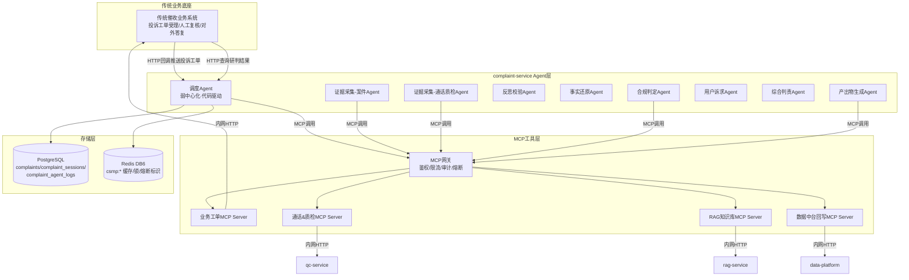
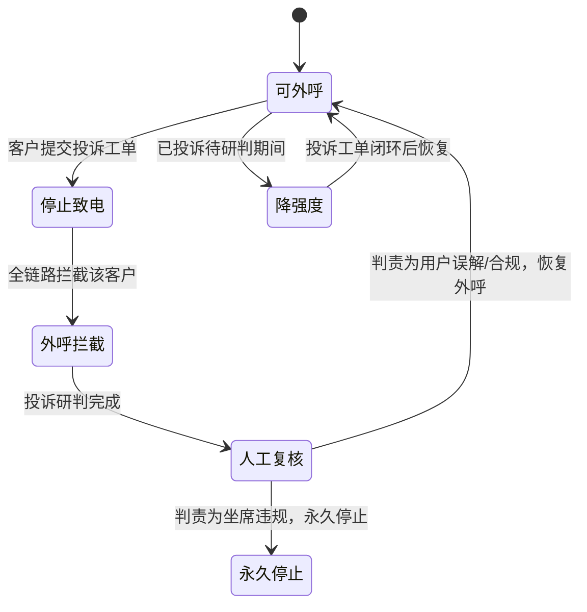

# DD-05 AI投诉异议智能研判系统 需求文档

> 文档类型：需求PRD（规范层）
> 版本：v1.1
> 状态：定稿
> 更新日期：2026-09-01
> 约束声明：遵循 step1/01 全局统一口径与 openspec/specs/00~~07 宪法层强制规范；服务名 complaint-service、端口 8006、错误码段 A5001~~A5013；所有 AI 输出为草稿，最终判责与对外答复必须经人工运营终审确认（Human-in-loop 不可跳过）。

## 修订记录

| 版本   | 日期         | 修订内容                                                                                                                | 修订人  |
| ---- | ---------- | ------------------------------------------------------------------------------------------------------------------- | ---- |
| v0.1 | 2026-08-18 | 文件创建，空占位                                                                                                            | —    |
| v1.0 | 2026-09-01 | 完整编写：弱中心化多Agent架构、MCP工具层、LangGraph状态流转、反思循环、Pydantic结构化输出、数据模型扩展、灰度双模、回归测试规范                                        | 规范定稿 |
| v1.1 | 2026-09-01 | 修订补强：新增NFR非功能需求、灾备故障处理、多环境差异、PromptOps工程化、LLM模型路由、PostgresSaver生产约束、数据脱敏安全规范、Prompt变更回归测试；修订MCP网关部署约束、Agent表禁止行为列格式 | 规范定稿 |

***

## 一、系统目标

构建【催收AI投诉异议智能研判系统】，针对催收业务用户投诉工单，实现：自动多源证据采集、证据完整性反思循环校验、多视角联合Agent研判、自动生成证据链/判责报告/答辩初稿、样本闭环回流。

技术选型：LangGraph做Agent编排，MCP协议标准化工具调用。

**架构模式选择：弱中心化调度架构**——禁止使用强Supervisor大包大揽模式，拒绝完全去中心化Agent架构。

### 1.1 价值定位

| 层面   | 传统模式痛点                    | AI研判目标                    |
| ---- | ------------------------- | ------------------------- |
| 取证效率 | 人工手动找录音、逐秒听、摘抄证据，单件耗时2-3天 | Agent自动多源取证，分钟级完成         |
| 判责标准 | 主观判断，标准不统一，误判率高           | RAG法规对照+多视角联合研判，标准统一      |
| 答辩质量 | 手写文案，质量参差不齐               | 自动生成答辩初稿，引用法规来源           |
| 风险兜底 | 二次投诉率高，监管处罚风险             | 证据不足自动转人工，Human-in-loop终审 |
| 经验沉淀 | 人工处理经验无法复用                | 全量session回流数据中台，样本闭环迭代    |

### 1.2 里程碑

| 里程碑  | 阶段     | 交付物                                        |
| ---- | ------ | ------------------------------------------ |
| M3   | 投诉研判骨架 | 服务骨架 + LangGraph Agent编排 + MCP工具层 + 基础研判流程 |
| M3.5 | 灰度双模   | 原有单Agent模式 + 新多Agent+MCP模式双开关 + 一致性对比指标    |
| M5   | 全量上线   | 10维度准入清单全通过，全量切换多Agent模式                   |

***

## 二、业务硬性约束（必须严格遵守）

1. 本系统属于金融强监管催收场景，**所有Agent仅输出研判草稿、建议，AI没有任何最终业务定责权限；判责、对外答复必须经过人工运营终审确认（Human-in-loop不可跳过）**。
2. 不修改原有七大AI微服务与传统催收业务系统内部逻辑；原有系统能力保持不变，仅通过MCP Server做一层封装对外暴露能力。
3. 投诉研判属于离线业务，非实时通话链路；允许一定执行时延，但必须设置超时、熔断、降级策略。
4. 全流程所有Agent推理、MCP调用、中间输出必须完整落库，做到全链路可审计、可回溯、可复现。
5. 防控大模型幻觉：所有法规、案例输出必须携带RAG知识库来源ID。

***

## 三、Agent整体架构原则：弱中心化调度架构

### 3.1 核心原则

1. 采用**弱中心化调度Agent作为流程协调中心**，不使用强Supervisor，不使用完全去中心化Agent。
2. 调度Agent只负责：任务接收、状态管理、子任务分发、循环次数控制、流程分支路由、异常降级流转；**调度Agent尽量使用代码if-else条件判断，尽可能减少LLM业务推理；不做事实还原、不做合规判责、不修改子Agent业务输出结论**。
3. 全部业务推理能力下沉到各个专项Agent。
4. 所有Agent之间不直接点对点消息通信；所有输入输出读写LangGraph全局State会话上下文；由Graph条件边+调度Agent驱动整体流转。
5. 所有Agent不直接调用底层业务接口；每个Agent内置MCP Client，统一通过MCP Client调用各个MCP Server获取外部能力。

### 3.2 系统架构图



### 3.3 Agent角色完整划分

| Agent角色          | 核心职责                                                                                                                                                                               | 是否调用MCP                         | 禁止行为                                               | 输出产物                                             |
| ---------------- | ---------------------------------------------------------------------------------------------------------------------------------------------------------------------------------- | ------------------------------- | -------------------------------------------------- | ------------------------------------------------ |
| 调度Agent（总协调，弱中心） | 1.接收外部投诉工单，初始化全局Session State；2.拆解子任务，驱动专项Agent执行；3.维护取证循环计数器，控制反思循环最大次数（默认上限3次，可配置）；4.根据反思报告做流程分支：重新取证 / 进入研判 / 证据不足转人工；5.捕获子Agent、MCP调用异常，执行降级；6.研判完成后触发样本回流；7.全程优先代码条件分支，少LLM推理 | 是（仅读取工单基础信息）                    | 做事实还原、合规判责；修改子Agent业务输出结论；充当Supervisor评价改写子Agent结果 | 全局session上下文、流程状态标记、流转指令、异常标记                    |
| 证据采集-案件Agent     | 拉取案件侧结构化数据：逾期信息、还款记录、历史工单、历史投诉记录；清洗过滤无效脏数据                                                                                                                                         | 是 MCP业务工单Server                 | 做任何业务判责                                            | 案件结构化事实材料                                        |
| 证据采集-通话质检Agent   | 获取对应案件全部通话ASR文本、AI质检违规片段、风险告警记录；标记ASR乱码、录音残缺等证据置信度                                                                                                                                 | 是 MCP通话&质检Server                | 做合规定性（仅做证据采集预处理）                                   | 通话证据集合，附带每条证据置信度标记                               |
| 反思校验Agent（循环核心）  | 对采集全部证据做完整性、一致性校验：1.检查关键通话是否缺失；2.检测证据互相矛盾；3.校验证据是否能够支撑投诉用户描述；输出反思报告，明确需要补充哪些证据；不直接发起工具调用，输出报告交给调度Agent决策                                                                           | 否 不直接调用MCP                      | 自行发起取证循环（仅输出校验报告，把流转权交还调度Agent）                    | 证据校验反思报告：evidence\_sufficient(bool)、缺失证据清单、矛盾点描述 |
| 事实还原Agent        | 纯客观还原事件完整时序线，不带主观定性，只陈列客观事实                                                                                                                                                        | 是 读取state内证据，不直接调用MCP           | 做违规判定、输出责任结论                                       | 客观事件时序还原文本                                       |
| 合规判定Agent        | 调用RAG法规，对照催收监管规则，逐条核对行为是否合规                                                                                                                                                        | 是 MCP RAG知识库Server              | 输出最终定责（仅输出合规分析意见）                                  | 合规分析意见、引用法规来源ID                                  |
| 用户诉求Agent        | 解析用户真实诉求、情绪等级、评估二次投诉风险                                                                                                                                                             | 否 读取state内证据                    | 做责任判定                                              | 用户诉求分析、二次投诉风险等级                                  |
| 综合判责Agent        | 融合事实还原、合规判定、用户诉求三份独立输出；识别多Agent意见冲突点并标记冲突（提示人工重点复核）；输出初步判责草稿：坐席违规 / 用户误解 / 合规但体验差                                                                                                  | 否 读取state多份研判结果，必要时可调用MCP复核法规片段 | 拥有最终定责权限（仅输出草稿）                                    | 初步判责结论、冲突标记说明                                    |
| 产出物生成Agent       | 根据判责草稿生成全套输出物：结构化证据链、判责报告、对外答辩初稿、内部整改建议；全部引用带上知识库来源ID                                                                                                                              | 是 MCP RAG知识库Server              | 编造事实、编造法规条款                                        | 完整投诉研判数据包（证据链、报告、答辩、整改建议）                        |

***

## 四、MCP系统规划

> MCP定位：工具调用标准化协议层；不改造原有业务微服务；底层能力依旧内网HTTP，包装MCP Server对外暴露；MCP网关统一鉴权、限流、审计日志、熔断降级；禁止MCP直接暴露公网。

### 4.1 MCP-Server拆分（按业务域隔离）

| # | MCP Server       | 能力                                            | 调用方                  | 底层对接                                    |
| - | ---------------- | --------------------------------------------- | -------------------- | --------------------------------------- |
| 1 | 业务工单MCP Server   | 按案件ID查询案件信息、历史工单、历史投诉；读取原始投诉工单                | 调度Agent、证据采集-案件Agent | complaint-service内网HTTP → 传统业务系统/PG     |
| 2 | 通话&质检MCP Server  | 获取通话ASR带时间戳、质检违规片段、告警元数据                      | 证据采集-通话质检Agent       | complaint-service内网HTTP → qc-service    |
| 3 | RAG知识库MCP Server | 检索监管法规、投诉处理范本；返回文档来源溯源ID                      | 合规判定Agent、产出物生成Agent | complaint-service内网HTTP → rag-service   |
| 4 | 数据中台回写MCP Server | 把完整session、Agent中间输出、人工终审真值回写数据中台；候选案例推送RAG入库 | 调度Agent（流程结束阶段）      | complaint-service内网HTTP → data-platform |

### 4.2 MCP-Client约束

1. 每个Agent内置独立MCP Client；携带工单唯一session\_id；
2. 捕获MCP调用超时、报错、空返回，将异常写入state；交由调度Agent做降级处理；
3. 每一次MCP调用完整记录审计日志：调用Agent、入参、返回、耗时、异常信息。

### 4.3 MCP错误分级处理约束

| 错误级别    | 场景           | 处置                                   | 重试          |
| ------- | ------------ | ------------------------------------ | ----------- |
| 业务类错误   | 查无案件、无对应通话记录 | 标记证据缺失，进入反思校验；未达循环上限可重新采集；达到上限流转人工复核 | 可重试（在循环上限内） |
| MCP服务故障 | 超时、连接失败      | 不做重试，标记服务异常，直接流转人工，禁止无限重试引发服务雪崩      | 禁止重试        |
| 权限安全拒绝  | 鉴权失败、数据越权    | 立刻终止自动流程，记录安全审计日志，流转人工               | 禁止重试        |

> MCP Server层完成用户敏感数据脱敏，禁止将原始明文敏感数据返回Agent。

***

## 五、完整业务执行流程（LangGraph状态流转）

### 5.1 业务状态流转图

```mermaid
stateDiagram-v2
    [*] --> 工单初始化: 传统业务系统推送投诉工单
    工单初始化 --> 并行证据采集: 调度Agent下发任务
    state 并行证据采集 {
        [*] --> 案件Agent
        [*] --> 通话质检Agent
        案件Agent --> [*]: 证据写入State
        通话质检Agent --> [*]: 证据写入State
    }
    并行证据采集 --> 反思校验: 证据采集完成
    反思校验 --> 并行证据采集: evidence_sufficient=false && loop_count<3
    反思校验 --> 待人工复核: evidence_sufficient=false && loop_count>=3
    反思校验 --> 多视角联合研判: evidence_sufficient=true
    state 多视角联合研判 {
        [*] --> 事实还原Agent
        [*] --> 合规判定Agent
        [*] --> 用户诉求Agent
        事实还原Agent --> 综合判责Agent
        合规判定Agent --> 综合判责Agent
        用户诉求Agent --> 综合判责Agent
        综合判责Agent --> [*]: 判责草稿写入State
    }
    多视角联合研判 --> 产出物生成: 生成完整研判数据包
    产出物生成 --> Human-in-loop终审: 回传传统业务系统
    Human-in-loop终审 --> 样本闭环回流: 人工确认真值写入State
    样本闭环回流 --> 已归档: 回写数据中台 + 候选案例推送RAG
    已归档 --> [*]: 流程结束
    待人工复核 --> 已归档: 人工处理后归档
```

### 5.2 阶段详解

**阶段1：工单初始化**

- 传统催收业务系统推送投诉工单给本系统；

- 调度Agent接收工单，初始化全局State会话上下文，初始化循环计数器loop\_count=0；

- 任务状态置为 `evidence_gathering`。

**阶段2：多Agent并行证据采集**

- 调度Agent下发任务，并行执行【证据采集-案件Agent】、【证据采集-通话质检Agent】；

- 两个Agent通过MCP Client拉取多源证据，预处理完成后把证据集合写入全局State；

- 证据残缺、ASR识别乱码做标记，供后续研判参考；

- 任务状态置为 `evidence_gathering`。

**阶段3：反思校验循环（核心闭环）**

- 执行反思校验Agent，输出反思报告写入State；

- 调度Agent读取state执行条件分支（优先代码判断）：

  - **分支A**：`evidence_sufficient=false && loop_count < 最大循环数(3)` → loop\_count +=1；跳转回证据采集阶段，重新采集缺失证据；开启新一轮循环。

  - **分支B**：`evidence_sufficient=false && loop_count >= 最大循环数` → 标记证据不足，流转至待人工复核节点，终止自动流程。

  - **分支C**：`evidence_sufficient=true` → 跳出循环，进入多视角联合研判。

- 任务状态在 `evidence_gathering` / `reflection_retry` / `pending_manual_review` 之间流转。

> 循环由调度Agent外层状态机控制，禁止Agent内部自递归循环，防止死循环。

**阶段4：多视角联合研判**

- 并行执行：事实还原Agent、合规判定Agent、用户诉求Agent；三份独立研判结果写入State；

- 执行综合判责Agent，融合多方输出，标记意见冲突点，输出初步判责草稿；

- 任务状态置为 `judging`。

**阶段5：产出物生成**

- 执行产出物生成Agent，生成完整研判数据包，全部附带RAG来源ID；

- 任务状态置为 `draft_generated`。

**阶段6：Human-in-loop人工终审（不可跳过）**

- 将完整研判数据包回传给传统催收业务系统；

- 运营人工复核，可修改判责、修改答辩文案、补充证据；

- 人工确认结果作为真值写入state；

- 任务状态置为 `pending_review` → `resolved` → `closed`。

**阶段7：样本闭环回流**

- 调度Agent调用数据中台回写MCP Server，将完整session全部数据回写给数据中台；

- 中台做样本治理，优质案例筛选后推送RAG知识库，完成迭代闭环；

- 任务状态置为 `archived`。

**阶段8：任务归档，流程结束。**

### 5.3 LangGraph实现要点

1. Graph节点 = 各个Agent；全部节点共享同一个State全局对象；
2. 使用`add_conditional_edges`做分支跳转；循环回边指向证据采集节点；
3. 支持任意节点插入人工断点；
4. State持久化，支持任务中断恢复；
5. 设置整体任务最大超时时间，超时自动流转人工。

***

## 六、LangGraph State Schema与伪代码

### 6.1 State结构体定义

```python
from pydantic import BaseModel, Field
from enum import Enum
from typing import Optional
from datetime import datetime


class TaskStatus(str, Enum):
    """投诉研判任务状态"""
    pending = "pending"                    # 待处理
    evidence_gathering = "evidence_gathering"  # 取证中
    reflection_retry = "reflection_retry"    # 反思重取证
    judging = "judging"                       # 研判中
    draft_generated = "draft_generated"       # 草稿已生成
    pending_review = "pending_review"         # 待人工复核
    resolved = "resolved"                     # 已人工确认
    closed = "closed"                         # 已关闭
    archived = "archived"                     # 已归档


class VerdictType(str, Enum):
    """判责结果枚举"""
    agent_violation = "agent_violation"       # 坐席违规
    user_misunderstanding = "user_misunderstanding"  # 用户误解
    normal = "normal"                          # 合规但体验差
    pending = "pending"                        # 待定


class EvidenceItem(BaseModel):
    """单条证据"""
    evidence_id: str = Field(..., description="证据唯一ID")
    source: str = Field(..., description="来源: case/call/qc/rag/history_complaint")
    turn_number: Optional[int] = Field(None, description="通话轮次（通话证据适用）")
    timestamp: Optional[str] = Field(None, description="时间戳")
    content: str = Field(..., description="证据内容")
    confidence: float = Field(1.0, ge=0.0, le=1.0, description="证据置信度")
    is_corrupted: bool = Field(False, description="是否残缺/乱码")


class ReflectionReport(BaseModel):
    """反思校验报告"""
    evidence_sufficient: bool = Field(..., description="证据是否充分")
    missing_evidence: list[str] = Field(default_factory=list, description="缺失证据清单")
    contradictions: list[str] = Field(default_factory=list, description="矛盾点描述")
    loop_count: int = Field(0, ge=0, description="当前循环次数")


class FactTimeline(BaseModel):
    """事实还原输出"""
    timeline: list[dict] = Field(..., description="客观事件时序列表")
    summary: str = Field(..., description="事件摘要（纯客观，无定性）")


class ComplianceOpinion(BaseModel):
    """合规判定输出"""
    opinions: list[dict] = Field(..., description="合规分析意见列表")
    regulation_refs: list[str] = Field(default_factory=list, description="法规来源ID列表")
    overall_compliance: str = Field(..., description="overall: compliant / partial_violation / violation")


class UserDemandAnalysis(BaseModel):
    """用户诉求分析输出"""
    demand_type: str = Field(..., description="诉求类型: refund/apology/correction/clarification/other")
    emotion_level: str = Field(..., description="情绪等级: calm/annoyed/angry/extreme")
    secondary_complaint_risk: str = Field(..., description="二次投诉风险: low/medium/high")


class VerdictDraft(BaseModel):
    """综合判责草稿"""
    verdict: VerdictType = Field(..., description="判责结果")
    confidence: float = Field(..., ge=0.0, le=1.0, description="置信度")
    reasoning: str = Field(..., description="判责理由")
    conflicts: list[str] = Field(default_factory=list, description="多Agent意见冲突点标记")
    conflict_highlight: bool = Field(False, description="是否需人工重点复核")


class JudgmentPackage(BaseModel):
    """完整研判数据包"""
    evidence_chain: list[EvidenceItem] = Field(..., description="结构化证据链")
    verdict_report: str = Field(..., description="判责报告")
    response_draft: str = Field(..., description="对外答辩初稿")
    internal_improvement: str = Field(..., description="内部整改建议")
    regulation_refs: list[str] = Field(default_factory=list, description="法规来源ID列表")
    rag_source_ids: list[str] = Field(default_factory=list, description="RAG知识库来源ID列表")


class ExceptionInfo(BaseModel):
    """异常信息"""
    has_exception: bool = Field(False, description="是否有异常")
    exception_type: Optional[str] = Field(None, description="异常类型: mcp_timeout/mcp_error/llm_degraded/permission_denied/max_loop_exceeded/token_exceeded")
    exception_detail: Optional[str] = Field(None, description="异常详情")
    degrade_action: Optional[str] = Field(None, description="降级动作")


class HumanReviewResult(BaseModel):
    """人工终审结果"""
    final_verdict: Optional[VerdictType] = Field(None, description="最终判责")
    final_response: Optional[str] = Field(None, description="最终对外答复文案")
    reviewer_id: Optional[str] = Field(None, description="复核人ID")
    review_comment: Optional[str] = Field(None, description="复核意见")
    reviewed_at: Optional[datetime] = Field(None, description="复核时间")


class ComplaintSessionState(BaseModel):
    """LangGraph 全局State——投诉研判会话上下文"""
    # 基础标识
    session_id: str = Field(..., description="投诉研判唯一session ID")
    trace_id: str = Field(..., description="全链路追踪ID")
    complaint_id: str = Field(..., description="投诉工单ID")
    case_ids: list[str] = Field(default_factory=list, description="关联案件ID列表（支持一对多）")
    session_ids: list[str] = Field(default_factory=list, description="关联通话session_id列表（支持多通通话）")
    complaint_text: str = Field(..., description="原始投诉文本")

    # 循环控制
    loop_count: int = Field(0, ge=0, le=3, description="反思循环计数器，硬上限3")
    max_loops: int = Field(3, description="最大循环次数，可配置")

    # 证据集合
    evidence_list: list[EvidenceItem] = Field(default_factory=list, description="全部证据集合")

    # 各阶段输出
    reflection_report: Optional[ReflectionReport] = Field(None, description="反思校验报告")
    fact_timeline: Optional[FactTimeline] = Field(None, description="事实还原")
    compliance_opinion: Optional[ComplianceOpinion] = Field(None, description="合规判定")
    user_demand: Optional[UserDemandAnalysis] = Field(None, description="用户诉求分析")
    verdict_draft: Optional[VerdictDraft] = Field(None, description="综合判责草稿")
    judgment_package: Optional[JudgmentPackage] = Field(None, description="完整研判数据包")

    # 异常与降级
    exception_info: ExceptionInfo = Field(default_factory=ExceptionInfo, description="异常信息")

    # 人工终审
    human_review: Optional[HumanReviewResult] = Field(None, description="人工终审结果")

    # 任务状态
    task_status: TaskStatus = Field(TaskStatus.pending, description="当前任务状态")

    # Token消耗
    total_tokens_consumed: int = Field(0, description="单工单总token消耗")
    max_token_threshold: int = Field(50000, description="单工单token阈值，超限转人工")
```

### 6.2 LangGraph伪代码

```python
from langgraph.graph import StateGraph, END
from langgraph.checkpoint.postgres import PostgresSaver


# ─── 节点定义 ───

async def orchestrator_node(state: ComplaintSessionState) -> ComplaintSessionState:
    """调度Agent：弱中心化协调，代码条件分支为主"""
    if state.exception_info.has_exception:
        state.task_status = TaskStatus.pending_review
        return state
    if state.total_tokens_consumed > state.max_token_threshold:
        state.exception_info = ExceptionInfo(
            has_exception=True,
            exception_type="token_exceeded",
            exception_detail=f"Token消耗{state.total_tokens_consumed}超阈值{state.max_token_threshold}",
            degrade_action="转人工处理"
        )
        state.task_status = TaskStatus.pending_review
        return state
    # 调度Agent不调用LLM做业务推理，仅读取工单基础信息（MCP调用）
    state.task_status = TaskStatus.evidence_gathering
    return state


async def evidence_case_agent_node(state: ComplaintSessionState) -> ComplaintSessionState:
    """证据采集-案件Agent：MCP调用业务工单Server，拉取案件/历史工单/历史投诉"""
    try:
        evidence = await mcp_client.call(
            server="business-ticket",
            tool="query_case_evidence",
            params={"case_ids": state.case_ids, "session_id": state.session_id}
        )
        state.evidence_list.extend(evidence)
    except MCPTimeoutError:
        state.exception_info = ExceptionInfo(
            has_exception=True, exception_type="mcp_timeout",
            exception_detail="业务工单MCP超时", degrade_action="标记缺失"
        )
    except MCPError as e:
        state.exception_info = ExceptionInfo(
            has_exception=True, exception_type="mcp_error",
            exception_detail=str(e), degrade_action="标记缺失"
        )
    return state


async def evidence_call_qc_agent_node(state: ComplaintSessionState) -> ComplaintSessionState:
    """证据采集-通话质检Agent：MCP调用通话&质检Server"""
    try:
        evidence = await mcp_client.call(
            server="call-qc",
            tool="query_call_qc_evidence",
            params={"session_ids": state.session_ids, "session_id": state.session_id}
        )
        state.evidence_list.extend(evidence)
    except MCPTimeoutError:
        state.exception_info = ExceptionInfo(
            has_exception=True, exception_type="mcp_timeout",
            exception_detail="通话质检MCP超时", degrade_action="标记缺失"
        )
    return state


async def reflection_agent_node(state: ComplaintSessionState) -> ComplaintSessionState:
    """反思校验Agent：不直接调用MCP，校验证据完整性/一致性"""
    report = await llm_provider.invoke(
        prompt=load_prompt("complaint_reflection"),
        schema=ReflectionReport,
        trace_id=state.trace_id,
        session_id=state.session_id,
    )
    state.reflection_report = report
    state.loop_count += 1
    return state


async def fact_agent_node(state: ComplaintSessionState) -> ComplaintSessionState:
    """事实还原Agent：读取state证据，纯客观时序还原"""
    result = await llm_provider.invoke(
        prompt=load_prompt("complaint_fact_timeline"),
        schema=FactTimeline,
        trace_id=state.trace_id,
        session_id=state.session_id,
    )
    state.fact_timeline = result
    return state


async def compliance_agent_node(state: ComplaintSessionState) -> ComplaintSessionState:
    """合规判定Agent：MCP调用RAG知识库Server，逐条核对合规性"""
    rag_result = await mcp_client.call(
        server="rag-kb",
        tool="search_regulations",
        params={"query": state.complaint_text, "session_id": state.session_id}
    )
    result = await llm_provider.invoke(
        prompt=load_prompt("complaint_compliance"),
        schema=ComplianceOpinion,
        trace_id=state.trace_id,
        session_id=state.session_id,
    )
    state.compliance_opinion = result
    return state


async def user_demand_agent_node(state: ComplaintSessionState) -> ComplaintSessionState:
    """用户诉求Agent：读取state证据，解析诉求/情绪/二次投诉风险"""
    result = await llm_provider.invoke(
        prompt=load_prompt("complaint_user_demand"),
        schema=UserDemandAnalysis,
        trace_id=state.trace_id,
        session_id=state.session_id,
    )
    state.user_demand = result
    return state


async def verdict_agent_node(state: ComplaintSessionState) -> ComplaintSessionState:
    """综合判责Agent：融合三方输出，标记冲突，输出草稿"""
    result = await llm_provider.invoke(
        prompt=load_prompt("complaint_verdict"),
        schema=VerdictDraft,
        trace_id=state.trace_id,
        session_id=state.session_id,
    )
    # confidence < 0.7 标记需人工重点复核
    if result.confidence < 0.7:
        result.conflict_highlight = True
    state.verdict_draft = result
    state.task_status = TaskStatus.draft_generated
    return state


async def generate_package_agent_node(state: ComplaintSessionState) -> ComplaintSessionState:
    """产出物生成Agent：生成完整研判数据包"""
    rag_result = await mcp_client.call(
        server="rag-kb",
        tool="search_response_templates",
        params={"verdict": state.verdict_draft.verdict, "session_id": state.session_id}
    )
    result = await llm_provider.invoke(
        prompt=load_prompt("complaint_generate_package"),
        schema=JudgmentPackage,
        trace_id=state.trace_id,
        session_id=state.session_id,
    )
    state.judgment_package = result
    return state


async def sample_backflow_node(state: ComplaintSessionState) -> ComplaintSessionState:
    """样本闭环回流：调度Agent调用数据中台回写MCP Server"""
    await mcp_client.call(
        server="data-platform-writeback",
        tool="write_session",
        params=state.model_dump()
    )
    state.task_status = TaskStatus.archived
    return state


# ─── 条件分支 ───

def should_retry_or_proceed(state: ComplaintSessionState) -> str:
    """调度Agent代码条件分支（非LLM推理）"""
    if state.exception_info.has_exception:
        return "to_manual"
    if state.reflection_report is None:
        return "to_reflection"
    if not state.reflection_report.evidence_sufficient:
        if state.loop_count < state.max_loops:
            return "to_re_gather"
        else:
            return "to_manual"
    return "to_judgment"


# ─── Graph构建 ───

def build_complaint_graph():
    graph = StateGraph(ComplaintSessionState)

    graph.add_node("orchestrator", orchestrator_node)
    graph.add_node("evidence_case", evidence_case_agent_node)
    graph.add_node("evidence_call_qc", evidence_call_qc_agent_node)
    graph.add_node("reflection", reflection_agent_node)
    graph.add_node("fact", fact_agent_node)
    graph.add_node("compliance", compliance_agent_node)
    graph.add_node("user_demand", user_demand_agent_node)
    graph.add_node("verdict", verdict_agent_node)
    graph.add_node("generate_package", generate_package_agent_node)
    graph.add_node("sample_backflow", sample_backflow_node)

    # 入口
    graph.set_entry_point("orchestrator")

    # 调度 -> 并行证据采集
    graph.add_edge("orchestrator", "evidence_case")
    graph.add_edge("orchestrator", "evidence_call_qc")

    # 并行证据采集 -> 反思
    graph.add_edge("evidence_case", "reflection")
    graph.add_edge("evidence_call_qc", "reflection")

    # 反思 -> 条件分支
    graph.add_conditional_edges(
        "reflection",
        should_retry_or_proceed,
        {
            "to_re_gather": "evidence_case",   # 循环回边
            "to_manual": "sample_backflow",    # 证据不足转人工
            "to_judgment": "fact",              # 证据充分进入研判
        }
    )

    # 并行研判 -> 综合 -> 产出 -> 回流
    graph.add_edge("fact", "verdict")
    graph.add_edge("compliance", "verdict")
    graph.add_edge("user_demand", "verdict")
    graph.add_edge("verdict", "generate_package")
    graph.add_edge("generate_package", "sample_backflow")
    graph.add_edge("sample_backflow", END)

    # 持久化：支持中断恢复
    checkpointer = PostgresSaver.from_conn_string(settings.database_url)
    graph.compile(checkpointer=checkpointer)
    return graph
```

### 6.3 【新增】PostgresSaver生产环境约束

> 生产环境LangGraph checkpointer必须满足以下约束，禁止裸连接、禁止无清理策略。

1. **生产环境必须使用`AsyncPostgresSaver`** **+ 数据库连接池**（如`asyncpg.ConnectionPool`，最小连接数5，最大连接数20），禁止使用裸`psycopg2`直连；checkpointer实例在服务启动时初始化，生命周期由应用容器管理；
2. **会话数据过期清理策略**：`complaint_sessions`表中`task_status IN ('archived','closed') AND update_time < NOW() - INTERVAL '90 days'`的记录，由定时任务每日凌晨清理至冷备归档表`complaint_sessions_archive`，防止`complaint_sessions`表持续膨胀影响checkpoint读写性能；
3. **会话挂起积压任务清理规则**：`task_status NOT IN ('archived','closed') AND update_time < NOW() - INTERVAL '24 hours'`的挂起会话，由巡检任务标记为`pending_review`（转人工），防止异常中断的会话无限占用state资源；
4. **PG数据库故障降级策略**：

   - checkpointer写入失败 → 捕获异常，将当前state快照序列化写入Redis（`csmp:session:{session_id}:fallback`，TTL=72h）作为降级checkpoint；

   - checkpoint恢复失败 → 记录异常日志，任务状态直接置为`pending_review`（流转人工），禁止无限重试恢复导致卡死；

   - PG主库不可用 → 触发服务降级，新工单拒绝接入并返回`A5010`（全局超时/服务降级），已接入工单尝试Redis降级checkpoint继续执行。

```python
# 生产环境checkpointer初始化示例
from langgraph.checkpoint.postgres.aio import AsyncPostgresSaver
import asyncpg

async def init_production_checkpointer():
    pool = await asyncpg.create_pool(
        dsn=settings.database_url,
        min_size=5,
        max_size=20,
        command_timeout=30,
    )
    checkpointer = AsyncPostgresSaver(pool)
    await checkpointer.setup()  # 建表/索引
    return checkpointer
```

***

## 七、系统详细功能点

### 7.1 工单与会话管理

- 支持HTTP回调/轮询接收投诉工单；每个工单独立session；

- 任务状态：`pending` → `evidence_gathering` → `reflection_retry` → `judging` → `draft_generated` → `pending_review` → `resolved` → `closed` → `archived`；

- 会话持久化（PostgreSQL `complaint_sessions` 表），支持任务中断恢复；

- 全局任务超时管控：默认30分钟，超时自动流转人工。

### 7.2 多Agent+MCP证据采集

- 并行多源证据采集；MCP调用异常捕获、证据置信度标记；

- 证据残缺、ASR识别乱码做标记（`is_corrupted=true`），供后续研判参考；

- 支持一个投诉工单关联多个案件ID、多通通话记录，兼容一对多业务场景；

- 支持重复投诉：同一用户再次提交投诉时，自动关联该用户历史投诉工单证据，历史证据纳入本轮研判上下文。

### 7.3 反思循环校验模块

- 证据完整性、证据矛盾检测；输出标准化反思报告（`ReflectionReport`）；

- 循环次数硬上限控制（默认3次，可配置），防止无限循环；

- 每一轮反思报告完整留存于`complaint_agent_logs`表。

### 7.4 多视角联合研判

- 客观事实时序还原（事实还原Agent）；合规分析（合规判定Agent）；用户诉求&二次投诉风险评估（用户诉求Agent）；

- 多Agent意见冲突自动标记，提醒人工重点审核；

- 输出三方独立意见，再由综合判责Agent融合。

### 7.5 研判产出物生成

- 结构化证据链（时间戳、通话片段、知识库来源ID）；

- 投诉判责报告；对外答辩初稿；内部整改建议；

- 强制溯源，禁止编造法规与事实；所有引用输出携带RAG来源ID。

### 7.6 Human-in-loop人工交互

- AI输出全部为草稿；人工可修改全部内容；人工终审结果作为真值；

- 统计AI输出与人工结果一致性指标，用于持续优化。

### 7.7 样本闭环回流

- 全量session数据回写数据中台；

- 产出正负样本集，用于Prompt优化、LoRA微调；

- 筛选优质案例推送RAG知识库。

### 7.8 可观测运维能力

- MCP调用全链路审计日志；Agent每一步中间输出落库；

- 监控指标：

| 指标         | 告警阈值 | 依据       |
| ---------- | ---- | -------- |
| 巕单处理时长P95  | >24h | step6/02 |
| 循环重试次数均值   | >2次  | 设计约束     |
| 证据不足转人工占比  | >30% | 设计约束     |
| AI-人工判责一致率 | <80% | step7/01 |
| MCP调用失败率   | >5%  | step6/02 |
| 投诉判责LLM降级率 | >15% | step6/02 |

***

## 八、Agent输出格式强制约束

> 所有专项Agent输出强制使用Pydantic结构化JSON Schema输出，禁止无约束自由长文本。中间结果写入LangGraph State全部使用结构化对象；仅最终对外业务报告允许做自然语言渲染。

### 8.1 Prompt七段结构（对齐 openspec/specs/05 强制3）

所有投诉研判场景Prompt必须包含以下七段，缺一不可：

| 段 | 名称            | 投诉研判场景内容                                                              |
| - | ------------- | --------------------------------------------------------------------- |
| 1 | 角色定位          | "你是一名投诉证据完整性校验助手" / "你是一名催收合规分析助手"                                    |
| 2 | 任务目标          | "校验证据是否充分支撑投诉描述" / "对照监管法规核对行为合规性"                                    |
| 3 | 输入约束          | "投诉文本：{complaint\_text}；证据集合：{evidence\_list}"                        |
| 4 | 输出JSON Schema | ReflectionReport / ComplianceOpinion / VerdictDraft / JudgmentPackage |
| 5 | 禁止行为          | 禁止编造法规/事实；禁止输出最终定责（仅草稿）；禁止自由定性                                        |
| 6 | 兜底规则          | confidence<0.7标记需人工复核；RAG score<0.6不引用法规                              |
| 7 | 枚举限定          | verdict枚举、overall\_compliance枚举、emotion\_level枚举等                     |

### 8.2 LLM调用规范（对齐 step5/03）

| 维度    | 规范                                                   |
| ----- | ---------------------------------------------------- |
| 统一入口  | `common/llm/provider.py`，业务层不得绕过                     |
| 模型    | qwen-plus (DashScope)，合规研判/答辩生成使用高阶大模型               |
| 推理参数  | temperature=0.1, top\_p=0.9, seed=42（硬编码，禁止覆盖）       |
| 输出格式  | response\_format=json\_object（强制JSON）                |
| 超时    | 10s + 3次指数退避(1s/2s/4s)                               |
| 置信度门控 | confidence < 0.7 标记需人工重点复核                           |
| 熔断    | pybreaker 连续3次失败或P95>800ms → RuleBasedScriptEngine兜底 |
| 调用审计  | llm\_call\_logs 全量记录                                 |
| CoT加密 | reasoning字段 AES-256-GCM 加密，仅admin可解密                 |
| 脱敏    | prompt/response落库前经mask.py脱敏                         |

### 8.3 模型与Token成本约束

1. 调度Agent优先使用代码条件分支，尽可能减少LLM大模型调用；
2. Agent区分模型选型：简单结构化处理（如反思校验、用户诉求分析）使用轻量模型；合规研判、答辩生成复杂推理使用高阶大模型；
3. 每个Agent做上下文裁剪，防止State上下文无限膨胀；
4. 设置单工单总token消耗阈值（默认50000），超过阈值直接终止自动流程，转交人工处理。

### 8.4 【新增】PromptOps工程化管理规范

> Prompt作为系统核心资产，必须纳入工程化管理，禁止硬编码、禁止无版本管控。

| 维度    | 规范                                                                                                       |
| ----- | -------------------------------------------------------------------------------------------------------- |
| 存储管理  | 禁止Prompt大段硬编码写在业务代码中；全部Prompt模板存储于配置中心（Nacos/本地版本库`prompts/complaint/`），业务代码仅通过`prompt_id + version`引用加载 |
| 版本管理  | 每个Prompt模板维护语义化版本号（如`complaint_reflection@1.2.0`）；变更日志记录修改人、修改时间、修改内容摘要；变更必须经技术评审+合规评审双签确认               |
| 变更流程  | Prompt修改 → 提交变更评审 → 通过回归测试（第十四章14.4节） → 灰度A/B验证 → 全量发布；禁止跳过评审直接上线                                        |
| A/B测试 | 支持按流量百分比灰度A/B测试新版本Prompt（如10%流量使用v1.2，90%流量使用v1.1）；提供一键回滚能力，回滚在60秒内生效                                    |
| 多环境隔离 | dev/test/pre/prod环境各自维护独立Prompt版本库；dev允许快速迭代，prod仅允许评审通过版本；环境间禁止直接复制未评审Prompt                            |
| 元数据字段 | 每个Prompt模板必须携带以下元数据：                                                                                     |

**Prompt元数据字段定义：**

```yaml
prompt_id: "complaint_reflection"          # 全局唯一标识
version: "1.2.0"                            # 语义化版本
target_model: "qwen-plus"                   # 目标模型
scene: "complaint_judgment/reflection"      # 业务场景路径
change_log:                                 # 变更日志
  - version: "1.2.0"
    date: "2026-09-01"
    author: "张三"
    reviewer: "李四（技术）/王五（合规）"
    summary: "优化证据缺失判断逻辑，增加矛盾检测维度"
    test_result: "PASS（回归测试集100%通过）"
  - version: "1.1.0"
    date: "2026-08-15"
    author: "张三"
    reviewer: "李四（技术）/王五（合规）"
    summary: "新增ASR乱码场景处理"
    test_result: "PASS"
guardrails:
  require_json_output: true
  require_rag_source: false
  max_tokens: 4096
  temperature: 0.1
```

### 8.5 【新增】LLM模型路由策略

> 明确模型选型规则，禁止无规则随意切换模型。

| Agent角色    | 模型选型             | 选型依据                      |
| ---------- | ---------------- | ------------------------- |
| 调度Agent    | 不调用LLM（纯代码条件分支）  | 调度Agent仅做if-else路由，不调用大模型 |
| 反思校验Agent  | 轻量模型（qwen-turbo） | 结构化校验任务，输入输出格式固定，轻量模型即可胜任 |
| 事实还原Agent  | 轻量模型（qwen-turbo） | 纯客观时序排列，无复杂推理判断           |
| 用户诉求Agent  | 轻量模型（qwen-turbo） | 情绪分类+诉求枚举，结构化分类任务         |
| 合规判定Agent  | 高阶大模型（qwen-plus） | 需要法规理解、语义比对、合规分析推理        |
| 综合判责Agent  | 高阶大模型（qwen-plus） | 融合多Agent输出，需复杂推理与冲突识别     |
| 产出物生成Agent | 高阶大模型（qwen-plus） | 答辩初稿生成需高质量自然语言能力          |

**模型熔断降级规则：**

```
高阶大模型（qwen-plus）
  ├─ 正常调用
  ├─ 连续3次失败 或 P95 > 800ms → pybreaker熔断
  │    → 自动降级切换备选模型（qwen-turbo）
  │    → 降级期间在state.exception_info标记 model_degraded
  │    → 降级期间合规判定Agent输出降级标记，产出物质量降低，人工复核权重提高
  │
  └─ 备选模型也连续3次失败
       → 全量熔断 → RuleBasedScriptEngine规则兜底
       → A5011 投诉研判熔断
       → 全部工单流转人工，禁止AI继续输出草稿
```

- 禁止无规则随意切换模型：模型路由策略由配置中心管理（`model_router.yaml`），业务代码不硬编码模型名；

- 模型切换需经评审确认，禁止开发人员直接在代码中替换模型；

- 熔断恢复后自动从备选模型切回主模型，恢复流程需经过1分钟观察期确认稳定。

***

## 九、数据模型扩展

### 9.1 新增表DDL

> 遵循 step4/01 公共字段规范（id/create\_time/update\_time/is\_delete）；UUID主键；TIMESTAMP WITH TIME ZONE；is\_delete CHAR(1)。

```sql
-- ============================================================
-- 投诉研判会话表（扩展complaints表，存Agent编排全量数据）
-- ============================================================
CREATE TABLE complaint_sessions (
    id UUID PRIMARY KEY DEFAULT uuid_generate_v4(),
    session_id VARCHAR(100) UNIQUE NOT NULL,
    trace_id VARCHAR(100) NOT NULL,
    complaint_id UUID NOT NULL REFERENCES complaints(id) ON DELETE CASCADE,
    case_ids JSONB NOT NULL DEFAULT '[]'::jsonb,          -- 关联案件ID列表（支持一对多）
    session_ids JSONB NOT NULL DEFAULT '[]'::jsonb,       -- 关联通话session_id列表
    complaint_text TEXT NOT NULL,
    loop_count INT NOT NULL DEFAULT 0 CHECK (loop_count BETWEEN 0 AND 3),
    max_loops INT NOT NULL DEFAULT 3,
    evidence_list JSONB DEFAULT '[]'::jsonb,               -- 全部证据集合
    reflection_report JSONB,                               -- 反思校验报告
    fact_timeline JSONB,                                   -- 事实还原
    compliance_opinion JSONB,                             -- 合规判定
    user_demand JSONB,                                    -- 用户诉求分析
    verdict_draft JSONB,                                  -- 综合判责草稿
    judgment_package JSONB,                                -- 完整研判数据包
    exception_info JSONB DEFAULT '{}'::jsonb,             -- 异常信息
    human_review JSONB,                                   -- 人工终审结果
    task_status VARCHAR(30) NOT NULL DEFAULT 'pending' CHECK (
        task_status IN ('pending','evidence_gathering','reflection_retry','judging',
                        'draft_generated','pending_review','resolved','closed','archived')
    ),
    total_tokens_consumed INT DEFAULT 0,
    max_token_threshold INT DEFAULT 50000,
    mode VARCHAR(20) NOT NULL DEFAULT 'multi_agent' CHECK (mode IN ('single_agent','multi_agent')),
    create_time TIMESTAMP WITH TIME ZONE DEFAULT NOW(),
    update_time TIMESTAMP WITH TIME ZONE DEFAULT NOW(),
    is_delete CHAR(1) NOT NULL DEFAULT '0' CHECK (is_delete IN ('0','1'))
);
CREATE INDEX idx_complaint_sessions_session_id ON complaint_sessions(session_id);
CREATE INDEX idx_complaint_sessions_complaint_id ON complaint_sessions(complaint_id);
CREATE INDEX idx_complaint_sessions_task_status ON complaint_sessions(task_status);
CREATE INDEX idx_complaint_sessions_trace_id ON complaint_sessions(trace_id);
CREATE INDEX idx_complaint_sessions_active ON complaint_sessions(task_status) 
    WHERE task_status NOT IN ('archived','closed') AND is_delete = '0';
COMMENT ON TABLE complaint_sessions IS '投诉研判LangGraph会话表，存储完整Agent编排全量数据';
COMMENT ON COLUMN complaint_sessions.case_ids IS '关联案件ID数组，支持一个投诉关联多个案件';
COMMENT ON COLUMN complaint_sessions.mode IS '研判模式：single_agent(原有单Agent) / multi_agent(新多Agent+MCP)';

-- ============================================================
-- Agent执行日志表（append-only，每步Agent中间输出）
-- ============================================================
CREATE TABLE complaint_agent_logs (
    id UUID PRIMARY KEY DEFAULT uuid_generate_v4(),
    session_id VARCHAR(100) NOT NULL REFERENCES complaint_sessions(session_id) ON DELETE CASCADE,
    trace_id VARCHAR(100) NOT NULL,
    agent_role VARCHAR(50) NOT NULL CHECK (agent_role IN (
        'orchestrator','evidence_case','evidence_call_qc','reflection',
        'fact','compliance','user_demand','verdict','generate_package','sample_backflow'
    )),
    step_name VARCHAR(100) NOT NULL,
    input_summary TEXT,
    output_json JSONB,
    mcp_calls JSONB DEFAULT '[]'::jsonb,                   -- 本次Agent的MCP调用记录
    llm_call_log_ids JSONB DEFAULT '[]'::jsonb,           -- 关联llm_call_logs记录ID
    tokens_consumed INT DEFAULT 0,
    latency_ms INT,
    status VARCHAR(20) NOT NULL CHECK (status IN ('success','failed','degraded','skipped')),
    error_msg TEXT,
    create_time TIMESTAMP WITH TIME ZONE DEFAULT NOW()
);
CREATE INDEX idx_complaint_agent_logs_session_id ON complaint_agent_logs(session_id);
CREATE INDEX idx_complaint_agent_logs_agent_role ON complaint_agent_logs(agent_role);
CREATE INDEX idx_complaint_agent_logs_create_time ON complaint_agent_logs(create_time DESC);
CREATE INDEX idx_complaint_agent_logs_trace_id ON complaint_agent_logs(trace_id);
COMMENT ON TABLE complaint_agent_logs IS 'Agent执行逐步日志，append-only，全链路可审计可回溯';
```

### 9.2 complaints表扩展字段（ALTER）

```sql
-- complaints表新增字段（不破坏已有结构）
ALTER TABLE complaints ADD COLUMN IF NOT EXISTS verdict_reasoning TEXT;
ALTER TABLE complaints ADD COLUMN IF NOT EXISTS response_draft TEXT;
ALTER TABLE complaints ADD COLUMN IF NOT EXISTS regulation_refs JSONB DEFAULT '[]'::jsonb;
ALTER TABLE complaints ADD COLUMN IF NOT EXISTS confidence FLOAT CHECK (confidence IS NULL OR (confidence >= 0 AND confidence <= 1));
ALTER TABLE complaints ADD COLUMN IF NOT EXISTS internal_improvement TEXT;
ALTER TABLE complaints ADD COLUMN IF NOT EXISTS conflict_highlight BOOLEAN DEFAULT FALSE;

COMMENT ON COLUMN complaints.verdict_reasoning IS '判责理由（Agent草稿）';
COMMENT ON COLUMN complaints.response_draft IS '对外答辩初稿（Agent生成，人工可修改）';
COMMENT ON COLUMN complaints.regulation_refs IS '引用法规来源ID列表';
COMMENT ON COLUMN complaints.confidence IS '判责置信度，<0.7需人工重点复核';
COMMENT ON COLUMN complaints.internal_improvement IS '内部整改建议';
COMMENT ON COLUMN complaints.conflict_highlight IS '多Agent意见冲突标记，提示人工重点复核';
```

### 9.3 Redis缓存设计（DB6，对齐 step4/03）

| Key                              | 结构                | TTL   | 用途                                  |
| -------------------------------- | ----------------- | ----- | ----------------------------------- |
| `csmp:session:{session_id}`      | STRING(JSON)      | 24h   | LangGraph State持久化缓存                |
| `csmp:ticket:{id}:pkg`           | STRING(JSON)      | 24h   | 取证包缓存                               |
| `csmp:verdict:{id}:latest`       | STRING(JSON)      | 24h   | 最新判责缓存                              |
| `csmp:rslv:{id}:latest`          | STRING(JSON)      | 24h   | 处置方案缓存                              |
| `csmp:hotspots:{start}:{end}`    | STRING(JSON)      | 6h    | 统计热点缓存                              |
| `csmp:gather:lock:{id}`          | STRING(SET NX EX) | 120s  | 取证幂等锁（支持4工具调用耗时）                    |
| `csmp:llm_degraded`              | STRING("1")       | 永不过期  | LLM熔断标识                             |
| `csmp:task:timeout:{session_id}` | STRING            | 30min | 全局任务超时标记                            |
| `csmp:mode:active`               | STRING            | 永不过期  | 当前生效模式：single\_agent / multi\_agent |

***

## 十、异常容错与降级策略

### 10.1 降级矩阵（对齐 step3/03 + step6/01）

| 依赖         | 熔断/失败阈值               | 降级方案                                      | 错误码   |
| ---------- | --------------------- | ----------------------------------------- | ----- |
| LLM（判责）    | 连续3次失败或P95>800ms      | pybreaker熔断 → RuleBasedScriptEngine规则兜底判责 | A5003 |
| LLM（产出物生成） | 连续3次失败                | 降级为模板填充（不含LLM生成文本）                        | A5003 |
| RAG检索（MCP） | 连续3次超时                | 降级为规则兜底判责，不引用法规                           | A5002 |
| 业务工单MCP    | 超时/报错                 | 标记证据缺失，进入反思校验循环                           | A5004 |
| 通话质检MCP    | 超时/报错                 | 标记证据缺失，进入反思校验循环                           | A5004 |
| 数据中台回写MCP  | 超时/报错                 | 自动重试3次，仍失败告警，数据不丢失                        | A5005 |
| MCP权限拒绝    | 鉴权失败                  | 立刻终止自动流程，记安全审计，流转人工                       | A5006 |
| 反思循环超限     | loop\_count >= 3      | 标记证据不足，流转人工复核                             | A5007 |
| Agent死循环防护 | 最大步骤限制                | 超步骤直接转人工                                  | A5008 |
| Token超限    | total\_tokens > 50000 | 终止自动流程，转人工                                | A5009 |
| 全局任务超时     | 30分钟                  | 超时自动流转人工                                  | A5010 |

### 10.2 MCP错误分级处置流程

```
MCP调用
  ├─ 业务类错误（查无案件/无通话记录）
  │    → 标记证据缺失
  │    → 进入反思校验
  │    → 未达循环上限 → 重新采集
  │    → 达到上限 → 流转人工
  │
  ├─ MCP服务故障（超时/连接失败）
  │    → 不重试（防雪崩）
  │    → 标记服务异常
  │    → 直接流转人工
  │
  └─ 权限安全拒绝
       → 立刻终止自动流程
       → 记录安全审计日志
       → 流转人工
```

### 10.3 投诉研判核心难点与防护（对齐催收七维文档 Table 12）

| # | 核心难点            | 风险             | 解决方案                                          |
| - | --------------- | -------------- | --------------------------------------------- |
| 1 | 证据链不全，Agent贸然判责 | AI错误定责，引发二次投诉  | 反思校验Agent证据完整性校验；证据不足直接送人工；Human-in-loop终审    |
| 2 | Agent工具调用死循环    | 投诉处置超时，token暴涨 | LangGraph状态缓存；最大步骤限制；循环次数硬上限由调度Agent代码控制      |
| 3 | 法规理解偏差          | 引用法规错误，答辩文案失准  | Agent调用RAG获取法规原文片段；答辩文案必须引用知识库来源ID；人工审核后才对外输出 |
| 4 | 罕见边缘案例处理差       | 输出质量不可控        | 边缘场景直接流转人工；人工处理完的投诉工单作为样本回流中台                 |
| 5 | AI-人工判责不一致率高    | AI研判不可信        | 建立AI-人工一致性指标监控；不一致案例补充Few-shot；定期LoRA微调       |

***

## 十一、API接口规范

> 遵循 step5/02 统一响应包 `{"code":"0","message","data","trace_id"}`；接口前缀 `/api/v1/complaints/*`；服务端口 8006。

### 11.1 接口清单

| 操作        | 方法   | 路径                                 | 说明                       |
| --------- | ---- | ---------------------------------- | ------------------------ |
| 接收投诉工单    | POST | /api/v1/complaints                 | 传统业务系统推送，触发研判            |
| 投诉列表      | GET  | /api/v1/complaints                 | 分页查询                     |
| 投诉详情      | GET  | /api/v1/complaints/{id}            | 含研判结果                    |
| 触发研判      | POST | /api/v1/complaints/{id}/judge      | 启动LangGraph Agent        |
| 获取研判状态    | GET  | /api/v1/complaints/{id}/status     | 查询任务状态                   |
| 获取研判结果    | GET  | /api/v1/complaints/{id}/verdict    | 判责+证据链+草稿                |
| 获取Agent日志 | GET  | /api/v1/complaints/{id}/agent-logs | 全链路Agent执行日志             |
| 人工复核      | PUT  | /api/v1/complaints/{id}/review     | 确认/修改/驳回                 |
| 关闭投诉      | PUT  | /api/v1/complaints/{id}/close      | 工单闭环                     |
| 投诉统计      | GET  | /api/v1/complaints/stats           | 高频投诉原因+指标                |
| 切换模式      | PUT  | /api/v1/complaints/mode            | 灰度切换 single/multi\_agent |
| 一致性对比     | GET  | /api/v1/complaints/consistency     | AI-人工一致率指标               |

### 11.2 错误码段（A5001\~A5013，对齐 step6/01）

| 错误码   | 异常场景       | 处置                         |
| ----- | ---------- | -------------------------- |
| A5001 | 投诉工单不存在    | 返回404                      |
| A5002 | RAG法规检索失败  | 降级为规则兜底判责                  |
| A5003 | LLM判责失败    | 降级为RuleBasedScriptEngine兜底 |
| A5004 | MCP取证失败    | 标记证据缺失，进入反思循环              |
| A5005 | 数据中台回写失败   | 重试3次+告警，数据不丢失              |
| A5006 | MCP权限拒绝    | 终止自动流程，安全审计，流转人工           |
| A5007 | 证据不足（循环超限） | 流转人工复核                     |
| A5008 | Agent步骤超限  | 转人工处理                      |
| A5009 | Token超限    | 终止自动流程，转人工                 |
| A5010 | 全局任务超时     | 超时自动流转人工                   |
| A5011 | 投诉研判熔断     | LLM熔断期间走规则兜底               |
| A5012 | 一致性告警      | AI-人工一致率<80%               |
| A5013 | 模式切换失败     | 回滚到上一模式                    |

***

## 十二、Guardrails合规护栏（对齐 step5/04 + openspec/specs/00/04）

### 12.1 五层护栏在投诉研判中的映射

| 层        | 投诉研判场景                                                   |
| -------- | -------------------------------------------------------- |
| L1 入口护栏  | 投诉工单参数校验、案件关联校验、MCP鉴权                                    |
| L2 前置校验  | 投诉文本敏感词检测、Prompt脱敏(mask.py)                              |
| L3 LLM推理 | 结构化输出校验、置信度门控、熔断检测                                       |
| L4 后置校验  | 判责结果枚举校验、法规引用来源校验、幻觉检测（禁止编造法规/事实）                        |
| L5 出口护栏  | 审计落库(llm\_call\_logs+complaint\_agent\_logs)、告警推送、人工终审标记 |

### 12.2 合规红线对齐（openspec/specs/00）

| 红线            | 在投诉研判中的落地                         |
| ------------- | --------------------------------- |
| 红线1（禁止暴力/威胁）  | 答辩初稿禁止含暴力/威胁类语句                   |
| 红线2（禁止伪造身份）   | 答辩初稿禁止伪造法院/公安/律师身份                |
| 红线3（停止致电）     | 投诉判责确认后，如坐席违规则写入停止致电标记            |
| 红线4（禁止编造政策）   | 答辩初稿中的减免/延期政策必须来自RAG知识库，禁止Agent编造 |
| 红线5（禁止自由解读法律） | 合规判定Agent必须调用RAG获取法规原文，禁止自由解读     |
| 红线6（双校验）      | 所有Agent输出经前置+后置双合规校验              |
| 红线7（禁止编造数据）   | 证据链中的金额/天数/账单只来源于MCP获取的结构化数据      |

### 12.3 【新增】数据脱敏安全规范

> 投诉研判全流程涉及大量用户PII数据，必须严格脱敏，防止敏感数据泄露。

**1. PII敏感字段清单**

| 字段分类 | 敏感字段 | 脱敏规则         | 示例                            |
| ---- | ---- | ------------ | ----------------------------- |
| 个人身份 | 姓名   | 保留姓，名用\*替换   | 张\*\*                         |
| 个人身份 | 身份证号 | 保留前3后4，中间用\* | 110\*\*\*\*\*\*\*\*\*\*\*1234 |
| 联系方式 | 手机号  | 保留前3后4，中间用\* | 138\*\*\*\*5678               |
| 金融信息 | 银行卡号 | 保留前4后4，中间用\* | 6222\*\*\*\*1234              |

**2. MCP Server返回前强制脱敏**

- 所有MCP Server在返回数据给Agent之前，必须在Server层完成PII字段脱敏，禁止将原始明文PII数据返回给Agent；

- 脱敏由`common/security/mask.py`统一执行，MCP Server调用方不重复实现脱敏逻辑；

- 脱敏日志记录脱敏操作时间、操作MCP Server、脱敏字段数量，写入审计日志。

**3. Agent执行日志落库脱敏规则**

- `complaint_agent_logs`表的`input_summary`和`output_json`字段在落库前必须经过`mask.py`脱敏；

- LLM调用记录`llm_call_logs`的`prompt`和`response`字段落库前脱敏；

- 仅脱敏后的数据写入数据库，原始明文不落库。

**4. 明文数据访问权限控制**

| 角色         | 明文访问权限                       | 审计要求                  |
| ---------- | ---------------------------- | --------------------- |
| 运营复核人员     | 可查看投诉工单原始信息（含明文PII），仅在人工终审环节 | 每次访问记录访问人、访问时间、访问工单ID |
| 研发人员       | 禁止访问生产环境明文PII                | 仅可在dev环境使用脱敏后测试数据     |
| 运维人员       | 禁止访问明文PII                    | 仅可查看系统运维日志（已脱敏）       |
| 管理员（admin） | 仅在安全审计调查时可解密CoT reasoning字段  | 需双人授权，记录审计日志          |

> 明文数据访问行为全部记录至`audit_logs`表，包含访问人ID、被访问工单ID、访问字段、访问时间、访问场景，供安全审计回溯。

***

## 十三、灰度与存量兼容

### 13.1 双模式开关

系统设计双模式开关：可切换【原有单Agent模式】/【新多Agent+MCP模式】。

| 模式            | 标识                  | 说明                                       |
| ------------- | ------------------- | ---------------------------------------- |
| single\_agent | `mode=single_agent` | 原有单Agent+多工具方案（LangGraph单Agent，4个工具顺序调用） |
| multi\_agent  | `mode=multi_agent`  | 新弱中心化多Agent+MCP+反思循环方案                   |

### 13.2 灰度策略

- 支持按流量百分比灰度（如10%/30%/50%/100%）；

- 两套模式并行输出结果做一致性对比；

- 灰度期间两个session独立执行，结果分别落库；

- 一致性指标达标（AI-人工一致率≥85%，两模式互一致率≥80%）后再全量切换；

- 模式切换失败自动回滚到上一active模式（A5013）。

### 13.3 Redis灰度标识

| Key                       | 用途                 |
| ------------------------- | ------------------ |
| `csmp:mode:active`        | 当前生效模式             |
| `csmp:mode:gray_percent`  | 灰度百分比              |
| `csmp:mode:gray_sessions` | 灰度期间的并行session对照记录 |

***

## 十四、回归测试规范（对齐 step7 + openspec/specs/07）

### 14.1 回归测试集分类

| 分类      | 场景                       | 预期              | 依据              |
| ------- | ------------------------ | --------------- | --------------- |
| 合规红线    | 答辩初稿含暴力/威胁/伪造身份          | 拦截率100%         | openspec/07 强制2 |
| 投诉定性幻觉  | Agent自由定性投诉是否违规          | 不自由定性，引用标准流程    | openspec/07 强制4 |
| 降级熔断    | LLM超时/MCP故障/Token超限/循环超限 | 正确降级兜底          | openspec/07 强制5 |
| 一致性测试   | 同一投诉证据提交10次判责            | verdict枚举100%一致 | openspec/07 强制7 |
| 证据不足转人工 | 反思循环超限                   | 必须流转人工，禁止强行判责   | 设计约束            |

### 14.2 CI门禁规则

| 规则      | 标准                        | 阻断级别 |
| ------- | ------------------------- | ---- |
| 红线拦截率   | 100%                      | 阻断   |
| 幻觉测试    | 0编造法规/事实                  | 阻断   |
| 降级测试    | 全部正确降级                    | 阻断   |
| 一致性测试   | verdict枚举10次100%一致        | 阻断   |
| 证据不足转人工 | 循环超限必须转人工                 | 阻断   |
| 覆盖率     | complaint-service核心模块≥85% | 阻断   |

### 14.3 冒烟脚本

`scripts/smoke/smoke_complaint_service.sh` 验证：

- /health 返回200

- 投诉工单创建

- 判责查询

- Agent日志查询

- 模式切换

### 14.4 【新增】Prompt变更回归测试

> Prompt变更必须执行回归测试，回归不通过禁止上线。

| 步骤       | 内容                               | 通过标准       |
| -------- | -------------------------------- | ---------- |
| 1. 变更登记  | 在PromptOps平台登记变更内容、目标版本号、变更原因    | 登记完成       |
| 2. 全量回归  | 使用新版本Prompt执行全量回归测试集（第14.1节6类用例） | 全部PASS，0失败 |
| 3. 一致性回归 | 同一投诉证据提交10次，验证verdict枚举100%一致    | 枚举一致率100%  |
| 4. 幻觉检测  | 执行幻觉高危场景测试矩阵（step7/02 第三节6类场景）   | 0编造法规/事实   |
| 5. 降级测试  | 验证Prompt变更后熔断/降级逻辑仍生效            | 全部正确降级     |
| 6. 灰度验证  | 10%流量灰度A/B测试，对比AI-人工一致率          | 一致率不下降     |
| 7. 评审确认  | 技术评审+合规评审双签确认                    | 双签通过       |
| 8. 全量发布  | 灰度验证通过后全量发布新版本Prompt             | 发布完成       |

> **强制规则**：步骤2-5任一未通过，禁止进入灰度阶段；步骤6灰度期间一致率下降超过5个百分点，自动触发一键回滚至上一稳定版本。

***

## 十五、停止致电与业务联动

### 15.1 投诉判责后的停止致电状态流转（对齐 step1/03）



### 15.2 联动规则

- 投诉工单受理后，客户进入"降强度"状态，禁止继续施压；

- 投诉研判完成且人工确认后：

  - 判责为坐席违规 → 写入停止致电标记，触发 `case.risk.upgraded` Pub-Sub事件，通知case-service和call-service；

  - 判责为用户误解/正常 → 恢复可外呼状态，投诉工单闭环；

- 停止致电标记写入客户档案，call-service和case-service在发呼前强制校验。

***

## 十六、Pub-Sub事件（对齐 step4/03）

| 频道                         | 发布者               | Payload                                                   | 订阅者                                           | 目的           |
| -------------------------- | ----------------- | --------------------------------------------------------- | --------------------------------------------- | ------------ |
| `complaint.judged`         | complaint-service | `{ticket_id, verdict, confidence, case_id, trace_id, ts}` | review-service / case-service / data-platform | 复盘投诉/案件升级/宽表 |
| `complaint.closed`         | complaint-service | `{ticket_id, resolution_version, trace_id, ts}`           | data-platform / review-service                | 宽表/报告合并      |
| `complaint.insight.weekly` | complaint-service | `{week_start, summary, trace_id, ts}`                     | review-service / rag-service                  | 周报合并/整改文档归档  |
| `complaint.mode.switched`  | complaint-service | `{old_mode, new_mode, gray_percent, trace_id, ts}`        | data-platform / 告警系统                          | 灰度模式切换通知     |

***

## 十七、禁止项清单（必须遵守）

- 禁止实现强Supervisor模式：不允许中心Agent改写、重写子Agent业务推理结果。

- 禁止完全去中心化Agent架构，无全局状态机、无统一流程控制器。

- AI不允许直接写业务数据库，不允许对外直接输出答复文案。

- Agent禁止直接调用底层业务接口，全部走MCP Client。

- 禁止Agent内部递归自循环，循环逻辑由调度Agent+LangGraph条件边控制。

- 禁止AI在证据不足时输出判责结果。

- 禁止编造法规条款、禁止引用未经RAG检索的法规。

- 禁止跳过Human-in-loop人工终审直接对外答复。

- 禁止MCP端口直接暴露公网。

- 禁止将原始明文敏感数据从MCP Server返回给Agent。

***

## 十八、验收标准

| 验收项           | 标准                                   | 依据              |
| ------------- | ------------------------------------ | --------------- |
| 弱中心化架构        | 调度Agent不修改子Agent输出，仅做代码条件分支          | 设计约束            |
| MCP工具层        | 4个MCP Server全部可调用，MCP网关鉴权/限流/审计生效    | 设计约束            |
| 反思循环          | 循环次数硬上限3次，超限流转人工，禁止死循环               | 设计约束            |
| 多Agent并行      | 案件Agent+通话质检Agent并行执行；事实/合规/用户诉求并行执行 | 设计约束            |
| 结构化输出         | 所有Agent输出Pydantic Schema校验通过，禁止自由文本  | openspec/05 强制1 |
| 置信度门控         | confidence<0.7标记需人工重点复核              | openspec/04 强制4 |
| Guardrails    | 五层护栏全覆盖，红线拦截率100%                    | openspec/04/07  |
| Human-in-loop | AI输出全部为草稿，人工终审不可跳过                   | 业务硬约束1          |
| 审计追溯          | 单trace\_id串联全部Agent日志+MCP调用+LLM调用    | openspec/04 强制6 |
| 降级兜底          | LLM/MCP故障正确降级，无卡死无报错外抛               | openspec/06 强制3 |
| 灰度双模          | 单Agent/多Agent模式可切换，一致性对比指标可查         | 灰度约束            |
| 样本回流          | 全量session回写数据中台，优质案例推送RAG            | 闭环约束            |
| 覆盖率           | complaint-service核心模块≥85%            | openspec/07 强制8 |
| 冒烟脚本          | smoke\_complaint\_service.sh 全PASS   | step7/03        |
| 敏感数据脱敏        | MCP Server层完成脱敏，0条明文PII返回Agent       | 安全约束            |

***

## 十九、部署与依赖（对齐 step3/01）

| 维度           | 值                                                                                               |
| ------------ | ----------------------------------------------------------------------------------------------- |
| 服务名          | complaint-service                                                                               |
| 端口           | 8006                                                                                            |
| 里程碑          | M3                                                                                              |
| Docker依赖     | postgres, redis, rag-service                                                                    |
| 健康检查         | /health → PG + Redis + rag-service连通                                                            |
| Redis DB     | 6 (csmp:前缀)                                                                                     |
| LangGraph持久化 | PostgreSQL checkpointer (complaint\_sessions表)                                                  |
| MCP网关        | 【修订】生产环境独立容器部署，禁止内嵌complaint-service业务进程；dev环境允许进程内MCP网关；MCP网关高可用：双副本+负载均衡，单副本故障自动切换，内网隔离，不暴露公网 |
| 日志级别         | INFO (dev) / INFO+ERROR告警 (prod)                                                                |

***

## 二十、【新增】非功能性需求NFR

### 20.1 性能指标（离线任务基线）

> 投诉研判属于离线业务，非实时通话链路，允许分钟级处理时延，但必须设置性能基线防止无限劣化。

| 指标           | 基线值      | 说明                         |
| ------------ | -------- | -------------------------- |
| 单实例最大并发工单数   | 20       | 同时处于active状态的研判会话上限，超限排队   |
| 端到端处理P95时延   | 15分钟     | 从工单接收到产出研判数据包的P95（含1轮反思循环） |
| 端到端处理P99时延   | 30分钟     | 含2-3轮反思循环场景的P99            |
| LLM单次调用P95时延 | 8s       | 含重试前的首次调用                  |
| MCP单次调用P95时延 | 3s       | 业务工单/通话质检/RAG知识库MCP调用      |
| 系统峰值吞吐       | 100工单/小时 | 单实例峰值接入能力                  |
| 反思循环额外耗时     | ≤5分钟/轮   | 每增加一轮反思循环，额外耗时上限           |

### 20.2 并发与限流策略

| 限流维度      | 策略                                               | 阈值                                                |
| --------- | ------------------------------------------------ | ------------------------------------------------- |
| 工单接入限流    | 信号量控制active会话数，超限工单进入Redis排队缓冲                   | max\_active=20，排队超时10分钟                           |
| MCP调用限流   | MCP网关层令牌桶限流，按Server分别限流                          | 业务工单MCP: 50 QPS；通话质检MCP: 30 QPS；RAG知识库MCP: 20 QPS |
| LLM QPS限流 | provider层令牌桶，按模型分别限流                             | qwen-turbo: 30 QPS；qwen-plus: 10 QPS              |
| 高投诉涌入缓冲   | 投诉高峰期工单进入Redis有序队列（`csmp:queue:pending`），按FIFO消费 | 队列最大长度500，超限告警                                    |
| 单工单限流     | 同一complaint\_id同时只允许一个active研判会话，防止重复执行          | Redis SETNX锁`csmp:complaint:lock:{id}`            |

### 20.3 资源预估

| 资源         | 规格（单实例）         | 说明                                                          |
| ---------- | --------------- | ----------------------------------------------------------- |
| CPU        | 4核              | LangGraph编排 + MCP Client + LLM调用                            |
| 内存         | 8GB             | State上下文 + 并发会话缓存                                           |
| PostgreSQL | 4核8GB，100GB SSD | complaint\_sessions + complaint\_agent\_logs + checkpointer |
| Redis      | 2核4GB，DB6       | 会话缓存 + 限流 + 排队 + 熔断标识                                       |
| MCP网关      | 2核4GB（双副本）      | 独立容器，鉴权/限流/审计/熔断                                            |
| 磁盘         | 50GB            | 日志 + 临时文件                                                   |
| 网络         | 内网千兆            | MCP调用 + LLM API + 数据中台回写                                    |

> 生产环境建议至少2个complaint-service实例 + 2个MCP网关副本，通过负载均衡实现高可用。

### 20.4 可靠性与可用性

| 指标         | 目标     | 保障措施                                                 |
| ---------- | ------ | ---------------------------------------------------- |
| 服务SLA可用率   | ≥99.5% | 双实例 + 健康检查 + 自动重启                                    |
| MTTR故障恢复时间 | ≤15分钟  | 容器自动重启 + checkpointer恢复 + 人工兜底                       |
| 任务零丢失      | 100%   | LangGraph checkpointer持久化 + Redis降级checkpoint + 排队缓冲 |
| 数据零丢失      | 100%   | 回写MCP重试3次 + 告警 + 数据不丢失                               |

### 20.5 压测要求

| 维度   | 要求                                                                        |
| ---- | ------------------------------------------------------------------------- |
| 压测场景 | 1）持续高并发工单接入（20并发持续30分钟）；2）投诉峰值涌入（100工单/小时持续1小时）；3）MCP调用超时降级压测；4）LLM熔断降级压测 |
| 压测工具 | Locust（HTTP压测）+ 自研脚本（模拟MCP/LLM调用）                                         |
| 准入条件 | P95时延达标、无OOM、无死锁、MCP失败率<5%、LLM降级率<15%、任务零丢失                               |
| 压测频率 | 每次大版本发布前执行；灰度切换前执行                                                        |

***

## 二十一、【新增】灾备与故障处理策略

### 21.1 complaint-service整体宕机

| 阶段   | 处置策略                                                             |
| ---- | ---------------------------------------------------------------- |
| 宕机期间 | 传统业务系统推送的投诉工单由HTTP回调失败重试机制缓存至传统业务系统本地队列，等待complaint-service恢复后重推 |
| 恢复后  | 依靠checkpointer恢复中断会话；恢复失败的会话标记`pending_review`转人工；新工单正常接入        |
| 告警   | 服务健康检查连续3次失败触发P1告警，通知运维                                          |

### 21.2 任务执行一半服务重启

| 场景                  | 处置策略                                                             |
| ------------------- | ---------------------------------------------------------------- |
| checkpointer恢复成功    | 从最近checkpoint恢复state，继续执行未完成的Agent节点                             |
| checkpointer恢复失败    | 记录异常日志，任务状态置为`pending_review`流转人工，禁止无限重试恢复导致卡死                   |
| Redis降级checkpoint恢复 | 读取`csmp:session:{session_id}:fallback`恢复state，标记`model_degraded` |

### 21.3 依赖组件故障的业务影响与处置

| 依赖组件       | 故障场景      | 业务影响                     | 处置策略                                                |
| ---------- | --------- | ------------------------ | --------------------------------------------------- |
| PostgreSQL | 主库不可用     | checkpointer无法读写，新工单无法接入 | 新工单拒绝接入返回A5010；已接入工单尝试Redis降级checkpoint；告警运维        |
| PostgreSQL | 慢查询/连接池耗尽 | 研判会话卡顿，处理时延飙升            | 连接池监控告警；超过连接上限的会话排队等待                               |
| Redis      | 不可用       | 缓存失效、限流失效、排队缓冲失效         | 降级为本地限流（单机信号量）；新工单拒绝接入直到恢复；告警运维                     |
| MCP网关      | 不可用       | 全部MCP调用失败                | 标记MCP服务异常，全部在途工单流转人工；新工单拒绝接入；告警运维                   |
| LLM API    | 不可用       | Agent推理能力丧失              | pybreaker全量熔断 → RuleBasedScriptEngine规则兜底；全部新工单流转人工 |
| RAG服务      | 不可用       | 合规判定Agent无法引用法规          | 降级为规则兜底判责，不引用法规；产出物生成降级为模板填充                        |

### 21.4 定期备份策略

| 备份对象                                | 备份频率         | 保留周期 | 备份方式                           |
| ----------------------------------- | ------------ | ---- | ------------------------------ |
| complaint\_sessions                 | 每日全量 + 每小时增量 | 90天  | pg\_dump全量 + WAL归档增量           |
| complaint\_agent\_logs              | 每日全量         | 180天 | pg\_dump全量（append-only表，仅增量备份） |
| complaint\_sessions\_archive（冷备归档表） | 每周全量         | 1年   | pg\_dump全量，存储至对象存储             |
| Redis DB6                           | 每日RDB快照      | 7天   | BGSAVE自动快照                     |

> 备份恢复演练：每季度执行一次备份恢复演练，验证备份可用性，恢复时间目标RTO ≤ 30分钟。

***

## 二十二、【新增】多环境差异说明

| 维度       | dev                           | test                           | pre       | prod                        |
| -------- | ----------------------------- | ------------------------------ | --------- | --------------------------- |
| MCP网关    | 进程内（简化调试）                     | 独立容器                           | 独立容器      | 独立容器（双副本高可用）                |
| LLM模型    | qwen-turbo（低成本）               | qwen-turbo + qwen-plus         | qwen-plus | qwen-plus（主）+ qwen-turbo（备） |
| RAG知识库   | Mock/少量测试数据                   | 测试数据集                          | 生产快照数据    | 生产全量数据                      |
| Prompt版本 | dev分支，允许快速迭代                  | 评审通过版本                         | 预发布版本     | 评审+回归通过版本                   |
| 调试开关     | 全部开启（含CoT明文、LLM raw response） | 部分开启（CoT加密，LLM raw response开启） | 关闭        | 全部关闭，禁止开启                   |
| 日志级别     | DEBUG                         | INFO                           | INFO      | INFO + ERROR告警              |
| 数据脱敏     | 测试数据无需脱敏                      | 模拟数据脱敏                         | 生产数据脱敏    | 生产数据脱敏，0明文PII               |
| 任务超时     | 60分钟（宽松）                      | 30分钟                           | 30分钟      | 30分钟                        |
| 熔断开关     | 关闭（便于调试）                      | 开启                             | 开启        | 开启                          |
| 灰度模式     | single\_agent                 | 支持切换                           | 支持灰度      | 按灰度策略执行                     |

> **生产环境禁止开关**：prod环境严禁开启CoT明文输出、严禁关闭数据脱敏、严禁关闭熔断降级、严禁使用未经评审的Prompt版本、严禁进程内MCP网关。违反任一禁止开关视为P0级生产事故。

***

## 变更摘要（v1.0 → v1.1）

| 序号 | 位置                          | 类型 | 变更内容                                                                                        |
| -- | --------------------------- | -- | ------------------------------------------------------------------------------------------- |
| 1  | 第三章 3.3 Agent角色完整划分表        | 修订 | 修复"禁止行为"列双否格式问题（"禁止不做X"→"做X"），补充重复投诉自动关联历史证据场景                                              |
| 2  | 第七章 7.2 多Agent+MCP证据采集      | 新增 | 补充"支持重复投诉，自动关联该用户历史投诉工单证据"业务场景约束                                                            |
| 3  | 第六章 6.3 PostgresSaver生产环境约束 | 新增 | AsyncPostgresSaver+连接池强制、会话数据过期清理、挂起积压任务清理、PG故障降级策略、checkpointer初始化示例代码                     |
| 4  | 第八章 8.4 PromptOps工程化管理规范    | 新增 | Prompt配置中心存储、语义化版本管理、变更评审流程、A/B灰度测试、多环境隔离、Prompt元数据YAML定义                                   |
| 5  | 第八章 8.5 LLM模型路由策略           | 新增 | 按Agent角色明确轻量/高阶模型选型、模型熔断降级规则（主→备→全量熔断→兜底）、禁止无规则切换模型                                         |
| 6  | 第十二章 12.3 数据脱敏安全规范          | 新增 | PII敏感字段清单（姓名/身份证/手机号/银行卡）、MCP返回前强制脱敏、Agent日志落库脱敏、明文访问权限控制矩阵                                 |
| 7  | 第十四章 14.4 Prompt变更回归测试      | 新增 | 8步Prompt变更回归测试流程（登记→全量回归→一致性→幻觉→降级→灰度→评审→发布），不通过禁止上线                                        |
| 8  | 第十九章 部署与依赖                  | 修订 | MCP网关从"进程内或独立容器"改为"生产环境独立容器部署，禁止内嵌业务进程；dev允许进程内；双副本高可用"                                     |
| 9  | 第二十章 非功能性需求NFR              | 新增 | 性能指标基线（P95/P99时延、并发数、吞吐）、并发限流策略（工单/MCP/LLM三层限流）、资源预估（CPU/内存/PG/Redis）、可靠性SLA/MTTR、压测要求与准入条件 |
| 10 | 第二十一章 灾备与故障处理策略             | 新增 | 服务整体宕机工单缓存策略、任务执行一半重启恢复策略、PG/Redis/MCP/LLM/RAG各组件故障影响与处置、定期备份策略与恢复演练                        |
| 11 | 第二十二章 多环境差异说明               | 新增 | dev/test/pre/prod四环境MCP/LLM/RAG/Prompt/调试开关/日志级别/脱敏/超时/熔断/灰度差异矩阵、生产环境禁止开关清单                 |

***

> 文档结束。本文为 complaint-service 需求PRD单一事实源，下游设计与开发必须对齐本文，与 openspec/specs 宪法层冲突时以宪法层为准并同步修订本文。

