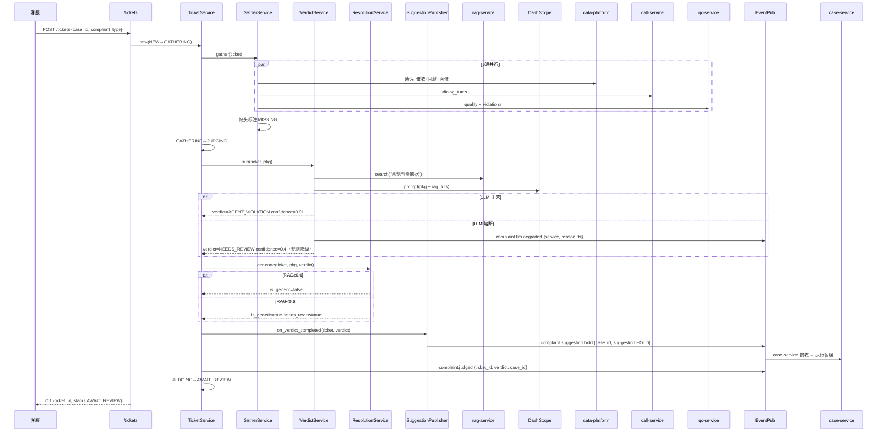
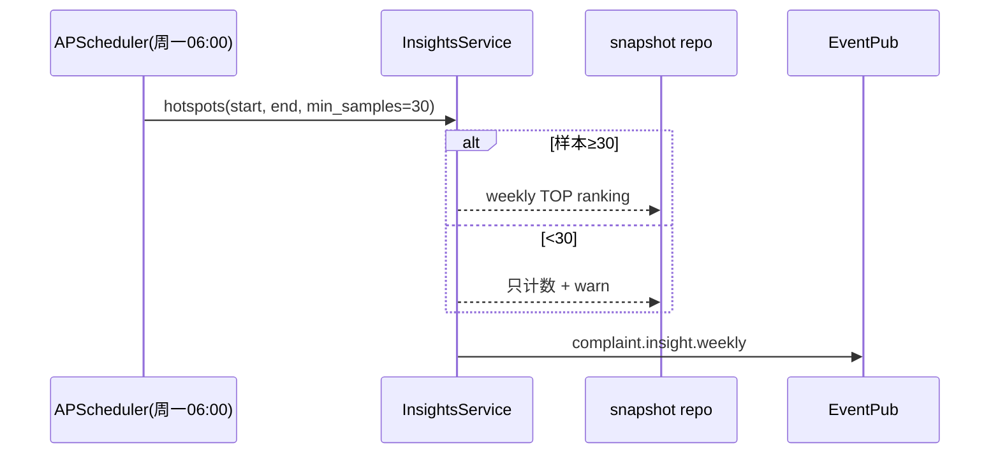

# 子系统详细设计 #05：AI 投诉异议智能研判系统

> 子系统编号：第 5 号
> 服务名：`complaint-service`
> 监听端口：**8006**
> 里程碑归属：**M3（分案 + 外呼 + 质检 跑通后启动）**
> 上游约束：step1/01~03 全局口径、step3/01~03 架构与降级、step4/01~03 数据设计、step5/01~04 技术规范、step6/01~02 异常容错告警、step7/01~03 测试规范、step8/01 M0 任务清单
> 宪法约束：openspec/specs/00~07

---

## 0.1 文档修订记录

| 版本 | 日期 | 修订人 | 修订内容 |
| :--- | :--- | :--- | :--- |
| V1.0 | 2026-08-18 | - | 初始版本，12 章模板 |
| V1.1 | 2026-08-20 | 规范优化 | 新增 AI 不修改案件状态约束；新增 MQ 建议推送（complaint.suggestion.hold）；新增 Ch13~15 AI 专项章节（LLM 专项/分层降级/数据闭环+可观测+脱敏）；更新子系统调用关系（RAG 被动/DP 被动/complaint→dp 回流）；对齐 step3~step8；新增 PII 脱敏列+数据闭环列 |
| V1.2 | 2026-08-20 | 对齐补全 | 4.1 新增限流列（对齐 DD-01/DD-04）；Ch13.2 补全 resolution.yml Prompt 模板；Ch13.3 补全处置方案输出解析链；Ch12 新增下游 base URL 配置项；7.1 时序图补全 complaint.llm.degraded 事件发布 |

---

## 1. 模块概览

AI 投诉异议智能研判系统是整套生态的**业务风险兜底模块**：

1. **投诉工单关联取证**（FR-CP-001）：创建投诉工单后，自动关联通话录音 URL、对话文本、历史催收记录、质检结果，打包"关联材料包"；缺失项标注不删除。
2. **AI 智能责任判责**（FR-CP-002）：LLM 比对投诉内容 × 实际通话文本 × 质检记录 × RAG 合规知识库，输出 `坐席违规 / 用户误解 / 正常催收` 三分类 + 判定依据；证据不足 → `待人工复核`。
3. **违规证据提取**（FR-CP-003）：判责 = 坐席违规时，截取违规话术 turn + 时间戳 + 上下文窗口（前2轮/后2轮）；无法精准定位时返回整段相关对话。
4. **处置方案自动生成**（FR-CP-004 P1）：RAG 检索同投诉类型的历史处置模板，LLM 生成答辩文案 + 整改措施；无匹配 → 通用模板，标记 `需人工调整`。
5. **投诉问题沉淀**（FR-CP-005 P1）：结案工单聚合高频投诉类型 / 高频违规点 / 高频话术整改建议，输出风险整改报告。
6. **MQ 建议推送**（新增）：判责完成后，通过 MQ 异步推送 `complaint.suggestion.hold` 给 case-service，建议案件暂缓催收。**AI 只输出建议，case-service 执行实际变更。**

> **AI 边界约束（全局）**：complaint-service 作为 AI 能力层服务，只做分析、判责、标签、建议、研判结论。不直接修改案件状态。案件暂缓/状态变更由 case-service 执行。complaint-service 通过 MQ 异步推送建议给 case-service。
> **RAG 被动约束**：rag-service 只提供被动检索，不主动向外调用。complaint-service 调用 RAG 检索合规知识库。
> **DP 被动约束**：data-platform 不主动调用上层 AI 服务，数据以消息推送方式下发。complaint-service 主动拉取 DP 通话/回款/质检数据。

---

## 2. 职责边界

### 2.1 必做事项

1. 投诉工单 CRUD + 状态机（NEW → GATHERING → JUDGING → AWAIT_REVIEW → RESOLVING → CLOSED）。
2. 关联材料包自动取证（6 类来源），缺失标注。
3. AI 判责（三分类 + 置信度 + 依据 JSONB）。
4. 违规证据片段截取（turn_id ± 窗口 2）。
5. 处置方案生成（RAG 模板 + LLM，RAG<0.6 走通用模板）。
6. 投诉沉淀统计（type/违规点/整改建议 三维度）。
7. **MQ 建议推送**：判责后推送 `complaint.suggestion.hold` 给 case-service。
8. 事件发布给 review-service / DP。
9. **研判样本回流 DP**：判责完成后样本回流 data-platform。

### 2.2 明确不做事项

1. **不做投诉前端对话/客服工单系统本身**：只提供 REST 接口。
2. **不做质检打分**：只消费 qc-service 的 quality_records。
3. **不做知识库/敏感词库维护**：只消费 rag-service。**RAG 只提供被动检索。**
4. **不做对话文本生产**：只消费 call-service 的 dialog_turns。
5. **不做案件状态修改**：**AI 只输出判责和建议，案件暂缓/状态变更由 case-service 执行。**
6. **不做坐席处罚流程**：只输出判责和整改建议；处罚动作由运营执行。
7. **不做报表图表**：只输出 JSON 统计。**DP 不主动调用上层服务。**
8. **不做违规证据音视频剪辑**：MVP 只做文本片段截取 + 录音 URL 标注。

---

## 3. 内部模块拆分

```
complaint-service (FastAPI app)
├── app/
│   ├── main.py
│   ├── routers/
│   │   ├── tickets.py         # 工单 CRUD + 流转 + 状态
│   │   ├── evidence.py        # GET 关联材料包
│   │   ├── verdict.py          # 触发/查看看判责 + 人工修正
│   │   ├── resolution.py       # 处置方案生成 + 应用
│   │   └── reports.py          # 投诉沉淀统计/导出
│   ├── services/
│   │   ├── ticket_service.py       # 工单流转 + 状态机
│   │   ├── gather_service.py        # 关联取证（6 源聚合，缺失标注）
│   │   ├── verdict_service.py       # AI判责：RAG+LLM 对比 或 规则降级
│   │   ├── evidence_clip.py          # 片段截取 + 窗口上下文
│   │   ├── resolution_service.py    # RAG模板+LLM 方案生成 / 通用模板 fallback
│   │   ├── insights_service.py      # 高频投诉类型/违规点统计
│   │   └── suggestion_publisher.py  # MQ 建议推送：complaint.suggestion.hold → case-service
│   ├── repositories/
│   │   ├── ticket_repo.py       # complaints
│   │   ├── evidence_repo.py     # complaint_evidences
│   │   ├── verdict_repo.py      # complaint_verdicts
│   │   ├── resolution_repo.py   # complaint_resolutions
│   │   └── stat_repo.py         # adhoc 统计
│   ├── events/
│   │   ├── publisher.py         # complaint.judged / .closed / .insight.weekly / .suggestion.hold
│   │   └── subscriber.py        # qc.check.completed / review.scored / kb.sensitive_updated
│   └── integrations/
│       ├── dp_client.py         # 查 dwd/dws 通话/回款/质检汇总
│       ├── call_client.py       # dialog_turns 拉取 + 录音 URL
│       ├── qc_client.py         # quality_records + qc_violations
│       └── rag_client.py        # /kb/search 合规知识库 + 历史处置文档检索
```

### 3.1 投诉工单状态机

```
NEW → GATHERING → JUDGING → AWAIT_REVIEW → RESOLVING → CLOSED
                    │                                       ↑
                    └→ NEEDS_REVIEW(证据不足) → AWAIT_REVIEW ─┘
```

- **NEW**：工单创建
- **GATHERING**：自动取证（6 源并行聚合）
- **JUDGING**：AI 判责中
- **AWAIT_REVIEW**：等待人工确认
- **RESOLVING**：处置方案生成中
- **CLOSED**：结案

---

## 4. 对外接口详细说明

`http://complaint-service:8006/api/v1`，统一响应包 `{"code":"0","message":str,"data":any|null,"trace_id":str}`。错误码 A5001–A5013 + B 类。

### 4.1 投诉工单

| 方法 | 路径 | 职责 | 权限 | 幂等 | 限流 | 错误码 | PII 脱敏 |
| :--- | :--- | :--- | :--- | :--- | :--- | :--- | :--- |
| POST | `/tickets` | 创建投诉 | SUPV/ADMIN/CS | 外部工单号 idempotency | 5/min | A5001 | user_desc 手机号 AES 加密 |
| GET | `/tickets/{id}` | 工单详情 | QC/SUPV/ADMIN | 幂等 | 60/min | A5002 | user_desc 脱敏展示 |
| GET | `/tickets` | 列表（status/type/date 过滤） | QC/SUPV/ADMIN | 幂等 | 30/min | A5002 | phone 脱敏 |
| POST | `/tickets/{id}/transition` | 状态流转 | SUPV/ADMIN | transition_id | 10/min | A5003 | — |

### 4.2 关联取证

| 方法 | 路径 | 职责 | 权限 | 错误码 | PII 脱敏 |
| :--- | :--- | :--- | :--- | :--- | :--- |
| POST | `/tickets/{id}/gather` | 手动触发重新取证 | SUPV/ADMIN | A5004 | — |
| GET | `/tickets/{id}/evidence-package` | 返回材料包 JSON | QC/SUPV/ADMIN/TRAINER | A5005 | 对话文本脱敏 |
| GET | `/tickets/{id}/evidence-export` | 材料包 ZIP 导出 | ADMIN | A5005/B0007 | 手机号/身份证脱敏 |

### 4.3 判责

| 方法 | 路径 | 职责 | 权限 | 错误码 | PII 脱敏 |
| :--- | :--- | :--- | :--- | :--- | :--- |
| POST | `/tickets/{id}/verdict/run` | 触发 AI 判责 | SUPV/ADMIN/TRAINER | A5006 | — |
| GET | `/tickets/{id}/verdict` | 获取判责 | QC/SUPV/ADMIN | A5007 | reasoning 不返回（仅 TRAINER） |
| POST | `/tickets/{id}/verdict/correct` | 人工修正 | SUPV/ADMIN | A5008 | — |
| GET | `/tickets/{id}/evidence-clips` | 违规证据片段 | QC/SUPV/ADMIN | A5009 | clip_text 脱敏 |

### 4.4 处置方案（P1）

| 方法 | 路径 | 职责 | 权限 | 错误码 | PII 脱敏 |
| :--- | :--- | :--- | :--- | :--- | :--- |
| POST | `/tickets/{id}/resolution/generate` | 生成方案 | SUPV/ADMIN | A5010 | — |
| GET | `/tickets/{id}/resolution` | 答辩文案+整改措施 | SUPV/ADMIN/TRAINER | A5011 | — |
| POST | `/tickets/{id}/resolution/apply` | 确认方案生效 | SUPV/ADMIN | A5012 | — |

### 4.5 投诉沉淀统计（P1）

| 方法 | 路径 | 职责 | 权限 | 错误码 |
| :--- | :--- | :--- | :--- | :--- |
| GET | `/reports/overview` | 概览 | ADMIN/SUPV | A5013 |
| GET | `/reports/hotspots` | 高频投诉 TOP N | ADMIN/SUPV/TRAINER | A5013 |
| GET | `/reports/weekly` | 周报数据 | ADMIN/SUPV/TRAINER | A5013 |
| GET | `/reports/export` | CSV 导出 | ADMIN | A5013/B0007 |

---

## 5. 内部类与方法清单

### 5.1 GatherService（6 类关联取证）

```python
class GatherService:
    async def gather(self, ticket: ComplaintRow) -> EvidencePackage
    # 1. dp_client: dwd_call_records × case_id 近 90 天通话
    # 2. call_client: dialog_turns by call_id（文本脱敏）
    # 3. qc_client: quality_records + qc_violations
    # 4. dp_client: 历史催收记录 dws_case_actions
    # 5. dp_client: 回款记录 ods_payments
    # 6. dp_client: case_info 用户画像脱敏
    # 缺失项标注 MISSING，不抛 500
```

### 5.2 VerdictService（AI 判责 + 降级）

```python
class VerdictService:
    async def run(self, ticket, pkg: EvidencePackage) -> VerdictRow
    # LLM 专项设计（见 Ch13）：
    # - Prompt 版本：verdict_v1（common/llm/prompts/verdict.yml）
    # - 置信度阈值：confidence<0.7 → NEEDS_REVIEW
    # - 输出解析：JSON → Pydantic VerdictSchema（verdict/confidence/evidence_turn_ids/reasoning）
    # - 幻觉校验：evidence_turn_ids 必须存在于 pkg；reasoning 不含编造金额
    # - 降级：LLM 熔断 → 规则判责（high_hits≥1 → AGENT_VIOLATION；否则 NEEDS_REVIEW）+ publish complaint.llm.degraded
    # - reasoning：AES 加密，仅 TRAINER 可见
```

### 5.3 EvidenceClipService + ResolutionService

```python
class EvidenceClipService:
    def clip(self, pkg, verdict) -> list[ClipRow]
    # turn ±2 窗口；无法定位 → 整段 fallback

class ResolutionService:
    async def generate(self, ticket, pkg, verdict) -> ResolutionRow
    # LLM 专项设计（见 Ch13）：
    # - Prompt 版本：resolution_v1
    # - RAG<0.6 → is_generic=true（禁止 LLM 自由撰写）
    # - 幻觉校验：reply 不含编造金额/政策
    # - 降级：LLM 熔断 → is_generic=true 通用模板 + publish llm.resolution.degraded
```

### 5.4 SuggestionPublisher（新增）

```python
class SuggestionPublisher:
    """判责后通过 MQ 异步推送建议给 case-service"""
    async def on_verdict_completed(self, ticket, verdict) -> None
    # verdict=AGENT_VIOLATION → publish complaint.suggestion.hold
    # payload: {case_id, complaint_id, suggestion: HOLD, reason, ts}
    # case-service 接收后执行案件暂缓
```

### 5.5 InsightsService

```python
class InsightsService:
    def hotspots(self, start, end, min_samples=30) -> Hotspots
    # <min_samples → 只计数+warn，不推断趋势
```

---

## 6. 涉及数据库表与字段

### 6.1 PostgreSQL public schema（与 step4/01 对齐）

| 表名 | 主键 | 关键列 | 数据闭环 |
| :--- | :--- | :--- | :--- |
| complaints | id | ticket_no UQ + case_id + user_id + complaint_type + user_desc(AES) + status ENUM + priority | complaint.judged → DP |
| complaint_evidences | id+complaint_id+source_type | source_type ENUM(6类) + status(OK/MISSING/ERROR) + missing_list JSONB | — |
| complaint_verdicts | id+complaint_id+version | verdict ENUM(4类) + confidence FLOAT + evidence_turn_ids JSONB + reasoning_encrypted AES + judged_by | complaint.judged → DP → dw.dws_complaint |
| complaint_resolutions | id+complaint_id+version | reply_text + corrective_actions JSONB + rag_score_max + is_generic BOOL + needs_review BOOL | — |
| complaint_clips | id+complaint_id | verdict_id FK + call_id + start/end_turn + start/end_ms + clip_text(脱敏) + is_fallback | — |
| complaint_insight_snapshots | id+week_start | JSONB weekly 快照 | complaint.insight.weekly → DP + review |

> 公共字段统一：id(UUID) / create_time / update_time / is_delete CHAR(1)

### 6.2 Redis（与 step4/03 对齐，DB 6 分配给 complaint-service）

```
csmp:ticket:{id}:pkg          取证包缓存 TTL=24h
csmp:verdict:{id}:latest      最新判责缓存 TTL=24h
csmp:rslv:{id}:latest         方案缓存 TTL=24h
csmp:hotspots:{start:end}     统计缓存 TTL=6h
csmp:gather:lock:{id}         取证幂等锁 TTL=60s
csmp:llm_degraded             LLM 熔断标识
```

---

## 7. 类图与时序图

### 7.1 投诉全链路（升级：新增 MQ 建议推送）



### 7.2 投诉沉淀周报（同 V1.0）



---

## 8. 模块独立测试方案

### 8.1 依赖与 Mock 清单

| 依赖 | 真实/Mock | 说明 |
| :--- | :--- | :--- |
| PG | 真实 | 6 张表 + 种子 |
| Redis | 真实 DB 6 | |
| data-platform | 真实+种子 | 通话/回款/画像 |
| call-service | Mock | 固定 dialog_turns + 录音 URL |
| qc-service | Mock | quality_records + violations |
| rag-service | 真实（最小闭环） | 检索 + 合规知识库种子 |
| LLM | Mock(MOCK_LLM=1) | 判责/方案可注入固定响应 |

### 8.2 独立可测断言清单

```
 1.  POST /tickets → 返回 id；状态=GATHERING
 2.  GET /evidence-package → 6 类 sources；1 类 MISSING → missing_list 非空
 3.  POST /verdict/run（Mock LLM AGENT_VIOLATION）→ 三分类正确
 4.  GET /verdict → 非 TRAINER 角色 reasoning=null（宪法5.3）
 5.  GET /evidence-clips → 3 条片段；窗口 ±2 正确
 6.  POST resolution/generate（Mock RAG<0.6）→ is_generic=true
 7.  POST resolution/generate（Mock RAG≥0.6）→ is_generic=false
 7a. POST resolution/generate → reply 含编造金额 → 幻觉校验拦截→is_generic=true
 8.  LLM 熔断 → verdict=NEEDS_REVIEW confidence=0.4 + complaint.llm.degraded 事件发布
 9.  POST verdict/correct → judged_by=USER_CORRECTED
10.  transition CLOSE → complaint.judged + complaint.closed 各发布 1 次
11.  种子 35 条 → hotspots TOP ranking；子集 20 → "样本量不足"
12.  ZIP 导出 → 手机号/身份证脱敏
13.  complaint.suggestion.hold 发布 → case-service 可消费（MQ 建议推送）
14.  研判样本回流 DP：complaint.judged 事件携带 case_id → DP 可消费
```

---

## 9. 模块通信与依赖

### 9.1 同步 HTTP（我作为 Client）

| 目标 | 路径 | 触发 | 超时 | 重试 | 熔断 | 降级 |
| :--- | :--- | :--- | :--- | :--- | :--- | :--- |
| data-platform 8001 | 内部 dwd+dws 查询 | gather/insights | 5s | 2× | 3连 | MISSING 标注 |
| call-service 8004 | GET /calls/{id}/transcript | gather | 5s | 2× | 3连 | MISSING 标注 |
| qc-service 8003 | GET /qc/records/{call_id} | gather | 5s | 2× | 3连 | MISSING 标注 |
| rag-service 8002 | POST /kb/search | verdict+resolution | 3s | 2× | 3连 | verdict→规则降级；resolution→is_generic |
| DashScope LLM | text-generation | verdict+resolution | 5s | 2× | 3连 | verdict→NEEDS_REVIEW；resolution→is_generic |

> **RAG 被动约束**：rag-service 只提供被动检索，不主动向外调用。
> **DP 被动约束**：data-platform 不主动调用上层 AI 服务，数据以消息推送方式下发。

### 9.2 同步 HTTP（我作为被调）

| 谁调我 | 路径 | 目的 |
| :--- | :--- | :--- |
| 前端业务 | 全部接口 | 投诉管理 |
| review-service | GET /reports/weekly | 运营报表合并 |
| case-service | GET /tickets/{id}/verdict | 查询判责结果 |

### 9.3 事件通知（Redis Pub-Sub）

#### 发布

| Channel | Payload | 订阅者 | 数据闭环 |
| :--- | :--- | :--- | :--- |
| `complaint.judged` | `{ticket_id, verdict, confidence, case_id, ts}` | review(复盘) + case(升级) + DP(宽表) | 研判样本回流 DP → dw.dws_complaint |
| `complaint.closed` | `{ticket_id, resolution_version, ts}` | DP + review | — |
| `complaint.insight.weekly` | `{week_start, summary, ts}` | review(周报合并) + rag(整改文档归档) | — |
| `complaint.suggestion.hold` | `{case_id, complaint_id, suggestion:HOLD, reason, ts}` | case-service(暂缓案件) | AI 只推送建议，case-service 执行 |
| `complaint.llm.degraded` | `{service, reason, ts}` | 告警订阅 | LLM 熔断告警 |

#### 订阅

| Channel | 发布者 | 处理 |
| :--- | :--- | :--- |
| `qc.check.completed` | qc-service | 质检完成 → 触发 gather 补充 |
| `review.scored` | review-service | 复盘关联证据更新 |
| `kb.sensitive_updated` | rag-service | 合规知识库更新 → 重跑判责（可选） |

---

## 10. 错误处理矩阵（与 step6/01 对齐）

| 错误码 | 描述 | 触发 | 降级 |
| :--- | :--- | :--- | :--- |
| A5001 | 创建失败（case 不存在/重复工单号） | 400/409 | 字段错误明细 |
| A5002 | 工单不存在/无权限 | 404/403 | — |
| A5003 | 状态机流转非法 | 409 | — |
| A5004 | gather 全失败（6 源全 ERROR） | 500 | 保留 GATHERING + 告警 |
| A5005 | 证据包/导出不存在 | 404 | — |
| A5006 | verdict.run 前 gather 未完成 | 422 | — |
| A5007 | verdict 未跑/无权限 | 404/403 | reasoning 不返回 |
| A5008 | 人工修正越权/已结案 | 403/409 | — |
| A5009 | 证据片段截取失败 | warn | 不返回 5xx |
| A5010 | 方案生成 LLM+RAG 双降级 | is_generic=true | 不报错 |
| A5011 | 方案不存在 | 404 | — |
| A5012 | apply 前未生成/已应用 | 409 | — |
| A5013 | 统计样本不足 | 200+warn | 不返回空 |
| B0001-B0010 | 系统级 | 统一 | — |

---

## 11. 宪法规则落地检查清单

| 条款 | 落地 | 验收 |
| :--- | :--- | :--- |
| 1.1 RAG≥0.6 | ResolutionService max<0.6 → is_generic=true | 断言 6 |
| 1.2 LLM 调用落表 | verdict+resolution 走 llm_client → llm_call_logs | 审计有记录 |
| 1.3 敏感词≥2 转人工 | 消费 qc.violations，判责 AGENT_VIOLATION | 种子 high≥2 → AGENT_VIOLATION |
| 2.2 AES | user_desc AES 加密；reasoning_encrypted AES；导出脱敏 | 断言 12 |
| 3.1 5s/重试3次/熔断 | 5 个 HTTP client | 注入故障→降级 |
| 3.2 LLM→规则降级 | VerdictService LLM 熔断 → NEEDS_REVIEW | 断言 8 |
| 3.3 RAG→静态模板 | ResolutionService RAG 熔断 → is_generic | 关闭 rag → is_generic |
| 3.4 监控+降级日志 | /health: dp_ok/call_ok/qc_ok/rag_ok/llm_degraded | GET /health |
| 3.5 熔断告警 | publish complaint.llm.degraded | 订阅捕获 |
| 5.1 X-Trace-Id | 全链路+事件 | 响应含 trace_id |
| 5.2 DWS | complaint.judged → DP dws_complaint | DP 有 complaint_type 聚合 |
| 5.3 reasoning 脱敏 | reasoning AES，仅 TRAINER 可见 | 断言 4 |
| AI 边界约束 | 不修改案件状态，只推送 MQ 建议 | case-service 执行暂缓 |

---

## 12. 可配置项清单

| 键 | 默认值 | 说明 |
| :--- | :--- | :--- |
| CMPT_GATHER_TIMEOUT | 5 | gather 源超时 |
| CMPT_GATHER_WINDOW_DAYS | 90 | 取证窗口 |
| CMPT_VERDICT_LLM_MODEL | qwen-max-longcontext | 判责 LLM |
| CMPT_VERDICT_CONFIDENCE_THRESHOLD | 0.7 | <0.7 → NEEDS_REVIEW |
| CMPT_VERDICT_DEGRADE_RULE | true | LLM 熔断→规则降级 |
| CMPT_CLIP_CONTEXT_WINDOW | 2 | 证据截取窗口 |
| CMPT_RESOLUTION_RAG_THRESHOLD | 0.6 | RAG<0.6 → is_generic |
| CMPT_HOTSPOTS_MIN_SAMPLES | 30 | 样本不足阈值 |
| CMPT_WEEKLY_CRON | "0 6 * * 1" | 周一 06:00 周报 |
| CMPT_INCLUDE_REASONING_ROLES | "TRAINER" | 可见 reasoning 角色 |
| CMPT_SUGGESTION_ENABLED | true | MQ 建议推送开关 |
| CMPT_DP_BASE | http://data-platform:8001/api/v1 | DP base URL |
| CMPT_CALL_BASE | http://call-service:8004/api/v1 | call-service base URL |
| CMPT_QC_BASE | http://qc-service:8003/api/v1 | qc-service base URL |
| CMPT_RAG_BASE | http://rag-service:8002/api/v1 | RAG base URL |
| CMPT_LLM_BASE | https://dashscope.aliyuncs.com | DashScope LLM base URL |
| CMPT_MOCK_LLM | false | unittest=true |

---

## 13. LLM 专项设计（新增，对齐 step5/03 + step5/04）

### 13.1 LLM 调用点清单

| # | 功能 | Prompt 版本 | 置信度阈值 | 输出解析 | 幻觉校验 | 降级 |
| :--- | :--- | :--- | :--- | :--- | :--- | :--- |
| L1 | AI 判责 | verdict_v1（verdict.yml） | confidence<0.7 → NEEDS_REVIEW | JSON → Pydantic VerdictSchema（verdict/confidence/evidence_turn_ids/reasoning） | evidence_turn_ids 必须存在于 pkg；reasoning 不含编造金额 | LLM 熔断→规则判责（high≥1→AGENT_VIOLATION；否则 NEEDS_REVIEW）confidence=0.4 |
| L2 | 处置方案生成 | resolution_v1（resolution.yml） | — | JSON → Pydantic ResolutionSchema（reply/corrective_actions/suggestion） | reply 不含编造金额/政策 | RAG<0.6→is_generic=true；LLM 熔断→is_generic=true |

### 13.2 Prompt 模板

```yaml
# common/llm/prompts/verdict.yml
version: "verdict_v1"
role: "你是金融催收合规判责员"
goal: "基于投诉内容、对话文本、质检记录、合规知识库，判定责任归属"
constraints:
  - "严格三分类：AGENT_VIOLATION / USER_MISUNDERSTAND / NORMAL_COLLECTION"
  - "证据不足返回 NEEDS_REVIEW"
  - "evidence_turn_ids 必须引用实际存在的 turn"
  - "不得编造金额或政策"
schema:
  type: object
  properties:
    verdict: {type: string, enum: [AGENT_VIOLATION, USER_MISUNDERSTAND, NORMAL_COLLECTION, NEEDS_REVIEW]}
    confidence: {type: number}
    evidence_turn_ids: {type: array, items: {type: integer}}
    reasoning: {type: string}
  required: [verdict, confidence, evidence_turn_ids, reasoning]
prohibitions: ["不得编造金额", "不得引用不存在的turn"]
fallback: "NEEDS_REVIEW"
```

```yaml
# common/llm/prompts/resolution.yml
version: "resolution_v1"
role: "你是金融催收投诉处置方案生成员"
goal: "基于投诉判责结果、合规知识库历史处置模板，生成答辩文案+整改措施"
constraints:
  - "RAG 检索 score<0.6 时禁止自由撰写，只输出通用模板"
  - "答辩文案必须引用判责结论（verdict）"
  - "整改措施必须可执行，不得含编造金额或政策"
  - "reply/corrective_actions/suggestion 三字段必填"
schema:
  type: object
  properties:
    reply: {type: string, description: "答辩文案"}
    corrective_actions:
      type: array
      items: {type: string}
      description: "整改措施清单"
    suggestion: {type: string, description: "处置建议"}
  required: [reply, corrective_actions, suggestion]
prohibitions: ["不得编造金额", "不得编造政策条文", "RAG<0.6 时不得自由撰写"]
fallback: "is_generic=true（通用模板）"
```

### 13.3 输出解析与校验链

```
═══════════════════════════════════════════════════
  L1 判责（verdict_v1）输出解析链
═══════════════════════════════════════════════════
LLM 返回 JSON
  → json.loads() 解析                     失败→重试3次→规则降级
  → Pydantic VerdictSchema 校验             失败→重试3次→规则降级
  → 置信度门控 confidence<0.7 → NEEDS_REVIEW
  → 幻觉校验：
    - evidence_turn_ids 必须存在于 pkg.dialog_turns
    - reasoning 不含编造金额/政策
    - verdict 必须为 4 类枚举之一
  → reasoning AES-256 加密存储
  → llm_call_logs 审计落表

═══════════════════════════════════════════════════
  L2 处置方案（resolution_v1）输出解析链
═══════════════════════════════════════════════════
LLM 返回 JSON
  → json.loads() 解析                     失败→重试3次→is_generic=true
  → Pydantic ResolutionSchema 校验          失败→重试3次→is_generic=true
  → RAG score 门控：score<0.6 → is_generic=true
  → 幻觉校验：
    - reply 不含编造金额/政策条文
    - corrective_actions 必须为可执行短语
    - reply 必须引用 verdict 结论
  → needs_review=true 标记（需人工调整）
  → llm_call_logs 审计落表
```

---

## 14. 分层降级策略（新增，对齐 step3/03 + step6/01）

### 14.1 故障分类与降级矩阵

| 故障类型 | 检测方式 | 降级路径 | 兜底内容 | 恢复条件 |
| :--- | :--- | :--- | :--- | :--- |
| ① LLM 完全不可用 | 5s 超时/500 | 重试3次→熔断→规则判责 | high≥1→AGENT_VIOLATION；否则 NEEDS_REVIEW | 60s 半开 |
| ① LLM 返回非法 JSON | json.loads() 失败 | 重试3次→规则降级 | 同上 | 同上 |
| ① LLM 熔断（方案生成） | 5s 超时/3 连失败 | 熔断→is_generic=true | 通用模板 | 60s 半开 |
| ① RAG 不可用 | 3s 超时/3 连失败 | 熔断→is_generic=true | 通用模板 | rag 恢复 |
| ① DP 不可用 | 5s 超时/3 连失败 | 缺失标注 MISSING | 不抛 500 | DP 恢复 |
| ① call/qc 不可用 | 5s 超时/3 连失败 | MISSING 标注 | 不阻断 | 恢复 |
| ② LLM 置信度不足 | confidence<0.7 | NEEDS_REVIEW | 人工复核 | — |
| ② LLM 幻觉（turn_id 不存在） | 幻觉校验 | 丢弃该 evidence | 降级 NEEDS_REVIEW | — |
| ② RAG score<0.6 | score 字段值 | is_generic=true | 通用模板 | — |
| ② gather 全失败 | 6 源全 ERROR | 保留 GATHERING | 告警人工 | — |

### 14.2 熔断状态机

```
CLOSED（正常调用 LLM）
  → 连续 3 次失败 → OPEN（Redis SET csmp:llm_degraded=1）
    → 60s 后 → HALF_OPEN（探测）
      → 成功 → CLOSED
      → 失败 → OPEN
```

---

## 15. 数据闭环 + 可观测 + 金融合规脱敏（新增，对齐 step4~06 + step5/04）

### 15.1 数据闭环矩阵

| 功能 | 数据来源 | 落库位置 | 回流 DP | 回流方式 |
| :--- | :--- | :--- | :--- | :--- |
| 关联取证 | DP+call+qc（6 源） | complaint_evidences | — | — |
| AI 判责 | LLM + RAG | complaint_verdicts | ✅ | complaint.judged → DP → dw.dws_complaint |
| 证据截取 | verdict.evidence_turn_ids | complaint_clips | — | — |
| 处置方案 | RAG + LLM | complaint_resolutions | ✅ | complaint.closed → DP |
| 投诉沉淀 | 聚合统计 | complaint_insight_snapshots | ✅ | complaint.insight.weekly → DP + review |
| MQ 建议推送 | verdict 结果 | suggestion_logs（case-service 侧） | — | complaint.suggestion.hold → case-service |
| LLM 调用审计 | LLM Provider | llm_call_logs | ✅ | DP 汇聚 LLM 日志 |

### 15.2 数据流图

```
DP+call+qc ──(6源取证)──→ complaint-service
                              │
                    ┌─────────┤
                    ▼         ▼
              complaint_verdicts
              complaint_evidences
              complaint_resolutions
              complaint_clips
                    │
                    ▼
          (complaint.judged Pub-Sub)
                    │
          ┌─────────┼─────────┐
          ▼         ▼         ▼
     data-platform  case    review
     (ETL→dw)    (暂缓)   (复盘)
                    │
                    ▼
          (complaint.suggestion.hold MQ)
                    │
                    ▼
              case-service
              (执行暂缓)
```

### 15.3 可观测埋点

| 事件 | 触发点 | 采集字段 | 告警阈值 |
| :--- | :--- | :--- | :--- |
| complaint.gather.completed | 取证完成 | trace_id, ticket_id, sources_ok, sources_missing | 全失败→立即告警 |
| complaint.verdict.completed | 判责完成 | trace_id, ticket_id, verdict, confidence, latency_ms | confidence<0.7 率>30%→Warning |
| llm.verdict.started | LLM 判责开始 | trace_id, prompt_version | — |
| llm.verdict.completed | LLM 判责完成 | trace_id, latency_ms, token_usage, status | P95>1000ms |
| llm.verdict.degraded | LLM 判责降级 | trace_id, reason | 立即告警 |
| llm.resolution.degraded | LLM 方案生成降级 | trace_id, reason, is_generic | is_generic 率>50%→Warning |
| complaint.resolution.generated | 方案生成 | trace_id, ticket_id, is_generic | — |
| complaint.suggestion.sent | MQ 建议推送 | trace_id, case_id, suggestion_type | — |
| complaint.closed | 工单关闭 | trace_id, ticket_id, resolution_version | — |

### 15.4 仪表盘指标

| 指标 | 来源 | 展示 |
| :--- | :--- | :--- |
| 投诉处理量 | complaint.closed count | 折线图 |
| 判责分布 | verdict GROUP BY verdict | 饼图 |
| 平均处理时长 | created_at→closed_at AVG | 折线图 |
| LLM 降级率 | llm.verdict.degraded / total | 百分比 |
| 通用方案率 | is_generic=true / total | 百分比 |
| MQ 建议执行率 | case-service executed / sent | 百分比 |

### 15.5 金融合规脱敏

| PII 类型 | 存储方式 | API 返回 | 导出 | 日志 | 流转 |
| :--- | :--- | :--- | :--- | :--- | :--- |
| user_desc | AES-256 加密 | 脱敏展示 | 脱敏导出 | 脱敏 | DP 回流脱敏 |
| 对话文本 | 脱敏后存储 | 脱敏展示 | 脱敏导出 | 脱敏 | — |
| 手机号 | 不存储 | 不返回 | 不导出 | 不记录 | — |
| reasoning | AES-256 加密 | 不返回（仅 TRAINER 可解密） | 不导出 | 不记录 | 审计哈希链 |
| 录音 URL | MinIO 签名 | 有权限可见 | 有权限可导出 | URL 不记录 | — |

---

## M3 验收标准

| 验收项 | 标准 |
| :--- | :--- |
| 工单创建+取证 | 6 源聚合+缺失标注 |
| AI 判责 | 三分类+置信度+证据定位 |
| 证据截取 | turn ±2 窗口 |
| 处置方案 | RAG<0.6→is_generic |
| LLM 降级 | 熔断→规则判责 NEEDS_REVIEW + complaint.llm.degraded 事件发布 |
| MQ 建议推送 | complaint.suggestion.hold → case-service 可消费 |
| 投诉沉淀 | 高频统计+样本不足不推断 |
| AI 边界 | 不修改案件状态，只推送建议 |
| 数据闭环 | complaint.judged → DP 可消费 |
| PII 脱敏 | user_desc AES，reasoning 不可见 |
| LLM 埋点 | latency/token/confidence 可采集 |
| trace_id | 全链路透传 |
