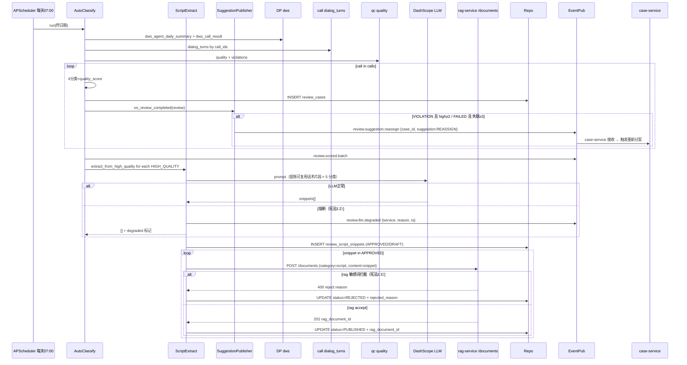
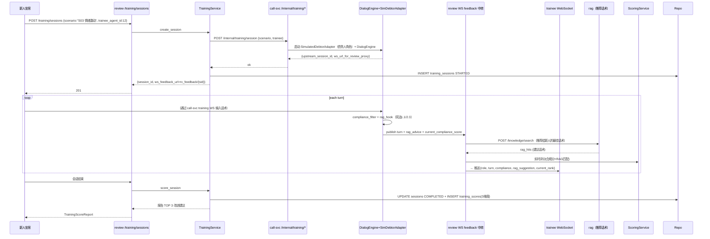
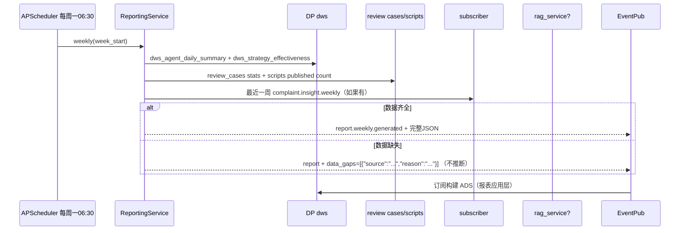

# 子系统详细设计 #06：AI 智能复盘与人才培训系统

> 子系统编号：第 6 号
> 服务名：`review-service`
> 监听端口：**8007**
> 里程碑归属：**M4（投诉系统跑通后启动；TR-004 AI模拟对打 = P2）**
> TR-004 方案：**复用 call-service 对话引擎 + 新增培训模式内部接口**（用户确认，不重写）
> 上游约束：step1/01~03 全局口径、step3/01~03 架构与降级、step4/01~03 数据设计、step5/01~04 技术规范、step6/01~02 异常容错告警、step7/01~03 测试规范、step8/01 M0 任务清单
> 宪法约束：openspec/specs/00~07

---

## 0.1 文档修订记录

| 版本 | 日期 | 修订人 | 修订内容 |
| :--- | :--- | :--- | :--- |
| V1.0 | 2026-08-18 | - | 初始版本，12 章模板 + TR-004 复用 call-svc 培训模式 |
| V1.1 | 2026-08-20 | 规范优化 | 新增 AI 不修改案件状态约束；新增 MQ 建议推送（review.suggestion.reassign）；新增 Ch13~15 AI 专项章节（LLM 专项/分层降级/数据闭环+可观测+脱敏）；更新子系统调用关系（RAG 被动/DP 被动/review→dp 回流）；对齐 step3~step8；新增 PII 脱敏列+数据闭环列；统一响应格式 |

---

## 1. 模块概览

AI 智能复盘与人才培训系统是整套生态的**团队能力迭代中枢**：

1. **全量通话自动复盘分类**（FR-TR-001）：订阅 DP `etl.task.done` 或 call-service `call.session.ended`，按 通话结果×质检结果×回款结果 四维把每通通话打四类：`优质案例 / 低效案例 / 违规案例 / 失败沟通案例`，并输出优劣评分。回款数据未同步时暂不分类，同步后自动补判（异常场景）。
2. **优质话术自动沉淀**（FR-TR-002）：优质标签的对话中，LLM 提炼高转化高合规话术片段，按场景分类，**自动 POST rag-service `/documents` 入库**（category=script，来源标注 REVIEW_AUTO_PICK）；无法提炼通用话术时保留完整案例供人工筛选。
3. **坐席能力画像**（FR-TR-003 P1）：多维度——话术能力（RAG 匹配率）、合规表现（平均分/违规率）、回款效率（PTP 兑现率/回款率）、短板问题（TOP N 违规点）；数据量不足不输出画像（≥20 通阈值）。
4. **AI 模拟对打培训**（FR-TR-004 P2，复用 call-svc）：review-service 创建培训场景（债务人类性：拖延/情绪对抗/愿意还款/失联/投诉倾向等 10 个默认场景），**调用 call-service 内部培训模式接口** `POST /internal/training/session` 启动会话，SimulatedDebtorAdapter（新增 Adapter）扮演债务人；坐席（新人）通过 WebSocket 输入话术；实时反馈（合规分 + RAG 建议话术 + 情绪评分）；最终输出能力评分+改进建议。**对话引擎不重复写**。
5. **运营报表自动生成**（FR-TR-005 P1）：周期结束自动生成团队质量周报/月报，合并 complaint-service `complaint.insight.weekly` 事件，输出 JSON 给前端 + 发布 DP 构建 ADS；数据缺失时标注缺口，不生成错误结论。
6. **MQ 建议推送**（新增）：复盘分类完成后，若发现坐席多次违规或案件沟通失败模式，通过 MQ 异步推送 `review.suggestion.reassign` 给 case-service，建议重新分案。**AI 只输出建议，case-service 执行实际变更。**
7. **宪法 1.2 LLM 全量落表**（话术提炼/评分/模拟反馈共 3 处 LLM 调用）+ **宪法 5.3 reasoning 脱敏对外** + **TR-002 入库的话术经过 rag-service 敏感词校验**（入库前必须 PASS，否则 reject 打回人工筛选）。

> **AI 边界约束（全局）**：review-service 作为 AI 能力层服务，只做分析、评分、标签、建议、研判结论。不直接修改案件状态。案件重新分案/状态变更由 case-service 执行。review-service 通过 MQ 异步推送建议给 case-service。
> **RAG 被动约束**：rag-service 只提供被动检索，不主动向外调用。review-service 调用 RAG 检索培训推荐话术 + POST /documents 入库优质话术。
> **DP 被动约束**：data-platform 不主动调用上层 AI 服务，数据以消息推送方式下发。review-service 主动拉取 DP 通话/回款/质检汇总数据。

---

## 2. 职责边界

### 2.1 必做事项

1. 通话自动分类（四类） + 优劣评分。
2. 优质话术提炼 + 自动入 rag-service 知识库（category=script）。
3. 坐席多维度能力画像（阈值 20 通）。
4. AI 模拟对打培训场景管理（10 种子场景）+ 内部调用 call-service 培训模式。
5. 运营周报月报（合并投诉 insight）。
6. **MQ 建议推送**：复盘发现坐席多次违规或沟通失败 → 推送 `review.suggestion.reassign` 给 case-service。
7. **复盘样本回流 DP**：复盘分类完成后样本回流 data-platform。
8. M2/M3 独立可测（TR-004 即使 call-service 未实现培训模式接口，review-service 有 Mock Adapter 可断言）。

### 2.2 明确不做事项

1. **不重复写对话引擎**：TR-004 复用 call-service DialogEngine + Adapter 抽象。review-service 只负责培训场景管理、评分反馈聚合、成绩归档。
2. **不做真实呼叫线路/ASR/TTS**：call-service。
3. **不做违规检测本身**：qc-service。
4. **不做知识库内容/敏感词库维护**：只调用 rag-service /documents 写入（类别 script）；写失败 fallback 到 review_cases 表人工筛选。**RAG 只提供被动检索。**
5. **不做前端培训 UI 渲染**：后端，提供 REST + WS 流 + 事件。
6. **不做 RBAC/JWT/审计表**：common/security。
7. **不做宽表/ETL**：data-platform 负责 ADS 构建；review-service 只是消费+生成报表 JSON。**DP 不主动调用上层服务。**
8. **不做 LLM 自由推理**：严格按 RAG/宪法 1.1/3.2 执行。
9. **不做案件状态修改**：**AI 只输出评分和建议，案件重新分案/状态变更由 case-service 执行。**

---

## 3. 内部模块拆分

```
review-service (FastAPI app)
├── app/
│   ├── main.py
│   ├── routers/
│   │   ├── reviews.py        # FR-TR-001：自动复盘分类列表/详情/手动标注
│   │   ├── scripts.py        # FR-TR-002：话术片段 + 自动入库 RAG
│   │   ├── profiles.py       # FR-TR-003 P1：坐席能力画像
│   │   ├── training.py       # FR-TR-004 P2：培训场景/会话/对打/成绩
│   │   └── reports.py        # FR-TR-005 P1：周报月报/合并投诉/导出
│   ├── services/
│   │   ├── auto_classify_service.py  # 4分类：优/低/违/失
│   │   ├── script_extract_service.py # 优质话术LLM提炼 + 调用rag/documents入库
│   │   ├── profile_service.py        # ≥20通 多维画像；<20 不输出（异常场景）
│   │   ├── training_service.py       # 场景CRUD + 创建会话 + 实时反馈聚合 + 成绩归档（复用call-svc）
│   │   ├── reporting_service.py      # 周/月报（合并 complaint.insight.weekly）
│   │   ├── score_service.py          # 优劣评分 + 培训评分（统一公式模块）
│   │   └── suggestion_publisher.py  # MQ 建议推送：review.suggestion.reassign → case-service
│   ├── repositories/
│   │   ├── review_repo.py    # review_cases（需求 step2 11张新表：4分类+评分）
│   │   ├── script_repo.py    # review_script_snippets（提炼话术）
│   │   ├── profile_repo.py   # agent_profiles（画像快照）
│   │   ├── training_repo.py  # training_scenarios / training_sessions / training_turns / training_scores
│   │   └── report_repo.py    # report_snapshots（周/月）
│   ├── events/
│   │   ├── publisher.py      # review.scored / .scored.batch / .script.published / training.completed / report.weekly.generated / .suggestion.reassign / .llm.degraded
│   │   └── subscriber.py     # call.session.ended / etl.task.done / complaint.insight.weekly / qc.check.completed
│   └── integrations/
│       ├── dp_client.py      # DWD/DWS 查询回款 + 日汇总
│       ├── call_client.py    # dialog_turns + **培训模式内部接口 POST /internal/training/session**
│       ├── qc_client.py      # 质检明细
│       └── rag_client.py     # POST /documents（话术入库） + search（培训时推荐话术）
└── data/
    └── training_scenarios_seed.csv   # 默认 10 种子培训场景（性格×金额×账龄×情绪）
```

### 3.1 TR-004 依赖边界图

```
review-service                                           call-service (复用引擎，零重写)
┌──────────────────────────────┐                       ┌──────────────────────────────┐
│ training_service             │ ──HTTP 内部鉴权 ──→    │ /internal/training/* 新路由组 │
│  · create scenario           │                       │  · create session            │
│  · create session via call   │                       │  · SimulatedDebtorAdapter     │
│  · 实时订阅 turn & feedback  │ ←──WS /training/stream │  · DialogEngine 复用          │
│  · 归档成绩                   │                       │  · compliance_filter 复用     │
└──────────────────────────────┘                       │  · rag_hook 复用             │
                                                       └──────────────────────────────┘
```
- `SimulatedDebtorAdapter` 放在 **call-service** 内部 `adapters/sim_debtor.py`（和现有 adapters 同目录，遵循 Protocol）。
- 培训模式路由组 `/internal/training/*` 在 call-service DD-01 中已预留"后续M4加路由"，文档标注。

---

## 4. 对外接口详细说明

`http://review-service:8007/api/v1`，统一响应包 `{"code":"0","message":str,"data":any|null,"trace_id":str}`。错误码 A6001–A6015 + B 类。

### 4.1 复盘分类

| 方法 | 路径 | 职责 | 权限 | 幂等 | 限流 | 错误码 | PII 脱敏 |
| :--- | :--- | :--- | :--- | :--- | :--- | :--- | :--- |
| POST | `/reviews/auto-run` | 触发全量复盘分类（按日期范围；回款数据不全的 call 标 WAIT_PAYMENT） | ADMIN/TRAINER | `as_of+range` 去重 | 1/30s | A6001 | — |
| GET | `/reviews` | 复盘分类列表：按 4 类 / agent_id / date / score 范围过滤 + 分页 | SUPV/ADMIN/TRAINER/AGENT(SELF) | 幂等 | 60/min | A6002 | basis 不含手机号 |
| GET | `/reviews/{id}` | 复盘详情：评分明细 + 标签 + 对应 turns | SUPV/ADMIN/TRAINER/AGENT(SELF) | 幂等 | 120/min | A6002 | turns 脱敏 |
| POST | `/reviews/{id}/correct` | 人工修正分类/评分/标签 | SUPV/TRAINER | 幂等按 version | 30/min | A6003 | — |

### 4.2 话术沉淀入库（FR-TR-002）

| 方法 | 路径 | 职责 | 权限 | 错误码 | PII 脱敏 |
| :--- | :--- | :--- | :--- | :--- | :--- |
| GET | `/scripts/snippets` | 提炼话术列表（可入库/待人工筛选二状态） | TRAINER/SUPV/ADMIN | A6004 | snippet_text 脱敏 |
| POST | `/scripts/snippets/{id}/publish-to-rag` | 选中片段 → POST rag-service `/documents`（category=script）；敏感词校验由 rag-service 负责（拦截则 reject 回传错误） | TRAINER/SUPV | A6005 | 入库前再过脱敏 |
| POST | `/scripts/auto-publish-all-approved` | 自动批量入库所有状态=APPROVED 的片段 | ADMIN/TRAINER | A6005 | 同上 |
| POST | `/scripts/snippets/{id}/reject` | 人工驳回：写入原因，不入 RAG | TRAINER/SUPV | A6004 | — |

### 4.3 坐席能力画像（P1）

| 方法 | 路径 | 职责 | 权限 | 错误码 | PII 脱敏 |
| :--- | :--- | :--- | :--- | :--- | :--- |
| GET | `/profiles/{agent_id}?as_of=today` | 坐席画像：话术/合规/回款/短板；通话<20 返回 status=INSUFFICIENT_DATA（FR-TR-003 异常） | SUPV/ADMIN/TRAINER/AGENT(SELF) | A6006 | 金额打码 |
| GET | `/profiles/compare` | 多人对比（≤5 人） | SUPV/ADMIN | A6006 | 金额打码 |
| POST | `/profiles/refresh-all` | 全量刷新画像快照 | ADMIN/TRAINER | A6006 | — |

### 4.4 AI 模拟对打培训（P2，复用 call-svc）

| 方法 | 路径 | 职责 | 权限 | 错误码 | PII 脱敏 |
| :--- | :--- | :--- | :--- | :--- | :--- |
| GET | `/training/scenarios` | 场景列表：默认 10 种子 + 运营扩展 | TRAINER/SUPV/ADMIN/AGENT | A6007 | — |
| POST | `/training/scenarios` | 新增自定义场景（债务人脚本/性格/标签） | TRAINER/SUPV | A6007 | — |
| POST | `/training/sessions` | **创建培训会话**（scene_id + trainee_agent_id）→ 内部调 call-service `/internal/training/session` → 返回 session_id + WS URL | AGENT/TRAINER | A6008/B0003 | — |
| **WS** | `/training/{session_id}/feedback` | **对打反馈流**（订阅 call-service /training/stream 中转 + review 实时评分/合规/RAG 推荐话术） | AGENT(SELF)/TRAINER | A6009 | turns 脱敏 |
| GET | `/training/sessions/{id}/report` | 会话结束后成绩报告：评分 + TOP 3 改进建议 + 违规提醒 | AGENT(SELF)/SUPV/TRAINER | A6010 | reasoning 仅 TRAINER |
| GET | `/training/leaderboard` | 培训排行榜（近30天平均分/场次/进阶趋势） | SUPV/TRAINER/AGENT | A6011 | — |

### 4.5 运营报表（P1）

| 方法 | 路径 | 职责 | 权限 | 错误码 | PII 脱敏 |
| :--- | :--- | :--- | :--- | :--- | :--- |
| GET | `/reports/weekly?week_start=` | 周报 JSON：质量趋势/违规整改/话术迭代 + 投诉 weekly 合并（FR-TR-005） | ADMIN/SUPV/TRAINER | A6012 | 金额打码 |
| GET | `/reports/monthly?month=` | 月报 | ADMIN/SUPV | A6012 | 金额打码 |
| POST | `/reports/{id}/refresh` | 手动刷新快照（默认 cron 自动） | ADMIN/TRAINER | A6013 | — |
| GET | `/reports/export` | CSV 导出（周报月报） | ADMIN/SUPV | A6013/B0007 | 手机号/身份证脱敏 |
| GET | `/reports/dashboard-today` | 今日实时概览：接通率 / PTP率 / 合规分均值 / 违规高危数（合并 DP dws 结果） | ADMIN/SUPV | A6014 | 金额打码 |

---

## 5. 内部类与方法清单

### 5.1 服务层

#### AutoClassifyService（FR-TR-001 四维分类 + 评分）

```python
class AutoClassifyService:
    async def run(self, start_date, end_date) -> ClassifyResult
    # 分类规则（可配置 classify_rules.jsonb）：
    #   quality_records.score >= 90 AND call_records.result == ptp AND payment.has_paid(30d)
    #        → 优质案例 HIGH_QUALITY (score >= 85)
    #   score ≥60 AND <90 AND result=promise_later/refuse 且 无 payment
    #        → 低效案例 LOW_EFFICACY (score 40~70)
    #   qc_violations.high_count >= 1 或 level = SERIOUS
    #        → 违规案例 VIOLATION (score 0~59)
    #   result=no_contact/lost 或 dialog_turns <5（沉默）
    #        → 失败沟通案例 FAILED_COMMUNICATION (score 0~40)
    # 回款数据未同步：label=WAIT_PAYMENT + 定期在 etl.task.done 订阅后补判
```

#### ScriptExtractService（FR-TR-002 提炼 + 入库 RAG）

```python
class ScriptExtractService:
    async def extract_from_high_quality(self, review_id: int) -> list[ScriptSnippet]
    # LLM 专项设计（见 Ch13）：
    # - Prompt 版本：script_extract_v1（common/llm/prompts/script_extract.yml）
    # - 输出解析：JSON → Pydantic ScriptSnippetSchema（snippets[]{category, text, reason}）
    # - 幻觉校验：snippet.text 必须来源于对话原文；不含编造金额
    # - 降级：LLM 熔断 → 不提炼，片段列表=[] + publish review.llm.degraded
    async def publish_to_rag(self, snippet_id: int) -> PublishResult
    # HTTP POST rag-service /documents
    # { title: "场景X话术-片段Y", category: "script", content: snippet.text, source: "REVIEW_AUTO_PICK" }
    # rag-service 敏感词拦截命中 → return PublishResult.rejected + rag 返回的理由；不写入
    # rag-service success → snippet.status=PUBLISHED + rag_document_id
```

#### ProfileService（FR-TR-003 多维画像）

```python
class ProfileService:
    MIN_CALLS = 20
    async def build(self, agent_id, as_of: date) -> ProfileRow
    # 维度1 话术能力（权重0.3）：rag 命中≥0.7 率 / 话术重复率
    # 维度2 合规表现（权重0.3）：合规分均值 / 违规率 high_count_rate
    # 维度3 回款效率（权重0.3）：PTP兑现率 / 回款率 / 每通平均回款金额
    # 维度4 短板问题（权重0.1）：TOP 5 最常见违规类型 + 对应建议
    # calls_count < 20 → status=INSUFFICIENT_DATA，不输出分数（FR-TR-003 异常场景）
    # LLM 专项设计（见 Ch13）：
    # - 短板建议 Prompt 版本：profile_advice_v1（common/llm/prompts/profile_advice.yml）
    # - RAG<0.6 → 建议改为"参考合规手册"模板，不自由推断
    # - 降级：LLM 熔断 → 建议=规则模板 + publish review.llm.degraded
```

#### TrainingService（FR-TR-004 P2，复用 call-svc）

```python
class TrainingService:
    async def create_session(self, scenario_id: int, trainee_agent_id: int) -> TrainingSessionRow
    # 1. 读 scenario: debtor_persona + debtor_script_prompts
    # 2. call_client.post_internal("/internal/training/session", {scenario, trainee})
    #    → call-service 返回 call_mode=TRAINING 专用 session_id + ws_url_feedback_proxy
    # 3. review-service 创建 WS 代理：订阅 call /training/stream → 叠加评分→推给前端 /training/{session_id}/feedback
    async def score_session(self, session_id) -> TrainingScoreRow
    # 统一公式：合规(40%) + 话术匹配RAG(30%) + PTP兑现(30%)，加改进建议（RAG检索+宪法1.1）
    # LLM 专项设计（见 Ch13）：
    # - 改进建议 Prompt 版本：training_report_v1（common/llm/prompts/training_report.yml）
    # - RAG<0.6 → 建议改为"参考合规手册"模板
    # - 降级：LLM 熔断 → 评分=纯公式无文字建议 + publish review.llm.degraded
```

#### ReportingService（FR-TR-005，合并投诉 weekly）

```python
class ReportingService:
    async def weekly(self, week_start: date) -> ReportSnapshot
    # 1. DP dws_agent_daily_summary 本周汇总（接通/PTP/合规分）
    # 2. review_cases 每周分类统计
    # 3. 订阅 complaint.insight.weekly 事件：投诉热点TOP
    # 4. script_snippets 本周新入库数量
    # 任一数据源缺失 → report JSON 中字段=data_gap=[{"source":"DP_PAYMENT","reason":"未同步"}]，不做推断（FR-TR-005 异常场景）
```

### 5.2 SuggestionPublisher（新增）

```python
class SuggestionPublisher:
    """复盘后通过 MQ 异步推送建议给 case-service"""
    async def on_review_completed(self, review: ReviewCaseRow) -> None
    # category=VIOLATION 且 high_count≥2 → publish review.suggestion.reassign
    # category=FAILED_COMMUNICATION 且 同一 case 失联≥3 次 → publish review.suggestion.reassign
    # payload: {case_id, review_id, suggestion: REASSIGN, reason, category, ts}
    # case-service 接收后触发重新分案
```

---

## 6. 涉及数据库表与字段

### 6.1 PostgreSQL public schema（与 step4/01 对齐）

| 表名 | 主键 | 关键列 | 数据闭环 |
| :--- | :--- | :--- | :--- |
| review_cases | id（需求 step2 对齐） | call_id(UQ per 自动+手动) + case_id + agent_id + category ENUM(HIGH_QUALITY/LOW_EFFICACY/VIOLATION/FAILED_COMM/WAIT_PAYMENT) + quality_score INT(0-100) + labels TEXT[] + basis JSONB + version + corrected_by/at/action | review.scored.batch → DP → dw.dws_call_result |
| review_script_snippets | id | review_id FK + category(identity/disclose/negotiate/object/close) + snippet_text + rag_document_id NULLABLE + status(DRAFT/APPROVED/PUBLISHED/REJECTED) + rejected_reason + created_by/published_by/at | review.script.published → RAG 回执 |
| agent_profiles | id + agent_id + as_of UNIQUE | call_count INT + dim1_ability FLOAT + dim2_compliance FLOAT + dim3_efficiency FLOAT + dim4_top_shortcomings JSONB + overall FLOAT + status(SUCCESS/INSUFFICIENT_DATA) + snapshotted_at | review.scored → DP → dw.dws_agent_profile |
| training_scenarios | id/name UNIQUE | name + debtor_persona JSONB（性格/金额/账龄/情绪/预期） + difficulty_level + default_turns JSONB + category + is_active + created_by/at | — |
| training_sessions | id | scenario_id FK + trainee_agent_id + call_mode="TRAINING" + upstream_call_session_id（call-service 返回） + status(STARTED/IN_PROGRESS/COMPLETED/FAILED) + started_at/ended_at + final_score FLOAT + improvement JSONB | training.completed → DP → dw.dws_training |
| training_scores | id | session_id FK + dimension(COMPLIANCE/RAG_MATCH/SIM_PTP) + score FLOAT + detail JSONB | — |
| report_snapshots | id + period_type + period_start UNIQUE | period_type(WEEKLY/MONTHLY) + content JSONB + data_gaps JSONB + merged_complaint_insight JSONB + generated_at/generated_by | report.weekly.generated → DP → ADS |

> 公共字段统一：id(UUID) / create_time / update_time / is_delete CHAR(1)

### 6.2 技能培训默认场景种子 10 条

```
S01 友好身份核实（M0 小金额 25-35 男 愿意沟通）
S02 还款困难-延期协商（M1 中等金额 女 资金暂时困难）
S03 情绪激动指责银行（M1+ 高对抗 客户投诉倾向高）
S04 拖延敷衍型（M2 态度敷衍不承诺）
S05 拒绝沟通挂机型（M3 一接就挂）
S06 PTP后再次违约（老承诺不兑现）
S07 第三方接听（家属/同事，严格核实不透露隐私）
S08 失联修复（旧号/空号，需补充信息）
S09 还款能力不足分期方案引导（大额M2+）
S10 投诉威胁话术识别合规应对（威胁要去监管投诉）
```

### 6.3 Redis

```
rv:review:{call_id}:latest     TTL=24h 分类缓存
rv:profile:{agent_id}:{as_of}  TTL=2h 画像缓存
rv:report:{period}:{start}     TTL=6h 报告缓存
rv:training:session:{id}       TTL=24h 会话状态
rv:training:feedback:{sid}     WS 代理队列（LPUSH/RPOP）
rv:llm_degraded                LLM 熔断标识
rv:rag:ok                      RAG 连接健康
rv:call_training:ok            call-service 培训模式接口健康（M4 前置）
```

---

## 7. 类图与时序图（mermaid）

### 7.1 FR-TR-001+002：自动分类 + 优质话术提炼 + 自动入 RAG 知识库



### 7.2 FR-TR-004 模拟对打：创建会话 → WS 中转实时反馈 → 成绩报告（复用 call-svc 引擎）



### 7.3 FR-TR-005 周报：AUTO + 投诉 insight 合并



---

## 8. 模块独立测试方案

### 8.1 依赖与 Mock 清单

| 依赖 | 真实/Mock | 说明 |
| :--- | :--- | :--- |
| PG | 真实 | 7 张表 + 种子 100 通已完成通话(分类覆盖4类) + 回款同步数据 |
| Redis | 真实 DB 7 | |
| data-platform | 真实启动 + 种子 dws 汇总 | |
| call-service | **真实启动即可（不需要真实CCC）**；但 training mode 内部接口若未实现（M4前），用 Mock TrainingAdapter 返回固定 upstream_session_id + 固定 turns | M4 前独立测试不阻断 |
| qc-service | **Mock**：固定返回 quality_records 100 条 + violations 分布 | |
| rag-service | **真实启动** + 话术文档种子 20 篇 | 脚本 publish 需要 rag /documents 接受 |
| LLM | Mock=1（话术提炼/培训评分画像改进建议） | |

### 8.2 独立断言清单

```
 1.  POST /reviews/auto-run（昨日，100 通话种子）→ 返回 100 review 行数；4 类分布 HIGH_QUALITY ≥ 10 / VIOLATION ≥ 10 / FAILED ≥ 10
 2.  上述 HIGH_QUALITY 10 条 → GET /scripts/snippets 返回 ≥ 20 条 APPROVED（≥2 条/通）
 3.  POST /scripts/snippets/{id}/publish-to-rag → 状态=PUBLISHED；rag-service 中查 rag_document_id 对应文档存在且 category=script
 4.  构造 snippet 内含辱骂敏感词 → publish 返回 reject；status=REJECTED；不写入 RAG
 5.  GET /profiles/{agent_id}（已 30 通话种子）→ status=SUCCESS 四维齐全；overall 0-100
 6.  GET /profiles/{agent_18}（只有 5 通话）→ status=INSUFFICIENT_DATA（FR-TR-003 异常）
 7.  创建培训场景 S99 自定义 + POST /training/sessions（Mock call training）→ 返回 session_id + status=STARTED
 8.  Mock call-svc /internal/training 3 连失败 → review create_session 返回 B0003 + 不创建 session（或创建 FAILED）
 9.  LLM 熔断模式（Mock 3次超时）：auto-run 中 extract_from_high_quality 返回空 snippets + review.llm.degraded 事件发布 + review_cases 状态不阻断（降级，宪法3.2）
10.  GET /reports/weekly 数据齐全 → 含 质量趋势/违规整改/话术迭代 + 投诉 weekly 合并
11.  GET /reports/weekly 故意关闭 complaint insight 订阅 → 报告 data_gaps 至少 1 条；不输出投诉 TOP 推断字段
12.  订阅 review.scored + training.completed + report.weekly.generated → auto-run + mock session 结束后，事件全部发布 1 次（不重复）
13.  review.suggestion.reassign 发布 → case-service 可消费（MQ 建议推送）：VIOLATION 且 high≥2 → 推送 REASSIGN
14.  复盘样本回流 DP：review.scored.batch 事件携带 case_id → DP 可消费
```

### 8.3 独立测试 shell 脚本骨架

```bash
#!/usr/bin/env bash
# scripts/test_review_independent.sh
set -euo pipefail
ROOT="$(cd "$(dirname "$0")/.." && pwd)"; cd "$ROOT"
echo "[1/6] 启动底座：PG Redis data-platform rag-service"
docker compose -f compose.yml up -d postgres redis data-platform rag-service
sleep 20
echo "[2/6] 种子：100通通话+回款+质检分布 + 10 默认培训场景 + 30 画像 agents"
docker exec -i postgres psql -U postgres -d ai_collection -f ./scripts/seed_review_ut.sql
echo "[3/6] 启动 review-service（端口18007，Mock call-service training + Mock qc + Mock LLM）"
PORT=18007 ENV=unittest MOCK_CALL_TRAINING=1 MOCK_QC=1 MOCK_LLM=1 \
  poetry run uvicorn review_service.main:app --port 18007 &
RV_PID=$!; sleep 12; trap "kill -9 $RV_PID 2>/dev/null || true" EXIT
echo "[4/6] 订阅事件 review.* training.* report.*"
EV=$(mktemp); redis-cli -u redis://localhost:6379/7 PSUBSCRIBE "review.*" "training.*" "report.*" > "$EV" & sleep 2
echo "[5/6] 12 条断言"
curl -s -X POST http://localhost:18007/api/v1/reviews/auto-run \
  -H 'Content-Type: application/json' -d '{"start_date":"2026-08-17","end_date":"2026-08-17"}' \
  | jq -re '.code=="0" and (.data.count)==100' > /dev/null
echo "  [1/12] auto-run 100 条 OK"
# ... 2..12 省略
echo "[6/6] ALL PASS"
```

---

## 9. 模块通信与依赖

### 9.1 同步 HTTP（我作为 Client，6 个下游）

| 目标 | 路径 | 触发 | 超时 | 重试 | 熔断 | 降级 |
| :--- | :--- | :--- | :--- | :--- | :--- | :--- |
| data-platform 8001 | dws 表查询 + ADS 报表源 | auto-run / reports | 5s | 2× | 3 | 缺字段标 data_gaps，不中断 |
| call-service 8004 | GET dialog_turns + `POST /internal/training/*`（培训模式内部接口组，DD-01 标注 M4 加路由） | auto-run 提取话术 / TR-004 | 5s | 2× | 3 | TR-004：创建会话失败=B0003，回滚 session=FAILED |
| qc-service 8003 | GET /qc/records/{call_id} + stats | auto-run 分类 | 5s | 2× | 3 | 缺失 quality=归类为 WAIT_PAYMENT（稍后补判） |
| rag-service 8002 | POST `/documents` / POST `/knowledge/search` | 话术入库 + 培训推荐话术 | 3s | 2× | 3 | 入库失败→REJECTED；培训推荐=返回空建议（不中断） |
| DashScope LLM | text-generation（3 处：extract / profile_advice / training_report） | 提炼/画像建议/培训报告 | 5s | 2× | 3 | 宪法3.2 降级：extract 空；建议=模板；培训评分只公式不主观 |
| complaint-service 8006 | GET `/reports/weekly`（可选，替代事件合并） | 报告手动 refresh 时（如果事件尚未到） | 5s | 1× | 2 | 缺失字段=data_gaps |

> **RAG 被动约束**：rag-service 只提供被动检索，不主动向外调用。
> **DP 被动约束**：data-platform 不主动调用上层 AI 服务，数据以消息推送方式下发。

### 9.2 被调

| 谁调我 | 路径 |
| :--- | :--- |
| 运营端/训练师端：复盘+培训 UI | 全量 REST + WS /training/{sid}/feedback |
| 前端 Dashboard | `/reports/dashboard-today`（今日概览） |

### 9.3 事件通知（Redis Pub-Sub）

#### 发布

| Channel | Payload | 订阅者 | 数据闭环 |
| :--- | :--- | :--- | :--- |
| `review.scored` | `{review_id, call_id, category, score, ts}` | complaint-service / case-service（二次分案输入）/ rag-service（后续优质话术语义关联） | 复盘样本回流 DP → dw.dws_call_result |
| `review.scored.batch` | `{run_id, total, counts:[...] , ts}` | DP（dws 构建） | → DP → dw.dws_call_result |
| `review.script.published` | `{snippet_id, rag_document_id, ts}` | rag-service（已入库，回执） | — |
| `training.completed` | `{session_id, trainee_agent_id, scenario_id, final_score, ts}` | DP（培训成绩宽表）/ SUPERVISOR 通知 | → DP → dw.dws_training |
| `report.weekly.generated` | `{report_id, week_start, ts}` | DP（ADS） + 邮件告警（外部） | → DP → ADS |
| `review.suggestion.reassign` | `{case_id, review_id, suggestion:REASSIGN, reason, category, ts}` | case-service(重新分案) | AI 只推送建议，case-service 执行 |
| `review.llm.degraded` | `{service, reason, ts}` | 告警订阅 | LLM 熔断告警 |

#### 订阅

| Channel | 发布者 | 处理 |
| :--- | :--- | :--- |
| `call.session.ended` | call-service | 实时触发单通复盘分类（非批量） |
| `etl.task.done` | data-platform | 1) 批量 auto-run 回款同步后的补判 WAIT_PAYMENT；2) 画像 refresh-all；3) 报告 snapshot |
| `qc.check.completed` | qc-service | 有质检记录到达，复盘分类可以从 VIOLATION 精确定级 |
| `complaint.insight.weekly` | complaint-service | 报告合并（FR-TR-005） |
| `kb.sensitive_updated` | rag-service | 已入库话术重新校验敏感词（可选开关） |

---

## 10. 错误处理矩阵

| 错误码 | 描述 | 触发 | 降级 |
| :--- | :--- | :--- | :--- |
| A6001 | auto-run range 过大（>31 天） | 400 "最多按自然月" |
| A6002 | 复盘记录不存在/越权 | 404/403 AGENT(SELF) 只能看自己 |
| A6003 | 修正 version 冲突 | 409 "请刷新" |
| A6004 | snippet 不存在/状态非法 | 404/409 |
| A6005 | 发布到 RAG 被 rag-service reject（敏感词命中） | 200 + {rejected:true, reason}（不是 5xx） | 状态 REJECTED，不中断 |
| A6006 | 画像 INSUFFICIENT_DATA | 200 + {status:INSUFFICIENT_DATA, min_calls:20}（不是 4xx） |
| A6007 | 培训场景非法（无 debtor_persona 字段）| 400 |
| A6008 | 创建培训会话 call-service 培训接口熔断 B0003 | 503 "培训引擎暂不可用"；session 不建或=FAILED |
| A6009 | WS 反馈 session 已结束 | 410 gone |
| A6010 | 报告不存在/越权 | 404/403 |
| A6011 | 排行榜范围过大 | 400 "最多365天" |
| A6012 | 报告周报月报 date 非法 | 400 |
| A6013 | refresh 快照失败（DP查询熔断）→ 重用上一次快照 + data_gaps 扩大 | 200 + note="部分数据滞后" |
| A6014 | Dashboard 今日概览 数据源全空 → 全 0 + note="今日数据尚未产生"（不是 500） |
| A6015 | 培训 leaderboard 无数据 → 200 + 空列表，不返回 404 |
| B0001–B0010 | 系统级 | 统一 |

---

## 11. 宪法规则落地检查清单

| 条款 | 落地 | 验收 |
| :--- | :--- | :--- |
| 1.1 RAG≥0.6 才能直接用 | 培训推荐话术 & 改进建议：RAG<0.6 → 不输出主观建议，只输出"参考合规手册"模板 | Mock RAG<0.6 → 建议中包含"参考合规手册"，不自由推断 |
| 1.2 LLM 调用落 llm_call_logs | extract/profile_advice/training_report 三处走 llm_client → 落表 | 一次 auto-run 后 llm_call_logs ≥ HIGH_QUALITY × N 次 |
| 1.3 敏感词≥2 转人工 | 消费 qc 违规；违规案例 VIOLATION 分类 + 短板建议标注 | 种子 high_count≥2 → category=VIOLATION |
| 2.1 TLS | - | |
| 2.2 AES 敏感字段存储 | 培训脚本中用户画像脱敏；API 返回均脱敏；入库 RAG 前文本再次过脱敏（review_service 内部再调用 common.security 一次） | 入库前 snippet 无明文手机号/身份证 |
| 2.3 敏感词三层过滤 | 不重复实现；发布到 RAG 时由 rag-service compliance 拦截；reject 的 snippet 状态=REJECTED | 断言 4：辱骂敏感词→REJECTED |
| 3.1 5s/3次/熔断 | 6 个 HTTP 客户端统一配置 | 注入故障第 4 次走降级 |
| 3.2 LLM → 规则降级 | extract 空；profile_advice=规则模板；training_report 评分=公式 无文字建议 | 断言 9：LLM 熔断=空 snippets，不中断 |
| 3.3 RAG → 静态脚本降级 | rag-client 3×熔断 → 培训推荐话术=空建议；改进建议=手册模板 | 关闭 rag-service 培训会话仍能跑 |
| 3.4 监控+降级日志 | /health 6 项：dp_ok/call_ok/qc_ok/rag_ok/llm_degraded/call_training_mode | 6 项存在 |
| 3.5 熔断后告警 | publish `review.llm.degraded` | 订阅捕获 |
| 5.1 X-Trace-Id | 全链路透传+事件携带 | - |
| 5.2 三张 DWS 表 | 发布 review.scored.batch & report.weekly → DP 构建 dws 三张 + ADS | DP 侧 review 维度字段存在 |
| 5.3 审计+reasoning 脱敏 | 修正分类/发布话术/培训场景/刷新报告 → 审计；培训评分 reasoning 仅 TRAINER 角色返回且推理中敏感词*掩码 | SUPV 角色 GET training report → reasoning=null |
| 5.4 故障自动恢复 | 重启后：snapshot 幂等 UNIQUE(period+start)；会话 FAILED 可重启；分类 version 去重 | 重启 review-service 报告不重复生成 |
| AI 边界约束 | 不修改案件状态，只推送 MQ 建议 | case-service 执行重新分案 |

---

## 12. 可配置项清单（.env，默认引用需求文档 5.6 权重/阈值）

| 键 | 默认值 | 说明 |
| :--- | :--- | :--- |
| RV_AUTO_CLASSIFY_CRON | "0 7 * * *" | 每天 07:00 批量复盘 |
| RV_AUTO_CLASSIFY_MAX_DAYS | 31 | auto-run 最大天数 |
| RV_HIGH_QUALITY_MIN_SCORE | 85 | HIGH_QUALITY 分类阈值 |
| RV_VIOLATION_HIGH_HITS_TRIGGER | 1 | ≥1 次 high → VIOLATION |
| RV_WAIT_PAYMENT_ON_MISSING_PAYMENT | true | 回款未同步=WAIT_PAYMENT（FR-TR-001 异常） |
| RV_EXTRACT_MIN_SNIPPETS_PER_CALL | 0 | LLM 降级允许=0 条（宪法3.2） |
| RV_PUBLISH_RAG_BATCH_SIZE | 20 | 批量入库 RAG 批次大小 |
| RV_PUBLISH_RAG_REJECT_AUDIT | true | 被 rag reject 的 snippet 一律写审计 |
| RV_PROFILE_MIN_CALLS | 20 | 画像阈值（FR-TR-003 异常场景） |
| RV_PROFILE_DIM1_W | 0.3 | 话术能力权重 |
| RV_PROFILE_DIM2_W | 0.3 | 合规表现权重（与需求5.6.4评分风格对齐） |
| RV_PROFILE_DIM3_W | 0.3 | 回款效率权重 |
| RV_PROFILE_DIM4_W | 0.1 | 短板权重 |
| RV_PROFILE_REFRESH_CRON | "0 8 * * MON" | 每周一早 8 点全量画像刷新 |
| RV_TRAINING_CALL_INTERNAL_BASE | http://call-service:8004/internal | call-service 培训模式内部 base URL（M4） |
| RV_TRAINING_ENABLED | false | M4 之前默认关闭（避免误调用不存在接口），上线后=true |
| RV_TRAINING_DIM1_W | 0.4 | 培训评分：合规权重 |
| RV_TRAINING_DIM2_W | 0.3 | RAG匹配权重 |
| RV_TRAINING_DIM3_W | 0.3 | SIM_PTP 权重 |
| RV_TRAINING_DEFAULT_SCENARIOS_CSV | data/training_scenarios_seed.csv | 默认 10 种子 CSV |
| RV_TRAINING_LEADERBOARD_DAYS | 30 | 排行榜近 30 天 |
| RV_TRAINING_LEADERBOARD_MAX_DAYS | 365 | 最大范围 |
| RV_REPORT_WEEKLY_CRON | "30 6 * * 1" | 周报生成：周一 06:30（在 complaint.insight.weekly 发布 06:00 之后） |
| RV_REPORT_MONTHLY_CRON | "0 7 1 * *" | 月报每月 1 号 07:00 |
| RV_REPORT_DATA_GAPS_ALLOWED | true | 数据缺失标注不推断（FR-TR-005 异常场景） |
| RV_REPORT_DASHBOARD_CACHE_SEC | 60 | 今日概览缓存 1 分钟 |
| RV_DP_BASE | http://data-platform:8001/api/v1 | |
| RV_CALL_BASE | http://call-service:8004/api/v1 | |
| RV_QC_BASE | http://qc-service:8003/api/v1 | |
| RV_RAG_BASE | http://rag-service:8002/api/v1 | |
| RV_CMPT_BASE | http://complaint-service:8006/api/v1 | |
| RV_LLM_BASE | https://dashscope.aliyuncs.com | DashScope LLM base URL |
| RV_SUGGESTION_ENABLED | true | MQ 建议推送开关 |
| RV_MOCK_LLM | false | unittest=true |

---

## 13. LLM 专项设计（新增，对齐 step5/03 + step5/04）

### 13.1 LLM 调用点清单

| # | 功能 | Prompt 版本 | 置信度阈值 | 输出解析 | 幻觉校验 | 降级 |
| :--- | :--- | :--- | :--- | :--- | :--- | :--- |
| L1 | 优质话术提炼 | script_extract_v1（script_extract.yml） | — | JSON → Pydantic ScriptSnippetSchema（snippets[]{category, text, reason}） | snippet.text 必须来源于对话原文；不含编造金额 | LLM 熔断→空列表+review.llm.degraded |
| L2 | 画像短板建议 | profile_advice_v1（profile_advice.yml） | — | JSON → Pydantic ProfileAdviceSchema（advice[]{dim, suggestion}） | suggestion 不含编造金额/政策；RAG<0.6→手册模板 | LLM 熔断→规则模板+review.llm.degraded |
| L3 | 培训改进建议 | training_report_v1（training_report.yml） | — | JSON → Pydantic TrainingAdviceSchema（improvements[]{dim, advice, priority}） | advice 不含编造金额；RAG<0.6→手册模板 | LLM 熔断→纯公式评分无文字建议+review.llm.degraded |

### 13.2 Prompt 模板

```yaml
# common/llm/prompts/script_extract.yml
version: "script_extract_v1"
role: "你是金融催收话术提炼员"
goal: "从优质催收对话中提取可复用、合规、高转化的话术片段"
constraints:
  - "按 5 个场景分类：identity(身份核实)/disclose(欠款告知)/negotiate(协商)/object(异议应对)/close(结束)"
  - "snippet.text 必须来源于对话原文，不得改写或编造"
  - "不含编造金额或政策"
  - "每通优质通话提炼 2~5 条片段"
schema:
  type: object
  properties:
    snippets:
      type: array
      items:
        type: object
        properties:
          category: {type: string, enum: [identity, disclose, negotiate, object, close]}
          text: {type: string}
          reason: {type: string, description: "为何此片段值得沉淀"}
        required: [category, text, reason]
  required: [snippets]
prohibitions: ["不得编造金额", "不得改写原文", "不得引用不存在的对话片段"]
fallback: "空列表（不提炼）"
```

```yaml
# common/llm/prompts/profile_advice.yml
version: "profile_advice_v1"
role: "你是催收坐席能力评估员"
goal: "基于坐席多维度数据生成短板改进建议"
constraints:
  - "RAG score<0.6 时输出'参考合规手册'模板，不自由推断"
  - "suggestion 不含编造金额或政策条文"
  - "按 4 维度输出：话术能力/合规表现/回款效率/短板问题"
schema:
  type: object
  properties:
    advice:
      type: array
      items:
        type: object
        properties:
          dim: {type: string, enum: [ability, compliance, efficiency, shortcomings]}
          suggestion: {type: string}
        required: [dim, suggestion]
  required: [advice]
prohibitions: ["不得编造金额", "不得编造政策条文", "RAG<0.6 时不得自由撰写"]
fallback: "规则模板（参考合规手册）"
```

```yaml
# common/llm/prompts/training_report.yml
version: "training_report_v1"
role: "你是催收培训评估员"
goal: "基于培训对打会话生成能力评分和改进建议"
constraints:
  - "评分必须基于公式：合规(40%)+RAG匹配(30%)+SIM_PTP(30%)"
  - "RAG<0.6 时改进建议改为'参考合规手册'模板"
  - "improvements 不含编造金额"
  - "TOP 3 改进建议按 priority 排序"
schema:
  type: object
  properties:
    improvements:
      type: array
      items:
        type: object
        properties:
          dim: {type: string, enum: [compliance, rag_match, sim_ptp]}
          advice: {type: string}
          priority: {type: string, enum: [HIGH, MEDIUM, LOW]}
        required: [dim, advice, priority]
  required: [improvements]
prohibitions: ["不得编造金额", "不得编造政策条文", "评分不得偏离公式"]
fallback: "纯公式评分无文字建议"
```

### 13.3 输出解析与校验链

```
═══════════════════════════════════════════════════
  L1 话术提炼（script_extract_v1）输出解析链
═══════════════════════════════════════════════════
LLM 返回 JSON
  → json.loads() 解析                     失败→重试3次→空列表
  → Pydantic ScriptSnippetSchema 校验       失败→重试3次→空列表
  → 幻觉校验：
    - snippet.text 必须存在于对话原文
    - 不含编造金额/政策
    - category 必须为 5 类枚举之一
  → 入库前再过 common.security 脱敏
  → llm_call_logs 审计落表

═══════════════════════════════════════════════════
  L2 画像建议（profile_advice_v1）输出解析链
═══════════════════════════════════════════════════
LLM 返回 JSON
  → json.loads() 解析                     失败→重试3次→规则模板
  → Pydantic ProfileAdviceSchema 校验       失败→重试3次→规则模板
  → RAG score 门控：score<0.6 → 手册模板
  → 幻觉校验：
    - suggestion 不含编造金额/政策条文
    - dim 必须为 4 类枚举之一
  → llm_call_logs 审计落表

═══════════════════════════════════════════════════
  L3 培训建议（training_report_v1）输出解析链
═══════════════════════════════════════════════════
LLM 返回 JSON
  → json.loads() 解析                     失败→重试3次→纯公式
  → Pydantic TrainingAdviceSchema 校验      失败→重试3次→纯公式
  → RAG score 门控：score<0.6 → 手册模板
  → 幻觉校验：
    - advice 不含编造金额
    - priority 必须为 3 类枚举之一
  → 评分仍由公式计算（LLM 只生成文字建议）
  → llm_call_logs 审计落表
```

---

## 14. 分层降级策略（新增，对齐 step3/03 + step6/01）

### 14.1 故障分类与降级矩阵

| 故障类型 | 检测方式 | 降级路径 | 兜底内容 | 恢复条件 |
| :--- | :--- | :--- | :--- | :--- |
| ① LLM 完全不可用 | 5s 超时/500 | 重试3次→熔断→规则降级 | extract=空；advice=模板；training=纯公式 | 60s 半开 |
| ① LLM 返回非法 JSON | json.loads() 失败 | 重试3次→规则降级 | 同上 | 同上 |
| ① RAG 不可用 | 3s 超时/3 连失败 | 熔断→手册模板/空建议 | 培训推荐=空；改进建议=手册模板 | rag 恢复 |
| ① DP 不可用 | 5s 超时/3 连失败 | 缺字段标 data_gaps | 不中断 | DP 恢复 |
| ① call/qc 不可用 | 5s 超时/3 连失败 | WAIT_PAYMENT/缺失标注 | 不阻断 | 恢复 |
| ① call-service 培训模式不可用 | 5s 超时/3 连失败 | 熔断→B0003 | session=FAILED | call 恢复 |
| ② LLM 幻觉（snippet 不在原文） | 幻觉校验 | 丢弃该 snippet | 降级为空列表 | — |
| ② RAG score<0.6 | score 字段值 | 手册模板 | 不自由推断 | — |
| ② 画像数据不足 | calls_count<20 | INSUFFICIENT_DATA | 不输出分数 | — |
| ② 报告数据缺失 | 字段为空 | data_gaps 标注 | 不推断 | — |

### 14.2 熔断状态机

```
CLOSED（正常调用 LLM/RAG/DP/call/qc）
  → 连续 3 次失败 → OPEN（Redis SET rv:llm_degraded=1）
    → 60s 后 → HALF_OPEN（探测）
      → 成功 → CLOSED
      → 失败 → OPEN
```

---

## 15. 数据闭环 + 可观测 + 金融合规脱敏（新增，对齐 step4~06 + step5/04）

### 15.1 数据闭环矩阵

| 功能 | 数据来源 | 落库位置 | 回流 DP | 回流方式 |
| :--- | :--- | :--- | :--- | :--- |
| 通话自动分类 | DP+call+qc（6 源） | review_cases | ✅ | review.scored.batch → DP → dw.dws_call_result |
| 优质话术提炼 | LLM + 对话原文 | review_script_snippets | — | — |
| 话术入库 RAG | snippet.text | RAG 知识库 | — | review.script.published → RAG 回执 |
| 坐席画像 | DP+RAG+qc | agent_profiles | ✅ | review.scored → DP → dw.dws_agent_profile |
| 培训对打 | call-svc+RAG+LLM | training_sessions+scores | ✅ | training.completed → DP → dw.dws_training |
| 运营报表 | DP+review+complaint | report_snapshots | ✅ | report.weekly.generated → DP → ADS |
| MQ 建议推送 | review 分类结果 | suggestion_logs（case-service 侧） | — | review.suggestion.reassign → case-service |
| LLM 调用审计 | LLM Provider | llm_call_logs | ✅ | DP 汇聚 LLM 日志 |

### 15.2 数据流图

```
DP+call+qc ──(6源取证)──→ review-service
                              │
                    ┌─────────┤
                    ▼         ▼
              review_cases   review_script_snippets
              agent_profiles  training_sessions
              report_snapshots
                    │
                    ▼
          (review.scored.batch Pub-Sub)
                    │
          ┌─────────┼─────────┐
          ▼         ▼         ▼
     data-platform  case    rag-service
     (ETL→dw)    (重新分案) (话术回执)
                    │
                    ▼
          (review.suggestion.reassign MQ)
                    │
                    ▼
              case-service
              (执行重新分案)
```

### 15.3 可观测埋点

| 事件 | 触发点 | 采集字段 | 告警阈值 |
| :--- | :--- | :--- | :--- | :--- |
| review.classify.completed | 分类完成 | trace_id, call_id, category, score | — |
| review.scored.batch | 批量分类完成 | trace_id, run_id, total, counts | — |
| llm.extract.started | LLM 话术提炼开始 | trace_id, prompt_version | — |
| llm.extract.completed | LLM 话术提炼完成 | trace_id, latency_ms, token_usage, snippet_count | P95>2000ms |
| llm.extract.degraded | LLM 话术提炼降级 | trace_id, reason | 立即告警 |
| llm.advice.degraded | LLM 画像建议降级 | trace_id, reason | 立即告警 |
| llm.training.degraded | LLM 培训建议降级 | trace_id, reason | 立即告警 |
| review.suggestion.sent | MQ 建议推送 | trace_id, case_id, suggestion_type | — |
| training.completed | 培训会话结束 | trace_id, session_id, final_score | — |
| report.weekly.generated | 周报生成 | trace_id, report_id, data_gaps_count | data_gaps>0→Warning |

### 15.4 仪表盘指标

| 指标 | 来源 | 展示 |
| :--- | :--- | :--- |
| 通话分类分布 | review_cases GROUP BY category | 饼图 |
| 优质话术入库量 | review_script_snippets PUBLISHED count | 折线图 |
| 坐席能力均值 | agent_profiles overall AVG | 折线图 |
| LLM 降级率 | llm.*.degraded / total | 百分比 |
| 培训完成量 | training_sessions COMPLETED count | 折线图 |
| MQ 建议执行率 | case-service executed / sent | 百分比 |
| 报表数据缺口率 | data_gaps>0 / total reports | 百分比 |

### 15.5 金融合规脱敏

| PII 类型 | 存储方式 | API 返回 | 导出 | 日志 | 流转 |
| :--- | :--- | :--- | :--- | :--- | :--- |
| 对话文本 | 脱敏后存储 | 脱敏展示 | 脱敏导出 | 脱敏 | DP 回流脱敏 |
| 手机号 | 不存储 | 不返回 | 不导出 | 不记录 | — |
| 逾期金额 | AES 加密存储 | ****（打码） | 不导出 | 不记录 | DP 回流脱敏版 |
| snippet_text | 入库前再过脱敏 | 脱敏展示 | 脱敏导出 | 脱敏 | RAG 入库前过脱敏 |
| 培训 reasoning | 不存储 | 仅 TRAINER 可见 | 不导出 | 不记录 | 审计哈希链 |

---

## M4 验收标准

| 验收项 | 标准 |
| :--- | :--- |
| 通话自动分类 | 4 类+优劣评分+回款未同步 WAIT_PAYMENT |
| 优质话术提炼 | LLM 提炼+RAG 入库+敏感词 reject |
| 坐席画像 | 4 维+≥20 通阈值+<20 INSUFFICIENT_DATA |
| AI 模拟对打 | 复用 call-svc 引擎+WS 实时反馈+成绩报告 |
| 运营报表 | 周报+月报+投诉 insight 合并+data_gaps 标注 |
| LLM 降级 | 熔断→空 snippets/模板/纯公式 + review.llm.degraded 事件发布 |
| MQ 建议推送 | review.suggestion.reassign → case-service 可消费 |
| 投诉沉淀 | 高频统计+样本不足不推断 |
| AI 边界 | 不修改案件状态，只推送建议 |
| 数据闭环 | review.scored.batch → DP 可消费 |
| PII 脱敏 | snippet_text 入库前过脱敏，reasoning 不可见 |
| LLM 埋点 | latency/token/snippet_count 可采集 |
| trace_id | 全链路透传 |
