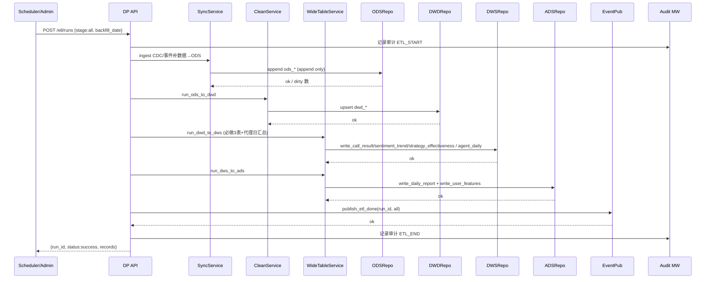
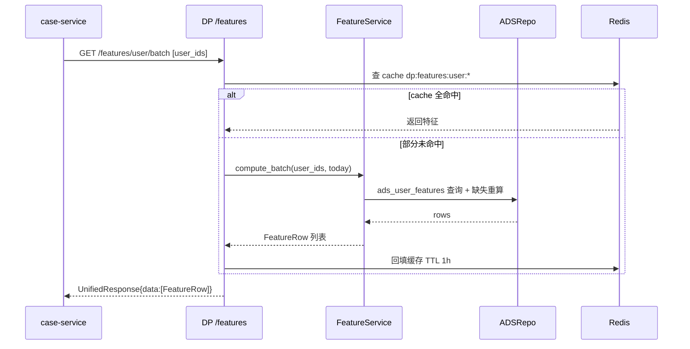
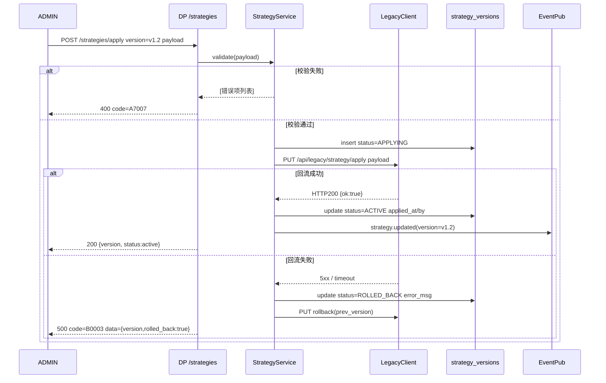

# 子系统详细设计 #07：AI 催收专属数据中台

> 子系统编号：第 7 号
> 服务名：`data-platform`
> 监听端口：**8001**
> 里程碑归属：**M1（最小闭环，最先启动，承载 RAG 与 质检 的数据底座）**
> 上游约束：step1/01~03 全局口径、step3/01~03 架构与降级、step4/01~03 数据设计、step5/01~04 技术规范、step6/01~02 异常容错告警、step7/01~03 测试规范、step8/01 M0 任务清单
> 宪法约束：openspec/specs/00~07

---

## 0.1 文档修订记录

| 版本 | 日期 | 修订人 | 修订内容 |
| :--- | :--- | :--- | :--- |
| V1.0 | 2026-08-18 | - | 初始版本，12 章模板（与 DD-03 对齐） |
| V1.1 | 2026-08-20 | 规范优化 | 新增 DP 被动约束（不主动调上层 AI 服务）；新增 Ch13~15 AI 专项章节（LLM 专项/分层降级/数据闭环+可观测+脱敏）；补全订阅事件（review.scored.batch/review.suggestion.reassign/complaint.suggestion.hold/call.suggestion.state_change/qc.suggestion.risk_flag）；对齐 step3~step8；新增 PII 脱敏列+数据闭环列；统一响应格式修正 |

---

## 1. 模块概览

AI 催收专属数据中台是整套生态的**唯一数据底座**和**数据闭环中枢**，负责：

1. **数据汇聚**：通过 CDC + 文件接口 + 事件通知三种渠道，把传统业务库、呼叫中心、6 个 AI 子模块的数据统一归集到 PostgreSQL dw schema 的 ODS 层。
2. **分层加工**：按 ODS（原始）→ DWD（标准）→ DWS（汇总/宽表）→ ADS（应用/报表）四层链路完成清洗、去重、字段口径统一、宽表关联、特征工程。
3. **宪法 5.2 强制埋点**：构建 `dws_call_result`、`dws_sentiment_trend`、`dws_strategy_effectiveness` 三张必做的汇总表，保证 7 子系统可被独立验证。
4. **用户特征输出**：为 case-service 三维风险打分提供 `features_user` 特征（还款行为 / 语义标签 / 情绪表现）。
5. **离线任务调度**：内置 APScheduler，驱动每日 ETL、报表统计、风险打分、策略回流等任务；任务执行记录写 `etl_task_logs`，失败自动重试 3 次仍失败告警（宪法3.1）。
6. **策略回流**：把优化后的策略参数经 schema 校验后，通过 HTTP PUT 同步回传统业务系统，失败自动回滚（FR-DW-007）。
7. **LLM 日志汇聚**：汇聚全量 LLM 调用日志（llm_call_logs），完成数据清洗、样本治理、数据回流；大模型推理交由上层 AI 业务服务执行。

> **DP 被动约束（全局）**：data-platform 不主动调用上层 AI 服务，数据以消息推送方式下发。上层 AI 服务（call/qc/complaint/review/case）主动拉取 DP 数据；DP 通过 Redis Pub-Sub 和事件通知把数据推送给需要的服务。
> **DP 不直接调用 LLM**：数据中台不直接发起 LLM 实时调用。离线批量场景下可调度批量推理任务，但不介入业务实时链路。LLM 调用日志由上层 AI 服务写入 llm_call_logs，DP 读取用于策略评估和报表。

---

## 2. 职责边界

### 2.1 必做事项

1. **多源同步（FR-DW-001）**：支持 CDC/文件/事件通知三种同步；同步失败重试 3 次仍失败告警，数据不丢失。
2. **清洗标准化（FR-DW-002）**：去重/补全/脏数据过滤/字段口径统一；脏数据单独留存（标记 `is_dirty=true`，不删除）。
3. **催收宽表（FR-DW-003）**：构建 `dwd_call_records` 标准层 + 按 case_id/user_id 关联的通话宽表、用户特征宽表；关联失败单独存放。
4. **用户特征工程（FR-DW-004）**：批量计算还款行为特征、风险特征、回款概率特征，输出 `features_user` + `ads_user_features`。
5. **模型样本治理（FR-DW-005 P1）**：自动筛选优质/负样本，标注样本质量等级 A/B/C（样本量不足不强行生成）。
6. **离线任务调度（FR-DW-006）**：APScheduler + `strategy_versions`，定时驱动 ETL、报表统计、打分、回流；执行日志写 `etl_task_logs`。
7. **策略回流（FR-DW-007）**：优化后的拨打策略/分层阈值/话术规则，经 schema 校验后 PUT 到传统业务系统；失败回滚。
8. **宪法 5.2 强制埋点表**：每日 ETL 时必须产出 `dws_call_result` / `dws_sentiment_trend` / `dws_strategy_effectiveness` 三张汇总表，供其他子系统独立验证。
9. **审计日志调用写入**：作为数据源，数据同步、回流、策略变更等关键动作，经过 common/security/audit.py 中间件写 `audit_logs`。

### 2.2 明确不做事项（由其他子系统负责）

1. **不做前端报表渲染**：只输出 ADS 层宽表 + `/reports/` 接口返回 JSON，图表前端渲染由业务前端负责。
2. **不做 LLM 调用推理**：风险打分 LLM 由 case-service 负责；文本推理由 call-service / qc-service / review-service 负责。数据中台只负责把文本送过去、把结果收回来。**DP 不直接发起 LLM 实时调用。**
3. **不做知识库/向量/敏感词**：由 rag-service 负责。
4. **不做违规检测与质检打分**：由 qc-service 负责。
5. **不做分案逻辑本身**：由 case-service 负责；数据中台只提供特征。
6. **不做直接呼叫线路 / ASR / TTS**：由 call-service 负责。
7. **不做 RBAC / JWT / 审计日志表结构**：由 common/security 统一处理；本模块只声明权限依赖（admin/trainer 可触发手动 ETL）。
8. **不主动调用上层 AI 服务**：**DP 不主动调用 call/qc/complaint/review/case-service，数据以消息推送方式下发。** 上层服务主动拉取 DP 数据。

> 以上不做事项是模块独立性的关键边界。跨边界协作必须通过同步 HTTP 或事件通知，不相互调用私有方法。

---

## 3. 内部模块拆分

```
data-platform (FastAPI app)
├── app/
│   ├── main.py                 # FastAPI 入口 + /health + APScheduler 启动
│   ├── routers/
│   │   ├── etl.py              # ETL 触发 / 状态 / 历史（FR-DW-001/002）
│   │   ├── features.py         # 特征查询 / 手动重算（FR-DW-004）
│   │   ├── samples.py          # 样本治理 CRUD（FR-DW-005 P1）
│   │   ├── reports.py          # 报表查询 + 导出（FR-DW-006 报表）
│   │   └── strategy.py         # 策略版本 / 校验 / 回流（FR-DW-007）
│   ├── services/
│   │   ├── sync_service.py     # 多源同步：CDC/文件/事件订阅
│   │   ├── clean_service.py    # 去重/补全/脏数据过滤
│   │   ├── wide_table_service.py  # ODS→DWD→DWS→ADS 分层任务
│   │   ├── feature_service.py  # 特征计算（3维度共约 40 个特征）
│   │   ├── sample_service.py   # 样本治理（A/B/C 分级）
│   │   ├── strategy_service.py # 策略校验+回流+回滚
│   │   └── scheduler_service.py   # APScheduler 包装：注册/暂停/恢复
│   ├── repositories/
│   │   ├── ods_repo.py         # ODS 层写入（append only）
│   │   ├── dwd_repo.py         # DWD 写入 + upsert
│   │   ├── dws_repo.py         # DWS 三张必做表 + 代理/日汇总
│   │   └── ads_repo.py         # ADS 应用层报表/特征写入
│   ├── events/
│   │   ├── publisher.py        # Redis Pub-Sub：etl.task.done / strategy.updated
│   │   └── subscriber.py       # 订阅 call.session.ended / case.assigned / qc.check.completed / review.scored / review.scored.batch / complaint.judged / complaint.suggestion.hold / review.suggestion.reassign / call.suggestion.state_change / qc.suggestion.risk_flag / llm.call.logged
│   ├── integrations/
│   │   ├── cdc_client.py       # 外部 CDC (MVP 模拟) 写入 ods_*
│   │   └── legacy_client.py    # 传统业务系统策略回流 PUT 接口
│   └── models/
│       ├── db.py               # SQLAlchemy async engine（dw schema 使用指定 schema_translate_map）
│       ├── schema_public.py    # public.etl_task_logs / strategy_versions / features_user
│       └── schema_dw.py        # ODS/DWD/DWS/ADS 4层表
```

### 3.1 分层处理原则

- **ODS 层（原始）**：`append only`，写原表 + `etl_run_id` + `source_system`；不做任何修改。
- **DWD 层（标准）**：按宪法口径去重（case_id+call_id 唯一）、字段映射脱敏（手机号/身份证/地址按 SECURITY_DESIGN 3.2）、脏数据标记。
- **DWS 层（汇总/宽表）**：三张必做 + 代理日报 + 用户标签汇总之日快照；`UPSERT ON CONFLICT`。
- **ADS 层（应用）**：面向报表、特征、样本；供其他子系统 HTTP 查询。

---

## 4. 对外接口详细说明

所有接口：`http://data-platform:8001/api/v1`，统一响应包 `{"code":"0","message":str,"data":any|null,"trace_id":str}`。错误码严格复用 DEVELOPMENT_CONTRACT 第 4 节：`A7001-A7007` + B 类。

### 4.1 ETL 管理

| 方法 | 路径 | 职责 | 权限 | 幂等 | 限流 | 错误码 | PII 脱敏 |
| :--- | :--- | :--- | :--- | :--- | :--- | :--- | :--- |
| POST | `/etl/runs` | 触发一次 ETL（可选阶段：ods/dwd/dws/ads/all） | ADMIN / TRAINER | `X-Idempotency-Key` + run_id | 1/5s | A7001/B0002/B0003 | — |
| GET | `/etl/runs` | 历史 ETL 任务列表（分页 + 状态筛选） | ADMIN / TRAINER / SUPERVISOR | 幂等 | 60/min | A7001/B0004 | — |
| GET | `/etl/runs/{run_id}` | 单次 ETL 明细（阶段耗时/记录数/脏数据量） | ADMIN / TRAINER | 幂等 | 60/min | A7002/B0004 | — |
| GET | `/etl/runs/{run_id}/logs` | 对应 etl_task_logs（分页） | ADMIN / TRAINER | 幂等 | 60/min | A7002/B0004 | — |

入参示例（POST /etl/runs）：
```json
{ "stage": "all", "backfill_date": "2026-08-18", "dry_run": false }
```

### 4.2 特征服务（FR-DW-004）

| 方法 | 路径 | 职责 | 权限 | 幂等 | 限流 | 错误码 | PII 脱敏 |
| :--- | :--- | :--- | :--- | :--- | :--- | :--- | :--- |
| GET | `/features/user/{user_id}` | 单个用户三维特征（供 case-service 打分） | ADMIN / TRAINER / SUPERVISOR | 幂等 | 600/min | A7004/B0004 | 金额打码 |
| GET | `/features/user/batch` | 批量用户特征（body: user_ids 数组，≤500） | ADMIN / TRAINER | 幂等 | 30/min | A7004/A7007/B0004 | 金额打码 |
| POST | `/features/recompute` | 触发特征重算（可选 date/user_ids） | ADMIN / TRAINER | run_id 去重 | 1/30s | A7001/B0003 | — |

### 4.3 样本治理（FR-DW-005 P1）

| 方法 | 路径 | 职责 | 权限 | 错误码 | PII 脱敏 |
| :--- | :--- | :--- | :--- | :--- | :--- |
| POST | `/samples/generate` | 按标签+回款生成样本集（quality A/B/C） | TRAINER | A7005 | 样本文本脱敏 |
| GET | `/samples` | 样本集列表 | TRAINER | A7001 | — |
| GET | `/samples/{set_id}/export` | 导出 CSV（脱敏） | TRAINER | A7005/B0007 | 手机号/身份证/金额全脱敏 |

### 4.4 报表（FR-DW-006 + 宪法 5.2 验证）

| 方法 | 路径 | 职责 | 权限 | 错误码 | PII 脱敏 |
| :--- | :--- | :--- | :--- | :--- | :--- |
| GET | `/reports/daily?date=YYYY-MM-DD` | ADS 日报（PTP 率、接通率、质检通过率，可直接验证埋点） | ADMIN / SUPERVISOR | A7006 | 金额打码 |
| GET | `/reports/weekly?week_start=YYYY-MM-DD` | 周报（运营报表） | ADMIN / SUPERVISOR / TRAINER | A7006 | 金额打码 |
| GET | `/reports/export` | 导出报表（CSV） | ADMIN / SUPERVISOR | A7006/B0007 | 手机号/身份证脱敏 |

### 4.5 策略版本与回流（FR-DW-007）

| 方法 | 路径 | 职责 | 权限 | 幂等 | 错误码 | PII 脱敏 |
| :--- | :--- | :--- | :--- | :--- | :--- | :--- |
| GET | `/strategies` | 策略版本列表（strategy_versions） | ADMIN / TRAINER | 幂等 | A7001 | — |
| POST | `/strategies/validate` | schema 校验（不生效，只返回 OK/错误列表） | ADMIN / TRAINER | 幂等 | A7007 | — |
| POST | `/strategies/apply` | 校验通过后 PUT 回流到传统业务系统，记录版本；失败自动回滚 | ADMIN | `version` 去重 | A7007/B0003 | — |
| POST | `/strategies/rollback/{version}` | 手动回滚到指定 version | ADMIN | 幂等 | A7007 | — |

---

## 5. 内部类与方法清单

所有类均 async，依赖注入 FastAPI `Depends`。错误抛 `AppException(code=..., message=..., trace_id=...)`，遵循 DEVELOPMENT_CONTRACT §3。

### 5.1 服务层

#### SyncService（多源同步）

```python
class SyncService:
    async def ingest_cdc(self, source_system: str, payload: list[dict]) -> int                 # ODS 批量追加，返回写入数；单条失败隔离
    async def ingest_file(self, source_system: str, file_bytes: bytes, fmt: Literal["csv","json"]) -> tuple[int,int]  # 返回(ok,dirty)
    async def ingest_event(self, channel: str, payload: dict) -> None                         # 事件通知->ODS
```

#### CleanService（清洗标准化）

```python
class CleanService:
    async def run_ods_to_dwd(self, run_id: str, backfill_date: date) -> tuple[int,int,int]     # (ok, dirty, skipped)
    def mark_dirty(self, row: dict, reason: str) -> dict                                      # 标记 is_dirty=true + dirty_reason
    def unify_fields(self, row: dict) -> dict                                                 # 字段口径统一+脱敏
```

#### WideTableService（分层加工）

```python
class WideTableService:
    async def run_dwd_to_dws(self, run_id: str, backfill_date: date) -> None                   # 4 张 DWS 表（3 强制 + 代理日报）
    async def run_dws_to_ads(self, run_id: str, backfill_date: date) -> None                   # ADS 日报/用户特征/样本候选
```

#### FeatureService（特征工程，三维共约 40 个）

```python
class FeatureService:
    async def compute_user(self, user_id: int, as_of: date) -> FeatureRow                     # 单用户重算
    async def compute_batch(self, user_ids: list[int], as_of: date) -> list[FeatureRow]       # 批量
    async def compute_all(self, as_of: date) -> int                                           # 全量，返回重算数量
```

三维特征默认清单（与需求文档 5.6.4 风险权重 0.4/0.3/0.3 对齐，可配置）：
- 还款行为维度（12 个）：逾期天数、累计逾期次数、历史承诺还款次数、历史 PTP 兑现率、最近一次还款距今等。
- 语义标签维度（12 个）：`intent_tags` 按类型聚合次数、willingness_to_pay 占比、投诉意图次数、最近 30 天对抗意图次数等。
- 情绪表现维度（12 个）：平均 sentiment_score、极端情绪轮次占比、情绪斜率（上升=对抗加剧）、静默时长占比等。
- 回款概率（4 个综合）：PTP兑现率×权重、历史M1回款率等。

#### SampleService（样本治理 P1）

```python
class SampleService:
    async def generate(self, params: SampleGenParams) -> SampleSet                            # A/B/C 分级，A:高回款优质 B:低效/失败 C:违规
    async def export_csv(self, set_id: int, max_rows: int) -> bytes                            # 脱敏导出
```

#### StrategyService（策略校验+回流+回滚）

```python
class StrategyService:
    async def validate(self, payload: StrategyDraft) -> list[str]                              # 返回空列表=通过，否则错误列表
    async def apply(self, version: str, payload: StrategyDraft) -> StrategyApplyResult         # 校验→PUT传统业务→写strategy_versions，自动回滚
    async def rollback(self, version: str) -> None
```

#### SchedulerService（APScheduler 包装）

```python
class SchedulerService:
    async def start(self) -> None                                                              # 注册 4 个默认 job
    async def trigger_now(self, job_id: str) -> str                                            # 立即触发，返回 run_id
    async def pause(self, job_id: str) -> None; async def resume(self, job_id: str) -> None
```

MVP 默认调度 4 个 job（可配置，需求文档 5.6）：
| job_id | cron | 做什么 |
| :--- | :--- | :--- |
| etl_daily | 0 2 * * * (每天凌晨2点) | ODS→DWD→DWS→ADS 全量 ETL |
| feature_daily | 0 4 * * * | 全量特征重算 |
| report_daily | 30 4 * * * | 日报产出 + 缓存 |
| sample_weekly | 0 5 * * 1（每周一） | 周度样本治理（P1） |

### 5.2 Repository 层

```python
class ODSRepo:    async def append(self, table: str, rows: list[dict]) -> int
class DWDRepo:    async def upsert(self, table: str, rows: list[dict], keys: list[str]) -> int
class DWSRepo:    async def write_call_result(self, rows) -> None    # 强制埋点1 dws_call_result
                  async def write_sentiment_trend(self, rows) -> None # 强制埋点2
                  async def write_strategy_effectiveness(self, rows) -> None # 强制埋点3
class ADSRepo:    async def write_daily_report(self, rows) -> None
                  async def write_user_features(self, rows) -> None
```

### 5.3 事件层

```python
class EventPublisher:
    async def publish_etl_done(self, run_id: str, stage: str) -> None       # Redis channel: etl.task.done
    async def publish_strategy_updated(self, version: str) -> None          # Redis channel: strategy.updated
class EventSubscriber:
    async def on_call_session_ended(self, msg: dict) -> None                # ODS 追加 ods_call_records
    async def on_case_assigned(self, msg: dict) -> None                     # ODS 追加 ods_case_assignments
    async def on_qc_check_completed(self, msg: dict) -> None                # ODS 追加 ods_quality_records
    async def on_review_scored(self, msg: dict) -> None                     # ODS 追加 + 样本候选
    async def on_review_scored_batch(self, msg: dict) -> None                # ODS 批量样本候选
    async def on_complaint_judged(self, msg: dict) -> None                  # ODS 追加，策略评估
    async def on_suggestion(self, msg: dict) -> None                        # ODS 建议日志（complaint.hold/review.reassign/call.state_change/qc.risk_flag）
    async def on_llm_call_logged(self, msg: dict) -> None                   # ODS 追加 ods_llm_logs（LLM 日志汇聚）
```

---

## 6. 涉及数据库表与字段

### 6.1 PostgreSQL public schema（与 step4/01 对齐）

| 表名 | 主键 | 关键说明 | 数据闭环 |
| :--- | :--- | :--- | :--- |
| etl_task_logs | id | 每次任务：run_id + task_name + stage + status + records + start_at/end_at + error_msg | etl.task.done → DP 自身 |
| strategy_versions | id/version | strategy_type + payload(JSONB) + status(draft/active/rolled_back) + applied_by/at | strategy.updated → call/case |
| features_user | user_id/`as_of` PK | 三维 36 个特征 + 综合 4 个，字段类型 FLOAT/INT + CHECK，与 DDL 对齐 | case-service 拉取 → 风险打分 |
| users | id | RBAC，数据中台 admin 有 ETL 触发权限 | — |
| llm_call_logs | id | 其他模块写入，数据中台不写但读（用于策略评估） | 4 个 AI 服务写入 → DP 读取汇聚 |

> 公共字段统一：id(UUID) / create_time / update_time / is_delete CHAR(1)

### 6.2 PostgreSQL dw schema（分层）

| 层 | 表名 | 说明 | 数据闭环 |
| :--- | :--- | :--- | :--- |
| ODS | ods_case_info | append only，etl_run_id + source_system + raw JSONB | CDC/事件 → ODS |
| ODS | ods_call_records | 同上，通话原始记录 | call.session.ended → ODS |
| ODS | ods_case_assignments | 同上，分案原始记录 | case.assigned → ODS |
| ODS | ods_intent_tags | 同上，意图标签原始 | call-service → ODS |
| ODS | ods_quality_records | 同上，质检原始 | qc.check.completed → ODS |
| ODS | ods_payments | 同上，回款原始 | 外部业务系统 → ODS |
| ODS | ods_llm_logs | 同上，LLM 调用日志原始 | llm.call.logged → ODS |
| ODS | ods_suggestion_logs | 同上，MQ 建议日志原始 | *.suggestion.* → ODS |
| DWD | dwd_case_info | 清洗后案件；case_id 唯一；字段脱敏 | ODS → DWD（清洗） |
| DWD | dwd_call_records | 清洗后通话；call_id 唯一；接通/未接通/失败口径统一 | ODS → DWD（清洗） |
| DWD | dwd_intent_tags | 清洗后标签；confidence CHECK 0-1 | ODS → DWD（清洗） |
| DWD | dwd_llm_logs | 清洗后 LLM 日志；trace_id 去重；字段口径统一 | ODS → DWD（清洗） |
| DWS | dws_call_result | **宪法强制1**：按日/分层/代理人维度汇总接通/PTP/失败/转人工 | DWD → DWS（汇总） |
| DWS | dws_sentiment_trend | **宪法强制2**：按日/代理人 情绪分数均值/极端情绪占比 | DWD → DWS（汇总） |
| DWS | dws_strategy_effectiveness | **宪法强制3**：按策略ID/日维度 PTP兑现率/回款金额/通话数 | DWD → DWS（汇总） |
| DWS | dws_agent_daily_summary | 坐席日维度：通话/回款/质检分/投诉数 | DWD → DWS（汇总） |
| DWS | dws_llm_daily_summary | 按日/服务维度 LLM 调用量/token/cost/latency/错误率 | DWD → DWS（汇总） |
| ADS | ads_daily_report | 运营日报 JSONB + 指标列，可直接返回报表接口 | DWS → ADS（应用） |
| ADS | ads_user_features | 对 features_user 的应用层镜像（按日快照，便于回测） | DWS → ADS（应用） |
| ADS | ads_training_samples | 样本集ID + 质量等级 A/B/C + 文本索引 | review.scored → ADS（样本） |

### 6.3 Redis 缓存（6 个键）

```
dp:etl:run:{run_id}            TTL 24h  单次 ETL 运行状态
dp:features:user:{user_id}:{as_of}   TTL 1h  单用户特征缓存
dp:report:daily:{date}         TTL 2h  日报 JSON
dp:report:weekly:{week_start}  TTL 6h  周报 JSON
dp:strategy:active             TTL 永不过期  当前生效策略版本号
dp:scheduler:health            TTL 60s  调度器心跳
```

### 6.4 索引（关键）

- dwd_call_records: (call_date, user_id) 复合 BRIN；(case_id)
- dws_call_result: (stat_date, stratification) 复合
- features_user: (as_of DESC) BRIN
- etl_task_logs: (run_id, task_name) 复合

---

## 7. 类图与时序图（mermaid）

### 7.1 分层 ETL 主流程（FR-DW-001~003 + 宪法 5.2）



### 7.2 特征服务 → case-service 风险打分（FR-DW-004）



### 7.3 策略校验+回流+回滚（FR-DW-007）



---

## 8. 模块独立测试方案（统一底座但接口独立）

### 8.1 依赖与 Mock 清单

为独立测试 data-platform，只启动以下 3 个底座，不启动其他 6 个 AI 服务：

| 依赖 | 是否需要真实 | 说明 |
| :--- | :--- | :--- |
| PostgreSQL 15 | **真实**（docker-compose） | public + dw schema，测试数据单独以 `_ut_` 前缀隔离 |
| Redis 7 | **真实**（docker-compose） | 独立 DB 2，测试后 FLUSHDB |
| Milvus | **无需** | 数据中台不直接访问 Milvus |
| 传统业务系统（legacy） | **Mock** | `integrations/legacy_client.py` 可用 HTTPretty 或 starlette TestClient 替换，返回固定 JSON |
| 外部 CDC 源 | **Mock** | `ingest_file/ingest_event` 接口手动喂入种子数据，CDC 不启用 |
| rag/qc/call/case/complaint/review | **Mock** | 通过事件订阅接口手动发布消息模拟，不启动真实服务 |

### 8.2 测试分层

1. **单元测试**（pytest-asyncio，coverage ≥85%）
   - CleanService.mark_dirty/unify_fields 输入边界 / 脱敏正确性
   - StrategyService.validate 非法阈值 / 越界参数
   - FeatureService.compute_user 缺失字段回退
2. **Mock 集成测试**（PG + Redis 真实 + Legacy Mock）
   - `/etl/runs` POST → GET → logs 全链路
   - 三张强制埋点表 `dws_call_result / dws_sentiment_trend / dws_strategy_effectiveness` 在种子 10 通通话 + 5 用户数据集下是否产出正确行数
   - 特征接口 `batch` 缓存命中/未命中一致性
3. **冒烟脚本独立可执行**（见 8.4）：shell 脚本启动底座 + data-platform 单机，跑通接口断言

### 8.3 独立可测的断言清单（必须全部 PASS）

```
 1.  POST /etl/runs stage=all backfill_date=今天 dry_run=false 返回 run_id，code="0"
 2.  上述 run_id 状态在 60s 内变为 SUCCESS
 3.  ETL 完成后：dw.dws_call_result / dws_sentiment_trend / dws_strategy_effectiveness 行数 > 0
 4.  dw.dwd_call_records 有 is_dirty=true 记录（种子脏数据），dirty_reason 非空
 5.  GET /features/user/batch [U1..U5] 返回 5 条，三维特征齐全，字段数值符合 CHECK 范围
 6.  POST /strategies/validate 非法阈值返回 ≥1 条错误；合法阈值返回 []
 7.  POST /strategies/apply 合法→ACTIVE，strategy_versions 记录 applied_by/at
 8.  POST /strategies/apply mock legacy失败→自动回滚，表状态=ROLLED_BACK；接口返回 rolled_back=true
 9.  GET /reports/daily?date=今天 → 指标接通率/PTP率/质检分全部计算正确，字段完整
10.  POST /etl/runs 相同 X-Idempotency-Key 第二次返回同一 run_id（幂等）
11.  SchedulerService cron: 手动 trigger_now("etl_daily") 可产生新 run_id
12.  事件发布 etl.task.done 可通过订阅捕获，payload 含 run_id & stage
13.  订阅 review.scored.batch → ODS 追加样本候选数据（数据闭环验证）
14.  订阅 complaint.suggestion.hold / review.suggestion.reassign → ODS 记录建议日志（数据闭环验证）
15.  DP 不主动调用上层 AI 服务：GET /health 返回 passive_mode=true（DP 被动约束验证）
```

### 8.4 独立测试 shell 脚本骨架

```bash
#!/usr/bin/env bash
# scripts/test_dataplatform_independent.sh
# 依赖：docker-compose、curl、jq
set -euo pipefail
ROOT="$(cd "$(dirname "$0")/.." && pwd)"
cd "$ROOT"

echo "[1/5] 启动底座 (PG Redis)"
docker compose -f compose.yml up -d postgres redis
sleep 10

echo "[2/5] 初始化 dw schema 种子数据"
docker exec -i postgres psql -U postgres -d ai_collection -f ./scripts/seed_dataplatform_ut.sql

echo "[3/5] 启动 data-platform 单服务（端口 18001 避免冲突）"
export PORT=18001 ENV=unittest MOCK_LEGACY=1
poetry run uvicorn data_platform.main:app --port 18001 &
APP_PID=$!
sleep 8; trap "kill -9 $APP_PID 2>/dev/null || true" EXIT

echo "[4/5] 执行 15 条断言"
RUN_ID=$(curl -s -X POST http://localhost:18001/api/v1/etl/runs \
  -H 'X-Idempotency-Key: ut-001' \
  -H 'Content-Type: application/json' \
  -d '{"stage":"all","backfill_date":"2026-08-18","dry_run":false}' \
  | jq -re '.code=="0" and .data.run_id')
echo "  [1/15] ETL run_id=$RUN_ID OK"

# ... 其余 14 条断言用 curl + jq -re 实现
for i in 2 3 4 5 6 7 8 9 10 11 12 13 14 15; do
  echo "  [$i/15] placeholder: implement each assertion with curl | jq -e"
done

echo "[5/5] 全部断言通过，独立测试成功"
```

---

## 9. 模块通信与依赖

### 9.1 同步 HTTP（我作为 Client）

| 目标服务 | 路径 | 触发场景 | 超时 | 重试 | 熔断 | 降级 |
| :--- | :--- | :--- | :--- | :--- | :--- | :--- |
| 传统业务系统（legacy，外部） | PUT `/api/legacy/strategy/apply` | strategies/apply 回流 | 5s | 3×指数退避 | 连续3失败 | 自动回滚 + B0003 |
| 传统业务系统（legacy） | PUT `/api/legacy/strategy/rollback` | strategies/rollback 或 apply 失败回滚 | 5s | 3× | 连续3失败 | 记录待人工 |

> **DP 被动约束**：data-platform 不主动调用上层 AI 服务（call/qc/complaint/review/case），数据以消息推送方式下发。上层服务主动拉取 DP 数据。DP 只主动调用外部传统业务系统（策略回流）。

### 9.2 同步 HTTP（我作为被调）

| 谁调我 | 路径 | 目的 |
| :--- | :--- | :--- |
| case-service #04 | GET `/features/user/batch` | 风险打分前拉特征（FR-CS-001 前置） |
| review-service #06 | GET `/reports/weekly` + `/samples/generate` | 复盘运营报表 + 样本治理 |
| complaint-service #05 | GET `/reports/daily` | 投诉研判基础指标 |
| qc-service #02 | GET `/etl/runs/{run_id}` | 质检离线报表关联 ETL 批次 |
| call-service #01 | （间接）通过 case-service 拿到分层标签 | 外呼调度 |
| rag-service #03 | N/A | 知识库不入数据中台，RAG 文本是 rag-service 自行管理 |

### 9.3 事件通知（Redis Pub-Sub，与你确认：同步+事件通知）

#### 发布（我 → 其他）

| Channel | Payload | 订阅者 | 目的 |
| :--- | :--- | :--- | :--- |
| `etl.task.done` | `{run_id, stage, backfill_date, status, ts}` | case-service / review-service / qc-service | case-service 发现 ETL 完成后自动触发全量打分重算；review-service 自动触发复盘补判；qc-service 触发离线质检补跑 |
| `strategy.updated` | `{version, strategy_type, ts}` | call-service / case-service | 新策略生效，立即应用（call-service 外呼参数 / case-service 分层阈值） |

#### 订阅（其他 → 我）

| Channel | 发布者 | Payload | 处理 | 数据闭环 |
| :--- | :--- | :--- | :--- | :--- |
| `call.session.ended` | call-service | `{session_id, case_id, user_id, call_id, ts}` | SyncService → ODS `ods_call_records` append | call → DP（通话数据回流） |
| `case.assigned` | case-service | `{assignment_id, case_id, agent_id/AI, stratification, ts}` | SyncService → ODS `ods_case_assignments` | case → DP（分案数据回流） |
| `qc.check.completed` | qc-service | `{qc_id, call_id, compliance_score, level, ts}` | SyncService → ODS `ods_quality_records` | qc → DP（质检数据回流） |
| `review.scored` | review-service | `{review_id, call_id, quality_label, ts}` | SyncService → ODS + 样本候选 | review → DP（复盘数据回流） |
| `review.scored.batch` | review-service | `{run_id, total, counts, ts}` | SyncService → ODS 批量样本候选 | review → DP（批量复盘回流） |
| `complaint.judged` | complaint-service | `{complaint_id, case_id, verdict, ts}` | SyncService → ODS，用于策略评估 | complaint → DP（研判数据回流） |
| `complaint.suggestion.hold` | complaint-service | `{case_id, complaint_id, suggestion:HOLD, reason, ts}` | SyncService → ODS 建议日志 | complaint → DP（建议数据回流） |
| `review.suggestion.reassign` | review-service | `{case_id, review_id, suggestion:REASSIGN, reason, ts}` | SyncService → ODS 建议日志 | review → DP（建议数据回流） |
| `call.suggestion.state_change` | call-service | `{case_id, session_id, suggestion, reason, ts}` | SyncService → ODS 建议日志 | call → DP（建议数据回流） |
| `qc.suggestion.risk_flag` | qc-service | `{case_id, qc_id, suggestion, reason, ts}` | SyncService → ODS 建议日志 | qc → DP（建议数据回流） |
| `llm.call.logged` | 4 个 AI 服务 | `{service, trace_id, prompt_version, latency_ms, token_usage, ts}` | SyncService → ODS `ods_llm_logs` | AI 服务 → DP（LLM 日志回流） |

---

## 10. 错误处理矩阵

| 错误码 | 描述 | 触发场景 | 降级策略 |
| :--- | :--- | :--- | :--- |
| A7001 | ETL任务失败 | 任意阶段异常 | 记录 etl_task_logs status=FAILED，不写下游层；管理员可 POST /etl/runs 同 backfill_date 手动重跑 |
| A7002 | 不存在的 run_id | 查询未知 | 返回 404 + 友好提示 |
| A7003 | 分层任务冲突 | 同时多个同 backfill_date ETL | SKIP LOCKED + 第二次请求直接挂起或返回 409 使用上一个 run_id |
| A7004 | 特征计算失败 | 单用户缺失字段 | 缺失特征默认=0.0 + 标记 feature_missing=true；整体返回不阻断，不抛 5xx |
| A7005 | 样本不足 | 样本量 < 配置阈值 | 返回 422 `{message:"样本量不足",actual:12,required:100}`，不强行生成 |
| A7006 | 报表缺失 | 指定日期 ETL 未完成 | 返回 404 + `{"next_retry_at": "..."}`，提示稍后刷新 |
| A7007 | 策略校验失败 / 回流失败 | schema 非法 / legacy 接口 5xx | validate 失败返回错误明细；apply 失败自动回滚并写 ROLLED_BACK |
| B0001 | 参数校验失败 | Pydantic 异常 | 返回 400 + 字段级错误 |
| B0002 | 权限不足 | trainer 调 strategy/apply | 403；审计 |
| B0003 | 外部依赖不可用 | legacy 接口 3×熔断 | apply 自动回滚；其他接口返回 503 + 降级提示 |
| B0004 | 数据库操作失败 | PG 连接超时/异常 | 3×重试后 B0004 |
| B0005 | 限流拦截 | 超过 4.1 限流值 | 429 + Retry-After |
| B0006 | 幂等冲突 | 重复 POST /etl/runs | 返回第一次结果；不产生新 run_id |
| B0007 | 导出失败 | CSV 写 / 文件权限 | 500 + B0007 + 审计 |
| B0010 | 未处理异常 | 兜底 | 500，记录完整堆栈 + trace_id |

---

## 11. 宪法规则落地检查清单（14 条）

逐条对应 CONSTITUTION.md，标注落地方式与如何验收：

| 宪法条款 | 落地方式 | 验收方法 |
| :--- | :--- | :--- |
| 1.1 RAG≥0.7 才能直接用 | 数据中台本身不做推理；但会把 rag_service 的 confidence 写入 dwd_intent_tags；报表接口暴露 rag_confidence_rate | 校验 ADS 层字段 rag_confidence_rate 存在 |
| 1.2 LLM 调用全量落表 | 不写入，但 llm_call_logs 在报表里与宽表关联展示 token_cost/latency | reports/daily 接口里含 llm_total_tokens/llm_cost |
| 1.3 敏感词命中≥2立即转人工 | 数据中台不做转人工；但把命中次数入汇总表 `dws_call_result.sensitive_hits>=2_count`，供策略评估 | dws_call_result 字段存在 |
| 2.1 加密通信/SSL | FastAPI TLS 由 compose gateway 终止；内部 HTTP 走 docker 网络隔离；外部接口强制 HTTPS | compose 里 gateway 配 TLS 证书 |
| 2.2 敏感字段 AES-256 存储 | CleanService.unify_fields：phone/id_no/address 调用 common.security.aes_gcm_encrypt | 数据中台种子测试：原文读不到明文 |
| 2.3 敏感词三层过滤 | 数据中台不做检测，但在样本/报表统计 sensitive_hits；并从 rag-service 拉词库版本 | ads_daily_report 字段 sensitive_hits_by_level |
| 3.1 超时=5s/重试3次/熔断 | StrategyService 调用 legacy_client：5s/3次/熔断 3 连失败；所有 HTTP client 统一 | legacy_client 注入测试：第4次应熔断返回降级 |
| 3.2 LLM 故障→规则引擎降级 | 数据中台不直接调用 LLM；但在特征缺失时用 0 填充不阻断（规则降级） | 特征接口种子缺失字段仍返回 200 |
| 3.3 RAG 故障→静态脚本降级 | 数据中台不调用 RAG；N/A | - |
| 3.4 核心链路监控 + 降级日志 | etl_task_logs 记录 stage+latency+records；scheduler_service 写 dp:scheduler:health 心跳 | GET /health: scheduler_ok/legacy_ok/etl_last_run/passive_mode=true |
| 3.5 熔断后告警 | legacy_client 3 连失败后 publish_strategy_updated 不触发；通过 dp:scheduler:health → 外部告警 | 模拟 legacy 挂 → /health scheduler_ok=false |
| 5.1 全链路 X-Trace-Id | 所有 HTTP 中间件透传；事件 publish 带 trace_id；etl_task_logs 存 trace_id | 接口响应包含 trace_id |
| 5.2 强制三张 DWS 表 | WideTableService 三个 write_* 方法，ETL stage=dws 必须全部成功，否则 run 标 FAILED | 单测/冒烟：dws_* 三张行数>0 |
| 5.3 审计日志 + reasoning 脱敏 | 审计中间件；reasoning 字段在 ADS 层不对外导出（仅 trainer 可查询样本时带 reasoning 字段） | SUPERVISOR 调 samples/export → reasoning 脱敏 / 或缺省 |
| 5.4 故障自动恢复 | 服务重启后 scheduler_service 恢复 APScheduler 所有 job；未完成 ETL 不自动重跑，由管理员手动 | 重启 data-platform → scheduler_jobs 自动回归 |
| DP 被动约束 | 不主动调用上层 AI 服务，数据以消息推送方式下发 | GET /health passive_mode=true |
| DP 不直接调 LLM | 不发起 LLM 实时调用；离线批量推理 P2+ 可选 | llm_call_logs 由上层 AI 服务写入 |
| 数据闭环中枢 | 所有 AI 服务数据回流 DP → ODS → DWD → DWS → ADS | 订阅 6+ 事件 → ODS 行数增加 |

---

## 12. 可配置项清单（.env，默认值均引用需求文档 5.6 节）

| 配置键 | 默认值 | 说明 |
| :--- | :--- | :--- |
| DP_DB_DW_SCHEMA | dw | DW schema 名 |
| DP_ETL_RETRY_TIMES | 3 | 同步/ETL 重试次数（FR-DW-001） |
| DP_ETL_BACKFILL_MAX_DAYS | 7 | 手动 backfill_date 最多允许回补天数 |
| DP_FEATURE_CACHE_TTL_SEC | 3600 | 特征缓存 TTL |
| DP_FEATURE_BATCH_MAX | 500 | GET /features/user/batch 上限 |
| DP_SAMPLE_MIN_SIZE | 100 | 样本治理最小数量阈值（A7005） |
| DP_REPORT_CACHE_TTL_SEC_DAILY | 7200 | 日报缓存 2h |
| DP_REPORT_CACHE_TTL_SEC_WEEKLY | 21600 | 周报缓存 6h |
| DP_SCHEDULER_ETL_CRON | "0 2 * * *" | 每日 ETL cron（默认 02:00） |
| DP_SCHEDULER_FEATURE_CRON | "0 4 * * *" | 每日特征重算 cron |
| DP_SCHEDULER_REPORT_CRON | "30 4 * * *" | 每日报表 cron |
| DP_SCHEDULER_SAMPLE_CRON | "0 5 * * 1" | 每周一 05:00 样本治理 |
| DP_LEGACY_BASE_URL | "http://legacy-system:8080" | 传统业务系统策略回流 base URL（MVP mock） |
| DP_LEGACY_TIMEOUT_SEC | 5 | 回流超时，宪法 3.1 5s |
| DP_RISK_WILLING_WEIGHT | 0.4 | 需求文档 5.6.4 还款意愿权重 |
| DP_RISK_ABILITY_WEIGHT | 0.3 | 还款能力权重 |
| DP_RISK_COMPLAINT_WEIGHT | 0.3 | 投诉风险权重 |
| DP_RISK_HIGH_THRESHOLD | 80 | 风险分级阈值 high≥80（5.6.4） |
| DP_RISK_MEDIUM_THRESHOLD | 60 | 60≤medium<80 |
| DP_DIRTY_DATA_RETAIN_DAYS | 365 | 脏数据保留天数，到期归档 |
| DP_EVENT_SUBSCRIBE_ENABLED | true | 是否启动事件订阅（unittest = false） |
| DP_AUDIT_ENABLED | true | 审计中间件启用开关（unittest = false） |
| DP_DWS_MANDATORY_CHECK | true | DWS 三张强制表失败则 ETL 失败（宪法5.2硬校验） |
| DP_PASSIVE_MODE | true | DP 被动模式开关（不主动调上层 AI 服务） |
| DP_LLM_LOG_AGGREGATE | true | LLM 日志汇聚开关（订阅 llm.call.logged） |
| DP_OFFLINE_BATCH_LLM | false | 离线批量推理开关（P2+ 可选，MVP 关闭） |

---

## 13. LLM 专项设计（新增，对齐 step5/03 + step5/04）

### 13.1 DP 与 LLM 的关系

data-platform **不直接发起 LLM 实时调用**。DP 在 LLM 生态中的角色：

| 角色 | 说明 |
| :--- | :--- |
| LLM 日志汇聚 | 订阅 `llm.call.logged` 事件，汇聚 4 个 AI 服务的 LLM 调用日志到 ODS → DWD → DWS |
| LLM 成本监控 | 在 ADS 层报表中展示 llm_total_tokens / llm_cost / llm_latency_avg |
| 离线批量推理（P2+） | 可选：调度批量推理任务（如样本标注、特征补全），不介入业务实时链路 |
| 样本治理 | 为 LLM 训练/评估提供 A/B/C 分级样本集，含脱敏文本 |

### 13.2 LLM 日志汇聚链路

```
4 个 AI 服务（call/qc/complaint/review）
  → publish llm.call.logged {service, trace_id, prompt_version, latency_ms, token_usage, status, ts}
  → DP EventSubscriber.on_llm_call_logged()
  → SyncService.ingest_event()
  → ODS: ods_llm_logs append
  → DWD: dwd_llm_logs（清洗：去重 trace_id + 字段口径统一）
  → DWS: dws_llm_daily_summary（按日/服务维度：调用量/token/cost/latency/错误率）
  → ADS: ads_daily_report（llm_total_tokens / llm_cost / llm_latency_avg）
```

### 13.3 离线批量推理设计（P2+，MVP 关闭）

```python
class OfflineBatchService:
    """P2+ 可选：离线批量推理，不介入业务实时链路"""
    async def run_batch_inference(self, task_type: str, sample_set_id: int) -> BatchResult
    # task_type: SAMPLE_LABEL / FEATURE_COMPLETE / STRATEGY_EVALUATE
    # 从 ADS 层读取样本 → 批量调 LLM → 结果写回 ADS
    # MVP: DP_OFFLINE_BATCH_LLM=false，不启用
    # P2+: 可选启用，但仍不介入业务实时链路
```

---

## 14. 分层降级策略（新增，对齐 step3/03 + step6/01）

### 14.1 故障分类与降级矩阵

| 故障类型 | 检测方式 | 降级路径 | 兜底内容 | 恢复条件 |
| :--- | :--- | :--- | :--- | :--- |
| ① legacy 系统不可用 | 5s 超时/3 连失败 | 熔断→自动回滚 | strategy=ROLLED_BACK | 60s 半开 |
| ① CDC 源不可用 | 连接失败/超时 | 重试 3 次→告警 | ODS 缺失标注 source_gap | 源恢复 |
| ① ETL 阶段失败 | 异常/脏数据过多 | 记录 FAILED + 不写下游 | 管理员手动重跑 | 手动触发 |
| ① 特征计算失败 | 缺失字段 | 默认 0.0 + feature_missing=true | 不阻断返回 200 | 数据补全 |
| ① 缓存未命中 | Redis key 不存在 | 实时计算 + 回填缓存 | 延迟增加但不报错 | 缓存回填 |
| ① 事件订阅断连 | Redis 连接断开 | 重连 + 补偿 | 事件丢失→下次 ETL 全量补 | Redis 恢复 |
| ② 样本量不足 | count < DP_SAMPLE_MIN_SIZE | 返回 422 | 不强行生成 | 数据积累 |
| ② 报表数据缺失 | 字段为空 | data_gaps 标注 | 不推断 | ETL 补跑 |
| ② 脏数据过多 | dirty_ratio > 30% | 标记 is_dirty + 告警 | 不删除，单独留存 | 数据治理 |

### 14.2 熔断状态机

```
CLOSED（正常调用 legacy）
  → 连续 3 次失败 → OPEN（Redis SET dp:legacy_degraded=1）
    → 60s 后 → HALF_OPEN（探测）
      → 成功 → CLOSED
      → 失败 → OPEN
```

---

## 15. 数据闭环 + 可观测 + 金融合规脱敏（新增，对齐 step4~06 + step5/04）

### 15.1 数据闭环矩阵（DP 作为中枢）

| 数据流向 | 来源 | DP 处理 | 去向 | 回流方式 |
| :--- | :--- | :--- | :--- | :--- |
| 通话数据 | call-service | ODS→DWD→DWS | case/review/qc | etl.task.done 通知 + HTTP 拉取 |
| 质检数据 | qc-service | ODS→DWD→DWS | case/review/complaint | etl.task.done 通知 + HTTP 拉取 |
| 复盘数据 | review-service | ODS→DWD→DWS | case/complaint | etl.task.done 通知 + HTTP 拉取 |
| 研判数据 | complaint-service | ODS→DWD→DWS | case/review | etl.task.done 通知 + HTTP 拉取 |
| MQ 建议数据 | 4 个 AI 服务 | ODS 建议日志 | case-service | 事件订阅 + ODS 记录 |
| LLM 日志 | 4 个 AI 服务 | ODS→DWD→DWS | ADS 报表 | llm.call.logged 事件订阅 |
| 用户特征 | DP 内部计算 | DWS→ADS | case-service | HTTP 拉取 features_user |
| 策略回流 | DP → legacy | strategy_versions | call/case | strategy.updated 事件 |

### 15.2 数据流图

```
call-service ──(call.session.ended)──→ DP
qc-service ────(qc.check.completed)──→ DP
review-service ─(review.scored)────→ DP
complaint-svc ──(complaint.judged)───→ DP
4 AI services ──(llm.call.logged)────→ DP
                    │
                    ▼
              ┌───────────┐
              │  ODS 层    │ append only
              └─────┬─────┘
                    │ 清洗+脱敏
                    ▼
              ┌───────────┐
              │  DWD 层    │ 去重+口径统一
              └─────┬─────┘
                    │ 汇总+宽表
                    ▼
              ┌───────────┐
              │  DWS 层    │ 3 张强制表+代理日报
              └─────┬─────┘
                    │ 应用层
                    ▼
              ┌───────────┐
              │  ADS 层    │ 报表+特征+样本
              └─────┬─────┘
                    │
          ┌─────────┼─────────┐
          ▼         ▼         ▼
     case-service  review   reports API
     (features)   (samples)  (daily/weekly)
```

### 15.3 可观测埋点

| 事件 | 触发点 | 采集字段 | 告警阈值 |
| :--- | :--- | :--- | :--- |
| etl.stage.started | ETL 阶段开始 | trace_id, run_id, stage | — |
| etl.stage.completed | ETL 阶段完成 | trace_id, run_id, stage, latency_ms, records | DWS 阶段失败→立即告警 |
| etl.run.completed | ETL 全量完成 | trace_id, run_id, total_latency_ms, total_records | 全量 P95>300000ms→Warning |
| feature.compute.completed | 特征计算完成 | trace_id, user_count, latency_ms | — |
| strategy.apply.completed | 策略回流完成 | trace_id, version, status | ROLLED_BACK→立即告警 |
| legacy.degraded | legacy 熔断 | trace_id, reason | 立即告警 |
| event.subscribe.recovered | 事件订阅恢复 | trace_id, channel, gap_count | gap_count>0→Warning |
| dws.mandatory.check | DWS 强制表检查 | trace_id, run_id, table_count | table_count<3→立即告警 |

### 15.4 仪表盘指标

| 指标 | 来源 | 展示 |
| :--- | :--- | :--- |
| ETL 日延迟 | etl_task_logs | 折线图 |
| DWS 三表行数 | dws_call_result/sentiment_trend/strategy_effectiveness | 柱状图 |
| 特征计算量 | features_user | 折线图 |
| LLM 调用量/成本 | ods_llm_logs → DWS 汇总 | 折线图+金额 |
| 策略回流成功率 | strategy_versions ACTIVE/ROLLED_BACK | 百分比 |
| 脏数据率 | dwd_* is_dirty=true count | 百分比 |
| 事件订阅健康 | dp:scheduler:health | 状态灯 |

### 15.5 金融合规脱敏

| PII 类型 | 存储方式 | API 返回 | 导出 | 日志 | 流转 |
| :--- | :--- | :--- | :--- | :--- | :--- |
| 手机号 | AES-256-GCM 加密存储 | 不返回明文 | 脱敏导出（138****5678） | 不记录明文 | DWD 层统一脱敏 |
| 身份证号 | AES-256-GCM 加密存储 | 不返回 | 脱敏导出 | 不记录 | DWD 层统一脱敏 |
| 地址 | AES-256-GCM 加密存储 | 不返回 | 脱敏导出 | 不记录 | DWD 层统一脱敏 |
| 逾期金额 | AES 加密存储 | ****（打码） | 不导出 | 不记录 | ADS 层报表打码 |
| LLM reasoning | 不存储 | 不返回 | 不导出 | 不记录 | 审计哈希链 |
| 样本文本 | 脱敏后存储 | 脱敏展示 | 脱敏导出 | 脱敏 | 入库前再过脱敏 |

---

## M1 验收标准

| 验收项 | 标准 |
| :--- | :--- |
| ETL 全链路 | ODS→DWD→DWS→ADS 四阶段跑通 + run_id 幂等 |
| DWS 强制三表 | dws_call_result / dws_sentiment_trend / dws_strategy_effectiveness 行数 > 0 |
| 脏数据标记 | is_dirty=true 记录存在 + dirty_reason 非空 |
| 特征服务 | GET /features/user/batch 返回三维特征 + 金额打码 |
| 策略回流 | validate→apply→ACTIVE；legacy 失败→ROLLED_BACK |
| 报表 | 日报/周报字段完整 + data_gaps 标注 |
| DP 被动约束 | GET /health passive_mode=true + 不主动调上层 AI 服务 |
| DP 不直接调 LLM | llm_call_logs 由上层 AI 服务写入，DP 只读 |
| 数据闭环 | 订阅 6+ 事件 → ODS 行数增加（call/qc/review/complaint/llm/suggestion） |
| LLM 日志汇聚 | llm.call.logged 事件 → ODS→DWS→ADS 报表 |
| PII 脱敏 | 手机号/身份证/地址 AES 加密存储 + 导出脱敏 |
| 熔断降级 | legacy 3 连失败→自动回滚 + 告警 |
| trace_id | 全链路透传 + 事件携带 |
| 调度器 | APScheduler 4 job 注册 + trigger_now 可用 |
