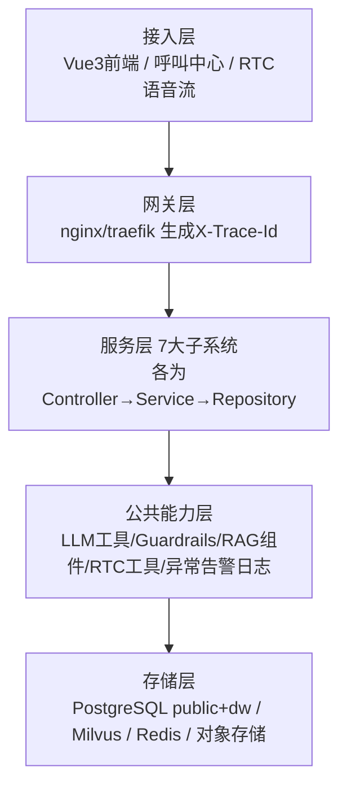

# 整体技术架构（含大模型 Guardrails 防护栏）

> 文档类型：架构设计（规范层）
> 版本：v1.0
> 状态：定稿
> 更新日期：2026-08-19
> 约束声明：遵循 step1/01 全局统一口径与 openspec/specs/01 架构强制规范；服务名/端口/里程碑以 step1/01 为准；demand/ 仅作历史参考。

## 修订记录

| 版本 | 日期 | 修订内容 | 修订人 |
|---|---|---|---|
| v0.1 | 2026-08-18 | 初稿骨架，仅分层与防护链路 | — |
| v1.0 | 2026-08-19 | 填充四层架构图、7 系统边界、依赖图、技术栈、部署拓扑、目录结构；Text2SQL 移出 MVP | 规范定稿 |

## 一、设计原则

1. 权责分离：传统系统负责流程调度、数据落库、业务执行；AI 仅负责认知判断、打分、建议输出，隔离大模型幻觉带来的业务风险。
2. 链路分离：实时交互链路低延迟优先，不经过数据中台；离线计算链路统一走数据中台，保障口径一致与性能稳定。
3. 模块解耦：七大子系统独立部署、独立迭代，通过标准化 HTTP/WS 接口交互，单个模块故障不影响全局业务；禁止跨模块直接 import 代码。
4. 规范优先：所有架构决策不得违背 openspec/specs 宪法层与 step1 全局口径，冲突时以宪法层为准并同步修订。
5. 最小闭环优先：M1 阶段先跑通"数据中台 + RAG + 质检"小闭环，其余子系统积木式叠加。

## 二、技术分层架构



| 层 | 职责 | 延迟要求 |
|---|---|---|
| 接入层 | 前端交互、呼叫中心对接、RTC 语音流接入 | — |
| 网关层 | 路由、鉴权、限流、生成并透传 X-Trace-Id | 网关损耗 < 50ms |
| 服务层 | 7 子系统业务实现，每服务内 Controller→Service→Repository(DAO) 单向依赖 | 实时应答 ≤1.5s，质检告警 ≤3s |
| 公共能力层 | LLM 调用、Guardrails 前后置、RAG 检索、RTC/VAD/状态机、异常告警日志 | 公共组件不持业务状态 |
| 存储层 | PostgreSQL public（业务）+ dw（中台）双 schema、Milvus 向量、Redis 缓存、对象存储录音 | 普通查询 P95 < 500ms |

## 三、七大子系统服务边界

每个子系统为独立 FastAPI 微服务，部署为独立容器；共享能力下沉到 `common/` 层。

| # | 子系统 | 服务名 | 端口 | 里程碑 | 核心模块 |
|---|---|---|---|---|---|
| 1 | 催收AI数据中台 | data-platform | 8001 | M1 | data-sync / data-clean / data-warehouse / data-scheduler |
| 2 | 混合RAG与多模态知识库 | rag-service | 8002 | M1 | kb-ingest / kb-chunk / kb-search / kb-version |
| 3 | AI录音质检系统 | qc-service | 8003 | M1 | qc-realtime / qc-scoring / qc-review |
| 4 | AI实时语音外呼与交互 | call-service | 8004 | M2 | call-dispatch / dialog-engine / asr-tts / transfer |
| 5 | AI智能分案与策略匹配 | case-service | 8005 | M2 | scoring / layering / routing / assign / reassign |
| 6 | AI投诉异议与合规研判 | complaint-service | 8006 | M3 | evidence / verdict / extract / solution |
| 7 | AI催收智能复盘与画像 | review-service | 8007 | M4 | classify / script-mine / report / portrait |

### 3.1 服务依赖关系

```mermaid
graph LR
    dp[data-platform] --> pg[(PostgreSQL)]
    rag --> pg
    rag --> mil[(Milvus)]
    rag --> es[(Elasticsearch)]
    rag --> emb[embedding-service]
    rag --> rnk[rerank-service]
    rag --> rds[(Redis)]
    qc --> pg
    qc --> rds
    qc -->|加载规则词库| rag
    call --> pg
    call --> rds
    call -->|话术检索| rag
    call -->|实时质检| qc
    call -->|喂入通话| dp
    case --> pg
    case -->|用户特征| dp
    comp[complaint-service] --> pg
    comp -->|合规知识| rag
    comp -->|质检记录| qc
    rv[review-service] --> pg
    rv -->|宽表| dp
```

### 3.2 职责边界要点

- data-platform：不参与实时通话链路，不持业务写权限（仅读业务库 + 写 dw schema）。
- rag-service：只管理知识内容与检索，不关心业务流程；检索 score<0.6 返回空并标记，由调用方兜底。
- qc-service：只做检测与打分，不做业务决策；告警走 Redis Pub-Sub，不阻塞主通话。
- call-service：话术生成必经 RAG 检索 + Guardrails 校验；confidence<0.7 转人工；15 轮熔断；50 路并发限流。
- case/complaint/review：AI 只输出判断与建议，不直接改写业务核心数据。

## 四、LLM 安全防护链路

```
用户输入 →【前置 Guardrails 拦截】→ 业务逻辑 → LLM 推理 →【后置 Guardrails 校验】→ 输出给外部
```

- 前置拦截：敏感词、违规意图、停止致电标记在进入 LLM 前拦截；
- 后置校验：LLM 输出经红线 7 条 + 结构化字段强校验，不符则丢弃并返回兜底话术；
- 任意一关拦截，返回兜底回答、记告警日志，违规内容不向下游传递（详见 step1/03 兜底话术表）。

## 五、公共能力层

- LLM 通用调用工具：qwen-plus 结构化输出封装（temperature 0.1 / response_format json_object）；
- Guardrails 合规护栏：前置拦截 + 后置校验，红线对齐 openspec/specs/00；
- RAG 检索公共组件：混合检索（Milvus 稠密 + Elasticsearch BM25 稀疏 + bge-reranker 重排序）、score<0.6 降级；
- RTC 语音公共工具：VAD 静音检测、语音打断、会话状态机；
- 全局异常、告警、日志埋点组件：trace_id 全链路透传。

> Text2SQL 组件仅 M5+ 引入，MVP 期间账单查询走 RAG + 结构化接口，不启用 Text2SQL。

## 六、技术栈锁定

| 维度 | 锁定 |
|---|---|
| 语言/运行时 | Python 3.11.15 |
| Web 框架 | FastAPI 0.104.1 + Uvicorn async |
| ORM/迁移 | SQLAlchemy 2.0 async + Alembic |
| AI 编排 | LangChain 0.1 + LangGraph 0.0.40 |
| 大模型 | 阿里云 DashScope qwen-plus（OpenAI 协议兼容） |
| 向量库 | Milvus 2.4 standalone |
| Embedding | BGE-M3 本地部署（1024 维） |
| 稀疏检索 | Elasticsearch 8（BM25） |
| 重排序 | bge-reranker（rerank-service:8101） |
| 数据库/缓存 | PostgreSQL 15 + Redis 7 |
| ASR/TTS | 阿里云 NLS（WebSocket 流式） |
| 呼叫中心 | 阿里云 CCC（HTTP API） |
| 调度/熔断/限流 | APScheduler / pybreaker / asyncio.Semaphore |
| 前端 | Vue3 + Vite5 + Pinia + Element Plus + TypeScript |

详细版本与 pip-tools 哈希约束见 step5/01。PostgreSQL 统一 public（业务）+ dw（中台）双 schema 共用单实例，ClickHouse 不引入 MVP。

## 七、部署拓扑（docker-compose）

| 服务 | 端口 | 依赖 | 里程碑 |
|---|---|---|---|
| postgres:15-alpine | 5432 | — | M0 |
| etcd v3.5.5 | 2379 | — | M0 |
| minio | 9000,9001 | — | M0 |
| elasticsearch 8 | 9200 | — | M0 |
| milvus v2.4.0 | 19530 | etcd,minio | M0 |
| redis:7-alpine | 6379 | — | M0 |
| embedding-service | 8100 | — | M0 |
| rerank-service | 8101 | — | M0 |
| data-platform | 8001 | postgres,redis | M1 |
| rag-service | 8002 | postgres,milvus,redis,embedding | M1 |
| qc-service | 8003 | postgres,redis,rag-service | M1 |
| call-service | 8004 | postgres,redis,rag-service,qc-service | M2 |
| case-service | 8005 | postgres,data-platform | M2 |
| complaint-service | 8006 | postgres,rag-service,qc-service | M3 |
| review-service | 8007 | postgres,data-platform | M4 |
| gateway (nginx/traefik) | 80,443 | 各业务服务 | M1 |
| frontend (nginx+Vue3 dist) | 80 | gateway | M3 |

### 网络与卷

- 网络：`ai_collection_backend`（内部服务间通信，不对外）+ `ai_collection_frontend`（仅 gateway、frontend）；外部仅暴露 gateway 80/443。
- 卷：`pg_data`、`milvus_data`、`etcd_data`、`minio_data`、`redis_data`，命名规范 `<service>_data`。

### 环境分层

| 维度 | dev | staging | prod |
|---|---|---|---|
| 部署 | docker-compose 单机 | docker-compose 单机 | docker-compose 多节点 / k8s |
| 数据 | 种子数据 | 脱敏生产副本 | 真实数据 |
| 大模型 | Mock 或低成本模型 | 真实模型 | 真实模型 |
| ASR/TTS/呼叫中心 | Mock | 阿里云测试环境 | 阿里云生产 |
| 日志级别 | DEBUG | INFO | INFO + ERROR 告警 |
| HTTPS | 关闭 | 开启 | 开启 + HSTS |

分文件：`docker-compose.yml`（基础）+ `docker-compose.dev.yml`（Mock + DEBUG + 源码热重载）+ `docker-compose.prod.yml`（资源限制 + HTTPS + 不挂源码）。

## 八、目录结构（monorepo）

```
ai_collection/
├── services/                # 7 子系统代码，各服务独立
│   ├── data-platform/       # 8001
│   ├── rag-service/         # 8002
│   ├── qc-service/          # 8003
│   ├── call-service/        # 8004
│   ├── case-service/        # 8005
│   ├── complaint-service/   # 8006
│   └── review-service/      # 8007
├── common/                  # 公共能力层（config/db/security/llm/speech/callcenter/trace/errors/utils）
├── deploy/                  # embedding-service + rerank-service Dockerfile
├── migrations/              # Alembic 迁移脚本
├── scripts/                # smoke 脚本、seed 数据、敏感词初始化
├── docs/                   # 设计文档归档
├── 标准工程目录结构/        # 规范层（step1~step8）
├── openspec/                # 宪法层（specs）
└── demand/                  # 历史参考（只读，不参与运行）
```

每个服务内部统一为 `api（Controller）/ service / repository（DAO）/ schemas / tests` 五段，遵循 openspec/specs/01 三层单向依赖；跨服务禁止互相 import 内部代码，必须走 HTTP/WS 接口。
