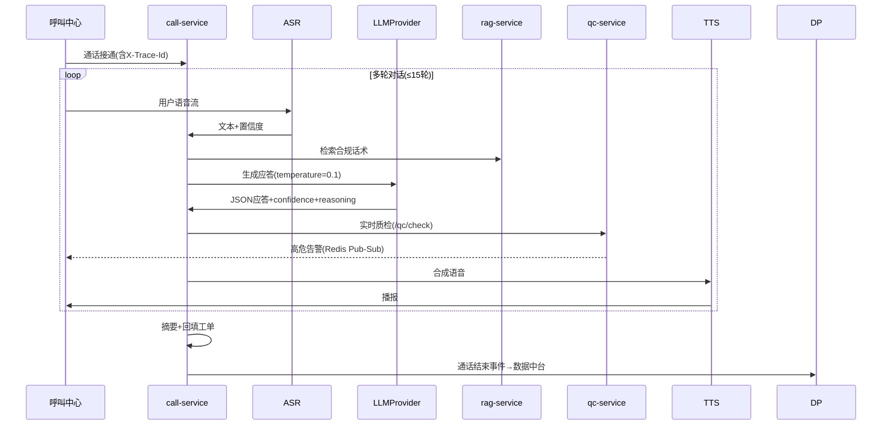
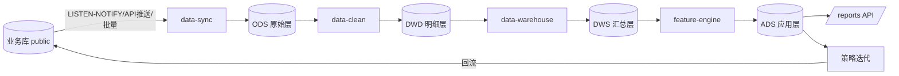
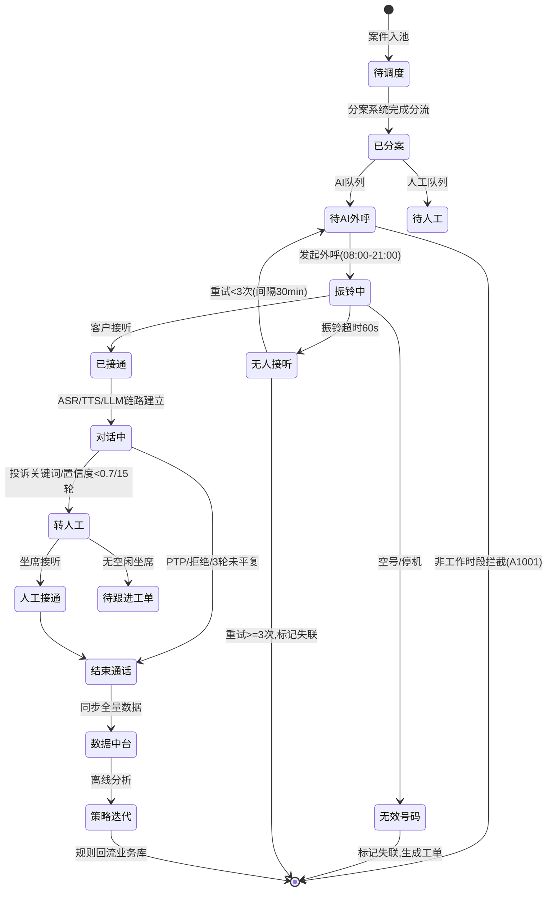

# 模块调用关系与流式 RTC 管道设计

> 文档类型：架构设计（规范层）
> 版本：v1.0
> 状态：定稿
> 更新日期：2026-08-19
> 约束声明：遵循 step1/01 全局统一口径与 openspec/specs/01、02；服务名/端口/响应包/trace_id 以 step1/01 为准。

## 修订记录

| 版本 | 日期 | 修订内容 | 修订人 |
|---|---|---|---|
| v0.1 | 2026-08-18 | 初稿骨架，仅调用关系与 RTC 管道 | — |
| v1.0 | 2026-08-19 | 补跨模块调用矩阵、通信协议、实时/离线数据流图、X-Trace-Id 全链路追踪、通话状态机 | 规范定稿 |
| v1.1 | 2026-09-08 | 集成分层：complaint Agent 取证改为 MCP；协议表补 Agent/MCP（platform-integration-boundaries） | Ellis Guo |
| v1.2 | 2026-09-08 | 澄清 call→rag 为 HTTP 调 rag-service；补充 2 深切片实现深度口径 | Ellis Guo |

## 一、模块调用关系

1. case-service 输出策略配置 → call-service；
2. call-service 经 **HTTP** 调 **rag-service** `/kb/search` 检索话术（非 `common` 内嵌 RAG 库）；
3. call-service 会话结束，事件推送录音 & ASR 文本 → qc-service、review-service、data-platform；
4. review-service 输出画像更新 → data-platform，反向供给 case-service；
5. complaint-service 接收投诉/通话文本，输出研判结果落库 + 推送 data-platform。

> 禁止反向强依赖：qc-service 不得直接调用 call-service；review-service 不得直接修改案件状态；跨模块通信走事件/中台接口。

## 二、跨模块调用矩阵

| 调用方 | 被调方 | 方式 | 接口 | 说明 |
|---|---|---|---|---|
| call-service | rag-service | HTTP | /kb/search | 话术检索，score<0.6 走兜底 |
| call-service | qc-service | HTTP/WS | /qc/check、/qc/check/stream | 实时质检 |
| call-service | data-platform | 事件 | 通话结束事件 | 喂入通话数据 |
| qc-service | rag-service | HTTP | /kb/documents?category=regulation | 加载规则词库 |
| case-service | data-platform | HTTP | /data/features/{case_id} | 取用户特征 |
| complaint-service | rag_kb（MCP）→ rag-service | MCP（内部可 HTTP） | rag_kb.search_regulations 等 | Agent 取证/合规知识；节点不直连 rag HTTP；MCP Server 可再调 /kb/* |
| complaint-service | call_qc（MCP）→ qc-service | MCP（内部可 HTTP） | call_qc.query_call_asr / query_qc_violations 等 | Agent 取证通话/质检；节点不直连 qc HTTP；MCP Server 可再调 /qc/* |
| review-service | data-platform | HTTP | /reports/*、宽表 | 复盘与画像 |
| data-platform | 业务库 | LISTEN-NOTIFY | — | 消费业务库变更 |

所有跨服务调用透传 `X-Trace-Id` 请求头。

## 三、通信协议

| 场景 | 协议 | 说明 |
|---|---|---|
| 前端 ↔ 网关 ↔ 服务 | HTTP/JSON | 统一响应包 `{"code":"0","message","data","trace_id"}`，详见 step5/02 |
| 服务间同步调用（管理面/CRUD） | HTTP/JSON（内部网络） | 5s 超时 + 3 次指数退避（1s/2s/4s） |
| Agent / 工作流工具取证 | MCP | LangGraph 等节点经 MCP Client 调 tool；Server 可内部再 HTTP 调下游服务 |
| 实时语音流 / 实时字幕 / 实时质检 | WebSocket | /calls/{id}/stream、/qc/check/stream |
| 异步跨服务通知 | 事件（Redis Pub-Sub / 等价） | 如通话结束、质检完成；channel 例 `qc.alert.{agent_id}` |
| 数据同步触发 | PostgreSQL LISTEN-NOTIFY | 监听 call_records/dialog_turns 变更 |
| 离线任务调度 | APScheduler（进程内） | 定时 + 事件驱动 |

## 四、数据流

### 4.1 实时链路（低延迟，不经数据中台）

### 4.2 离线链路（经数据中台）

### 4.3 数据分层

| 层 | schema | 命名 | 用途 |
|---|---|---|---|
| ODS 原始层 | dw | ods_<表名> | 业务库 1:1 镜像 |
| DWD 明细层 | dw | dwd_<主题>_<表名> | 清洗去重后明细 |
| DWS 汇总层 | dw | dws_<维度>_<周期> | 按 case/agent/date 汇总 |
| ADS 应用层 | dw | ads_<场景> | 报表与模型直接消费 |

强制埋点表：`dws_call_result`、`dws_sentiment_trend`、`dws_strategy_effectiveness` 必须产出，缺失视为未完成。

## 五、RTC 流式管道

语音流输入 → VAD 检测 → ASR 转写 → 业务上下文组装 → LLM 推理 → 结构化解析 → Guardrails 校验 → TTS 合成语音输出。

- VAD 静音检测、语音打断、会话状态机独立工具类封装，严禁混入业务代码；
- 业务 API 全部 SSE 流式分片输出，固定四标识 start/content/end/error，字段不可缺失；
- 流式埋点：会话 ID、用户 ID、Prompt 入参、模型返回、耗时、模型版本、拦截状态。

## 六、全链路追踪（X-Trace-Id）

落地位置：`common/trace/middleware.py`。

1. 生成：每个外部请求进入 gateway 时，未携带 `X-Trace-Id` 则生成 `trace_<ulid>`；
2. 透传：FastAPI 中间件写入 contextvars；所有出站 HTTP、WebSocket、Redis、LLM、ASR/TTS 调用均从 contextvars 读取并透传；
3. 贯穿：ASR → 意图 → LLM → TTS → 质检，全流程同一 trace_id；
4. 落库：call_records.session_id、dialog_turns、qc_records、llm_call_logs、audit_logs 均记录 trace_id；
5. 日志：结构化 JSON 日志强制含 trace_id；
6. 查询：/audit-logs?trace_id= 支持单案件全流程串联查询。

## 七、通话生命周期状态机

催收会话流转由独立状态机驱动，禁止由大模型决定业务流程跳转；LLM 只负责生成会话文本。

退出条件：

- 无效号码：标记失联并生成工单，不再重试；
- 非工作时段：外呼 API 入口拦截，返回 A1001；
- 转人工无空闲坐席：生成"待跟进工单"（高优先级），结束通话；
- 重试：未接通重试间隔 30 分钟，当日最多 3 次（可配置）。
